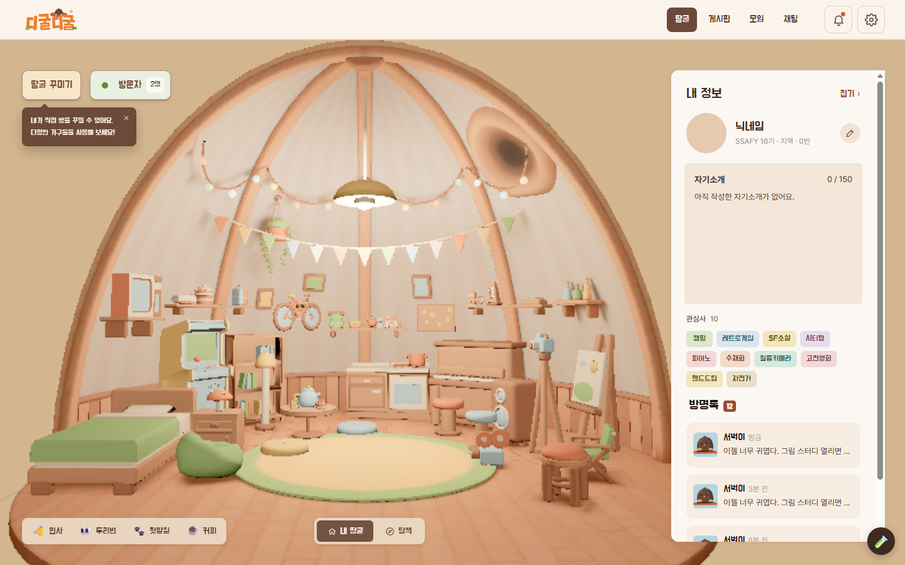
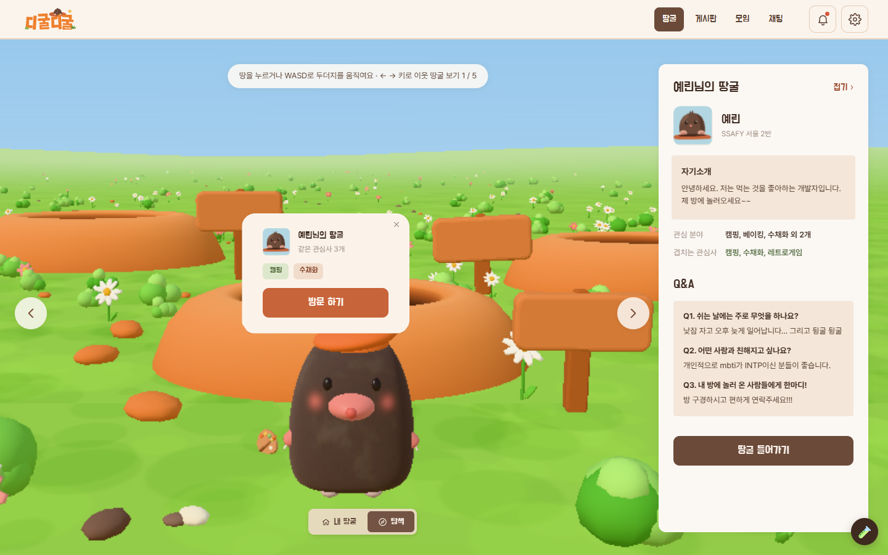

# 디굴디굴 (it-ting)

관심사로 꾸며진 **땅굴**을 서로 구경하고, 1:1 대화와 모임으로 이어지는 커뮤니티의 프론트엔드 프로토타입입니다.
가입할 때 고른 관심사로 3D 땅굴이 자동으로 만들어지고, 두더지 캐릭터로 이웃의 땅굴을 찾아다닙니다.

| | |
|---|---|
| **써 보기 (팀 공유용)** | https://claude.ai/artifact/Fd1hfXP3T6nzY2Zg4QXYAS — 시작 화면 → 가입 → 온보딩 → 내 땅굴 순서로 체험. 주소 끝에 `#/screens`를 붙이면 전체 화면 목록 |
| **디자인 기준** | Figma "it-ting 스켈레톤" 파일의 **03. Screens** 페이지 (받아 둔 자료는 `design/figma/`). 기능 명세는 **02 페이지** |
| **3D 모델** | 디자이너 핸드오프 v1 ~ v3.5.1 (`design/digul_3d_handoff_*`) |
| **공부용 기술 문서** | [docs/frontend-guide.md](docs/frontend-guide.md) |
| **다음에 할 일** | [docs/next-steps.md](docs/next-steps.md) |

| 내 땅굴 | 탐색하기 |
|---|---|
|  |  |

<sub>스크린샷은 그래픽 가속이 없는 헤드리스 브라우저(저사양 모드)로 찍어서 실제보다 거칠게 보입니다. 2026-11-13</sub>

## 컨셉

- 가입할 때 고른 관심사로 땅굴이 자동 생성되고, 이후 직접 꾸밀 수 있음
- 서로의 땅굴을 구경 → 1:1 대화 → 모임(그룹 채팅)
- 강화하려는 차별점
  1. **처음 말 거는 부담을 낮춤**: 땅굴의 가구·방명록·Q&A가 대화 계기가 됨
  2. **내향적인 사람도 편하게**: 인사·두리번 같은 리액션, 대화는 요청 → 수락
  3. **니치한 취미끼리 잘 찾도록**: 사람이 적은 관심사에 가중치를 줌

## 지금 들어 있는 것

| 영역 | 화면 | 주소 (공유 빌드는 앞에 `#`) |
|---|---|---|
| 시작 | 랜딩(스크롤 2구간), 둘러보기(비로그인), 로그인, 회원가입 1·2, 비밀번호 찾기 | `/` (공유 빌드는 `/start`), `/look`, `/login`, `/signup`, `/password-reset` |
| 온보딩 | 이름·두더지 꾸미기 → 관심사(3~10개) → 자기소개 Q&A → 땅굴 만드는 중 → 땅굴 미리보기 | `/onboarding/:step` (`?demo`로 예시 값 채움) |
| 땅굴 | 내 땅굴(3D), 꾸미기 모드, 탐색하기(3D 밭 + 오늘의 이웃 추천), 남의 땅굴, 방명록, 대화 요청 | `/burrow`, `/burrow/explore`, `/burrow/:userId` |
| 게시판 | 글 목록, 글 상세(댓글·답글), 글쓰기, 저장한 글, 삭제·신고 | `/board`, `/board/:postId`, `/board/write`, `/board/saved` |
| 모임 | 목록(정렬·개수), 내 모임, 상세(상태 6종), 신청 관리, 만들기·수정·취소, 캘린더 | `/meetups`, `/meetups/me`, `/meetups/:id`, `/meetups/new`, `/meetups/:id/edit` |
| 채팅 | 1:1·모임 대화, 받은·보낸 요청 | `/chat`, `/chat/:roomId`, `/chat/requests` |
| 기타 | 알림, 설정(CC-BY 크레딧 포함), 개발용 화면 목록 | `/notifications`, `/settings`, `/screens` |

데이터는 모두 예시(`app/src/data/mock.ts`)이고 **서버는 없습니다.** 글쓰기·신청 같은 동작은 저장되지 않고, 로그인·회원가입은 입력 없이 통과합니다.

클릭 없이 특정 상태를 여는 주소 예시 (전체 목록은 `/screens`):
`/burrow?panel=closed`, `/burrow?guestbook=0`, `/burrow?modal=guestbook`, `/burrow?mode=decor`, `/burrow/yerin?modal=request`, `/burrow/explore?recommend=1`, `/meetups?modal=calendar`, `/meetups/new?modal=done`

### 3D 땅굴
- **두더지:** 디자이너 glb(동작 19개 + 빈백 전용 앉기). 걷기·숨쉬기·인사·두리번·땅 긁기. 방향키·WASD·바닥 클릭으로 조종, 마우스 휠로 확대·축소
- **액세서리 41개:** 머리·얼굴·목·손 부위마다 하나씩, 최대 4개. 레벨·관심사 잠금 규칙 포함 (`data/moleItems.ts`, `three/moleDress.ts`)
- **땅굴 방:** 조명을 미리 구운 glb 방. 들어오면 천장 구멍이 열리고 두더지가 떨어짐. 무드에 따라 벽지가 바뀜 (`three/roomScene.ts`)
- **관심사 가구:** 카테고리 11개 · 세부 관심사 65개. 고른 관심사에 맞는 가구가 슬롯 배치 규칙(`data/slots.json`)대로 놓이고, 반려동물 5종도 있음
- **상호작용:** 방석·빈백에 앉기, 부엌 선반에서 커피. 리액션 👋👀🐾☕. 남의 땅굴엔 집주인 두더지가 있어 인사하면 마주 보고 인사
- **탐색하기:** 관심사 밭에 이웃의 굴 입구(흙더미)가 있고, ←/→로 이웃을 넘겨 봄
- **로딩:** 3D가 다 차려질 때까지 "땅굴 파는 중..." 애니메이션, 그 뒤 한 번에 페이드 인

### 저사양 PC 대응
그래픽 가속이 꺼진 PC(CPU로 그리는 WARP)에서는 페이지 전체가 멈출 정도로 느려서 따로 대응했습니다.
- 감지(`lib/graphicsTier.ts`) → 안내 띠 + 저사양 모드(해상도 낮춤, 스톱모션 10fps, 카메라 고정, 쉬면 그리기 멈춤)
- 움직이지 않는 배경은 한 번만 그리고 두더지만 매 프레임 그림 (`three/staticBackdrop.ts`). 탐색하기 걷기 8.7 → 60fps
- 멈춰 있을 때 방은 고해상도로 한 번 그려 선명하게
- 각 기법은 🧪 저사양 실험실 패널(주소에 `?lowlab`)에서 하나씩 켜고 끌 수 있음 → [gpu-lowspec-ideas.md](docs/gpu-lowspec-ideas.md)

## 실행

```bash
cd app
npm install
npm run dev          # http://localhost:5173  (시작 화면부터)
npm run build        # 일반 빌드 → app/dist
npm run build:share  # 팀 공유용 빌드 → app/dist-share
```

- 기술: Vite + React 19 + TypeScript + react-router 7, CSS Modules, three.js 0.165 (땅굴 화면에 들어갈 때만 불러옴)
- 서체: Do Hyeon(제목·버튼) + Pretendard(본문, npm으로 번들)

### 팀 공유용 배포 (Claude 아티팩트)
저장소가 비공개라 GitHub Pages 대신 Claude 아티팩트에 올립니다.
1. `cd app && npm run build:share` → 해시 라우팅·상대 경로 빌드, 끝에 `scripts/share-page.mjs`가 `dist-share/share-page.html`과 `files.json`을 만듦
2. 같은 아티팩트 url로 publish (root = `dist-share`, 바뀐 assets만 보내고 옛 해시 파일은 지움)

아티팩트의 제약 때문에 지키는 규칙:
- `.glb` 파일을 못 올림 → 공유 빌드에서만 glb를 JS 안의 data URL로 넣음 (`vite.config.ts`의 `assetsInlineLimit`, `three/glb.ts`)
- 외부 CSS 차단 → 서체는 npm 패키지로 번들
- svg·avif data URL이 있으면 공개 공유 검토에서 거절됨 → CSS에 svg data URL 쓰지 말 것

### 3D 모델이 새로 오면
1. 디자이너 zip을 `design/digul_3d_handoff_<버전>/`에 풀기 (영상·원본 이미지는 gitignore)
2. glb는 텍스처를 WebP로 줄이고 Draco로 압축해 `app/src/assets/models/`에 넣기
3. 가구는 `data/furnitureCatalog.json`·`slots.json`만 바꾸면 코드 수정 없이 반영됨
4. 처리 기록은 `docs/3d-handoff-*-integration.md`에 남김

## 폴더

| 경로 | 내용 |
|---|---|
| `app/` | **앱 본체** |
| `app/src/screens/` | 화면 (start, onboarding, burrow, board, meetups, chat, notifications, settings) |
| `app/src/components/` | 여러 화면이 같이 쓰는 조각 (헤더, 모달, 3D 화면 틀 `RoomView`, 2D 두더지 `MoleAvatar` …) |
| `app/src/three/` | 3D 장면 (땅굴 방, 탐색하기 밭, 두더지 동작·옷 입히기, 저사양 기법) |
| `app/src/data/` | 예시 데이터, 관심사·가구·슬롯·벽지 카탈로그(JSON), 방 생성 규칙 |
| `app/src/styles/` | 디자인 토큰(`tokens.css`)과 전역 스타일 |
| `design/figma/` | Figma에서 받아 둔 화면 PNG와 페이지 구조(`screens-metadata*.xml`) |
| `design/digul_3d_handoff_*/` | 디자이너 3D 핸드오프 (문서·스펙·glb) |
| `docs/` | 계획·조사·결정 기록 (아래 목록) |
| `explore/` | 3D 실험 (three.js · Babylon.js · PlayCanvas 비교, 저사양 측정 `explore/gpu/`). 미리보기 `node explore/serve.js 5190` |
| `legacy/` | 방향 전환 전의 단일 HTML 시안들 (v1~v3, 두더지, 밤티 두더지) → [legacy/README.md](legacy/README.md) |
| `CLAUDE.md` | 작업 인수인계 문서 (작업 방식, 주의할 점, 결정 기록) |

## 문서 목록 (`docs/`)

**계획·가이드**
- [frontend-plan.md](docs/frontend-plan.md) — 화면 목록과 구현 계획
- [frontend-guide.md](docs/frontend-guide.md) — 앱 구조, React 상태, 라우팅, 3D를 React에 넣는 법 (공부용)
- [next-steps.md](docs/next-steps.md) — 다음에 할 일

**디자인 반영**
- [figma-sync-2026-11-11.md](docs/figma-sync-2026-11-11.md), [figma-sync-2026-11-12.md](docs/figma-sync-2026-11-12.md) — Figma 최신 버전 반영
- [landing-loading.md](docs/landing-loading.md) — 시작 화면·땅굴 로딩 정리
- [community-spec-review.md](docs/community-spec-review.md) — Figma 02(기능 명세) F8 커뮤니티 CRUD 검증과 결정 30건 (명세 텍스트는 `design/figma/spec/`)

**3D**
- [3d-tech-research.md](docs/3d-tech-research.md) — Figma 그림체를 재현하는 기술 조사
- [3d-figma-reproduction.md](docs/3d-figma-reproduction.md) — 코드만으로 재현한 시험판
- [3d-engine-candidates.md](docs/3d-engine-candidates.md), [playcanvas-vs-threejs.md](docs/playcanvas-vs-threejs.md) — 엔진 비교 → three.js 선택
- [3d-handoff-v2-integration.md](docs/3d-handoff-v2-integration.md), [3d-handoff-v3-integration.md](docs/3d-handoff-v3-integration.md) — 디자이너 glb 반영 (v1 ~ v3.5.1)

**성능·운영**
- [rendering-overview.md](docs/rendering-overview.md) — 3D 렌더링 방식, 저사양 PC에서 보이는 모습, 개선 방향
- [gpu-fallback-research.md](docs/gpu-fallback-research.md) — 그래픽 가속이 꺼진 PC 실측과 대응
- [gpu-lowspec-ideas.md](docs/gpu-lowspec-ideas.md) — 저사양 아이디어 9개 구현·측정
- [dev-deploy-risks.md](docs/dev-deploy-risks.md) — 백엔드 연결·배포 때 위험 지점과 API 규약 초안
- [marketing-strategy.md](docs/marketing-strategy.md) — SSAFY 반 단위에서 시작하는 확산 전략

## 지금까지 한 일

| 날짜 | 내용 |
|---|---|
| 2026-11-10 | 방향 전환: 이전 시안을 `legacy/`로 옮기고 Figma 03. Screens 기준 React 앱으로 새로 시작. 3D 그림체 조사 → 엔진 3개 비교 → three.js 결정. 코드로 만든 펠트 두더지·가구로 첫 땅굴 |
| 2026-11-11 | Figma 최신 버전 반영(온보딩 새 디자인, 시작 화면, 게시판 글쓰기, 채팅, 알림, 설정). 3D 핸드오프 v1~v3: 디자이너 두더지·액세서리 41개·glb 땅굴 방·관심사 슬롯 배치. 공유 빌드 첫 화면을 시작 화면으로. 그래픽 가속 꺼짐 감지·저사양 모드 |
| 2026-11-12 | 저사양 실험실(기법 9개 측정, 기본값 확정). 3D 핸드오프 v3.1~v3.5.1(관심사 가구 전부 모델, 반려동물, 벽지). Figma 2차 반영(모임 상태·신청 관리, 꾸미기 가구 탭, 오늘의 이웃, 답글). 땅굴 구도 조정, 로딩 애니메이션. 커뮤니티 기능 명세(Figma 02 F8) 검증 |

## 남은 일
자세한 건 [docs/next-steps.md](docs/next-steps.md). 큰 것만:
- 실제 SSAFY PC(그래픽 가속 꺼짐)에서 저사양 모드 확인
- 탐색하기에서 흙더미를 누르면 굴로 걸어 들어가는 연출
- 390px 모바일 화면 확인
- 백엔드 연결 준비 (로딩·에러 처리, 인증 가드, 날짜 형식) → [dev-deploy-risks.md](docs/dev-deploy-risks.md)
- 사용자 확인 대기: 꾸미기 가구 탭 해석, 모임 상태 박스 문구, 임의로 쓴 온보딩 문구
