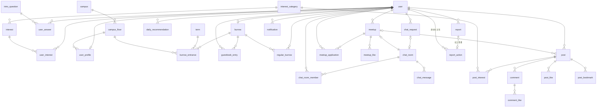

# 디굴디굴 DB 설계

[서비스 명세](../spec/README.md)를 바탕으로 한 테이블 설계다. DB는 MySQL이다. 테이블·칼럼·제약은 [IT-TING-DB의 설계 문서](https://github.com/sbukkki/IT-TING-DB/tree/c8a3311efb0a0c036e7b0c1a5aaedffc4b2db21b/docs)를 기준으로 반영했다(기준 커밋 `c8a3311`). 기존 서비스 명세 링크와 화면·구현 관련 설명은 유지한다. 타입·길이·제약이 정해지지 않은 값은 미정으로 남긴다.

## 문서 목록

| 문서 | 테이블 |
|---|---|
| [계정 · 프로필 · 관심사 · 질문](account.md) | `user`, `user_withdrawal`, `user_profile`, `user_suspension`, `interest_category`, `interest`, `user_interest`, `intro_question`, `user_answer` |
| [들판 · 땅굴 입구 · 방명록 · 단골 · 추천](burrow.md) | `term`, `campus`, `campus_floor`, `burrow`, `burrow_entrance`, `guestbook_entry`, `regular_burrow`, `daily_recommendation`, `daily_recommendation_member` |
| [채팅](chat.md) | `chat_request`, `chat_room`, `chat_room_member`, `chat_message`, `chat_message_image` |
| [모임](meetup.md) | `meetup`, `meetup_application`, `meetup_like` |
| [커뮤니티 · 신고](community.md) | `post`, `post_version`, `post_image`, `uploaded_image`, `post_interest`, `comment`, `comment_version`, `post_like`, `comment_like`, `post_bookmark`, `report`, `report_action` |
| [알림 · 공지](notification.md) | `notification`, `notification_setting`, `push_subscription`, `notice` |

테이블은 모두 42개다. 인증 코드와 비밀번호 재설정 링크, 가입 진행 기록, 잠깐 맡아 둔 닉네임은 DB가 아니라 임시 저장소(Redis)에 둔다.

## 설계 원칙: 저장하는 것과 화면에 그리는 것을 나눈다

명세는 화면을 기준으로 쓰여 있다. 화면에 보이는 값을 그대로 칼럼으로 옮기지 않고 셋으로 나눈다.

| 구분 | 뜻 | 예 | DB |
|---|---|---|---|
| 저장 | 사용자가 입력했거나 실제로 일어난 사실 | 닉네임, 고른 관심사, 참여 신청과 그 시각, 메시지 본문 | 칼럼으로 둔다 |
| 계산 | 저장된 값에서 그때그때 만들어 내려주는 값 | 좋아요 수, 안 읽은 수, "모집 완료" 배지, 겹치는 관심사, 땅굴 무드 | 두지 않는다 |
| 화면 | 프론트엔드가 가진 고정 자원과 표현 | 가구 · 두더지 그림, 들판 지도와 자리 번호마다의 화면 위치, 안내 문구, 견본 방 | 관계없다 |

- 각 문서의 끝에 "저장하지 않는 것"을 적는다. 계산하는 값은 무엇에서 계산하는지를 함께 적는다.
- 성능 때문에 계산 값을 칼럼으로 둬야 하면 그 사실을 문서에 드러내 적는다.
- 같은 사실을 두 곳에 저장하지 않는다. 어쩔 수 없이 겹치면 어느 쪽이 기준인지 적는다.

## 이름과 공통 규칙

- 테이블과 칼럼 이름은 영어 소문자와 밑줄(snake_case)로 쓴다. 테이블 이름은 단수형이다. 사용자는 `user`다(계정은 `user`, 프로필은 `user_profile`). 기존 `member` 계열 테이블과 사용자 FK는 `user` 계열과 `user_id`로 맞췄다. `chat_room_member`, `daily_recommendation_member`의 이름과 신고 대상 코드 `MEMBER`는 원본대로 유지한다.
- PK는 `id`(BIGINT, 자동 증가)다. 다만 두 테이블을 잇기만 하는 테이블은 두 FK를 묶어 PK로 쓰고, 한 사람에 하나뿐인 테이블은 `user_id`를, 순서가 있는 딸린 테이블은 부모의 FK와 순번을 묶어 PK로 쓴다.
- FK 칼럼은 `가리키는 테이블_id`로 쓴다(예: `user_id`). 뜻을 드러내야 하면 역할을 쓴다(예: `host_id`, `author_id`).
- 시각은 DATETIME(6)(마이크로초까지)이고 UTC로 저장한다. 이름은 `…_at`으로 끝난다. 줄이 만들어진 시각은 `created_at`, 마지막으로 바뀐 시각은 `updated_at`, 삭제한 시각은 `deleted_at`이다. 어느 테이블에 무엇을 두는지는 아래 [공통 날짜 칼럼](#공통-날짜-칼럼)에 있다. "했는지"는 참/거짓 대신 한 시각으로 저장한다(예: `canceled_at`이 있으면 취소됨).
- 상태와 종류처럼 값이 정해진 칼럼은 MySQL의 ENUM 타입으로 두고, 값은 영어 대문자 코드로 쓴다(예: `PENDING`). 모임 카테고리(`meetup.category`)와 그림이 프론트엔드에 있는 값(두더지 아이템)은 코드만 VARCHAR로 저장한다.
- 글자 수가 명세에 있는 칼럼은 그 길이를 쓴다(예: `VARCHAR(50)`). 명세에 없으면 길이를 미정으로 표시하고 구현할 때 정한다. 타입이나 NULL·UNIQUE 제약도 정해지지 않았다면 임의로 확정하지 않는다.
- UNIQUE처럼 규칙을 지키는 제약과 원본에서 명시한 조회 인덱스 후보를 적었다. 나머지 조회 인덱스와 물리 FK 여부가 미정인 논리 참조는 구현하면서 정한다.

### 공통 날짜 칼럼

세 칼럼을 가능한 한 모든 테이블에 둔다. 같은 뜻의 칼럼이 이미 있거나 둘 까닭이 없는 테이블만 뺀다.

| 칼럼 | 두는 곳 | 빼는 곳과 까닭 |
|---|---|---|
| `created_at` | 모든 테이블 | `chat_room_member`는 `joined_at`이 같은 뜻이다. `daily_recommendation_member`와 `post_interest`는 부모 행에 딸려 함께 생기므로 부모의 시각을 따른다 |
| `updated_at` | 만든 뒤에 값이 바뀌는 테이블 | 한 번 쓰면 바뀌지 않는 테이블(버전, 메시지, 좋아요 · 저장 · 단골, 조치 기록, 탈퇴 기록)에는 두지 않는다. `chat_request.responded_at`, `meetup_application.status_changed_at`, `notification.read_at`은 같은 뜻이라 따로 두지 않는다 |
| `deleted_at` | 지워도 줄을 남겨야 하는 테이블(`interest_category`, `interest`, `campus`, `campus_floor`, `meetup`, `post`, `comment`, `notice`) | 아래 네 경우 |

`deleted_at`을 두지 않는 경우는 넷이다.

- **켜고 끄는 관계**(`user_interest`, `regular_burrow`, `meetup_like`, `post_like`, `comment_like`, `post_bookmark`): 지운 줄이 남아 있으면 다시 켤 때 기본키에 걸린다. 끄면 줄을 지운다.
- **상태나 다른 시각이 그 역할을 하는 테이블**: `user`는 `status`와 `user_withdrawal`, `chat_request`와 `meetup_application`은 `status`, `chat_room_member`는 `left_at`으로 안다.
- **지우지 않는 기록**(`post_version`, `comment_version`, `report`, `report_action`, `user_suspension`, `user_withdrawal`, `chat_message`, `intro_question`, `daily_recommendation`, `daily_recommendation_member`), **기간이 지나면 정리하는 줄**(`notification`은 30일), **지우면 줄을 바로 지우는 글**(`guestbook_entry`. 시간이 지나도 지우지 않는다).
- **탈퇴하면 실제로 지우는 개인 정보**(`user_profile`, `user_interest`, `user_answer`, `burrow`, `burrow_entrance`, `push_subscription`, `notification_setting`, 받은 `notification`).

## 전체 관계

딸린 작은 테이블 11개(`user_withdrawal`, `user_suspension`, `daily_recommendation_member`, `chat_message_image`, `post_version`, `comment_version`, `post_image`, `uploaded_image`, `notification_setting`, `push_subscription`, `notice`)는 그림에서 뺐다. 영역별 그림은 각 문서에 있다.

## 설계하며 정한 것

2026-11-15의 설계 결정을 바탕으로 2026-11-16에 IT-TING-DB의 테이블 구조와 처리 규칙을 반영했다. 2026-11-18에 서비스 명세와 대조해 탈퇴자가 쓴 방명록(G5, 남긴다)과 새 학기 안내를 다시 띄우는 때(접속할 때마다)를 명세에 맞췄다. 같은 날 공통 날짜 칼럼, ENUM 타입, 탈퇴 기록 테이블, 프로필 사진, 추천 단순화, 방명록 가림, 글 · 댓글 버전 관리를 반영했다(G6, G7, A5, A6, B5, B6, M5, C5, C6). 2026-11-20에 방명록 글을 기간으로 지우지 않게 하고, 새 학기 안내를 보류할 수 없게 바꿨다. 같은 날 오늘의 추천을 캠퍼스 · 층과 기수로 고르고 덜 추천된 사람부터 뽑게 바꿨다(B5). 새 학기에 캠퍼스 · 층을 고르면 땅굴이 이사하고 지난 학기 들판에 입구를 남기지 않게 바꿨다(B3). 바꾸려면 이 표와 해당 문서를 함께 고친다.

| 번호 | 무엇을 | 정한 것 |
|---|---|---|
| G1 | 이름 규칙 | snake_case, 테이블은 단수형, 사용자는 `user` |
| G2 | PK | BIGINT 자동 증가 |
| G3 | 개수와 요약 값(좋아요 수, 댓글 수, 확정 인원, 찜 수, 대화방의 마지막 메시지) | 칼럼으로 두지 않고 조회할 때 센다. 필요해지면 그때 칼럼을 더한다 |
| G4 | 그림이 프론트엔드에 있는 값 목록(모임 카테고리, 두더지 아이템, 탈퇴 사유) | 테이블을 두지 않고 고른 값의 코드만 저장한다. 가구는 관심사마다 하나로 정해져 있어 저장하지 않는다 |
| G5 | 탈퇴한 사용자 | `user` 줄은 남기고 로그인 값을 비운다. 프로필·땅굴과 받은 방명록은 정리하고, 쓴 방명록은 남긴다. 재가입은 새 계정 ID를 쓴다 |
| G6 | 공통 날짜 칼럼 | `created_at`, `updated_at`, `deleted_at`을 가능한 한 모든 테이블에 둔다. 같은 뜻의 칼럼이 있거나 둘 까닭이 없는 테이블만 뺀다 |
| G7 | 값이 정해진 칼럼 | MySQL의 ENUM 타입으로 둔다. 값의 목록이 정해지지 않은 칼럼은 정해질 때까지 VARCHAR로 둔다 |
| A1 | 계정과 프로필 | `user`(계정)와 `user_profile`(프로필)로 나눈다 |
| A2 | Mattermost ID | 저장하고 한 계정만 쓰게 한다 |
| A3 | 인증 코드와 비밀번호 재설정 링크 | DB가 아니라 임시 저장소(Redis)에 둔다 |
| A4 | 온보딩 저장 시점 | 중간 입력은 현재 화면 흐름에서 유지하고 최종 확정 시 프로필·관심사·서로 다른 질문 3개의 답변·땅굴·입구를 한 트랜잭션에서 저장한다 |
| A5 | 탈퇴 기록 | `user_withdrawal`에 계정, 사유, 시각을 따로 모은다. `user.status`는 그대로 둔다 |
| A6 | 프로필 사진 | 선택 사항으로 `user_profile.profile_image_url`에 둔다. 올리지 않아도 두더지로 표시한다 |
| B1 | 땅굴 | `burrow` 테이블을 둔다. 땅굴은 들판 위에 자리를 가진 장소다 |
| B2 | 땅굴 무드 | 저장하지 않고 대표 관심사의 대분류에서 정한다 |
| B3 | 프로필의 캠퍼스 · 층 | `user_profile`에 저장하고 기준으로 삼는다. 땅굴의 입구를 여기에 맞춘다. 땅굴 하나에 입구는 하나이고, 새 학기에 고르면 입구가 새 들판으로 옮겨진다 |
| B4 | 들판에서 땅굴의 자리 | 자리 번호(`slot`)만 저장한다. 그 자리가 화면의 어디인지와 그리는 일은 프론트엔드가 맡는다 |
| B5 | 오늘의 추천 | 받는 시점에 캠퍼스 · 층과 기수만 고른다. 단골로 담은 땅굴의 주인은 빼고, 요청한 사람에게 덜 추천된 사람부터 뽑는다. 고른 조건은 저장하지 않고, 지난 추천 결과는 지우지 않는다 |
| B6 | 방명록 글의 신고 | 서로 다른 3명이 신고하면 가린다. 글 · 댓글과 같은 규칙이다 |
| H1 | 대화 요청의 만료(5일) | 상태로 저장하지 않고 보낸 시각에서 계산한다. 필요해지면 그때 바꾼다 |
| H2 | 대화 안의 안내 줄 | 메시지로 저장한다(`chat_message.type`). 문구는 저장하지 않는다 |
| H3 | 메시지 속 모임 카드 | 본문에 링크만 저장하고 카드는 그릴 때 만든다 |
| H4 | 대화 요청 취소와 중복 | 만료 전 `REJECTED`도 발신자가 취소할 수 있다. 두 사용자 사이의 활성 요청·방을 양방향으로 확인한다 |
| H5 | 모임 채팅 접근 | `chat_room_member.left_at`과 모임 삭제 여부로 판단한다. 종료·취소 후 방만 나가도 모임 참여 기록은 유지한다 |
| M1 | 모집 상태 | 저장하지 않고 인원과 시각에서 계산한다. 취소만 `canceled_at`으로 저장한다 |
| M2 | 참여 신청 | 한 사람이 한 모임에 한 줄. `WITHDRAWN`에서 다시 신청하면 그 줄을 "신청 대기"로 되돌린다 |
| M3 | 삭제한 모임 | 줄은 남기고 `deleted_at`을 채운다 |
| M4 | 모임 취소 | 대기 신청은 `MEETUP_CANCELED`로 마감하고 확정 참여 기록과 채팅방은 유지한다 |
| M5 | 모임의 캠퍼스와 온라인 플랫폼 | 두지 않는다. 오프라인 장소는 글로 적고, 온라인 모임은 접속 링크만 갖는다 |
| C1 | 신고 | 한 테이블에 대상 종류, 대상 id, 처리 상태를 둔다. 내용을 고쳐도 같은 글 · 댓글에 계속 쌓인다 |
| C2 | 조회수 | 글에 숫자만 저장한다 |
| C3 | 답글의 "@닉네임" | 상대를 사용자 참조로 저장한다 |
| C4 | 관리자 이력과 복구 후 재가림 | `report_action`에 신고 종결·복구 이력을 남기고 마지막 복구 경계 이후 신고만 재가림에 센다. 정지·해제 담당자와 사유는 `user_suspension`에 남긴다 |
| C5 | 글 · 댓글의 수정 | 제목과 본문을 `post_version`, `comment_version`에 고칠 때마다 한 줄씩 쌓고, 가장 최근 버전을 보여 준다 |
| C6 | 삭제한 글 · 댓글 | 화면에서는 바로 사라지고, 2주 뒤 모든 버전을 지운다 |
| N1 | 알림의 제목과 설명 | 저장하지 않고 종류 · 대상 · 일으킨 사람에서 만든다 |
| N2 | 요청 배지와 일정 알림 | 요청 배지는 알림 설정·읽음과 별도로 계산한다. 일정 임박은 `event_key`와 `UNIQUE(user_id, event_key)`로 중복을 막고 댓글 가려짐 알림을 추가한다 |

## 아직 다루지 않은 것

- 관리자 신고 처리·복구 이력과 계정 정지·해제 조치는 관련 문서에 반영했다. 새 학기를 여는 방식과 남은 운영 정책은 [명세의 보류한 결정](../spec/open-issues.md) 및 영역별 검토 항목을 따른다.
- 파일(글 사진)을 어디에 올리는지, 실시간(메시지, 알림 점)을 어떻게 보내는지는 DB 설계가 아니라 구현 방식이다.
