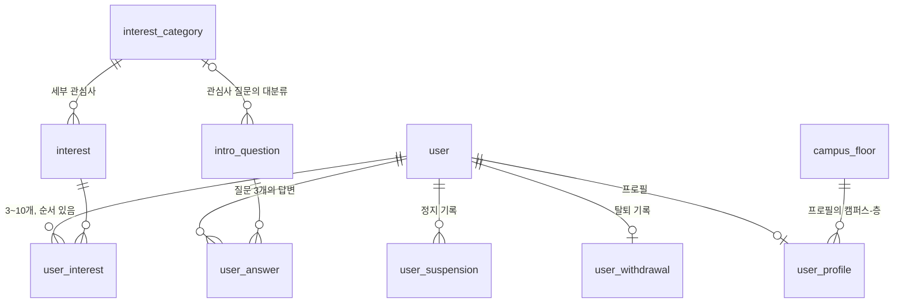

# 계정 · 프로필 · 관심사 · 질문

계정, 프로필, 관심사, 자기소개 질문과 답변을 저장한다. 계정(`user`)과 프로필(`user_profile`)은 테이블을 나눈다. 명세는 [02 로그인 · 회원가입](../spec/02-auth.md), [03 온보딩](../spec/03-onboarding.md), [04 내 땅굴](../spec/04-my-burrow.md), [10 설정 · 계정](../spec/10-settings.md), [11 운영 · 관리자](../spec/11-admin.md)다. 이름 규칙과 공통 칼럼은 [README](README.md)를 따른다.

## 가입은 마쳐야 저장하고 온보딩은 다시 시작하기

### 기존 설계

이메일 가입은 비밀번호를 설정할 때, Google 가입은 첫 Google 로그인 때 `user`를 만든다. `ssafy_verified_at`과 `onboarded_at`으로 다음 화면을 판단한다. `user_profile`은 SSAFY 인증 때 만들고, 닉네임과 두더지 아이템은 온보딩 첫 단계에서 채우도록 되어 있었다.

### 문제와 재현 조건

가입 도중(SSAFY 인증을 마치기 전)에 나가면 남는 것 없이 처음부터 다시 가입해야 한다. 이메일 가입 2단계에서 계정을 만들면 SSAFY 인증을 하지 않은 반쪽 계정이 남고, 그 이메일로 다시 가입할 수 없다. SSAFY 인증까지 마친 뒤 온보딩에서 닉네임·관심사·답변을 고르다 나가면, 다음 로그인에서는 빈 온보딩 1단계로 시작해야 한다. 중간 입력을 프로필에 즉시 기록하면 이전 값이 다시 보이거나 미완료 닉네임이 중복 검사를 막을 수 있다.

### 원인

계정을 만드는 시점이 가입을 마치는 시점보다 빨랐고, 온보딩 중 화면 입력값의 저장 시점이 구분되어 있지 않았다.

### 해결 방법

| 시점 | DB 변경 |
| --- | --- |
| 이메일 인증, 비밀번호 입력, 첫 Google 로그인 | 없음. 가입에 필요한 값은 임시 저장소의 가입 진행 기록에 둔다([인증 코드 · 가입 진행 기록](#인증-코드--비밀번호-재설정-링크-db에-두지-않는다)) |
| SSAFY 인증과 필수 동의 완료 | `user`(로그인 수단, `mattermost_id`, `ssafy_verified_at`, `terms_agreed_at`)와 `user_profile`(기수·캠퍼스-층)을 한 트랜잭션에서 생성 |
| 온보딩 진행 중 | 단계 간 이동에 필요한 닉네임·아이템·관심사·답변은 현재 화면 흐름에서만 유지 |
| 온보딩 4에서 관심사 확정 | `user_profile`의 닉네임과 아이템, `user_interest`, `user_answer`, `burrow`, 해당 학기 `burrow_entrance`를 저장하고 `user.onboarded_at` 갱신 |

최종 확정은 한 트랜잭션으로 처리한다. 계정 행을 잠근 뒤 완료 여부를 다시 확인하고, 닉네임 중복은 기존 UNIQUE로 검사한다. 닉네임 충돌이나 입구 생성 실패 시 모두 롤백한다. 확정 요청을 재시도하면 이미 완료된 땅굴을 반환한다. 인증을 마쳤어도 `onboarded_at`이 없으면 일반 서비스 화면과 공개 프로필 조회 대상에서 제외한다.

미완료 데이터를 이미 저장한 환경이라면 `onboarded_at IS NULL`인 계정의 온보딩 입력만 식별해 정리한다. SSAFY 인증으로 확정된 기수·캠퍼스-층과 로그인 수단은 보존한다.

### 검증 결과

설계 검토에서 확인했다. 실행 검증에서는 아래 결과를 확인한다.

| 시나리오 | 기대 결과 |
| --- | --- |
| 이메일 인증과 비밀번호 입력 후 이탈 | 계정이 없다. 로그인되지 않고, 같은 이메일로 회원가입 1부터 다시 가입할 수 있다 |
| 첫 Google 로그인 후 SSAFY 인증 전 이탈 | 계정이 없다. 다시 Google로 들어오면 회원가입 3으로 진입 |
| SSAFY 인증 후 온보딩 중 이탈하고 다시 로그인 | 빈 온보딩 1단계로 진입. 인증 당시 소속은 유지 |
| 땅굴 미리보기에서 이전 단계로 이동 | 현재 온보딩 흐름에서 고른 입력은 유지 |
| 닉네임 충돌 또는 땅굴 입구 생성 실패 | 최종 입력 전체 롤백. `onboarded_at`은 비어 있음 |
| 최종 확정 요청 중복 제출 | 계정당 땅굴 1개, 땅굴당 입구 1개 |

## 탈퇴 후 같은 Mattermost 계정으로 다시 가입하기

### 기존 설계

탈퇴 시 `user`를 `WITHDRAWN`으로 바꾸고 로그인 정보와 Mattermost 식별자를 비운다. `user_profile`은 삭제하고 남겨야 하는 콘텐츠는 기존 `user.id`를 참조한다.

### 문제와 재현 조건

탈퇴한 사람이 같은 Mattermost 계정으로 다시 가입할 수 있어야 한다. 기존 `user.id`를 되살리면 이전 계정의 글이나 채팅 기록도 새 계정의 활동으로 나타난다. 탈퇴자가 받은 방명록은 땅굴과 함께 삭제하고, 쓴 방명록은 남겨야 한다.

### 원인

Mattermost 인증 정보와 콘텐츠가 참조하는 서비스 내부 계정 ID의 수명이 다르다.

### 해결 방법

`A2`, `G5`의 회원 식별 구조를 유지한다. 탈퇴 트랜잭션에서 `status`를 `WITHDRAWN`으로 바꾸고 `user_withdrawal`에 탈퇴 사유와 시각을 한 줄 남긴 뒤 `email`, `password_hash`, `google_sub`, `google_email`, `mattermost_id`를 NULL로 바꾼다. 프로필·땅굴과 의존 관계를 정리한다. 받은 방명록은 삭제하고 쓴 방명록은 남기며, 범위는 [들판 · 땅굴](burrow.md)에 정의한다.

재가입 시 현재 인증 가능한 계정에 대한 `mattermost_id` UNIQUE 규칙을 적용한다. 인증이 끝난 새 계정은 별도의 `user.id`를 사용한다. 과거 커뮤니티 글·댓글, 남은 방명록 글, 채팅 메시지, 지난 모임 기록은 기존 탈퇴 계정을 계속 가리킨다.

### 검증 결과

설계 검토에서 확인했다. 실행 시에는 탈퇴 후 동일한 Mattermost 식별자로 새 계정에서 인증할 수 있고, 탈퇴 전 콘텐츠에는 ‘탈퇴한 사용자’가 유지되는지 확인한다. 동일 식별자에 대한 인증 두 건을 동시에 확정하는 경우에는 한 계정만 식별자를 가져야 한다.

## 계정 영역 테이블 구조

계정 영역의 9개 테이블을 상세 검토할 수 있도록 정리했다. `미정`은 기존 설계나 서비스 명세에서 구체화되지 않은 타입 또는 제약이다.

### `user`

로그인 수단, SSAFY 인증, 온보딩 완료와 탈퇴 상태를 관리하는 계정이다.

| 컬럼 이름 | 타입 | 외래키·기본키 | NULL 허용 여부·UNIQUE 여부·도메인 범위 | 설명 |
| --- | --- | --- | --- | --- |
| `id` | `BIGINT` | PK | `NOT NULL`, PK로 유일 | 자동 증가. 다른 테이블이 참조하는 계정 ID |
| `email` | `VARCHAR(254)` | — | `NULL` 허용, `UNIQUE` | 이메일로 가입한 계정의 로그인 이메일 |
| `password_hash` | `VARCHAR(100)` | — | `NULL` 허용, 개별 UNIQUE 없음 | 이메일 로그인 비밀번호의 BCrypt 해시. Google로만 가입한 계정에서는 비어 있음 |
| `google_sub` | `VARCHAR(255)` | — | `NULL` 허용, `UNIQUE` | Google 로그인 또는 연동에 사용하는 Google 계정 식별자 |
| `google_email` | `VARCHAR(254)` | — | `NULL` 허용, 개별 UNIQUE 없음 | 연동된 Google 이메일. 설정의 연동 상태 화면에 표시 |
| `mattermost_id` | `VARCHAR(64)` | — | `NULL` 허용, `UNIQUE` | SSAFY 인증을 완료한 계정의 Mattermost 식별자 |
| `ssafy_verified_at` | `DATETIME` | — | `NOT NULL`, 개별 UNIQUE 없음 | SSAFY 인증을 마친 시각. 계정을 만들 때 넣는다 |
| `terms_agreed_at` | `DATETIME` | — | `NOT NULL`, 개별 UNIQUE 없음 | 필수 약관과 개인정보 수집·이용에 모두 동의한 시각. 계정을 만들 때 넣는다 |
| `onboarded_at` | `DATETIME` | — | `NULL` 허용, 개별 UNIQUE 없음 | 온보딩 마지막 단계에서 관심사를 확정한 시각 |
| `role` | `ENUM` | — | `NOT NULL`, 개별 UNIQUE 없음, `USER` / `ADMIN` | 서비스 사용자 또는 관리자 역할 |
| `status` | `ENUM` | — | `NOT NULL`, 개별 UNIQUE 없음, `ACTIVE` / `WITHDRAWN` | 계정 상태. 온보딩을 마쳤는지는 `onboarded_at`으로 판단 |
| `created_at` | `DATETIME` | — | `NOT NULL`, 개별 UNIQUE 없음 | 계정이 생성된 시각 |
| `updated_at` | `DATETIME` | — | `NOT NULL`, 개별 UNIQUE 없음 | 계정 정보가 마지막으로 갱신된 시각 |

이메일 가입과 Google 가입 모두 SSAFY 인증과 필수 동의를 마칠 때 계정 행을 생성한다. 이메일 길이는 이메일 주소의 최대 길이(254자)를 따른다. 이메일은 DB의 정렬 규칙(`utf8mb4_0900_ai_ci`)에 따라 대소문자를 가리지 않고 비교한다. 마이그레이션은 `V3__create_user.sql`이다. 그 전의 가입 진행 값은 임시 저장소에 두며, 가입 도중에 나가면 계정이 남지 않는다. 재로그인 시 온보딩 완료 시각에 따라 다음 화면을 정한다.

탈퇴하면 계정 ID를 남기고 로그인·인증 식별 정보를 비운다. 탈퇴한 시각과 사유는 [`user_withdrawal`](#user_withdrawal)에 따로 남긴다. 남는 글·댓글·쓴 방명록 글·채팅 메시지·지난 모임 기록은 기존 ID를 참조한다. 탈퇴자가 받은 방명록은 삭제하며, 재가입하면 새 계정 ID를 사용한다.

관리자 권한은 DB에서 직접 설정한다. 탈퇴한 사용자는 화면에서 "탈퇴한 사용자"와 기본 두더지로 보여준다. 받은 방명록은 탈퇴 시 삭제하고, 쓴 방명록을 포함한 보존 콘텐츠는 기존 계정 ID를 가리킨다.

### `user_withdrawal`

탈퇴 기록이다. 탈퇴한 계정과 사유, 시각을 한 곳에 모아 본다.

| 컬럼 이름 | 타입 | 외래키·기본키 | NULL 허용 여부·UNIQUE 여부·도메인 범위 | 설명 |
| --- | --- | --- | --- | --- |
| `id` | `BIGINT` | PK | `NOT NULL`, PK로 유일 | 자동 증가. 탈퇴 기록 ID |
| `user_id` | `BIGINT` | FK → `user.id` | `NOT NULL`, `UNIQUE` | 탈퇴한 계정 |
| `reason` | `ENUM` | — | `NULL` 허용, 개별 UNIQUE 없음, `NOT_USING`(자주 쓰지 않아요), `COURSE_ENDED`(SSAFY 과정이 끝났어요), `NO_MATCH`(맞는 사람이나 모임을 찾지 못했어요), `INCONVENIENT`(쓰기 불편해요), `UNPLEASANT`(불쾌한 일을 겪었어요), `ETC`(기타) | 사용자가 선택한 탈퇴 사유. 고르지 않으면 비움 |
| `created_at` | `DATETIME` | — | `NOT NULL`, 개별 UNIQUE 없음 | 탈퇴한 시각 |

다시 가입하면 새 계정 ID를 쓰므로 계정 하나에 탈퇴 기록은 하나다. `user.status`는 로그인과 조회에서 탈퇴한 계정을 바로 거르려고 그대로 둔다. 한 번 쓰고 바꾸지 않는 기록이라 `updated_at`과 `deleted_at`은 두지 않는다. 사유의 코드는 [API 명세](../api/10-settings.md#post-apiv1mewithdraw)를 쓰며 정했다. 화면의 글은 프론트엔드가 갖는다.

### `user_profile`

다른 사용자에게 표시하는 프로필이다. 계정당 프로필은 0~1개다. SSAFY 인증을 마쳐 계정을 만들 때 함께 생성하고, 탈퇴하면 삭제한다.

| 컬럼 이름 | 타입 | 외래키·기본키 | NULL 허용 여부·UNIQUE 여부·도메인 범위 | 설명 |
| --- | --- | --- | --- | --- |
| `user_id` | `BIGINT` | PK, FK → `user.id` | `NOT NULL`, PK로 유일 | 프로필 소유자의 계정 ID |
| `nickname` | `VARCHAR(12)` | — | `NULL` 허용, `UNIQUE`, 최대 12자 | 온보딩에서 입력하고 최종 확정 시 저장하는 닉네임 |
| `generation` | `SMALLINT` | — | `NOT NULL`, 개별 UNIQUE 없음 | SSAFY 인증에 사용한 기수. 내 정보 수정에서 변경할 수 없음 |
| `campus_floor_id` | `BIGINT` | FK → `campus_floor.id` | `NOT NULL`, 개별 UNIQUE 없음 | 프로필 소속의 기준이 되는 캠퍼스·층 |
| `intro` | `VARCHAR(150)` | — | `NULL` 허용, 개별 UNIQUE 없음, 최대 150자 | 선택 자기소개 |
| `profile_image_url` | `VARCHAR(500)` | — | `NULL` 허용, 개별 UNIQUE 없음 | 선택 프로필 사진의 주소. 올리지 않으면 비움 |
| `mole_head` | `VARCHAR(30)` | — | `NULL` 허용, 개별 UNIQUE 없음, 머리 부위 아이템 코드 | 두더지 머리 아이템. NULL은 미착용 |
| `mole_face` | `VARCHAR(30)` | — | `NULL` 허용, 개별 UNIQUE 없음, 얼굴 부위 아이템 코드 | 두더지 얼굴 아이템. NULL은 미착용 |
| `mole_neck` | `VARCHAR(30)` | — | `NULL` 허용, 개별 UNIQUE 없음, 목 부위 아이템 코드 | 두더지 목 아이템. NULL은 미착용 |
| `mole_hand` | `VARCHAR(30)` | — | `NULL` 허용, 개별 UNIQUE 없음, 손 부위 아이템 코드 | 두더지 손 아이템. NULL은 미착용 |
| `created_at` | `DATETIME` | — | `NOT NULL`, 개별 UNIQUE 없음 | 행이 만들어진 시각 |
| `updated_at` | `DATETIME` | — | `NOT NULL`, 개별 UNIQUE 없음 | 프로필 정보가 마지막으로 갱신된 시각 |

SSAFY 인증이 완료되면 기수와 캠퍼스·층을 저장한다. `profile_image_url`의 길이는 파일 저장소를 정할 때(04) 더 길어야 하면 새 마이그레이션으로 늘린다. 닉네임은 온보딩 미완료 단계에서 NULL을 허용하며, 온보딩 완료에는 닉네임이 필요하다. 닉네임은 앞뒤 공백을 지운 뒤 한글 · 영어 · 숫자로 1 ~ 12자이고, UNIQUE는 DB 정렬 규칙대로 영어 대소문자를 가리지 않는다([온보딩 API](../api/03-onboarding.md#닉네임-규칙), KAN-44). 두더지 선택도 온보딩 최종 확정 시 반영한다.

- 남의 땅굴, 글 작성자, 프로필 팝업처럼 다른 사람을 보여줄 때 로그인 값은 노출하지 않고 프로필을 읽는다.
- 실명과 반은 받지 않는다. 프로필 사진은 선택이고, 올리지 않아도 두더지로 표시한다. 땅굴은 `burrow`([들판 · 땅굴](burrow.md))에 따로 있다.

### `user_suspension`

계정 정지 기간과 관리자의 정지·해제 조치를 기록한다.

| 컬럼 이름 | 타입 | 외래키·기본키 | NULL 허용 여부·UNIQUE 여부·도메인 범위 | 설명 |
| --- | --- | --- | --- | --- |
| `id` | `BIGINT` | PK | `NOT NULL`, PK로 유일 | 자동 증가. 정지 기록 ID |
| `user_id` | `BIGINT` | FK → `user.id` | `NOT NULL`, 개별 UNIQUE 없음 | 정지 대상 계정 |
| `reason` | `VARCHAR(200)` | — | `NOT NULL`, 개별 UNIQUE 없음 | 정지 사유. 정지된 사용자의 로그인 안내에 표시 |
| `starts_at` | `DATETIME` | — | `NOT NULL`, 개별 UNIQUE 없음 | 정지 시작 시각 |
| `ends_at` | `DATETIME` | — | `NOT NULL`, 개별 UNIQUE 없음 | 정지 종료 시각 |
| `imposed_by` | `BIGINT` | FK → `user.id` | `NOT NULL`, 개별 UNIQUE 없음(신규 기록) | 정지를 등록한 관리자 계정 |
| `lifted_at` | `DATETIME` | — | `NULL` 허용, 개별 UNIQUE 없음 | 관리자가 수동으로 해제한 시각 |
| `lifted_by` | `BIGINT` | FK → `user.id` | `NULL` 허용, 개별 UNIQUE 없음 | 수동 해제한 관리자 계정 |
| `lift_reason` | `TEXT` | — | `NULL` 허용, 개별 UNIQUE 없음 | 수동 해제 사유 |
| `created_at` | `DATETIME` | — | `NOT NULL`, 개별 UNIQUE 없음 | 정지 조치를 등록한 시각 |
| `updated_at` | `DATETIME` | — | `NOT NULL`, 개별 UNIQUE 없음 | 행이 마지막으로 바뀐 시각 |

수동 해제 시 `lifted_at`, `lifted_by`, `lift_reason`을 함께 채운다. 기간 만료 여부는 `ends_at`에서 판단한다. 관리자를 알 수 없는 기존 정지 기록을 이관하는 경우의 예외는 [커뮤니티 · 신고](community.md)의 조치 이력 설계를 따른다.

### `interest_category`

관심사 대분류 목록이다. [00 공통](../spec/00-common.md) 5의 대분류 12개(세부 관심사 90개는 `interest`)를 운영자가 관리한다.

| 컬럼 이름 | 타입 | 외래키·기본키 | NULL 허용 여부·UNIQUE 여부·도메인 범위 | 설명 |
| --- | --- | --- | --- | --- |
| `id` | `BIGINT` | PK | `NOT NULL`, PK로 유일 | 자동 증가. 관심사 대분류 ID |
| `name` | `VARCHAR(20)` | — | `NOT NULL`, UNIQUE | 대분류 표시 이름. 이모지(아이콘)는 넣지 않는다(프론트엔드가 갖는다) |
| `created_at` | `DATETIME` | — | `NOT NULL`, 개별 UNIQUE 없음 | 행이 만들어진 시각 |
| `updated_at` | `DATETIME` | — | `NOT NULL`, 개별 UNIQUE 없음 | 행이 마지막으로 바뀐 시각 |
| `deleted_at` | `DATETIME` | — | `NULL` 허용, 개별 UNIQUE 없음 | 삭제한 시각. NULL이면 삭제되지 않음 |

관심사 대분류와 세부 관심사는 운영자가 DB에서 직접 관리한다(관리 화면 없음). 대분류는 커뮤니티 글의 태그와 관심사 질문의 연결에 쓴다.

### `interest`

사용자가 선택하는 세부 관심사 목록이다.

| 컬럼 이름 | 타입 | 외래키·기본키 | NULL 허용 여부·UNIQUE 여부·도메인 범위 | 설명 |
| --- | --- | --- | --- | --- |
| `id` | `BIGINT` | PK | `NOT NULL`, PK로 유일 | 자동 증가. 세부 관심사 ID |
| `interest_category_id` | `BIGINT` | FK → `interest_category.id` | `NOT NULL`, 개별 UNIQUE 없음 | 세부 관심사가 속한 대분류 |
| `name` | `VARCHAR(30)` | — | `NOT NULL`, UNIQUE(대분류가 달라도 겹치지 않음) | 세부 관심사 표시 이름 |
| `created_at` | `DATETIME` | — | `NOT NULL`, 개별 UNIQUE 없음 | 행이 만들어진 시각 |
| `updated_at` | `DATETIME` | — | `NOT NULL`, 개별 UNIQUE 없음 | 행이 마지막으로 바뀐 시각 |
| `deleted_at` | `DATETIME` | — | `NULL` 허용, 개별 UNIQUE 없음 | 삭제한 시각. NULL이면 삭제되지 않음 |

세부 관심사는 땅굴 가구와 겹치는 관심사를 표시하는 데 사용한다. 가구는 세부 관심사마다 하나로 정해져 있고, 어느 관심사에 어느 가구인지는 프론트엔드가 갖는다.

### `user_interest`

사용자가 고른 세부 관심사와 선택 순서를 저장한다.

| 컬럼 이름 | 타입 | 외래키·기본키 | NULL 허용 여부·UNIQUE 여부·도메인 범위 | 설명 |
| --- | --- | --- | --- | --- |
| `user_id` | `BIGINT` | 복합 PK, FK → `user.id` | `NOT NULL`, 개별 UNIQUE 없음 | 관심사를 고른 사용자 |
| `interest_id` | `BIGINT` | 복합 PK, FK → `interest.id` | `NOT NULL`, 개별 UNIQUE 없음 | 선택한 세부 관심사 |
| `sort_order` | `TINYINT` | — | `NOT NULL`, 개별 UNIQUE 없음, `1`–`10`(CHECK), `1`이 대표 관심사 | 사용자마다 관심사를 고른 순서. 이 값으로 선택 목록을 정렬 |
| `created_at` | `DATETIME` | — | `NOT NULL`, 개별 UNIQUE 없음 | 행이 만들어진 시각 |
| `updated_at` | `DATETIME` | — | `NOT NULL`, 개별 UNIQUE 없음 | 행이 마지막으로 바뀐 시각 |

복합 기본키는 `PK(user_id, interest_id)`다. 사용자 한 명은 관심사를 3~10개 고른다. 선택하지 않게 된 관심사의 행은 지운다. 가구는 관심사마다 하나로 정해져 있어 사용자가 고르지 않으므로 저장하지 않는다.

### `intro_question`

운영자가 추가·수정하는 자기소개 질문 목록이다.

| 컬럼 이름 | 타입 | 외래키·기본키 | NULL 허용 여부·UNIQUE 여부·도메인 범위 | 설명 |
| --- | --- | --- | --- | --- |
| `id` | `BIGINT` | PK | `NOT NULL`, PK로 유일 | 자동 증가. 질문 ID |
| `type` | `ENUM` | — | `NOT NULL`, 개별 UNIQUE 없음, `INTEREST` / `TMI` | 관심사 질문 또는 TMI 질문 |
| `interest_category_id` | `BIGINT` | FK → `interest_category.id` | `NULL` 허용, 개별 UNIQUE 없음, `INTEREST`일 때 필수 | 관심사 질문에 연결된 대분류. TMI는 비워 둠 |
| `content` | `TEXT` | — | `NOT NULL`, 개별 UNIQUE 없음 | 사용자에게 표시할 질문 문구 |
| `created_at` | `DATETIME` | — | `NOT NULL`, 개별 UNIQUE 없음 | 질문이 생성된 시각 |
| `updated_at` | `DATETIME` | — | `NOT NULL`, 개별 UNIQUE 없음 | 행이 마지막으로 바뀐 시각 |

관리자가 질문을 추가·수정하며, 숨기거나 지우지 않는다. `type`과 `interest_category_id`의 짝(`INTEREST`면 대분류 필수, `TMI`면 비움)은 CHECK 제약으로 지킨다(KAN-43).

처음 값(KAN-43 마이그레이션): 대분류 12개와 세부 관심사 90개는 [00 공통](../spec/00-common.md) 5의 표 순서대로 넣어 id 순이 표 순서와 같다. 자기소개 질문은 명세에 문구가 없어 초안 40개(대분류마다 관심사 질문 2개 = 24개, TMI 16개)를 넣었다. 문구는 [작업 기록](../work/KAN-43.md#부록-자기소개-질문-초안)에 있고, 바꿀 때는 새 마이그레이션으로 고친다.

### `user_answer`

사용자가 자기소개용으로 선택한 질문과 각 자리의 답변을 기록한다.

| 컬럼 이름 | 타입 | 외래키·기본키 | NULL 허용 여부·UNIQUE 여부·도메인 범위 | 설명 |
| --- | --- | --- | --- | --- |
| `user_id` | `BIGINT` | 복합 PK, FK → `user.id` | `NOT NULL`, 개별 UNIQUE 없음 | 질문에 답한 사용자 |
| `slot` | `TINYINT` | 복합 PK | `NOT NULL`, 개별 UNIQUE 없음, `1`, `2`, `3`만 허용 | 자기소개에서 질문과 답변이 보이는 자리 |
| `intro_question_id` | `BIGINT` | FK → `intro_question.id` | `NOT NULL`, 개별 UNIQUE 없음 | 선택한 자기소개 질문 |
| `answer` | `VARCHAR(50)` | — | `NOT NULL`, 개별 UNIQUE 없음, 10~50자 | 선택 질문에 작성한 답변 |
| `created_at` | `DATETIME` | — | `NOT NULL`, 개별 UNIQUE 없음 | 행이 만들어진 시각 |
| `updated_at` | `DATETIME` | — | `NOT NULL`, 개별 UNIQUE 없음 | 행이 마지막으로 바뀐 시각 |

복합 기본키 `PK(user_id, slot)`는 같은 사용자의 자리 중복을 막는다. 복합 UNIQUE `UNIQUE(user_id, intro_question_id)`는 같은 사용자가 한 질문을 여러 자리에 고르는 것을 막는다. `slot`의 1 ~ 3과 답변의 10 ~ 50자는 CHECK 제약으로 지킨다(KAN-44).

온보딩 최종 확정 시 서로 다른 질문 3개와 각 답변을 저장한다. 질문을 다시 고르면 같은 자리의 질문 ID와 답변을 갱신한다.

## 인증 코드 · 비밀번호 재설정 링크 (DB에 두지 않는다)

잠깐 쓰고 버리는 값이라 MySQL이 아니라 임시 저장소(Redis)에 둔다. 만료 시간이 지나면 저절로 사라진다.

| 값 | 무엇을 기억하나 | 만료 |
|---|---|---|
| 이메일 인증 코드 | 숫자 6자리 코드, 만료 시각, 틀린 횟수(키는 소문자로 바꾼 이메일, `itting:email-code:<이메일>`). 마지막으로 보낸 시각은 따로 둔다(`itting:email-code-sent:<이메일>`) | 5분. 5번 틀리면 지운다. 보낸 시각은 60초(재전송 간격) |
| 가입 진행 기록 | 가입 방법, 인증한 이메일 또는 Google 식별자와 Google 이메일. 가입 쿠키로 찾는다(`itting:signup:<토큰>`) | 1시간. 계정을 만들면 지운다([로그인 · 회원가입 API](../api/02-auth.md#가입-진행)) |
| SSAFY(Mattermost) 인증 코드 | 가입 진행 기록 안에 Mattermost ID, 기수, 숫자 6자리 코드, 만료 시각, 틀린 횟수, 마지막으로 보낸 시각 | 코드는 5분, 5번 틀리면 지운다. 재전송 간격 60초 |
| 비밀번호 재설정 링크 | 계정, 만료 시각(`itting:password-reset:<링크 값>`). 계정마다 마지막 링크(`itting:password-reset-user:<계정 id>`), 입력한 이메일마다(`itting:password-reset-sent:<이메일>`)와 계정마다(`itting:password-reset-sent-user:<계정 id>`) 마지막으로 요청한 시각 | 30분. 한 번 쓰면 지운다. 다시 보내면 이전 링크를 지운다. 요청 간격 60초(입력 이메일과 계정 둘 다) |
| 맡아 둔 닉네임 | 닉네임마다 맡은 계정(`itting:nickname-hold:<소문자로 바꾼 닉네임>`), 계정마다 맡은 닉네임(`itting:nickname-hold-user:<계정 id>`) | 5분. 닉네임을 저장하거나 다른 닉네임을 확인하면 지운다([온보딩 API](../api/03-onboarding.md#닉네임-맡아-두기)) |

## 저장하지 않는 것

### 계산해서 내려주는 값

| 값 | 무엇에서 계산하나 |
|---|---|
| 대표 관심사 | `user_interest`에서 `sort_order`가 1인 것 |
| 땅굴 무드(벽 · 바닥) | 대표 관심사가 속한 `interest_category` |
| 땅굴 이름("닉네임의 땅굴"), 관심사 가구 수 | `user_profile.nickname`, `user_interest` 줄 수 |
| 가입 방법(이메일 / Google로만), Google 연동 상태 | `password_hash`, `google_sub`가 있는지 |
| 지금 정지 중인지, 정지 안내의 남은 기간 | `user_suspension`의 기간과 `lifted_at` |
| 로그인 뒤 갈 곳(온보딩 / 새 학기 안내 / 내 땅굴) | `onboarded_at`, 땅굴의 `burrow_entrance`가 이번 학기 들판에 있는지([들판 · 땅굴](burrow.md)) |
| 온보딩 2 세부 관심사 칩의 고른 사람 수 | 관심사별 `user_interest` 줄 수 |
| 겹치는 관심사 | 두 사람의 `user_interest` |
| 인증 코드의 남은 시간 | 임시 저장소(Redis)에 남은 만료 시간 |

### 프론트엔드가 관리하는 것

- 두더지와 아이템 그림, 관심사마다 하나로 정해진 가구와 그 그림, 방 안의 자리, 무드별 벽 · 바닥 그림, 분야 아이콘과 한 줄 안내
- 견본 방(팀이 만들어 둔 예시 방)의 내용 전체, 비로그인이 구경한 방 수
- 온보딩 진행 표시, 글자 수 표시, 안내 문구

### 추가로 저장하지 않는 것

- 온보딩 미완료 입력의 로그인 간 복원 데이터. 같은 온보딩 흐름 안에서 화면 상태로 유지한다.
- 가입 경로와 로그인 후 이동 화면. 인증 수단과 `onboarded_at`에서 판단한다.
- 가입을 마치지 않은 사람의 입력. 계정을 만들기 전에는 DB에 아무것도 두지 않는다.
- 이전 계정과 새 계정의 연결. 과거 기록은 기존 `user.id`로 표시한다.

## 명세에 없어 구현 단계로 넘기는 것

아래 항목은 [명세의 보류한 결정](../spec/open-issues.md)과 함께 검토한다.

- 내 정보 수정에서 관심사를 넣고 뺄 때의 순서 규칙, 뺀 관심사에 딸린 질문 · 답변의 처리(남은 검토 항목 44)
- 같은 이메일의 Google 계정과 이메일 계정의 관계
