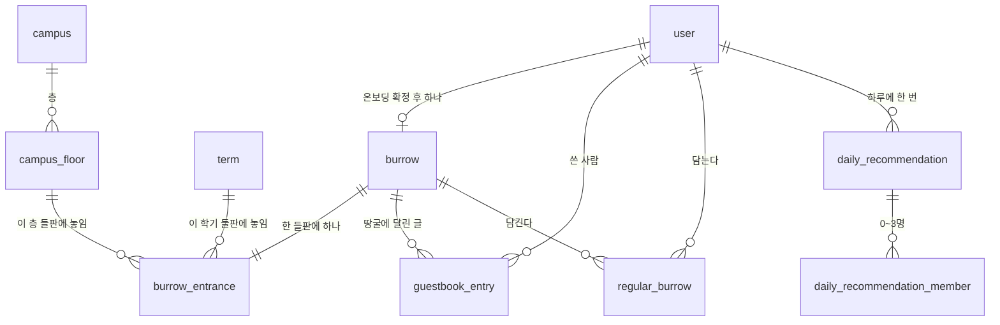

# 들판 · 땅굴 입구 · 방명록 · 단골 · 추천

학기와 캠퍼스-층, 땅굴과 땅굴 입구, 방명록, 단골, 오늘의 추천 친구를 저장한다. 명세는 [00 공통 19](../spec/00-common.md), [04 내 땅굴](../spec/04-my-burrow.md), [05 탐색 · 방문](../spec/05-explore-visit.md), [10 설정 · 계정](../spec/10-settings.md)이다. 이름 규칙과 공통 칼럼은 [README](README.md)를 따른다.

## 새 학기에는 캠퍼스·층을 반드시 고르게 하기

### 기존 설계

이번 학기의 `burrow_entrance` 유무로 새 학기 소속 확정 여부를 판단했다. 안내에서 ‘나중에 하기’를 누르면 입구 없이 서비스를 계속 쓸 수 있었고, 안내를 이미 보여줬는지는 브라우저의 접속 단위 저장소에 기록했다. 입구는 학기마다 한 행씩 두어 지난 학기 들판에도 입구가 남았다.

### 바뀐 명세

‘나중에 하기’를 누른 사람은 이번 학기 입구가 없는 채로 내 땅굴, 탐색, 내 정보 수정을 쓴다. 탐색으로 나갈 들판, 추천 후보, 내 정보 저장이 모두 이번 학기 입구가 없는 경우를 따로 처리해야 했다. 명세([05 탐색 · 방문](../spec/05-explore-visit.md)의 새 학기 안내 1 · 4)는 2026-11-20에 새 학기가 열리면 캠퍼스·층을 반드시 고르게 하도록 바뀌었다.

### 원인

소속을 확정하지 않은 상태를 허용해, 입구 유무와 안내 표시 여부를 따로 관리해야 했다.

### 해결 방법

‘나중에 하기’와 닫기를 없앤다. 접속한 사용자의 땅굴 입구가 이번 학기 들판에 있지 않으면 새 학기 안내를 띄우고, 고를 때까지 다른 기능을 쓸 수 없게 한다. 안내 표시 여부는 기록하지 않는다.

땅굴은 이사한다. ‘이 층으로 정하기’로 이번 학기 캠퍼스·층을 확정하면 `user_profile.campus_floor_id`를 바꾸고, 땅굴의 `burrow_entrance` 행을 이번 학기의 그 층 들판으로 옮긴다(`term_id`, `campus_floor_id`, `slot`을 바꾼다). 땅굴 하나에 입구는 하나이고 지난 학기 들판의 자리는 비운다. 방명록, 단골, 방의 모습은 땅굴에 딸려 있어 그대로다. 그 뒤 내 정보 수정에서 캠퍼스·층을 바꾸면 같은 행을 다시 옮긴다. 새 학기가 열린 뒤 아직 접속하지 않은 사용자의 입구는 지난 학기 들판에 그대로 있다.

### 검증 결과

설계 검토에서 확인했다. 실행 시에는 입구가 이번 학기 들판에 있지 않은 계정으로 접속하면 안내가 뜨고 닫을 수 없는지, 고르기 전에는 다른 기능이 막히는지, 확정한 뒤에는 어느 접속에서도 안내가 뜨지 않는지, 지난 학기 들판의 자리가 비고 방명록과 단골이 그대로인지 확인한다.

## 추천은 캠퍼스·층과 기수만 골라 덜 추천된 사람부터 뽑기

### 기존 설계

추천 조건(관심사, 답이 궁금한 질문, 같은 질문, 소속)을 `recommend_setting`과 `recommend_setting_question`에 저장하고, 조건에 많이 맞는 사람부터 뽑았다. 하루 추천 결과는 `daily_recommendation`과 `daily_recommendation_member`에 순서대로 저장한다.

### 문제와 재현 조건

조건이 여러 개이고 저장까지 하다 보니 조건별 가중치, 동점 처리, 질문에 답한 사람이 모자랄 때 채우는 순서를 모두 정해야 했다. 추천은 하루에 세 명을 가볍게 만나게 하는 기능인데 규칙이 그보다 무거웠다.

### 원인

누구를 먼저 보여 줄지 정하는 조건과 그 조건을 기억하는 저장 구조가 추천의 목적에 비해 컸다.

### 해결 방법

추천을 받는 시점에 캠퍼스·층과 기수만 고르게 하고, 그 안에서 세 명을 뽑는다. 고른 캠퍼스·층과 기수는 저장하지 않는다. `recommend_setting`과 `recommend_setting_question`은 없앤다.

후보는 입구가 이번 학기의 고른 캠퍼스·층 들판에 있고 프로필의 기수가 고른 기수와 같으며 온보딩을 마친 활동 회원이다. 본인과, 요청한 사람이 단골로 담은 땅굴의 주인은 제외한다. 후보마다 요청한 사람에게 추천된 횟수를 `daily_recommendation`과 `daily_recommendation_member`에서 세어, 횟수가 가장 적은 사람부터 뽑고 횟수가 같은 사람끼리는 무작위로 뽑는다. 아직 추천되지 않은 사람이 먼저 나오고, 모두 한 번씩 추천된 뒤에는 횟수가 같아져 다시 모두 같은 순위가 된다. 따로 초기화하지 않는다. 횟수를 세어야 하므로 지난 추천 결과는 지우지 않는다. 맞는 사람이 세 명보다 적으면 있는 만큼만 추천한다. 날짜별 UNIQUE와 결과 순서는 그대로 써서, 같은 날 다시 요청하면 처음 확정한 결과를 읽는다. 결과가 0명이어도 그날의 `daily_recommendation`은 기록한다.

### 검증 결과

설계 검토에서 확인했다. 실행 시에는 고른 캠퍼스·층과 기수에 맞는 사람만 뽑히는지, 단골로 담은 땅굴의 주인이 빠지는지, 아직 추천되지 않은 사람이 먼저 뽑히고 모두 한 번씩 추천된 뒤에는 다시 고르게 뽑히는지, 맞는 사람이 세 명보다 적으면 있는 만큼만 반환되는지, 같은 날 다시 요청하면 조건을 바꿔도 처음 결과가 그대로 나오는지 확인한다. 같은 날 동시 요청은 확정된 한 결과를 반환해야 한다.

## 탈퇴자가 받은 방명록은 지우고 쓴 방명록은 남기기

### 기존 설계

`guestbook_entry.author_id`는 작성자를, `guestbook_entry.burrow_id`는 받은 땅굴을 가리킨다. 방명록 글은 시간이 지나도 지우지 않는다. 명세([10 설정 · 계정](../spec/10-settings.md)의 회원 탈퇴 1)는 탈퇴하면 내 땅굴은 지우고, 내가 쓴 방명록 글은 남겨 작성자를 “탈퇴한 사용자”로 표시하도록 정한다.

### 문제와 재현 조건

A가 B의 땅굴에 글을 쓰고 B도 A의 땅굴에 글을 쓴 뒤 A가 탈퇴한다. A의 땅굴은 사라지므로 거기에 달린 B의 글은 함께 지워야 한다. B의 땅굴에 A가 쓴 글은 남아야 하고 작성자가 “탈퇴한 사용자”로 보여야 한다. 탈퇴 처리가 작성자 기준으로도 글을 지우면 B의 방명록에서 글이 사라진다.

### 원인

탈퇴와 관련된 방명록은 탈퇴자가 받은 글(수신 땅굴 기준)과 탈퇴자가 쓴 글(작성자 기준) 두 가지이고, 둘의 처리가 다르다.

### 해결 방법

[회원 탈퇴](account.md)와 같은 트랜잭션에서 `burrow_id = 탈퇴 회원의 땅굴 ID`인 행을 삭제한다. `author_id = 탈퇴 회원 ID`인 행은 지우지 않는다. 이 행은 탈퇴 뒤에도 남는 `user` 행을 계속 가리키고, 화면에는 작성자를 “탈퇴한 사용자”로 보여준다. 남은 글은 다른 방명록 글처럼 계속 남는다.

`regular_burrow`의 담은 회원·담긴 땅굴 기준 행과 땅굴 입구를 정리한 뒤 땅굴을 삭제한다. 방명록 작성과 탈퇴가 겹치면 작성 트랜잭션도 작성자와 땅굴 주인 계정 상태를 잠근 뒤 확인해, 탈퇴한 계정이 새 글을 쓰거나 탈퇴한 사람의 땅굴에 글이 다시 생기지 않게 한다.

이미 접수된 신고 행의 처리는 [커뮤니티 · 신고](community.md)에 정의한다.

### 검증 결과

설계 검토에서 확인했다. 실행 검증에서는 A의 땅굴에 달린 글이 사라지고, B의 땅굴에 A가 쓴 글은 “탈퇴한 사용자”의 글로 계속 남는지 확인한다. 방명록 쓰기와 A의 탈퇴가 동시에 실행돼도 A의 땅굴에 글이 남거나 탈퇴한 A의 새 글이 생기지 않아야 한다.

## 테이블 구조

타입이나 제약을 정하지 않은 항목은 미정으로 표시한다. 복합 제약은 각 표 아래에 적는다.

### `term`

연도와 상·하반기로 구분하는 학기다.

| 컬럼 이름 | 타입 | 외래키·기본키 | NULL 허용 여부·UNIQUE 여부·도메인 범위 | 설명 |
| --- | --- | --- | --- | --- |
| `id` | `BIGINT` | PK | NOT NULL, PK로 유일 | 자동 증가 학기 ID |
| `year` | `SMALLINT` | — | NOT NULL, 개별 UNIQUE 없음 | 학기 연도 |
| `half` | `TINYINT` | — | NOT NULL, 개별 UNIQUE 없음, 1 상반기, 2 하반기(CHECK) | 연도 내 학기 구분 |
| `opened_at` | `DATETIME` | — | NOT NULL, 개별 UNIQUE 없음 | 들판을 연 시각 |
| `created_at` | `DATETIME` | — | NOT NULL, 개별 UNIQUE 없음 | 행이 만들어진 시각 |
| `updated_at` | `DATETIME` | — | NOT NULL, 개별 UNIQUE 없음 | 행이 마지막으로 바뀐 시각 |

복합 UNIQUE는 `UNIQUE(year, half)`다. 지난 학기도 계속 탐색할 수 있다. 지난 학기 들판에는 새 학기에 아직 접속하지 않은 사용자의 입구만 남는다.

새 학기를 여는 방법(직접 / 날짜에 자동)은 [보류한 결정](../spec/open-issues.md)이다. 어느 쪽이든 `term`에 행이 생긴다. 처음 값은 2026 하반기 하나이고 2026-07-01 00:00(한국 시간)에 열린 것으로 넣었다(KAN-43). 여는 방법이 정해지기 전까지 다음 학기는 새 마이그레이션으로 더한다.

### `campus`

운영자가 관리하는 캠퍼스 목록이다.

| 컬럼 이름 | 타입 | 외래키·기본키 | NULL 허용 여부·UNIQUE 여부·도메인 범위 | 설명 |
| --- | --- | --- | --- | --- |
| `id` | `BIGINT` | PK | NOT NULL, PK로 유일 | 자동 증가 캠퍼스 ID |
| `name` | `VARCHAR(20)` | — | NOT NULL, UNIQUE | 캠퍼스의 표시 이름 |
| `sort_order` | `INT` | — | NOT NULL, 개별 UNIQUE 없음 | 캠퍼스 목록의 표시 순서. 작은 것이 먼저이고, 같으면 id 순 |
| `created_at` | `DATETIME` | — | NOT NULL, 개별 UNIQUE 없음 | 행이 만들어진 시각 |
| `updated_at` | `DATETIME` | — | NOT NULL, 개별 UNIQUE 없음 | 행이 마지막으로 바뀐 시각 |
| `deleted_at` | `DATETIME` | — | NULL 허용, 개별 UNIQUE 없음 | 삭제한 시각. NULL이면 삭제되지 않음 |

목록 값은 임시이며, 마이그레이션 `V2__create_campus.sql`이 서울 · 대전 · 부울경 · 구미 · 광주와 캠퍼스마다 1 ~ 20층을 넣는다. 실제 값이 정해지면 새 마이그레이션으로 고친다. 운영자가 DB에서 직접 관리한다(관리 화면 없음).

### `campus_floor`

캠퍼스마다 선택할 수 있는 층을 관리한다.

| 컬럼 이름 | 타입 | 외래키·기본키 | NULL 허용 여부·UNIQUE 여부·도메인 범위 | 설명 |
| --- | --- | --- | --- | --- |
| `id` | `BIGINT` | PK | NOT NULL, PK로 유일 | 자동 증가 캠퍼스·층 ID |
| `campus_id` | `BIGINT` | FK → `campus.id` | NOT NULL, 개별 UNIQUE 없음 | 층이 속한 캠퍼스 |
| `floor` | `INT` | — | NOT NULL, 개별 UNIQUE 없음 | 캠퍼스 안의 층 번호 |
| `created_at` | `DATETIME` | — | NOT NULL, 개별 UNIQUE 없음 | 행이 만들어진 시각 |
| `updated_at` | `DATETIME` | — | NOT NULL, 개별 UNIQUE 없음 | 행이 마지막으로 바뀐 시각 |
| `deleted_at` | `DATETIME` | — | NULL 허용, 개별 UNIQUE 없음 | 삭제한 시각. NULL이면 삭제되지 않음 |

복합 UNIQUE는 `UNIQUE(campus_id, floor)`다. 들판은 학기와 캠퍼스·층의 조합으로 조회한다.

- 캠퍼스마다 선택할 수 있는 층 목록이 다르다.
- 들판(서버)은 테이블로 두지 않는다. 들판은 `term` 하나와 `campus_floor` 하나의 짝이고, 들판만의 값이 없다.

### `burrow`

온보딩 최종 확정 시 생성하는 사용자의 땅굴이다. 계정당 땅굴은 0~1개이며, 입구·방명록·단골이 이 ID를 참조한다.

| 컬럼 이름 | 타입 | 외래키·기본키 | NULL 허용 여부·UNIQUE 여부·도메인 범위 | 설명 |
| --- | --- | --- | --- | --- |
| `id` | `BIGINT` | PK | NOT NULL, PK로 유일 | 자동 증가 땅굴 ID |
| `user_id` | `BIGINT` | FK → `user.id` | NOT NULL, UNIQUE | 땅굴 주인 |
| `created_at` | `DATETIME` | — | NOT NULL, 개별 UNIQUE 없음 | 온보딩을 확정해 땅굴을 만든 시각 |

- 방 안의 모습(가구, 벽 · 바닥)은 이 테이블에 저장하지 않는다. 주인의 관심사([계정 · 프로필](account.md)의 `user_interest`)로 그린다. 가구는 관심사마다 하나로 정해져 있다.
- 들판에서의 자리는 `burrow_entrance`가 갖는다. 땅굴 하나에 입구는 하나다.

### `burrow_entrance`

땅굴이 지금 놓인 들판과 자리다. 땅굴 하나에 한 행이다.

| 컬럼 이름 | 타입 | 외래키·기본키 | NULL 허용 여부·UNIQUE 여부·도메인 범위 | 설명 |
| --- | --- | --- | --- | --- |
| `id` | `BIGINT` | PK | NOT NULL, PK로 유일 | 자동 증가 입구 ID |
| `burrow_id` | `BIGINT` | FK → `burrow.id` | NOT NULL, UNIQUE | 입구가 연결된 땅굴 |
| `term_id` | `BIGINT` | FK → `term.id` | NOT NULL, 개별 UNIQUE 없음 | 입구가 놓인 들판의 학기 |
| `campus_floor_id` | `BIGINT` | FK → `campus_floor.id` | NOT NULL, 개별 UNIQUE 없음 | 입구가 놓인 들판의 캠퍼스·층 |
| `slot` | `INT` | — | NOT NULL, 개별 UNIQUE 없음 | 그 들판에서 서버가 배정한 자리 번호 |
| `created_at` | `DATETIME` | — | NOT NULL, 개별 UNIQUE 없음 | 입구를 처음 놓은 시각 |
| `updated_at` | `DATETIME` | — | NOT NULL, 개별 UNIQUE 없음 | 행이 마지막으로 바뀐 시각 |

`burrow_id`는 UNIQUE다. 복합 UNIQUE는 `UNIQUE(term_id, campus_floor_id, slot)`이다. 새 학기에 이사하거나 캠퍼스·층을 옮길 때 이 행의 학기, 층, 자리를 바꾼다. 지난 자리의 행은 남기지 않는다.

- 입구가 생기는 때는 온보딩 최종 확정이다. 새 학기 안내의 "이 층으로 정하기"와 내 정보 수정의 캠퍼스·층 변경은 입구를 옮긴다. 새 학기 안내는 보류할 수 없다.
- 자리 번호는 서버가 그 들판에 땅굴이 놓인 순서대로 준다. 같은 들판에서는 유지하고, 캠퍼스·층을 바꾸면 새 들판의 다음 자리 번호를 배정한다.
- 다음 자리 번호는 그 들판의 가장 큰 번호 + 1이다(1부터, `CHECK (slot >= 1)`). 이사로 빈 가운데 번호는 다시 쓰지 않는다. 가장 큰 번호의 땅굴이 떠나면 그 번호는 다음에 놓이는 땅굴이 받는다(KAN-45에서 확인). 번호를 줄 때(온보딩 확정, 새 학기 이사, 내 정보 수정의 캠퍼스·층 변경)는 그 `campus_floor` 행을 `SELECT ... FOR UPDATE`로 잠가 같은 층의 요청을 한 줄로 세운다. 그래서 같은 순간에 확정해도 번호가 겹치지 않는다(KAN-44).
- DB는 "어느 들판의 몇 번 자리"까지만 안다. 배치 좌표와 구멍을 그리는 일은 프론트엔드가 맡는다.

### `guestbook_entry`

방문자가 다른 사용자의 땅굴에 남긴 글이다.

| 컬럼 이름 | 타입 | 외래키·기본키 | NULL 허용 여부·UNIQUE 여부·도메인 범위 | 설명 |
| --- | --- | --- | --- | --- |
| `id` | `BIGINT` | PK | NOT NULL, PK로 유일 | 자동 증가 방명록 글 ID |
| `burrow_id` | `BIGINT` | FK → `burrow.id` | NOT NULL, 개별 UNIQUE 없음 | 글을 받은 땅굴 |
| `author_id` | `BIGINT` | FK → `user.id` | NOT NULL, 개별 UNIQUE 없음 | 작성자. 땅굴 주인은 자기 땅굴에 작성할 수 없음 |
| `content` | `VARCHAR(50)` | — | NOT NULL, 개별 UNIQUE 없음, 최대 50자 | 방명록 본문 |
| `status` | `ENUM` | — | NOT NULL, 개별 UNIQUE 없음, `PUBLIC`, `HIDDEN` | 공개·가려짐 상태 |
| `created_at` | `DATETIME` | — | NOT NULL, 개별 UNIQUE 없음 | 작성 시각. 최신순의 기준 |
| `updated_at` | `DATETIME` | — | NOT NULL, 개별 UNIQUE 없음 | 행이 마지막으로 바뀐 시각 |

마이그레이션 `V20261123_1550__create_guestbook_entry.sql`이 만든다(KAN-45). 목록은 한 땅굴의 `PUBLIC` 글을 최신순(`created_at`, `id` 내림차순)으로 읽으므로 인덱스 `(burrow_id, status, created_at, id)`를 둔다. 글을 쓰는 API는 [05 탐색 · 방문](../api/README.md)에서 만든다.

본문을 수정할 수 없다. 삭제하면 행을 지운다. 시간이 지나도 지우지 않는다. 탈퇴한 사용자가 받은 글은 탈퇴할 때 지우고, 쓴 글은 남겨 작성자를 “탈퇴한 사용자”로 보여준다. 범위는 위의 트러블슈팅을 따른다.

신고 대상이다(`report.target_type = GUESTBOOK`, [커뮤니티 · 신고](community.md)). 서로 다른 3명이 신고하면 `status`를 `HIDDEN`으로 바꿔 가린다. 가려지는 조건, 작성자 알림, 관리자 복구는 글·댓글과 같은 규칙을 따른다. 가려진 글은 방명록 목록과 글 수에서 빼고, 땅굴 주인·방문자·작성자 모두에게 보여주지 않는다. 가려진 글은 관리자가 복구하거나 지울 때까지 `HIDDEN`으로 남는다.

### `regular_burrow`

사용자가 단골로 담은 땅굴의 관계를 저장한다.

| 컬럼 이름 | 타입 | 외래키·기본키 | NULL 허용 여부·UNIQUE 여부·도메인 범위 | 설명 |
| --- | --- | --- | --- | --- |
| `user_id` | `BIGINT` | 복합 PK, FK → `user.id` | NOT NULL, 개별 UNIQUE 없음 | 단골로 담은 사용자 |
| `burrow_id` | `BIGINT` | 복합 PK, FK → `burrow.id` | NOT NULL, 개별 UNIQUE 없음 | 단골로 담긴 땅굴 |
| `created_at` | `DATETIME` | — | NOT NULL, 개별 UNIQUE 없음 | 단골로 담은 시각 |

복합 기본키는 `PK(user_id, burrow_id)`다. 단골을 해제하면 해당 행을 삭제한다.

상대의 수락이 필요하지 않고 상대에게 알리지 않는다.

### `daily_recommendation`

사용자가 특정 날짜에 추천을 받았다는 사실을 기록한다.

| 컬럼 이름 | 타입 | 외래키·기본키 | NULL 허용 여부·UNIQUE 여부·도메인 범위 | 설명 |
| --- | --- | --- | --- | --- |
| `id` | `BIGINT` | PK | NOT NULL, PK로 유일 | 자동 증가 일일 추천 ID |
| `user_id` | `BIGINT` | FK → `user.id` | NOT NULL, 개별 UNIQUE 없음 | 추천을 받은 사용자 |
| `recommended_on` | `DATE` | — | NOT NULL, 개별 UNIQUE 없음 | 추천 기준 날짜 |
| `created_at` | `DATETIME` | — | NOT NULL, 개별 UNIQUE 없음 | 행이 만들어진 시각 |

복합 UNIQUE는 `UNIQUE(user_id, recommended_on)`이다. 추천 후보가 0명이어도 이 행은 남긴다. 추천을 받을 때 고른 캠퍼스·층과 기수는 저장하지 않는다. 지난 날짜의 행은 지우지 않는다.

### `daily_recommendation_member`

그날의 추천 결과와 카드 순서를 보관한다.

| 컬럼 이름 | 타입 | 외래키·기본키 | NULL 허용 여부·UNIQUE 여부·도메인 범위 | 설명 |
| --- | --- | --- | --- | --- |
| `daily_recommendation_id` | `BIGINT` | 복합 PK, FK → `daily_recommendation.id` | NOT NULL, 개별 UNIQUE 없음 | 해당 날짜의 일일 추천 |
| `sort_order` | 미정 (정수형) | 복합 PK | NOT NULL, 개별 UNIQUE 없음, 1–3 | 추천 결과의 표시 순서 |
| `target_user_id` | `BIGINT` | FK → `user.id` | NOT NULL, 개별 UNIQUE 없음 | 추천된 사용자 |

복합 기본키는 `PK(daily_recommendation_id, sort_order)`다. 일일 추천 기록 한 건에 결과 행은 0~3개이며, 각 결과 행은 반드시 일일 추천 기록 하나에 속한다.

같은 날 다시 요청하면 저장한 같은 사람들을 보여준다. 지난 추천 결과도 지우지 않고, 후보마다 요청한 사람에게 추천된 횟수를 세는 데 쓴다. 카드의 관심사·질문·답변은 결과에 복사하지 않고 추천된 사람의 현재 프로필에서 읽는다.

## 저장하지 않는 것

### 계산해서 내려주는 값

| 값 | 원본 테이블과 컬럼 | 계산 방법 |
| --- | --- | --- |
| 이번 학기 | `term.id`, `term.opened_at` | 현재 시각까지 개설된 행 중 `opened_at`이 가장 최근인 학기를 고른다. 개설된 학기가 없으면 이번 학기가 비어 있다. |
| 들판 입구 목록과 비어 있음 | `burrow_entrance.term_id`, `burrow_entrance.campus_floor_id`, `burrow_entrance.slot`, `burrow_entrance.burrow_id` | 선택한 학기와 층이 모두 일치하는 입구를 `slot` 순으로 조회한다. 조회 결과가 0개면 비어 있음이다. |
| 이번 학기 소속 확정 및 안내 여부 | `burrow.user_id`, `burrow_entrance.burrow_id`, `burrow_entrance.term_id` | 사용자 땅굴의 입구가 이번 학기 들판에 있는지 확인한다. 아니면 새 학기 안내를 띄우고, 고를 때까지 다른 기능을 막는다. |
| 땅굴에서 탐색으로 나갈 들판 | `burrow_entrance.burrow_id`, `burrow_entrance.term_id`, `burrow_entrance.campus_floor_id` | 현재 땅굴의 입구가 놓인 학기와 캠퍼스·층을 사용한다. |
| 방노트 | `burrow.user_id`, `user_profile.intro`, `user_interest.interest_id`, `user_interest.sort_order`, `interest.name`, `user_answer.slot`, `user_answer.intro_question_id`, `user_answer.answer`, `intro_question.content` | 주인 ID로 프로필·관심사·답변을 조회한다. 관심사는 `sort_order`로, 질문과 답변은 `slot`으로 정렬한다. |
| 방명록 글 수 | `guestbook_entry.burrow_id`, `guestbook_entry.status` | 해당 땅굴에 달린 행 중 `status`가 `PUBLIC`인 행을 센다. 삭제된 행은 남아 있지 않다. |
| 단골 수 | `regular_burrow.burrow_id` | 해당 땅굴을 담은 행을 `COUNT(*)`로 센다. 해제되거나 탈퇴 정리로 삭제된 관계는 제외된다. |
| 오늘 추천을 이미 받았는지와 결과 | `daily_recommendation.user_id`, `daily_recommendation.recommended_on`, `daily_recommendation.id`, `daily_recommendation_member.daily_recommendation_id`, `daily_recommendation_member.sort_order`, `daily_recommendation_member.target_user_id` | 현재 사용자와 오늘의 추천 기준 날짜로 부모 행의 존재를 확인한다. 행이 있으면 결과를 `sort_order`순으로 읽는다. 결과가 없어도 부모 행이 있으면 추천을 받은 날이다. |
| 추천 후보 | `burrow_entrance.term_id`, `burrow_entrance.burrow_id`, `burrow.id`, `burrow.user_id`, `user.status`, `user.onboarded_at`, `regular_burrow.user_id`, `regular_burrow.burrow_id` | 이번 학기의 입구에서 주인 계정을 찾는다. 본인과 요청한 사람이 단골로 담은 땅굴의 주인을 제외하고 `ACTIVE`이면서 온보딩을 마친 사용자만 고른다. |
| 고른 캠퍼스·층과 기수에 맞는지 | `burrow_entrance.campus_floor_id`, `user_profile.generation` | 후보의 입구가 이번 학기의 고른 캠퍼스·층 들판에 있고 프로필의 기수가 고른 기수와 같은지 비교한다. |
| 요청한 사람에게 추천된 횟수와 뽑는 순서 | `daily_recommendation.user_id`, `daily_recommendation_member.daily_recommendation_id`, `daily_recommendation_member.target_user_id` | 요청한 사람의 추천 기록에서 후보마다 결과 행 수를 센다. 횟수가 가장 적은 후보부터, 횟수가 같으면 무작위로 최대 3명을 뽑는다. |

### 프론트엔드가 관리하는 것

- 들판 지도 그림과 자리 번호마다의 화면 위치, 구멍의 생김새, 들판에서 내 두더지가 서 있는 곳, 지금 보고 있는 들판
- 우체통의 깃발과 편지 표현, 학기와 캠퍼스-층의 표기("2026 하반기 서울-2층"), 안내 문구

## 명세에 없어 구현 단계로 넘기는 것

- 새 학기의 수동·자동 개설 방식. 빈 입구 자리는 다시 쓰지 않기로 했다(KAN-44, 위 `burrow_entrance`)
- 추천 기준 날짜의 경계, 캠퍼스·층이나 기수를 고르지 않고 전체에서 받을 수 있는지
- 방명록 글이 가려졌다는 알림을 눌렀을 때 갈 곳
