# 채팅

대화 요청, 대화방, 메시지를 저장한다. 명세는 [06 채팅](../spec/06-chat.md)과 [05 탐색 · 방문](../spec/05-explore-visit.md)의 대화 요청이다. 이름 규칙과 공통 칼럼은 [README](README.md)를 따른다.

```mermaid
erDiagram
    user ||--o{ chat_request : "보낸다 / 받는다"
    chat_request |o--o| chat_room : "수락하면 만들어진다"
    meetup |o--|| chat_room : "모임 대화방"
    chat_room ||--o{ chat_room_member : "참여자"
    user ||--o{ chat_room_member : ""
    chat_room ||--o{ chat_message : "메시지"
    user ||--o{ chat_message : "보낸다"
    chat_message ||--o{ chat_message_image : "사진 0~3장"
```

## 상대에게 숨긴 거절 이후에도 요청 취소 허용하기

### 기존 설계

`chat_request`는 `PENDING`, `ACCEPTED`, `REJECTED`, `CANCELED`를 저장한다. 거절된 요청은 받은 사람의 목록에서 빠지고 보낸 사람에게는 발송 후 5일 동안 대기 중으로 보인다.

### 문제와 재현 조건

A가 B에게 요청을 보내고 B가 거절한다. A 화면에는 여전히 대기 카드가 있는데 취소 API가 `PENDING`만 받으면 A가 거절 사실을 알아낼 수 있다. 또 보낸 사람과 받는 사람의 방향을 구분해 중복을 검사하면, B가 반대 방향으로 곧바로 새 요청을 만들 수 있다.

### 원인

실제 요청 상태, 사용자에게 보여주는 상태, 두 사람 사이의 새 요청 허용 조건이 서로 다르다.

### 해결 방법

| 조건 | 처리 |
| --- | --- |
| 생성 후 5일 미만의 `PENDING` | 받는 사람은 수락·거절 가능. 보낸 사람은 취소 가능 |
| 생성 후 5일 미만의 `REJECTED` | 받는 사람의 목록·요청 수에서 제외. 보낸 사람에게는 대기로 표시하고 취소 허용. 받는 사람이 보낸 사람에게 새 요청을 보내면 이 요청을 `ACCEPTED`로 바꾸고 대화방을 만듦 |
| 위 두 상태가 만료 전인 동안 | 방향에 관계없이 같은 두 사람의 새 요청 행을 만들지 않음. 거절한 사람이 보내는 요청만 위 줄대로 수락으로 처리 |
| 보낸 사람이 취소 | `PENDING` 또는 `REJECTED`를 `CANCELED`로 바꾸고 `responded_at` 갱신. 두 경우에 동일한 응답을 주고 알림은 생성하지 않음 |
| 생성 후 5일 이상 또는 `CANCELED` | 활성 요청에서 제외. 두 사람이 활성 1:1 대화방에 없으면 새 요청 가능 |

기존 `H1`대로 만료 여부를 `created_at`에서 계산한다. `responded_at`은 마지막 상태 변경 시각으로 사용한다. 수락은 만료 전 `PENDING`에서만 가능하다. 예외로, 거절한 사람이 만료 전에 보낸 사람에게 새 요청을 보내면 그 `REJECTED` 요청을 수락으로 처리한다. 보낸 사람에게는 거절됐던 사실이 드러나지 않고, 요청이 두 건이 되지도 않는다. 두 경우 모두 요청·방·참여자 두 명을 같은 트랜잭션에서 갱신한다.

생성·수락·거절·취소 및 1:1 방 나가기는 해당 두 `user` 행을 ID 오름차순으로 잠근 뒤 상태를 확인한다. 요청 생성은 양방향의 활성 요청과 활성 1:1 방을 확인한 후 삽입한다. 잠금 아래 다시 읽은 시점을 기준으로 유효 기간을 검사한다. 두 사람이 동시에 요청해도 하나만 생성되며, 수락과 취소가 동시에 들어오면 먼저 처리된 유효한 상태 전이가 결과를 결정한다.

### 검증 결과

설계 검토에서 확인했다. 실행 검증에서는 거절 전·후의 취소 응답이 같은지, 거절 후 B가 A에게 요청을 보내면 새 요청 없이 A의 요청이 수락으로 바뀌고 대화방이 하나만 생기는지, 취소 직후 또는 정확히 5일이 지난 시점에는 새 요청이 가능한지 확인한다. 양방향 동시 생성은 요청 1개, 동시 수락은 대화방 1개만 만들어야 한다.

## 모임 참여 기록과 대화방 접근 권한 구분하기

### 기존 설계

모임 작성 시 `chat_room`을 만들고 주최자와 확정 참여자를 `chat_room_member`에 둔다. 나간 회원은 `left_at`을 기록해 방을 목록에서 뺀다. 모임 상세 미리보기는 주최자 여부 또는 `meetup_application.status = CONFIRMED`를 기준으로 설명되어 있었다.

### 문제와 재현 조건

모임 종료나 취소 뒤 확정 참여자가 대화방에서만 나가면 신청 기록은 `CONFIRMED`로 남는다. 상세 화면이 그 값만 검사하면 퇴장 후에도 메시지 미리보기나 직접 링크로 방에 접근할 수 있다. 또 `ends_at`이 비어 있는 모임은 채팅방만 나갈 수 있는 시점을 정해야 한다.

### 원인

`meetup_application`은 모임 참여 기록을, `chat_room_member`는 대화방에 접근할 수 있는지를 나타낸다. 두 상태는 모임 종료 또는 취소 후 달라질 수 있다.

### 해결 방법

- **접근 권한**은 해당 모임 방의 `chat_room_member` 행과 `left_at IS NULL`로 판단한다. 삭제된 모임도 차단한다. 주최자에게 같은 규칙을 적용한다. 목록, 방 직접 열기, 메시지 조회·전송, 실시간 구독과 모임 상세의 최근 메시지 3개가 이 검사를 공통으로 사용한다.
- **입장 전 메시지**도 활성 멤버에게 보여준다. 메시지 조회에 `joined_at`을 하한으로 쓰지 않는다.
- **시작 전인 모임**에서는 확정 참여자가 시작 24시간 전까지 참여 자체를 취소할 수 있다. 이때 신청 상태를 `CANCELED`로 바꾸고 `left_at`을 한 트랜잭션에서 채운다. 주최자 내보내기도 `KICKED`와 `left_at`을 함께 반영한다.
- **모임 취소 이후 또는 종료 시각에 도달한 뒤**에는 주최자도 방에서만 나갈 수 있다. 종료 기준은 `COALESCE(ends_at, starts_at)`이다. 이 경로에서는 `left_at`만 채우고 신청 상태와 주최자·참여 기록을 보존한다. 채워진 `left_at`을 지워 재입장시키지 않는다. 기존 실시간 연결도 퇴장이 확정되면 접근을 종료한다.

### 검증 결과

설계 검토에서 확인했다. 실행 시에는 나중에 확정된 회원이 과거 메시지를 볼 수 있는지, 취소된 모임의 주최자가 퇴장할 수 있는지 확인한다. 종료 시각이 없는 모임은 시작 시각을 경계로 확인한다. 퇴장 뒤에는 참여 기록이 남아도 목록·직접 링크·미리보기·실시간 수신으로 메시지를 볼 수 없어야 한다.

## 테이블 구조

타입이나 제약을 정하지 않은 항목은 미정으로 표시한다. 복합 제약은 각 표 아래에 적는다.

### `chat_request`

1:1 대화의 요청과 응답 상태를 관리한다.

| 컬럼 이름 | 타입 | 외래키·기본키 | NULL 허용 여부·UNIQUE 여부·도메인 범위 | 설명 |
| --- | --- | --- | --- | --- |
| `id` | `BIGINT` | PK | NOT NULL, PK로 유일 | 자동 증가 요청 ID |
| `sender_id` | `BIGINT` | FK → `user.id` | NOT NULL, 개별 UNIQUE 없음 | 요청을 보낸 사용자 |
| `receiver_id` | `BIGINT` | FK → `user.id` | NOT NULL, 개별 UNIQUE 없음 | 요청을 받은 사용자 |
| `message` | `VARCHAR(50)` | — | NULL 허용, 개별 UNIQUE 없음, 최대 50자 | 요청을 보낼 때 붙이는 인사말 |
| `status` | `ENUM` | — | NOT NULL, 개별 UNIQUE 없음, `PENDING`, `ACCEPTED`, `REJECTED`, `CANCELED` | 요청의 실제 처리 상태 |
| `chat_room_id` | `BIGINT` | FK → `chat_room.id` | NULL 허용, 개별 UNIQUE 없음, 수락 시 연결 | 요청을 수락해 생성한 1:1 방 |
| `created_at` | `DATETIME` | — | NOT NULL, 개별 UNIQUE 없음 | 보낸 시각. 5일 만료의 기준 |
| `responded_at` | `DATETIME` | — | NULL 허용, 개별 UNIQUE 없음 | 수락·거절·취소 등 마지막 상태 변경 시각 |

만료 조건, 거절을 숨긴 발신자 화면, 양방향 중복 방지는 위의 상태 전이 규칙을 따른다. 탈퇴한 사용자가 보내거나 받은 요청은 지운다.

### `chat_room`

1:1 대화와 모임 대화의 공통 정보를 가진다.

| 컬럼 이름 | 타입 | 외래키·기본키 | NULL 허용 여부·UNIQUE 여부·도메인 범위 | 설명 |
| --- | --- | --- | --- | --- |
| `id` | `BIGINT` | PK | NOT NULL, PK로 유일 | 자동 증가 대화방 ID |
| `type` | `ENUM` | — | NOT NULL, 개별 UNIQUE 없음, `DIRECT`, `MEETUP` | 1:1 또는 모임 대화방 |
| `meetup_id` | `BIGINT` | FK → `meetup.id` | NULL 허용, UNIQUE, `MEETUP`일 때 필수 | 연결된 모임. 1:1 방에서는 비움 |
| `notice` | `TEXT` | — | NULL 허용, 개별 UNIQUE 없음 | 모임 대화방 상단에 주최자가 쓰는 공지 한 건 |
| `created_at` | `DATETIME` | — | NOT NULL, 개별 UNIQUE 없음 | 1:1 요청 수락 또는 모임 생성 시각 |
| `updated_at` | `DATETIME` | — | NOT NULL, 개별 UNIQUE 없음 | 행이 마지막으로 바뀐 시각 |

1:1 방에서 누군가 나간 뒤 다시 요청이 수락되면 새 방을 만든다. 모임당 방은 하나다.

### `chat_room_member`

사용자별 대화방 참여 상태와 읽은 위치를 기록한다.

| 컬럼 이름 | 타입 | 외래키·기본키 | NULL 허용 여부·UNIQUE 여부·도메인 범위 | 설명 |
| --- | --- | --- | --- | --- |
| `chat_room_id` | `BIGINT` | 복합 PK, FK → `chat_room.id` | NOT NULL, 개별 UNIQUE 없음 | 참여한 대화방 |
| `user_id` | `BIGINT` | 복합 PK, FK → `user.id` | NOT NULL, 개별 UNIQUE 없음 | 해당 대화방 참여자 |
| `joined_at` | `DATETIME` | — | NOT NULL, 개별 UNIQUE 없음 | 방에 들어온 시각 |
| `left_at` | `DATETIME` | — | NULL 허용, 개별 UNIQUE 없음 | 대화방에서 나간 시각 |
| `last_read_message_id` | `BIGINT` | 논리 참조 → `chat_message.id` | NULL 허용, 개별 UNIQUE 없음 | 마지막으로 읽은 같은 방의 메시지 ID. 물리 FK 여부 미정 |

복합 기본키는 `PK(chat_room_id, user_id)`다. 1:1은 두 사람이며, 모임은 주최자와 확정 참여자가 입장한다. 참여 취소·내보내기·탈퇴와 방에서만 나가기는 위의 접근 규칙을 따른다. 탈퇴하면 들어 있던 모든 방(1:1, 모임)에 `WITHDRAWN` 안내 메시지를 한 줄 넣고 `left_at`을 채운다.

### `chat_message`

대화방의 일반 메시지와 대화 중 안내 사건을 남긴다.

| 컬럼 이름 | 타입 | 외래키·기본키 | NULL 허용 여부·UNIQUE 여부·도메인 범위 | 설명 |
| --- | --- | --- | --- | --- |
| `id` | `BIGINT` | PK | NOT NULL, PK로 유일 | 자동 증가 메시지 ID. 방 안에서 조회 순서의 기준 |
| `chat_room_id` | `BIGINT` | FK → `chat_room.id` | NOT NULL, 개별 UNIQUE 없음 | 메시지가 속한 방 |
| `type` | `ENUM` | — | NOT NULL, 개별 UNIQUE 없음, `TEXT`, `ACCEPTED`, `JOINED`, `LEFT`, `WITHDRAWN` | 사용자 메시지 또는 수락·참여·퇴장·탈퇴 안내 |
| `sender_id` | `BIGINT` | FK → `user.id` | NOT NULL, 개별 UNIQUE 없음 | 작성자 또는 안내를 일으킨 사용자 |
| `content` | `TEXT` | — | NULL 허용, 개별 UNIQUE 없음, `TEXT`이고 사진이 없으면 빈 값 불가, 최대 1,000자 | 일반 메시지 본문. 안내 사건과 사진만 보낸 메시지에서는 비움 |
| `created_at` | `DATETIME` | — | NOT NULL, 개별 UNIQUE 없음 | 발송 또는 안내 사건이 발생한 시각 |

메시지는 수정·삭제 없이 남기고 발신자가 탈퇴해도 기존 계정 ID를 참조한다. 안내 문구는 종류와 사용자 표시를 바탕으로 화면에서 만든다.

- 읽은 사람 목록은 저장하지 않는다(읽음 표시 없음).
- 안내 사건이 발생할 때 서버가 메시지 행을 넣는다. 프론트엔드는 `type`과 사용자의 닉네임으로 문구를 만들며, 대화 조회는 저장된 메시지를 순서대로 읽는다.
- 첨부는 사진만 받는다. 메시지에 붙인 사진은 [`chat_message_image`](#chat_message_image)에 둔다.

### `chat_message_image`

메시지에 붙인 사진과 표시 순서를 기록한다.

| 컬럼 이름 | 타입 | 외래키·기본키 | NULL 허용 여부·UNIQUE 여부·도메인 범위 | 설명 |
| --- | --- | --- | --- | --- |
| `chat_message_id` | `BIGINT` | 복합 PK, FK → `chat_message.id` | NOT NULL, 개별 UNIQUE 없음 | 사진이 붙은 메시지 |
| `sort_order` | `TINYINT` | 복합 PK | NOT NULL, 개별 UNIQUE 없음, 1–3 | 메시지 안에서 사진의 표시 순서 |
| `image_id` | `BIGINT` | FK → `uploaded_image.id` | NOT NULL, UNIQUE | 붙인 사진. 사진 하나는 메시지 하나에만 붙는다 |

복합 기본키는 `PK(chat_message_id, sort_order)`다. 메시지 하나에 최대 3장을 붙인다. 사진은 먼저 올려 [`uploaded_image`](community.md#uploaded_image)에 기록하고, 메시지를 보낼 때 이 표로 메시지에 붙인다. 메시지를 고치거나 지우지 않으므로 이 표의 줄도 바뀌지 않는다.

## 저장하지 않는 것

### 계산해서 내려주는 값

| 값 | 원본 테이블과 컬럼 | 계산 방법 |
| --- | --- | --- |
| 요청 만료 여부 | `chat_request.created_at`, `chat_request.status` | `PENDING`, `REJECTED`에서 현재 시각이 `created_at + 5일` 이상이면 활성 요청에서 제외한다. |
| 받은 요청 수와 보낸 요청 수 | `chat_request.receiver_id`, `chat_request.sender_id`, `chat_request.status`, `chat_request.created_at` | 받은 요청은 현재 사용자가 수신자인 만료 전 `PENDING`을 센다. 보낸 요청은 현재 사용자가 발신자인 만료 전 `PENDING`, `REJECTED`를 센다. |
| 땅굴 방문자 화면의 대화 버튼 | `chat_room.type`, `chat_room_member.chat_room_id`, `chat_room_member.user_id`, `chat_room_member.left_at`, `chat_request.sender_id`, `chat_request.receiver_id`, `chat_request.status`, `chat_request.created_at`, `user.status` | 두 사람이 모두 활동 중이며 나가지 않은 `DIRECT` 방이 있으면 ‘대화하기’다. 그 외에 내가 보낸 활성 요청이 있으면 ‘요청 보냄’이다. 그 외에는 ‘대화 요청하기’를 표시한다. 상대가 보낸 `PENDING` 요청이 있으면 새 요청을 막고, 내가 거절한 `REJECTED` 요청이 있으면 요청을 보낼 때 그 요청을 수락으로 처리한다. |
| 안 읽은 메시지 수 | `chat_room_member.chat_room_id`, `chat_room_member.user_id`, `chat_room_member.last_read_message_id`, `chat_message.chat_room_id`, `chat_message.id`, `chat_message.type` | 같은 방의 `TEXT` 중 마지막으로 읽은 ID보다 큰 행을 센다. 읽은 ID가 NULL이면 하한을 적용하지 않는다. 안내 유형은 제외한다. 본인이 보낸 메시지를 별도로 제외할지는 미정이다. |
| 대화 목록의 마지막 메시지와 시각 | `chat_message.chat_room_id`, `chat_message.id`, `chat_message.type`, `chat_message.content`, `chat_message.created_at` | 같은 방에서 ID가 가장 큰 행을 찾는다. `TEXT`면 본문, 안내 유형이면 해당 안내 문구를 만들고 `created_at`을 시각으로 사용한다. |
| 대화 목록 이름과 그림 | `chat_room.type`, `chat_room.meetup_id`, `chat_room_member.user_id`, `user.status`, `user_profile.nickname`, `user_profile.mole_head`, `user_profile.mole_face`, `user_profile.mole_neck`, `user_profile.mole_hand`, `meetup.title` | 1:1은 참여 행에서 본인을 제외한 계정의 닉네임과 두더지 아이템으로 표시한다. 상대가 탈퇴했다면 탈퇴한 사용자 이름과 기본 두더지를 사용한다. 모임 방의 이름은 `meetup.title`을 읽는다. |
| 1:1 방 읽기 전용 여부 | `chat_room.type`, `chat_room_member.user_id`, `chat_room_member.left_at`, `user.status` | 현재 사용자가 아직 볼 수 있는 `DIRECT` 방에서, 상대가 나갔거나 상대 상태가 `WITHDRAWN`이면 읽기 전용이다. |
| 모임 방 접근과 상세 미리보기 | `chat_room.meetup_id`, `chat_room_member.chat_room_id`, `chat_room_member.user_id`, `chat_room_member.left_at`, `meetup.deleted_at`, `chat_message.id` | 삭제되지 않은 모임에 연결된 방에서 내 참여 행의 `left_at`이 NULL일 때 접근한다. 미리보기는 해당 방의 최근 메시지 3개를 읽는다. |
| 메시지 안의 모임 카드 | `chat_message.content`, `meetup.id`, `meetup.title`, `meetup.starts_at`, `meetup.capacity`, `meetup_application.meetup_id`, `meetup_application.status` | 본문의 모임 링크에서 ID를 꺼내 제목과 시작 시각을 읽는다. 인원은 주최자 1명과 `CONFIRMED` 신청 수를 합산하고 정원과 함께 표시한다. |
| 겹치는 관심사 | `user_interest.user_id`, `user_interest.interest_id`, `interest.name` | 두 사용자의 선택 행을 `interest_id`가 같은 것끼리 조인한다. 일치 수와 연결된 관심사 이름을 사용한다. |

### 프론트엔드가 관리하는 것

- 찻방 그림과 두더지가 앉는 자리, 메시지의 좌우 배치
- 대화 요청 팝업의 빠른 멘트 문구, 안내 줄과 토스트의 문구

## 명세에 없어 구현 단계로 넘기는 것

- 모임 방 목록 이미지의 표현
- 둘 다 나간 1:1 방과 삭제된 모임에 연결된 방의 보관 기준
- 읽음 위치의 물리 FK와 본인 발신 메시지의 안 읽은 수 포함 여부
