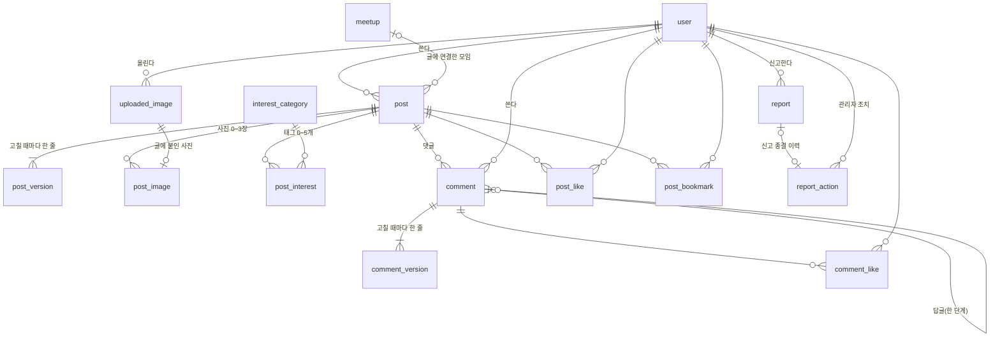

# 커뮤니티 · 신고

글, 댓글, 좋아요, 저장, 신고를 저장한다. 명세는 [08 커뮤니티](../spec/08-community.md), [09 알림](../spec/09-notification.md), [11 운영 · 관리자](../spec/11-admin.md)다. 이름 규칙과 공통 칼럼은 [README](README.md)를 따른다.

## 복구 이후에 접수된 신고로 재가림 판단하기

### 기존 설계

글과 댓글은 서로 다른 3명의 신고가 쌓이면 `HIDDEN`이 된다. 관리자가 복구하면 `PUBLIC`으로 돌아간다. `report`는 신고자와 대상별로 한 건만 허용한다.

### 문제와 재현 조건

A·B·C가 글을 신고해 가려진 뒤 관리자가 복구한다. D가 새로 신고했을 때 과거 신고를 다시 합산하면 새 신고가 한 건뿐인데도 글이 가려진다. 복구 시 기존 신고를 삭제하면 관리자 처리 이력과 중복 신고 여부를 확인할 수 없게 된다.

### 원인

신고의 보관과 자동 가림에 포함할 신고의 범위가 구분되어 있지 않았다.

### 해결 방법

`report_action`에 복구 행을 남긴다. 복구 시 해당 글·댓글을 잠그고, 그 대상에 이미 접수된 가장 큰 `report.id`를 `restored_through_report_id`에 기록한 뒤 `PUBLIC`으로 바꾼다. 상태 변경과 복구 기록은 한 트랜잭션에서 처리한다.

새 신고도 같은 대상 행을 잠근 뒤 삽입한다. 가장 최근 복구에서 기록한 ID보다 큰 신고만 자동 가림에 집계한다. 복구 이력이 없으면 그 대상의 접수 신고 전체를 집계한다. 기존 `UNIQUE(reporter_id, target_type, target_id)`는 유지한다. 과거에 같은 대상을 신고한 사람은 복구 후에도 다시 신고할 수 없다.

세 번째 유효 신고로 공개 상태가 가려짐으로 바뀌는 트랜잭션에서만 작성자 알림을 만든다. 글과 댓글에 별도 알림 종류를 사용하고, 두 경우 모두 신고자 식별 정보를 알림에 담지 않는다. 방명록 글도 같은 규칙으로 가린다([들판 · 땅굴](burrow.md)의 `guestbook_entry.status`). 사용자 신고는 관리자 검토로 처리한다. 이미 삭제된 방명록 글에 대한 신고는 대상 없음으로 처리 상태를 남길 수 있으며, 삭제된 본문은 보관하지 않는다.

### 검증 결과

설계 검토에서 확인했다. 실행 검증에서는 복구 후 다른 세 명이 신고할 때 첫째·둘째 신고에서는 공개, 셋째에서는 가려짐과 알림 1건을 확인한다. 과거 신고자의 중복 요청, 복구 직전·직후의 동시 신고, 가려진 글에 추가로 들어온 신고도 확인한다.

## 신고 처리와 계정 정지·해제의 관리자 이력 남기기

### 기존 설계

`report.status`는 최초 접수만 정의했다. `user_suspension`은 정지 사유와 기간, 해제 시각을 담지만 누가 정지·해제했는지와 해제 사유를 담지 않았다.

### 문제와 재현 조건

관리자가 신고를 처리하거나 정지를 해제한 뒤, 누가 언제 어떤 판단을 했는지 기존 상태값만으로 확인할 수 없다. 같은 글·댓글이 여러 번 복구되면 마지막 복구 정보만으로는 이전 조치를 확인할 수 없다.

### 원인

현재 상태와 상태를 바꾼 관리자의 조치 기록은 기록 목적과 보존 범위가 다르다.

### 해결 방법

`report_action`을 추가한다. 각 행은 신고 처리 또는 대상 복구 한 건을 기록한다. 컬럼과 제약은 아래 [`report_action`](#report_action) 표에 정리한다.

신고 처리 시 `report.status`를 `RECEIVED`에서 `RESOLVED`로 바꾸고 같은 트랜잭션에서 처리 결과를 삽입한다. 신고 처리 행의 대상 정보는 `report_id`가 참조하는 신고에서 읽는다. 복구 행은 특정 신고 한 건이 아닌 대상 전체에 대한 조치이므로 직접 대상을 기록한다. 조치 유형에 맞는 칼럼 조합을 제약으로 검증한다. 복구의 최신 행은 `(target_type, target_id, action_type, id)`로, 재가림 집계는 `report(target_type, target_id, id)`로 조회한다.

`user_suspension`에는 `imposed_by`와 `lifted_by`(BIGINT, FK → `user.id`), `lift_reason`(TEXT)을 추가한다. 정지 조치 시각과 사유는 기존 `created_at`, `reason`을 사용한다. 수동 해제 시에만 `lifted_at`, `lifted_by`, `lift_reason`을 함께 기록한다. 기간 만료는 기존 `ends_at`으로 판단한다.

기존 데이터에 처리자나 사유가 없다면 임의로 채우지 않는다. 과거 기록을 보존하는 전환이 필요할 경우 `imposed_by` 등 누락값은 기존 행에서만 허용하고, 새 조치에는 필수로 받는다. 기존 복구 경계를 확인할 수 없는 데이터는 실제 이력을 확보한 뒤 보정한다.

### 검증 결과

설계 검토에서 확인했다. 실행 검증에서는 두 번 복구한 대상의 두 관리자 조치가 모두 조회되고, 신고 종결 재시도에는 처리 행이 추가되지 않으며, 자연 만료와 수동 해제가 구분되는지 확인한다.

## 글과 댓글을 고쳐도 이전 내용 남기기

### 기존 설계

글의 제목과 본문, 댓글의 본문을 `post`와 `comment`에 직접 두고, 고치면 그 값을 덮어썼다. 고친 사실은 `edited_at`으로만 남겼다.

### 문제와 재현 조건

악성 글을 올린 사람이 신고를 받은 뒤 내용을 무난하게 고치면, 관리자가 신고를 살펴볼 때는 문제가 된 내용이 이미 사라져 있다. 고치기 전에 무엇이 적혀 있었는지 확인할 방법이 없다.

### 원인

"지금 보여 줄 내용"과 "그동안 적혀 있던 내용"을 같은 칼럼에 두어, 고치는 순간 이전 내용이 없어진다.

### 해결 방법

내용을 버전으로 나눠 저장한다. `post`와 `comment`에는 작성자, 상태, 시각처럼 글 자체에 딸린 값만 두고, 제목과 본문은 `post_version`과 `comment_version`에 고칠 때마다 한 줄씩 더한다. 버전 번호는 1부터 시작하고 이전 버전은 고치거나 지우지 않는다. 화면에는 번호가 가장 큰 버전을 보여 준다.

글의 사진, 관심사 태그, 카테고리, 연결한 모임은 버전으로 나누지 않고 가장 최근 값만 둔다. 좋아요, 저장, 댓글, 신고는 버전이 아니라 글과 댓글 자체(`post.id`, `comment.id`)를 가리킨다. 그래서 내용을 몇 번 고치든 신고는 같은 글에 계속 쌓인다. 신고가 들어올 때 그 시점의 버전 번호를 `report.target_version`에 함께 적어, 관리자가 무엇을 보고 신고했는지 알 수 있게 한다.

### 검증 결과

설계 검토에서 확인했다. 실행 검증에서는 글을 두 번 고친 뒤 버전이 3개 남고 화면에는 마지막 내용이 보이는지, 고치기 전과 후에 들어온 신고가 같은 글로 합쳐져 세 번째 신고에서 가려지는지, 신고마다 신고 당시의 버전 번호가 적혀 있는지 확인한다.

## 삭제한 글과 댓글을 2주 뒤에 완전히 지우기

### 기존 설계

글이나 댓글을 삭제하면 `status`를 `DELETED`로 바꾸고 행을 남겼다. 내용은 그대로 남아 있었고 언제 지울지는 정하지 않았다.

### 문제와 재현 조건

악성 글을 올리고 신고가 들어오기 전에 지워 버리면, 내용을 바로 없앨 경우 관리자가 확인할 수 없다. 반대로 삭제한 내용을 끝없이 보관하면 사용자가 지운 글이 DB에 계속 남는다.

### 원인

"화면에서 사라지는 때"와 "DB에서 없어지는 때"를 구분하지 않았다.

### 해결 방법

삭제하면 `status`를 `DELETED`로 바꾸고 `deleted_at`에 시각을 적는다. 이때부터 화면에는 삭제된 것으로 보인다. 모든 버전의 내용은 2주 동안 그대로 둔다.

`deleted_at`에서 2주가 지나면 예약 작업이 그 글이나 댓글의 버전을 전부 지운다. 글이면 사진도 함께 지운다. `post`와 `comment`의 행 자체는 남겨서, 삭제된 글 안내와 답글 · 신고 기록의 참조에 쓴다. 가려진 글을 작성자가 삭제한 경우도 같다.

### 검증 결과

설계 검토에서 확인했다. 실행 검증에서는 삭제 직후 화면에서는 보이지 않지만 버전이 모두 남아 있는지, 2주가 지나면 모든 버전과 사진이 없어지고 글 행은 `DELETED`로 남는지, 2주 안에 들어온 신고를 관리자가 내용과 함께 볼 수 있는지 확인한다.

## 테이블 구조

타입이나 제약을 정하지 않은 항목은 미정으로 표시한다. 복합 제약은 각 표 아래에 적는다.

### `post`

커뮤니티 글의 작성자, 공개 상태, 연결된 모임을 저장한다. 제목과 본문은 [`post_version`](#post_version)에 있다.

| 컬럼 이름 | 타입 | 외래키·기본키 | NULL 허용 여부·UNIQUE 여부·도메인 범위 | 설명 |
| --- | --- | --- | --- | --- |
| `id` | `BIGINT` | PK | NOT NULL, PK로 유일 | 자동 증가 글 ID |
| `author_id` | `BIGINT` | FK → `user.id` | NOT NULL, 개별 UNIQUE 없음 | 글 작성자 |
| `category` | `ENUM` | — | NOT NULL, 개별 UNIQUE 없음, `PROMOTION`, `REVIEW`, `FREE` | 모임 홍보·모임 후기·자유 |
| `meetup_id` | `BIGINT` | FK → `meetup.id` | NULL 허용, 개별 UNIQUE 없음, `PROMOTION`과 `REVIEW`면 필수 | 글에 연결한 모임. `PROMOTION`은 작성자가 연 모집 중인 모임, `REVIEW`는 작성자가 열었거나 참여가 확정된 지난 모임, `FREE`는 작성자가 열었거나 참여가 확정된 모임만 연결한다(취소된 모임 제외). 연결한 뒤 모임의 상태가 바뀌어도 그대로 둔다 |
| `status` | `ENUM` | — | NOT NULL, 개별 UNIQUE 없음, `PUBLIC`, `HIDDEN`, `DELETED` | 공개·가려짐·삭제 상태 |
| `view_count` | `INT` | — | NOT NULL, 개별 UNIQUE 없음 | 글을 열 때마다 1을 더하는 저장형 조회수 |
| `created_at` | `DATETIME` | — | NOT NULL, 개별 UNIQUE 없음 | 작성 시각. 최신순 정렬 기준 |
| `updated_at` | `DATETIME` | — | NOT NULL, 개별 UNIQUE 없음 | 행이 마지막으로 바뀐 시각 |
| `deleted_at` | `DATETIME` | — | NULL 허용, 개별 UNIQUE 없음 | 삭제한 시각. 여기서 2주 뒤 모든 버전을 지운다 |

글을 삭제하면 해당 글과 소속 댓글·답글을 `DELETED`로 바꾸고 `deleted_at`을 적는다. 글 행은 삭제된 글 안내와 기존 참조에 사용한다.

### `post_version`

글의 제목과 본문을 고칠 때마다 한 줄씩 쌓는다. 번호가 가장 큰 줄이 지금 보이는 내용이다.

| 컬럼 이름 | 타입 | 외래키·기본키 | NULL 허용 여부·UNIQUE 여부·도메인 범위 | 설명 |
| --- | --- | --- | --- | --- |
| `id` | `BIGINT` | PK | NOT NULL, PK로 유일 | 자동 증가 버전 ID |
| `post_id` | `BIGINT` | FK → `post.id` | NOT NULL, 개별 UNIQUE 없음 | 이 버전이 속한 글 |
| `version` | `INT` | — | NOT NULL, 개별 UNIQUE 없음, 1부터 | 글 안에서의 버전 번호 |
| `title` | `VARCHAR(50)` | — | NOT NULL, 개별 UNIQUE 없음, 최대 50자 | 글 제목. 최신 버전이 검색 대상 |
| `content` | `VARCHAR(1000)` | — | NOT NULL, 개별 UNIQUE 없음, 최대 1,000자 | 글 본문. 최신 버전이 검색 대상 |
| `created_at` | `DATETIME` | — | NOT NULL, 개별 UNIQUE 없음 | 이 버전을 쓴 시각. 2번부터는 고친 시각 |

복합 UNIQUE는 `UNIQUE(post_id, version)`이다. 글을 쓸 때 1번이 생기고, 고칠 때마다 다음 번호가 생긴다. 한 번 쓴 버전은 고치거나 지우지 않으므로 `updated_at`과 `deleted_at`이 없다. 글을 삭제하고 2주가 지나면 그 글의 버전을 모두 지운다.

가려짐은 신고자 수로 매번 계산하지 않고 `status`로 저장한다. 관리자가 복구하면 `PUBLIC`으로 되돌린다.

### `post_image`

글에 올린 이미지와 표시 순서를 기록한다.

| 컬럼 이름 | 타입 | 외래키·기본키 | NULL 허용 여부·UNIQUE 여부·도메인 범위 | 설명 |
| --- | --- | --- | --- | --- |
| `id` | `BIGINT` | PK | NOT NULL, PK로 유일 | 자동 증가 사진 ID |
| `post_id` | `BIGINT` | FK → `post.id` | NOT NULL, 개별 UNIQUE 없음 | 사진이 붙은 글 |
| `sort_order` | `TINYINT` | — | NOT NULL, 개별 UNIQUE 없음, 1–3, 1번은 대표 사진 | 글 안에서 사진의 표시 순서 |
| `image_id` | `BIGINT` | FK → `uploaded_image.id` | NOT NULL, UNIQUE | 붙인 사진. 사진 하나는 글 하나에만 붙는다 |
| `created_at` | `DATETIME` | — | NOT NULL, 개별 UNIQUE 없음 | 행이 만들어진 시각 |

한 글에 최대 3장을 붙인다. 사진은 먼저 올려 [`uploaded_image`](#uploaded_image)에 기록하고, 글을 쓰거나 고칠 때 이 표로 글에 붙인다.

### `uploaded_image`

올린 사진을 기록한다. 글이나 채팅 메시지에 붙이기 전에 먼저 올리므로 따로 둔다. 글의 사진([`post_image`](#post_image))과 채팅 메시지의 사진([`chat_message_image`](chat.md#chat_message_image))이 이 표를 가리킨다.

| 컬럼 이름 | 타입 | 외래키·기본키 | NULL 허용 여부·UNIQUE 여부·도메인 범위 | 설명 |
| --- | --- | --- | --- | --- |
| `id` | `BIGINT` | PK | NOT NULL, PK로 유일 | 자동 증가 사진 ID |
| `uploader_id` | `BIGINT` | FK → `user.id` | NOT NULL, 개별 UNIQUE 없음 | 사진을 올린 사용자 |
| `image_url` | `VARCHAR`(길이 미정) | — | NOT NULL, 개별 UNIQUE 없음 | 업로드한 파일 위치 |
| `created_at` | `DATETIME` | — | NOT NULL, 개별 UNIQUE 없음 | 올린 시각 |

형식은 JPEG, PNG, WebP이고 한 장에 5MB까지다([API 명세](../api/08-community.md#사진)). 올린 사람만 자기 사진을 글이나 메시지에 붙일 수 있고, 사진 하나는 한 곳에만 붙는다. 파일 저장소와, 어디에도 붙지 않은 사진이나 글에서 뗀 사진을 지우는 때는 미정이다.

### `post_interest`

글에 붙인 관심사 대분류 태그를 저장한다.

| 컬럼 이름 | 타입 | 외래키·기본키 | NULL 허용 여부·UNIQUE 여부·도메인 범위 | 설명 |
| --- | --- | --- | --- | --- |
| `post_id` | `BIGINT` | 복합 PK, FK → `post.id` | NOT NULL, 개별 UNIQUE 없음 | 태그가 붙은 글 |
| `interest_category_id` | `BIGINT` | 복합 PK, FK → `interest_category.id` | NOT NULL, 개별 UNIQUE 없음 | 연결된 관심사 대분류 |

복합 기본키는 `PK(post_id, interest_category_id)`다. 글마다 최대 5개를 붙인다.

### `comment`

글에 달린 댓글과 한 단계 답글을 저장한다. 본문은 [`comment_version`](#comment_version)에 있다.

| 컬럼 이름 | 타입 | 외래키·기본키 | NULL 허용 여부·UNIQUE 여부·도메인 범위 | 설명 |
| --- | --- | --- | --- | --- |
| `id` | `BIGINT` | PK | NOT NULL, PK로 유일 | 자동 증가 댓글 ID |
| `post_id` | `BIGINT` | FK → `post.id` | NOT NULL, 개별 UNIQUE 없음 | 댓글이나 답글이 달린 글 |
| `author_id` | `BIGINT` | FK → `user.id` | NOT NULL, 개별 UNIQUE 없음 | 댓글 작성자 |
| `parent_id` | `BIGINT` | FK → `comment.id` | NULL 허용, 개별 UNIQUE 없음 | 답글의 최상위 댓글. 일반 댓글에서는 비움 |
| `mention_user_id` | `BIGINT` | FK → `user.id` | NULL 허용, 개별 UNIQUE 없음 | 답글에 답할 때 화면에 표시할 멘션 대상 |
| `status` | `ENUM` | — | NOT NULL, 개별 UNIQUE 없음, `PUBLIC`, `HIDDEN`, `DELETED` | 공개·가려짐·삭제 상태 |
| `created_at` | `DATETIME` | — | NOT NULL, 개별 UNIQUE 없음 | 작성 시각. 등록순 정렬 기준 |
| `updated_at` | `DATETIME` | — | NOT NULL, 개별 UNIQUE 없음 | 행이 마지막으로 바뀐 시각 |
| `deleted_at` | `DATETIME` | — | NULL 허용, 개별 UNIQUE 없음 | 삭제한 시각. 여기서 2주 뒤 모든 버전을 지운다 |

답글에 붙이는 답글도 동일한 최상위 부모를 참조한다. 댓글을 삭제하면 달린 답글도 `DELETED`로 바꾼다. 가려진 댓글은 화면에 안내 문구를 표시한다.

댓글이 가려져도 달린 답글은 그대로 유지한다.

### `comment_version`

댓글과 답글의 본문을 고칠 때마다 한 줄씩 쌓는다. 번호가 가장 큰 줄이 지금 보이는 내용이다.

| 컬럼 이름 | 타입 | 외래키·기본키 | NULL 허용 여부·UNIQUE 여부·도메인 범위 | 설명 |
| --- | --- | --- | --- | --- |
| `id` | `BIGINT` | PK | NOT NULL, PK로 유일 | 자동 증가 버전 ID |
| `comment_id` | `BIGINT` | FK → `comment.id` | NOT NULL, 개별 UNIQUE 없음 | 이 버전이 속한 댓글 또는 답글 |
| `version` | `INT` | — | NOT NULL, 개별 UNIQUE 없음, 1부터 | 댓글 안에서의 버전 번호 |
| `content` | `VARCHAR(300)` | — | NOT NULL, 개별 UNIQUE 없음, 최대 300자 | 댓글 또는 답글 본문 |
| `created_at` | `DATETIME` | — | NOT NULL, 개별 UNIQUE 없음 | 이 버전을 쓴 시각. 2번부터는 고친 시각 |

복합 UNIQUE는 `UNIQUE(comment_id, version)`이다. 규칙은 [`post_version`](#post_version)과 같다.

### `post_like`

사용자가 글에 누른 좋아요를 저장한다.

| 컬럼 이름 | 타입 | 외래키·기본키 | NULL 허용 여부·UNIQUE 여부·도메인 범위 | 설명 |
| --- | --- | --- | --- | --- |
| `post_id` | `BIGINT` | 복합 PK, FK → `post.id` | NOT NULL, 개별 UNIQUE 없음 | 좋아요를 받은 글 |
| `user_id` | `BIGINT` | 복합 PK, FK → `user.id` | NOT NULL, 개별 UNIQUE 없음 | 좋아요를 누른 사용자 |
| `created_at` | `DATETIME` | — | NOT NULL, 개별 UNIQUE 없음 | 좋아요를 누른 시각. 최근 7일 집계에 사용 |

복합 기본키는 `PK(post_id, user_id)`다. 좋아요를 취소하거나 사용자가 탈퇴하면 행을 삭제한다.

### `comment_like`

사용자가 댓글 또는 답글에 누른 좋아요를 저장한다.

| 컬럼 이름 | 타입 | 외래키·기본키 | NULL 허용 여부·UNIQUE 여부·도메인 범위 | 설명 |
| --- | --- | --- | --- | --- |
| `comment_id` | `BIGINT` | 복합 PK, FK → `comment.id` | NOT NULL, 개별 UNIQUE 없음 | 좋아요를 받은 댓글 또는 답글 |
| `user_id` | `BIGINT` | 복합 PK, FK → `user.id` | NOT NULL, 개별 UNIQUE 없음 | 좋아요를 누른 사용자 |
| `created_at` | `DATETIME` | — | NOT NULL, 개별 UNIQUE 없음 | 좋아요를 누른 시각 |

복합 기본키는 `PK(comment_id, user_id)`다. 좋아요를 취소하거나 사용자가 탈퇴하면 행을 삭제한다.

### `post_bookmark`

사용자가 저장한 글을 기록한다.

| 컬럼 이름 | 타입 | 외래키·기본키 | NULL 허용 여부·UNIQUE 여부·도메인 범위 | 설명 |
| --- | --- | --- | --- | --- |
| `post_id` | `BIGINT` | 복합 PK, FK → `post.id` | NOT NULL, 개별 UNIQUE 없음 | 저장한 글 |
| `user_id` | `BIGINT` | 복합 PK, FK → `user.id` | NOT NULL, 개별 UNIQUE 없음 | 글을 저장한 사용자 |
| `created_at` | `DATETIME` | — | NOT NULL, 개별 UNIQUE 없음 | 저장한 시각. 저장 날짜와 정렬에 사용 |

복합 기본키는 `PK(post_id, user_id)`다. 저장을 취소하거나 사용자가 탈퇴하면 행을 삭제한다.

### `report`

글·댓글·사용자·방명록에 접수된 신고를 보관한다.

| 컬럼 이름 | 타입 | 외래키·기본키 | NULL 허용 여부·UNIQUE 여부·도메인 범위 | 설명 |
| --- | --- | --- | --- | --- |
| `id` | `BIGINT` | PK | NOT NULL, PK로 유일 | 자동 증가 신고 ID |
| `reporter_id` | `BIGINT` | FK → `user.id` | NOT NULL, 개별 UNIQUE 없음 | 신고한 사용자 |
| `target_type` | `ENUM` | — | NOT NULL, 개별 UNIQUE 없음, `POST`, `COMMENT`, `MEMBER`, `GUESTBOOK` | 신고 대상의 종류 |
| `target_id` | `BIGINT` | 종류별 논리 참조 | NOT NULL, 개별 UNIQUE 없음 | 종류에 따라 `post.id`, `comment.id`, `user.id`, `guestbook_entry.id`를 가리킴 |
| `target_version` | `INT` | — | NULL 허용, 개별 UNIQUE 없음, `POST`와 `COMMENT`에서 필수 | 신고 당시 보이던 버전 번호. 사용자와 방명록 글 신고에서는 비움 |
| `reason` | `ENUM` | — | NOT NULL, 개별 UNIQUE 없음, `SPAM`, `ABUSE`, `OBSCENE`, `ETC` | 신고 사유 코드 |
| `detail` | `VARCHAR(100)` | — | NULL 허용, 개별 UNIQUE 없음, `ETC`에서 필수, 최대 100자 | 기타 신고 사유의 상세 내용 |
| `status` | `ENUM` | — | NOT NULL, 개별 UNIQUE 없음, `RECEIVED`, `RESOLVED` | 신고 접수 또는 종결 상태 |
| `created_at` | `DATETIME` | — | NOT NULL, 개별 UNIQUE 없음 | 신고가 접수된 시각 |
| `updated_at` | `DATETIME` | — | NOT NULL, 개별 UNIQUE 없음 | 행이 마지막으로 바뀐 시각 |

복합 UNIQUE는 `UNIQUE(reporter_id, target_type, target_id)`다. 공개 상태 변경과 복구 후 신고 집계는 위의 트러블슈팅을 따른다.

내 신고로 글·댓글을 접어 표시하는 여부는 내 신고 행의 존재로 판단한다. 신고는 버전이 아니라 글과 댓글 자체를 가리키므로 내용을 고쳐도 같은 대상에 계속 쌓인다. 글, 댓글, 방명록 글은 서로 다른 3명이 신고하면 가린다. 사용자 신고에는 자동 조치를 적용하지 않는다.

### `report_action`

신고 종결과 글·댓글·방명록 글 복구 시 관리자의 조치와 사유를 남긴다.

| 컬럼 이름 | 타입 | 외래키·기본키 | NULL 허용 여부·UNIQUE 여부·도메인 범위 | 설명 |
| --- | --- | --- | --- | --- |
| `id` | `BIGINT` | PK | NOT NULL, PK로 유일 | 자동 증가 조치 ID |
| `action_type` | `ENUM` | — | NOT NULL, 개별 UNIQUE 없음, `REPORT_ACTIONED`, `REPORT_DISMISSED`, `TARGET_RESTORED` | 조치함·조치 없이 종결·대상 복구 |
| `admin_id` | `BIGINT` | FK → `user.id` | NOT NULL, 개별 UNIQUE 없음 | 조치를 수행한 관리자 |
| `reason` | `TEXT` | — | NOT NULL, 개별 UNIQUE 없음 | 관리자의 조치 또는 종결 사유 |
| `created_at` | `DATETIME` | — | NOT NULL, 개별 UNIQUE 없음 | 조치를 기록한 시각 |
| `report_id` | `BIGINT` | FK → `report.id` | NULL 허용, UNIQUE, 신고 종결 시 필수 | 처리한 신고. 대상 복구 행에서 비움 |
| `target_type` | `ENUM` | — | NULL 허용, 개별 UNIQUE 없음, 대상 복구 시 필수, `POST`, `COMMENT`, `GUESTBOOK` | 복구한 대상의 종류 |
| `target_id` | `BIGINT` | 종류별 논리 참조 | NULL 허용, 개별 UNIQUE 없음, 대상 복구 시 필수 | 복구한 글, 댓글, 방명록 글의 ID |
| `restored_through_report_id` | `BIGINT` | 논리 참조 → `report.id` | NULL 허용, 개별 UNIQUE 없음 | 복구 직전에 해당 대상에 접수된 가장 큰 신고 ID. 대상에 신고가 없으면 비움 |

신고 종결은 `report_id`로 대상 정보를 읽고, 대상 복구 행은 `target_type`과 `target_id`를 함께 기록한다. 이 테이블은 앞서 확정한 관리자 이력 설계를 표로 옮긴 것이다.

## 저장하지 않는 것

### 계산해서 내려주는 값

| 값 | 원본 테이블과 컬럼 | 계산 방법 |
| --- | --- | --- |
| 좋아요·댓글·저장 수 | `post_like.post_id`, `comment.post_id`, `comment.status`, `post_bookmark.post_id`, `comment_like.comment_id` | 글별 좋아요와 저장은 각 테이블의 해당 글 행을 센다. 댓글 수는 같은 글의 댓글과 답글 중 `DELETED`가 아닌 행을 센다. 댓글별 좋아요는 해당 댓글 ID의 행을 센다. 이 집계들은 별도로 계산한 뒤 합친다. |
| 인기 점수와 이번 주 인기 글 TOP5 | `post.status`, `post.created_at`, `post_like.post_id`, `post_like.created_at` | 공개 글마다 최근 7일에 생성된 글 좋아요의 개수를 센다. 댓글과 저장은 세지 않는다. 점수 내림차순과 글 작성 시각 내림차순으로 정렬하고, TOP5는 점수가 0인 글을 빼고 상위 5개를 고른다. 인기순 정렬과 다음 읽을 글도 같은 점수를 쓴다. |
| 많이 이야기하는 관심사 | `post.id`, `post.status`, `post.created_at`, `post_interest.post_id`, `post_interest.interest_category_id` | 최근 7일에 작성된 공개 글에 붙은 태그를 대분류별로 묶어 서로 다른 글 ID를 센다. 글 수가 많은 상위 8개를 사용한다. |
| 지금 보이는 제목과 본문 | `post_version.post_id`, `post_version.version`, `comment_version.comment_id`, `comment_version.version` | 글이나 댓글마다 `version`이 가장 큰 줄을 읽는다. 검색도 이 줄의 제목과 본문에서 한다. |
| 본문 미리보기와 썸네일 | `post_version.content`, `post_image.post_id`, `post_image.sort_order`, `post_image.image_id`, `uploaded_image.image_url` | 본문 앞부분을 잘라 미리보기로 쓴다. 글에 연결된 `sort_order = 1` 사진의 URL을 대표로 쓴다. 사진이 없으면 화면의 기본 그림을 사용한다. |
| 수정 여부와 상대 시간 | `post_version.version`, `comment_version.version`, `post.created_at`, `comment.created_at` | 버전이 둘 이상이면 수정 표시를 붙인다. 상대 시간은 현재 시각과 작성 시각의 차이로 계산한다. |
| 내가 좋아요·저장했는지 | `post_like.post_id`, `post_like.user_id`, `comment_like.comment_id`, `comment_like.user_id`, `post_bookmark.post_id`, `post_bookmark.user_id` | 현재 사용자와 해당 글·댓글 ID의 조합으로 각 관계 행이 존재하는지 확인한다. |
| 내 활동 건수 | `post.author_id`, `post.status`, `comment.author_id`, `comment.post_id`, `comment.status`, `post_bookmark.user_id`, `post_bookmark.post_id` | 내가 쓴 글은 삭제되지 않은 내 글을 센다. 댓글 단 글은 내 삭제되지 않은 댓글·답글이 달린 공개 글 ID를 중복 없이 센다. 저장한 글은 내 저장 행과 연결된 공개 글을 센다. |
| 내 관심사만 보기 | `user_interest.user_id`, `user_interest.interest_id`, `interest.interest_category_id`, `post_interest.interest_category_id`, `post_interest.post_id` | 내 세부 관심사를 대분류 ID로 바꾸고, 글에 붙은 대분류와 하나 이상 겹치는 글을 조회한다. |
| 작성자 표시 | `post.author_id`, `comment.author_id`, `user.status`, `user_profile.nickname`, `user_profile.mole_head`, `user_profile.mole_face`, `user_profile.mole_neck`, `user_profile.mole_hand` | 작성자의 계정이 탈퇴 상태면 기본 두더지와 ‘탈퇴한 사용자’를 표시한다. 활동 중이면 프로필의 닉네임과 두더지 아이템을 읽는다. |
| 내 신고로 접힌 글·댓글과 자동 가림 집계 | `report.reporter_id`, `report.target_type`, `report.target_id`, `report.id`, `report_action.action_type`, `report_action.restored_through_report_id` | 내 신고 행이 존재하면 나에게 해당 글·댓글을 접어 보여준다. 전체 자동 가림에는 마지막 복구 기준 ID 이후에 접수된 서로 다른 신고자 수를 집계한다. 3명이 되는 전이에서만 `post.status` 또는 `comment.status`를 `HIDDEN`으로 기록한다. |

### 프론트엔드가 관리하는 것

- 사진이 없을 때 보여주는 관심사 일러스트, 신고 팝업과 안내 화면의 문구
- 검색어, 탭 · 필터 · 정렬 선택
- 본문 미리보기의 표시 길이

## 명세에 없어 구현 단계로 넘기는 것

아래 항목은 [명세의 보류한 결정](../spec/open-issues.md)과 함께 검토한다.

- 글 삭제 시 좋아요·저장 관계의 정리(남은 검토 항목 60)
- 2주 뒤 버전과 사진을 지우는 예약 작업의 실행 방법, 사진 파일을 저장소에서 지우는 때
- 글을 고쳐 사진을 바꿨을 때 이전 사진을 남길지(지금은 가장 최근 사진만 둔다)
