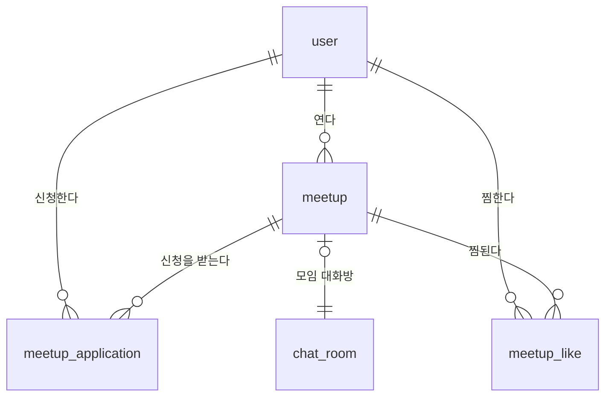

# 모임

모임, 참여 신청, 찜을 저장한다. 명세는 [07 모임](../spec/07-meetup.md)이다. 이름 규칙과 공통 칼럼은 [README](README.md)를 따른다.

## 모임 취소 시 대기 신청을 함께 마감하기

### 기존 설계

모임 취소는 `meetup.canceled_at`을 기록한다. 신청은 한 사람·한 모임당 한 행을 사용하며 기존 상태는 `PENDING`, `WITHDRAWN`, `REJECTED`, `CONFIRMED`, `CANCELED`, `KICKED`였다. 모집 마감 작업은 그때까지 대기 중인 신청을 `REJECTED`로 처리한다.

### 문제와 재현 조건

확정 참여자와 대기 신청자가 있는 모임을 주최자가 취소한다. 모임에만 취소를 표시하면 신청자의 요청이 계속 대기 중으로 집계되거나 이후 모집 마감 작업에서 미승인 알림이 추가로 나갈 수 있다.

### 원인

모임 취소가 대기 신청의 상태 전이로 정의되어 있지 않았다. 기존 `CANCELED`는 참여 확정자가 자기 참여를 취소한 경우에 사용한다.

### 해결 방법

`meetup_application.status VARCHAR(20)`에 종료 상태 `MEETUP_CANCELED`를 추가한다. 기존 `UNIQUE(meetup_id, user_id)`를 유지한다.

| 대상 | 주최자가 모임을 취소할 때 |
| --- | --- |
| `meetup` | `canceled_at`을 기록하고 새 신청과 승인을 차단 |
| `PENDING` 신청 | `MEETUP_CANCELED`로 바꾸고 `status_changed_at` 갱신. 미처리 요청 집계에서 제외. 재신청 불가 |
| `CONFIRMED` 신청 | 참여 기록 유지 |
| 모임 대화방 | 방과 참여 기록 유지. 각 회원은 [채팅 정책](chat.md)에 따라 방에서만 나갈 수 있음 |
| 알림 | 취소 처리 직전의 대기 신청자와 확정 참여자에게 모임 취소 알림만 생성. 해당 상태 전이로 미승인 알림을 만들지 않음 |

모임 행을 먼저 잠근 뒤 취소 자격과 현재 상태를 확인한다. 모임 취소, 신청 상태 변경, 수신자별 서비스 내 알림 생성은 한 트랜잭션에서 처리한다. 승인이나 모집 마감 작업도 같은 모임 행을 잠근 뒤 상태를 다시 확인한다. 취소가 먼저 처리되면 모집 마감 작업은 건너뛴다. 모집 마감이 먼저 처리한 신청은 이미 `REJECTED`이므로 취소로 인한 대기 신청 변경 대상에서 제외한다. 취소를 재시도하면 이미 처리된 결과를 반환한다.

확정 참여자가 없어 모임을 삭제하는 기존 경로에서는 삭제 시점의 대기 신청자에게 모임 삭제 알림을 보낸다. 취소 상태와 구분한다.

기존 데이터에 취소된 모임의 `PENDING` 신청이 남아 있다면 `MEETUP_CANCELED`로 보정하고 `status_changed_at`에는 해당 모임의 취소 시각을 사용한다. 보정 작업에서는 과거 알림을 다시 발송하지 않는다.

### 검증 결과

설계 검토에서 확인했다. 실행 검증에서는 대기·확정·거절된 신청이 각각 있는 모임을 취소하고 상태 변화와 알림 수신자를 확인한다. 취소와 모집 마감 작업을 동시에 실행해 동일 신청에 모임 취소로 인한 종료와 자동 미승인이 중복 적용되지 않는지도 확인한다.

## 일정 임박 알림과 채팅에서의 종료 기준

### 기존 설계

`starts_at`, 선택값인 `ends_at`, 선택값인 `recruit_deadline_at`이 각각 다른 시점을 나타낸다. 모임 상세는 시작 시각이 지나면 지난 모임으로 표시한다.

### 문제와 재현 조건

모집 마감과 모임 시작을 같은 기준으로 사용하면 일정 임박 알림이 잘못 발송될 수 있다. 시작했지만 종료 시각이 남은 모임에서는 상세가 ‘지난 모임’이어도 채팅방만 나갈 수 있는 시각은 아직 오지 않았을 수 있다.

### 원인

모집, 화면 표시, 채팅 퇴장은 서로 다른 시각을 기준으로 한다.

### 해결 방법

| 동작 | 기준 |
| --- | --- |
| 신청 마감과 대기 신청 자동 미승인 | `recruit_deadline_at`이 있으면 그 값, 없으면 `starts_at` |
| 상세의 지난 모임 표시 | `starts_at` 도달 |
| 종료 후 채팅방만 퇴장 | `ends_at`이 있으면 그 값, 없으면 `starts_at`. 모임 취소 시에도 가능 |
| 모임 일정 임박 알림 | 현재 `starts_at`에서 발송 기준 시각을 계산. 세부 정책은 [알림 · 공지](notification.md)에 기록 |

### 검증 결과

설계 검토에서 확인했다. 실행 시에는 시작과 종료 시각이 다른 모임에서 상세의 지난 모임 표시와 채팅 전용 퇴장 조건이 각 시각에 바뀌는지 확인한다.

## 테이블 구조

타입이나 제약을 정하지 않은 항목은 미정으로 표시한다. 복합 제약은 각 표 아래에 적는다.

### `meetup`

주최자가 등록한 모임 정보와 취소·삭제 시각을 보관한다.

| 컬럼 이름 | 타입 | 외래키·기본키 | NULL 허용 여부·UNIQUE 여부·도메인 범위 | 설명 |
| --- | --- | --- | --- | --- |
| `id` | `BIGINT` | PK | NOT NULL, PK로 유일 | 자동 증가 모임 ID |
| `host_id` | `BIGINT` | FK → `user.id` | NOT NULL, 개별 UNIQUE 없음 | 모임 주최자 |
| `category` | `VARCHAR(20)` | — | NOT NULL, 개별 UNIQUE 없음, `HOBBY`(취미/문화), `FOOD`(식사/카페), `STUDY`(스터디/프로젝트), `ETC`(기타), `GAME`(게임), `EXERCISE`(운동) | 모임 카테고리 |
| `title` | `VARCHAR(30)` | — | NOT NULL, 개별 UNIQUE 없음, 최대 30자 | 이름. 검색 대상 |
| `description` | `TEXT` | — | NULL 허용, 개별 UNIQUE 없음, 최대 1,000자 | 소개. 검색 대상 |
| `capacity` | `INT` | — | NOT NULL, 개별 UNIQUE 없음, 2–50명, 주최자 포함 | 모임 정원 |
| `supplies` | `VARCHAR(100)` | — | NULL 허용, 개별 UNIQUE 없음, 최대 100자 | 준비물 안내 |
| `accepts_message` | `BOOLEAN` | — | NOT NULL, 개별 UNIQUE 없음 | 신청 시 주최자에게 남길 말을 받을지 |
| `starts_at` | `DATETIME` | — | NOT NULL, 개별 UNIQUE 없음 | 모임 시작 시각 |
| `ends_at` | `DATETIME` | — | NULL 허용, 개별 UNIQUE 없음, 값이 있으면 `starts_at`보다 뒤 | 모임 종료 시각 |
| `recruit_deadline_at` | `DATETIME` | — | NULL 허용, 개별 UNIQUE 없음, 등록 후 변경 불가 | 모집 마감 시각. NULL이면 시작 시각을 적용 |
| `mode` | `ENUM` | — | NOT NULL, 개별 UNIQUE 없음, `OFFLINE`, `ONLINE` | 만나는 방식 |
| `place` | `VARCHAR(100)` | — | NULL 허용, 개별 UNIQUE 없음, `OFFLINE`일 때 필수, 최대 100자 | 오프라인 장소 |
| `place_detail` | `VARCHAR(100)` | — | NULL 허용, 개별 UNIQUE 없음, 최대 100자 | 오프라인 상세 주소 |
| `join_url` | `VARCHAR(500)` | — | NULL 허용, 개별 UNIQUE 없음, 최대 500자 | 온라인 접속 링크. 접근 권한이 있는 사용자에게 제공 |
| `canceled_at` | `DATETIME` | — | NULL 허용, 개별 UNIQUE 없음 | 주최자가 모임을 취소한 시각 |
| `deleted_at` | `DATETIME` | — | NULL 허용, 개별 UNIQUE 없음 | 주최자가 모임을 삭제한 시각 |
| `created_at` | `DATETIME` | — | NOT NULL, 개별 UNIQUE 없음 | 모임 등록 시각. 최신등록순 정렬 기준 |
| `updated_at` | `DATETIME` | — | NOT NULL, 개별 UNIQUE 없음 | 모임이 마지막으로 갱신된 시각 |

모임 대화방은 등록할 때 같이 만들고 `chat_room.meetup_id`로 연결한다. 취소와 삭제는 각 시각과 위의 상태 전이로 구분한다.

- `join_url`은 참여 확정자에게만 내려준다.
- 모임에 캠퍼스를 두지 않는다. 오프라인 모임이 열리는 곳은 `place`와 `place_detail`에 글로 적고, 캠퍼스로 모임을 거르지 않는다.
- 온라인 플랫폼 이름은 따로 저장하지 않는다. 온라인 모임은 접속 링크만 갖는다.
- 이름·소개·준비물·장소·접속 링크의 글자 수는 명세에 없어 [API 명세](../api/07-meetup.md)를 쓰며 정했다.

### `meetup_application`

사용자별 참여 신청과 그 처리 상태를 저장한다.

| 컬럼 이름 | 타입 | 외래키·기본키 | NULL 허용 여부·UNIQUE 여부·도메인 범위 | 설명 |
| --- | --- | --- | --- | --- |
| `id` | `BIGINT` | PK | NOT NULL, PK로 유일 | 자동 증가 신청 ID |
| `meetup_id` | `BIGINT` | FK → `meetup.id` | NOT NULL, 개별 UNIQUE 없음 | 신청한 모임 |
| `user_id` | `BIGINT` | FK → `user.id` | NOT NULL, 개별 UNIQUE 없음 | 신청자. 주최자는 이 테이블에 넣지 않음 |
| `status` | `ENUM` | — | NOT NULL, 개별 UNIQUE 없음, `PENDING`, `WITHDRAWN`, `REJECTED`, `CONFIRMED`, `CANCELED`, `KICKED`, `MEETUP_CANCELED` | 대기·신청 취소·미승인·확정·참여 취소·내보내짐·모임 취소로 종료 |
| `message` | `VARCHAR(100)` | — | NULL 허용, 개별 UNIQUE 없음, 최대 100자 | 신청 시 주최자에게 남길 말 |
| `created_at` | `DATETIME` | — | NOT NULL, 개별 UNIQUE 없음 | 신청을 기록한 시각 |
| `status_changed_at` | `DATETIME` | — | NOT NULL, 개별 UNIQUE 없음 | 가장 최근 상태 변경 시각 |

복합 UNIQUE는 `UNIQUE(meetup_id, user_id)`다. 기존 신청 행이 `WITHDRAWN`이면 다시 신청할 때 그 행을 `PENDING`으로 되돌린다. 모집 마감 및 탈퇴 시 상태 전이는 위의 설계를 따른다. 탈퇴자의 예정 모임에서는 대기 신청을 `WITHDRAWN`, 확정 신청을 `CANCELED`로 바꾼다.

- 신청 행이 없거나 `WITHDRAWN`일 때만 신청할 수 있다. `REJECTED`, `CANCELED`, `KICKED`, `MEETUP_CANCELED`에서는 다시 신청할 수 없다.
- 모집 마감 시각(없으면 시작 시각)에 남은 `PENDING`을 실제로 `REJECTED`로 바꾸고 알림을 보낸다. 취소·삭제된 모임은 제외하며, 예약 작업의 실행 방법은 구현 단계에서 정한다.

### `meetup_like`

찜한 모임과 사용자별 빈자리 알림 설정을 저장한다.

| 컬럼 이름 | 타입 | 외래키·기본키 | NULL 허용 여부·UNIQUE 여부·도메인 범위 | 설명 |
| --- | --- | --- | --- | --- |
| `meetup_id` | `BIGINT` | 복합 PK, FK → `meetup.id` | NOT NULL, 개별 UNIQUE 없음 | 찜한 모임 |
| `user_id` | `BIGINT` | 복합 PK, FK → `user.id` | NOT NULL, 개별 UNIQUE 없음 | 모임을 찜한 사용자 |
| `vacancy_alert` | `BOOLEAN` | — | NOT NULL, 개별 UNIQUE 없음 | 이 모임에서 빈자리 알림을 받을지 |
| `created_at` | `DATETIME` | — | NOT NULL, 개별 UNIQUE 없음 | 찜한 시각 |
| `updated_at` | `DATETIME` | — | NOT NULL, 개별 UNIQUE 없음 | 행이 마지막으로 바뀐 시각 |

복합 기본키는 `PK(meetup_id, user_id)`다. 찜 해제 또는 사용자 탈퇴 시 해당 찜 행을 삭제한다.

## 저장하지 않는 것

### 계산해서 내려주는 값

| 값 | 원본 테이블과 컬럼 | 계산 방법 |
| --- | --- | --- |
| 유효 모집 마감과 채팅 퇴장 시각 | `meetup.recruit_deadline_at`, `meetup.starts_at`, `meetup.ends_at`, `meetup.canceled_at` | 모집 마감은 `COALESCE(recruit_deadline_at, starts_at)`이다. 모임 종료 후 방에서만 나갈 수 있는 시점은 `COALESCE(ends_at, starts_at)`이며 취소되면 취소 시각부터 가능하다. |
| 확정 인원과 남은 자리 | `meetup.id`, `meetup.host_id`, `meetup.capacity`, `meetup_application.meetup_id`, `meetup_application.status` | 주최자 1명에 해당 모임의 `CONFIRMED` 신청 수를 더한다. 정원에서 확정 인원을 빼면 남은 자리다. |
| 모집 상태 배지 | `meetup.deleted_at`, `meetup.canceled_at`, `meetup.starts_at`, `meetup.recruit_deadline_at`, `meetup.capacity`, `meetup_application.status` | 삭제된 모임은 목록에서 제외한다. 나머지는 취소됨 → 시작 시각에 도달했으면 지난 모임 → 정원이 찼거나 유효 모집 마감을 지났으면 모집 완료 → 그 외 모집 중 순으로 판단한다. |
| 찜 수와 인기순 | `meetup_like.meetup_id` | 모임별 찜 행을 센다. 인기순에서는 찜 개수가 많은 모임이 먼저이며 목록에서는 모집 완료 모임을 뒤에 둔다. |
| 대기 신청 수와 모임 참여 요청 배지 | `meetup_application.meetup_id`, `meetup_application.status`, `meetup.host_id`, `meetup.deleted_at`, `meetup.canceled_at`, `meetup.recruit_deadline_at`, `meetup.starts_at` | 모집 마감 전의 취소·삭제되지 않은 모임에서 `PENDING`을 센다. 모임별 숫자는 해당 모임만, 알림 팝업 숫자는 현재 사용자가 주최한 모임 전체를 집계한다. |
| 보는 사람의 상태와 재신청 가능 여부 | `meetup.host_id`, `meetup.canceled_at`, `meetup.deleted_at`, `meetup.starts_at`, `meetup.recruit_deadline_at`, `meetup.capacity`, `meetup_application.user_id`, `meetup_application.status` | 주최 여부를 먼저 확인하고 나머지는 신청 상태를 매핑한다. 신청 행이 없거나 `WITHDRAWN`이면 미신청으로 표시한다. 이 두 경우에만 모집 중이고 빈자리가 있을 때 신청할 수 있다. |
| 내 모임 탭과 건수 | `meetup.host_id`, `meetup.starts_at`, `meetup.canceled_at`, `meetup.deleted_at`, `meetup_application.user_id`, `meetup_application.status`, `meetup_like.user_id`, `meetup_like.meetup_id` | 시작 전이고 취소되지 않은 모임 가운데 내가 주최했거나 확정된 모임은 다가오는 모임, 대기·미승인 신청은 신청 대기, 주최한 모임은 내가 연 모임, 찜한 모임은 찜한 모임 탭에 둔다. 시작이 지났거나 취소된 주최·확정 모임은 지난 모임으로 본다. 대기 중에 취소된 모임(`MEETUP_CANCELED`)은 어느 탭에도 두지 않는다. 삭제된 모임을 제외하고 탭마다 서로 다른 모임 ID를 센다. |
| 캘린더와 이번 달 요약 | `meetup.starts_at`, `meetup.category`, `meetup.host_id`, `meetup.deleted_at`, `meetup.canceled_at`, `meetup_application.user_id`, `meetup_application.status` | 선택 월의 `starts_at`을 날짜별로 묶는다. 삭제·취소된 모임은 제외하고 지난 모임은 포함한다. 내 모임 보기에는 주최·확정·대기 모임만 두고, 요약은 보기와 관계없이 해당 월의 확정·대기·주최 모임 ID를 상태별로 센다. |
| D-day 및 날짜 필터 | `meetup.starts_at`과 서비스 기준 날짜 | 시작 날짜에서 오늘 날짜를 빼 D-day를 구한다. 오늘은 같은 날짜, 이번 주는 오늘부터 일요일까지, 이번 주말은 해당 주의 토·일로 거른다. |
| 관심사가 겹치는 참여자 수 | `meetup.host_id`, `meetup_application.user_id`, `meetup_application.status`, `user_interest.user_id`, `user_interest.interest_id` | 주최자와 `CONFIRMED` 신청자를 합치고 현재 사용자는 제외한다. 내 관심사와 같은 `interest_id`가 하나 이상 있는 참여자 ID를 중복 없이 센다. |
| 빈자리 알림 대상 | `meetup.capacity`, `meetup.canceled_at`, `meetup.deleted_at`, `meetup.recruit_deadline_at`, `meetup.starts_at`, `meetup_application.status`, `meetup_like.vacancy_alert`, `meetup_like.user_id` | 모집 마감 전에 정원이 찬 상태에서 자리가 생겼는지 확인한다. 해당 모임에 `vacancy_alert`를 켠 사용자를 발송 후보로 삼고 알림 설정을 적용한다. |

### 프론트엔드가 관리하는 것

- 모임 대표 이미지(표지판 그림), 카테고리별 카드 색과 캘린더 라벨 색
- 만들기 화면의 미리보기 카드, 행동 카드와 팝업의 안내 문구
- 검색어, 필터 · 정렬 선택, "N개씩 보기", 페이지 번호

## 명세에 없어 구현 단계로 넘기는 것

- 일정 임박의 발송 시점과 내 모임 ‘확인 필요’ 알림의 새 항목 기준
