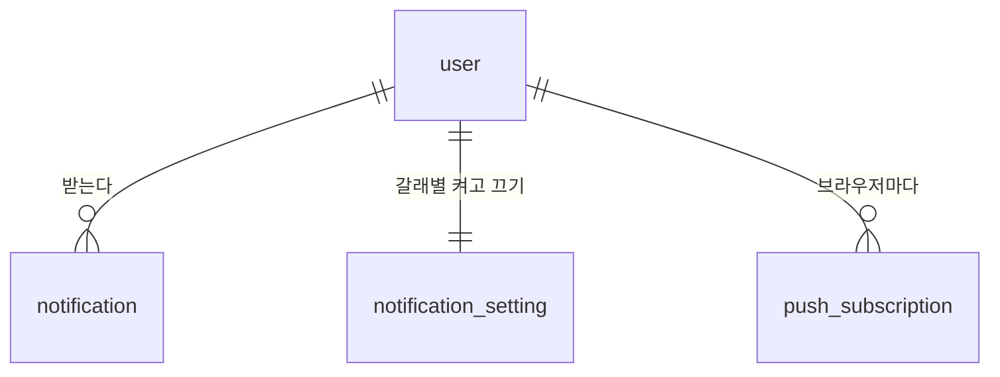

# 알림 · 공지

알림, 알림 설정, 브라우저 푸시, 공지사항을 저장한다. 명세는 [09 알림](../spec/09-notification.md), [10 설정 · 계정](../spec/10-settings.md), [00 공통 2](../spec/00-common.md)다. 이름 규칙과 공통 칼럼은 [README](README.md)를 따른다.

## 알림을 꺼도 미처리 요청 배지 유지하기

### 기존 설계

`notification_setting`에서 종류별 알림을 끌 수 있다. 알림 팝업의 요청 건수는 `meetup_application`과 `chat_request`에서 계산한다.

### 문제와 재현 조건

모임 또는 채팅 알림을 끈 사용자에게 요청이 도착한다. 화면이 알림 행이나 같은 알림 설정을 기준으로 요청 건수를 조회하면, 처리할 요청이 있는데도 배지가 숨겨진다.

### 원인

알림은 사건을 알리는 기록이고, 요청 배지는 아직 처리해야 하는 업무의 개수다.

### 해결 방법

| 화면 또는 동작 | 기준 |
| --- | --- |
| 모임 참여 요청 배지 | 내가 주최한 취소·삭제되지 않은 모임에서 유효 모집 마감 전인 `PENDING` 신청 |
| 채팅 요청 배지 | 내가 받은 유효 기간 내 `PENDING` 요청. [채팅 만료 규칙](chat.md) 적용 |
| 새 서비스 내 알림과 브라우저 푸시 | 종류별 설정을 적용. 푸시는 브라우저 권한과 구독 상태도 확인 |
| GNB 빨간 점 | 보관 기간 내 안 읽은 알림 중 현재 켜진 종류가 있는지 확인 |

요청 두 줄은 항상 표시하고 건수가 있는 경우에만 배지를 그린다. ‘모두 읽음’은 알림의 `read_at`에만 영향을 준다. 모임 취소는 [모임 상태 전이](meetup.md)에 따라 대기 신청 건수에 반영한다.

### 검증 결과

설계 검토에서 확인했다. 실행 시에는 모임·채팅 알림을 끈 계정으로 새 요청을 받아 배지에만 반영되는지, ‘모두 읽음’ 후에도 배지가 남는지, 요청 처리 또는 만료 뒤에는 건수가 줄어드는지 확인한다.

## 모임 일정 임박과 댓글 가려짐 알림 추가하기

### 기존 설계

`notification`은 알림 종류와 이동 대상, 선택적인 행위자, 읽음·생성 시각을 저장한다. 일정 임박은 발송 시점·대상이 정의되지 않았고, 가려진 댓글은 글과 같은 신고 규칙을 따르지만 알림 종류가 없었다.

### 문제와 재현 조건

모임 시작이 가까워지거나 댓글이 가려져도 해당 사건에 사용할 알림 종류와 이동 대상이 일관되게 정의되어 있지 않다. 일정 작업이 재시도되면 같은 회차의 알림이 중복 생성될 수 있다.

### 원인

저장 가능한 알림의 구조는 있었지만 사건별 발송 조건과 중복 방지 기준이 없었다.

### 해결 방법

| 새로 정의하는 `notification.type` | 이동 대상 | 생성 기준 |
| --- | --- | --- |
| `MEETUP_START_REMINDER` | `MEETUP`과 모임 ID | 모임의 현재 `starts_at`가 발송 조건에 도달할 때. 취소·삭제·이미 시작한 모임은 제외 |
| `COMMENT_HIDDEN` | `POST`와 해당 댓글의 글 ID | 댓글이 `PUBLIC`에서 `HIDDEN`으로 전환될 때 댓글 작성자에게 생성. `actor_id`는 비움 |

댓글 가려짐은 기존 커뮤니티 갈래, 일정 임박은 기존 모임 갈래를 사용한다. 댓글 알림은 기존 글 상세 경로로 이동한다. 방노트 알림은 보류한다. 모임 일정 임박은 모임 시작 기준이며 모집 마감 알림과 구분한다.

일정 작업의 재시도를 위해 `notification.event_key VARCHAR(191) NULL`과 `UNIQUE(user_id, event_key)`를 추가한다. 일정 알림은 같은 모임의 같은 시작 시각, 같은 회차(24시간 전 · 1시간 전)를 같은 사건으로 식별한다. 기존 행은 키 없이 유지한다. 작업은 저장 직전에 모임의 현재 시작 시각과 취소·삭제 상태를 다시 확인하고, 같은 수신자의 사건 키가 이미 있으면 삽입과 푸시 발송을 건너뛴다. 모임이 시작되면 새 알림을 생성하지 않는다.

**발송 정책**: 시작 24시간 전과 1시간 전에 한 번씩 보낸다. 주최자와 확정 참여자가 받는다. 보낼 때가 지난 뒤에 확정된 사람에게는 그 회차를 보내지 않는다. 시작 시각이 바뀌면 바뀐 시각을 기준으로 다시 보낸다.

### 검증 결과

설계 검토에서 확인했다. 실행 시에는 같은 수신자에 대한 일정 작업 동시 실행이 한 알림만 생성하는지, 취소나 수정 이후 이전 일정 작업을 재시도해도 잘못 발송되지 않는지 확인한다. 댓글 신고가 임계치에 도달하면 작성자에게만 알림이 생기고, 이후 신고에서는 중복 발송되지 않아야 한다.

## 테이블 구조

타입이나 제약을 정하지 않은 항목은 미정으로 표시한다. 복합 제약은 각 표 아래에 적는다.

### `notification`

수신자별 알림 사건, 이동 대상과 읽음 상태를 보관한다.

| 컬럼 이름 | 타입 | 외래키·기본키 | NULL 허용 여부·UNIQUE 여부·도메인 범위 | 설명 |
| --- | --- | --- | --- | --- |
| `id` | `BIGINT` | PK | NOT NULL, PK로 유일 | 자동 증가 알림 ID |
| `user_id` | `BIGINT` | FK → `user.id` | NOT NULL, 개별 UNIQUE 없음 | 알림을 받는 사용자 |
| `type` | `ENUM` | — | NOT NULL, 개별 UNIQUE 없음, [알림 유형과 대상](#알림-유형과-대상)의 22가지 코드 | 알림 문구와 분류를 결정하는 종류 코드 |
| `target_type` | `ENUM` | — | NOT NULL, 개별 UNIQUE 없음, `MEETUP`, `CHAT_ROOM`, `CHAT_REQUEST`, `POST`, `GUESTBOOK`, `BURROW`, `NOTICE` | 알림을 눌렀을 때 이동할 대상의 종류 |
| `target_id` | `BIGINT` | 종류별 논리 참조 | NULL 허용, 개별 UNIQUE 없음, `GUESTBOOK`에서는 NULL | 이동 대상 ID. 방명록은 수신자 자신의 땅굴로 이동. `BURROW`는 땅굴 주인의 `user.id` |
| `actor_id` | `BIGINT` | FK → `user.id` | NULL 허용, 개별 UNIQUE 없음 | 알림 사건을 일으킨 사용자. 시스템 알림 또는 신고자 보호가 필요한 알림에서는 비움 |
| `read_at` | `DATETIME` | — | NULL 허용, 개별 UNIQUE 없음 | 읽은 시각. NULL이면 안 읽음 |
| `created_at` | `DATETIME` | — | NOT NULL, 개별 UNIQUE 없음 | 알림이 생긴 시각. 최신순 정렬과 30일 만료의 기준 |
| `event_key` | `VARCHAR(191)` | — | NULL 허용, 개별 UNIQUE 없음 | 같은 수신자에게 동일 사건을 재처리할 때 쓰는 키. 일정 임박은 회차마다(`MEETUP_START_REMINDER:<모임 id>:<시작 시각 epoch 초>:<24H\|1H>`), 새 메시지는 안 읽은 동안 대화방마다(`CHAT_MESSAGE_RECEIVED:<대화방 id>`, 읽으면 비움) |

복합 UNIQUE는 `UNIQUE(user_id, event_key)`다. 일정 임박 알림은 동일 모임, 동일 시작 시각, 동일 회차(24시간 전 · 1시간 전)를 같은 사건으로 본다. 새 메시지 알림도 같은 키로 대화방마다 안 읽은 줄 하나를 지킨다(동시에 메시지가 와도 줄이 늘지 않는다). 대상이 먼저 사라져도 알림은 보관 기간 동안 남는다.

인덱스는 `(user_id, created_at, id)`(목록 · 수 · 읽음)와 `(created_at)`(30일 정리)이다.

- 제목과 보조 설명은 저장하지 않고 `type`, 대상, `actor_id`에서 만든다.
- 알림은 지울 수 없고 읽음 처리만 한다. 30일이 지난 알림은 조회에서 빼고, 매일 04:00(한국 시간) 예약 작업이 1,000줄씩 지운다.
- 탈퇴한 사용자가 받은 알림은 탈퇴할 때 지운다. 탈퇴한 사용자가 일으킨 알림(`actor_id`)은 남기고 일으킨 사람을 “탈퇴한 사용자”로 보여준다.
- 원본이 삭제되거나 표시할 수 없으면 알림을 누를 때 안내 화면으로 보낸다.
- 설정에서 끈 갈래의 새 알림은 생성하지 않는다.
- 새 메시지 알림은 대화방마다 안 읽은 알림 한 줄만 둔다. 이미 있으면 새로 만들지 않고 `created_at`과 `actor_id`를 새 메시지에 맞춰 바꾼다. 수신자가 그 대화방을 읽으면 `read_at`을 채우고 `event_key`를 비운다.
- 일으킨 사람을 드러내지 않는 종류(거절 · 내보내기 · 모임 수정 · 취소 · 삭제 · 빈자리 · 일정 임박, 신고로 가려짐, 공지)는 `actor_id`를 비운다.

### `notification_setting`

사용자의 분류별 알림 설정을 관리한다. 줄이 없는 계정은 모두 켜진 것으로 본다. 브라우저 푸시는 브라우저마다 켜고 끄므로 이 테이블에 두지 않고 [`push_subscription`](#push_subscription)에 줄이 있는지로 안다.

| 컬럼 이름 | 타입 | 외래키·기본키 | NULL 허용 여부·UNIQUE 여부·도메인 범위 | 설명 |
| --- | --- | --- | --- | --- |
| `user_id` | `BIGINT` | PK, FK → `user.id` | NOT NULL, PK로 유일 | 알림 설정의 소유자 |
| `meetup_on` | `BOOLEAN` | — | NOT NULL, `DEFAULT TRUE`, 개별 UNIQUE 없음 | 모임 알림 수신 여부. 기본 켜짐 |
| `chat_on` | `BOOLEAN` | — | NOT NULL, `DEFAULT TRUE`, 개별 UNIQUE 없음 | 채팅 알림 수신 여부. 기본 켜짐 |
| `community_on` | `BOOLEAN` | — | NOT NULL, `DEFAULT TRUE`, 개별 UNIQUE 없음 | 커뮤니티 알림 수신 여부. 기본 켜짐 |
| `burrow_on` | `BOOLEAN` | — | NOT NULL, `DEFAULT TRUE`, 개별 UNIQUE 없음 | 땅굴 알림 수신 여부. 기본 켜짐 |
| `notice_on` | `BOOLEAN` | — | NOT NULL, `DEFAULT TRUE`, 개별 UNIQUE 없음 | 공지 알림 수신 여부. 기본 켜짐 |
| `created_at` | `DATETIME` | — | NOT NULL, 개별 UNIQUE 없음 | 행이 만들어진 시각 |
| `updated_at` | `DATETIME` | — | NOT NULL, 개별 UNIQUE 없음 | 행이 마지막으로 바뀐 시각 |

### `push_subscription`

브라우저 푸시를 보낼 구독 정보를 보관한다.

| 컬럼 이름 | 타입 | 외래키·기본키 | NULL 허용 여부·UNIQUE 여부·도메인 범위 | 설명 |
| --- | --- | --- | --- | --- |
| `id` | `BIGINT` | PK | NOT NULL, PK로 유일 | 자동 증가 구독 ID |
| `user_id` | `BIGINT` | FK → `user.id` | NOT NULL, 개별 UNIQUE 없음(색인 있음) | 구독을 등록한 사용자 |
| `endpoint` | `VARCHAR(2000)`, ASCII(`ascii_bin`) | — | NOT NULL, UNIQUE | 브라우저가 준 푸시 수신 주소. 대소문자를 구분해 비교한다 |
| `p256dh` | `VARCHAR(255)`, ASCII(`ascii_bin`) | — | NOT NULL, 개별 UNIQUE 없음 | 브라우저의 공개 키(base64url). 푸시 내용을 암호화할 때 쓴다 |
| `auth` | `VARCHAR(255)`, ASCII(`ascii_bin`) | — | NOT NULL, 개별 UNIQUE 없음 | 브라우저의 인증 값(base64url). 푸시 내용을 암호화할 때 쓴다 |
| `created_at` | `DATETIME` | — | NOT NULL, 개별 UNIQUE 없음 | 구독이 등록된 시각 |

“브라우저 알림 받기”를 켠 브라우저마다 한 줄이다. 사용자는 여러 브라우저에서 구독할 수 있다. 끄면 그 브라우저의 줄만 지운다. 브라우저 하나는 한 계정의 푸시만 받는다. 이미 있는 `endpoint`를 다른 계정이 등록하면 새 줄을 넣지 않고 그 줄의 `user_id`와 키를 바꾼다. 인덱스는 `UNIQUE(endpoint)`와 `(user_id)`(그 사람의 모든 브라우저 찾기)다.

KAN-59에서 정했다. 푸시 주소는 영문 URL이라 ASCII로 두면 2,000자에도 UNIQUE 색인을 걸 수 있다(색인 한도 3,072바이트). 주소와 키는 대소문자에 뜻이 있어 대소문자를 가리는 `ascii_bin`으로 비교한다. 키 두 개를 한 칸에 JSON으로 넣지 않고(`push_keys`) 칸을 나눠, 길이 검사와 읽기를 쉽게 했다. 푸시 서비스가 “없는 구독”(`404`, `410`)이라고 답하면 그 줄을 지운다([설정 · 계정 API](../api/10-settings.md#브라우저-푸시)).

### `notice`

운영자가 등록한 공지사항을 저장한다.

| 컬럼 이름 | 타입 | 외래키·기본키 | NULL 허용 여부·UNIQUE 여부·도메인 범위 | 설명 |
| --- | --- | --- | --- | --- |
| `id` | `BIGINT` | PK | NOT NULL, PK로 유일 | 자동 증가 공지 ID |
| `category` | `ENUM` | — | NOT NULL, 개별 UNIQUE 없음, `NOTICE`, `UPDATE`, `EVENT` | 일반 공지·업데이트·이벤트 구분 |
| `title` | `VARCHAR(100)` | — | NOT NULL, 개별 UNIQUE 없음 | 공지 제목. 100자는 KAN-58에서 정했다. 관리자 API(11)가 입력을 이 길이에 맞춰 검사한다 |
| `content` | `TEXT` | — | NOT NULL, 개별 UNIQUE 없음 | 공지 본문 |
| `created_at` | `DATETIME` | — | NOT NULL, 개별 UNIQUE 없음 | 공지 게시 시각. 최신순 정렬 기준 |
| `updated_at` | `DATETIME` | — | NOT NULL, 개별 UNIQUE 없음 | 행이 마지막으로 바뀐 시각 |
| `deleted_at` | `DATETIME` | — | NULL 허용, 개별 UNIQUE 없음 | 삭제한 시각. NULL이면 삭제되지 않음 |

관리자가 올리며 읽기만 한다(댓글 · 좋아요 없음).

### 알림 유형과 대상

| 갈래 | `type` | 사건 | 받는 사람 | 이동 대상 |
| --- | --- | --- | --- | --- |
| 모임 | `MEETUP_APPLICATION_RECEIVED` | 참여 신청 받음 | 주최자 | `MEETUP` |
| 모임 | `MEETUP_APPLICATION_ACCEPTED` | 신청 수락 | 해당 신청자 | `MEETUP` |
| 모임 | `MEETUP_APPLICATION_REJECTED` | 신청 미승인(거절 · 자동) | 해당 신청자 | `MEETUP` |
| 모임 | `MEETUP_PARTICIPATION_CANCELED` | 참여 취소 | 주최자 | `MEETUP` |
| 모임 | `MEETUP_KICKED` | 내보내짐 | 해당 참여자 | `MEETUP` |
| 모임 | `MEETUP_UPDATED` | 모임 정보 수정 | 해당 신청자와 참여자 | `MEETUP` |
| 모임 | `MEETUP_CANCELED` | 모임 취소 | 해당 신청자와 참여자 | `MEETUP` |
| 모임 | `MEETUP_DELETED` | 모임 삭제 | 신청 대기자 | `MEETUP` |
| 모임 | `MEETUP_VACANCY_OPENED` | 빈자리 생김 | 해당 모임의 빈자리 알림을 켠 사용자 | `MEETUP` |
| 모임 | `MEETUP_START_REMINDER` | 일정 임박(시작 24시간 전 · 1시간 전) | 주최자와 확정 참여자 | `MEETUP` |
| 채팅 | `CHAT_MESSAGE_RECEIVED` | 새 메시지. 대화방마다 한 줄 | 채팅방의 나가지 않은 다른 참여자 | `CHAT_ROOM` |
| 채팅 | `CHAT_REQUEST_RECEIVED` | 대화 요청 | 요청을 받은 사용자 | `CHAT_REQUEST` |
| 채팅 | `CHAT_REQUEST_ACCEPTED` | 대화 요청 수락 | 요청을 보낸 사용자 | `CHAT_ROOM` |
| 커뮤니티 | `POST_COMMENTED` | 글에 댓글 | 글 작성자 | `POST` |
| 커뮤니티 | `POST_LIKED` | 글 좋아요 | 글 작성자 | `POST` |
| 커뮤니티 | `COMMENT_REPLIED` | 댓글 답글 | 답한 대상인 댓글 또는 답글의 작성자 | `POST` |
| 커뮤니티 | `COMMENT_LIKED` | 댓글·답글 좋아요 | 해당 댓글 또는 답글의 작성자 | `POST` |
| 커뮤니티 | `POST_HIDDEN` | 글 가려짐 | 글 작성자 | `POST` |
| 커뮤니티 | `COMMENT_HIDDEN` | 댓글 가려짐 | 해당 댓글 또는 답글의 작성자 | `POST` |
| 땅굴 | `GUESTBOOK_ENTRY_CREATED` | 방명록 새 글 | 땅굴 주인 | `GUESTBOOK` |
| 땅굴 | `GUESTBOOK_ENTRY_HIDDEN` | 방명록 글 가려짐 | 방명록 글 작성자 | `BURROW`(그 글을 썼던 땅굴) |
| 공지 | `NOTICE_PUBLISHED` | 서비스 공지 | 대상 사용자 전체 | `NOTICE` |

방노트 알림은 보류한다. 코드는 [API 명세](../api/09-notification.md#알림의-종류)를 쓰며 정했다.

## 저장하지 않는 것

### 계산해서 내려주는 값

| 값 | 원본 테이블과 컬럼 | 계산 방법 |
| --- | --- | --- |
| 알림 문구와 이동 대상 | `notification.type`, `notification.target_type`, `notification.target_id`, `notification.actor_id`, `user.status`, `user_profile.nickname`, `meetup.title`, `post_version.title`, `notice.title` | 종류에 맞는 문구에 대상 제목과 행위자 표시를 채운다. 이동 경로는 대상 종류와 ID로 결정하며, 방명록은 수신자의 땅굴로 보낸다. 원본이 없거나 표시할 수 없으면 대상 없음 안내를 연다. |
| 알림 분류와 수신 설정 | `notification.type`, `notification_setting.meetup_on`, `notification_setting.chat_on`, `notification_setting.community_on`, `notification_setting.burrow_on`, `notification_setting.notice_on` | 사건별 알림 유형을 다섯 갈래로 매핑한다. 수신자의 해당 스위치를 확인해 새 알림 생성 여부를 정한다. |
| 안 읽은 알림 수와 GNB 빨간 점 | `notification.user_id`, `notification.read_at`, `notification.created_at`, `notification.type`, `notification_setting.meetup_on`, `notification_setting.chat_on`, `notification_setting.community_on`, `notification_setting.burrow_on`, `notification_setting.notice_on` | 수신자의 30일 이내 알림 중 `read_at IS NULL`인 행을 세어 안 읽은 수를 구한다. GNB에는 그중 현재 켜진 분류가 하나라도 있을 때 빨간 점을 그린다. |
| 팝업 최근 알림과 전체 목록 | `notification.user_id`, `notification.type`, `notification.read_at`, `notification.created_at` | 수신자의 30일 이내 알림을 안 읽음 먼저, 생성 시각 내림차순으로 정렬한다. 팝업은 모임 참여 신청·대화 요청 알림 유형을 제외하고 5개를 읽는다. 전체 목록은 요청 알림을 포함하고 선택한 분류를 적용한다. |
| 모임 참여 요청 배지 | `meetup.host_id`, `meetup.canceled_at`, `meetup.deleted_at`, `meetup.starts_at`, `meetup.recruit_deadline_at`, `meetup_application.meetup_id`, `meetup_application.status` | 수신자가 주최한 모임 중 취소·삭제되지 않았고 모집 마감 전인 모임의 `PENDING` 신청 수를 센다. 알림을 꺼도 계산한다. |
| 대화 요청 배지 | `chat_request.receiver_id`, `chat_request.status`, `chat_request.created_at` | 현재 사용자에게 온 `PENDING` 중 발송 후 5일이 지나지 않은 요청을 센다. 알림 읽음 처리와 분류 설정은 배지에 영향을 주지 않는다. |
| 모임 일정 임박 발송 후보 | `meetup.starts_at`, `meetup.canceled_at`, `meetup.deleted_at`, `notification.user_id`, `notification.event_key` | 정해진 발송 간격을 현재 시작 시각에 적용한다. 취소·삭제·이미 시작한 모임을 빼고 수신 정책의 사용자에게 발송한다. 같은 모임·시작 시각·수신자에 대한 기존 알림이 있으면 건너뛴다. |
| 공지사항 전체 건수와 최신순 | `notice.id`, `notice.created_at` | 공지 행을 `COUNT(*)`로 세고 목록은 게시 시각 내림차순으로 조회한다. |

### 프론트엔드가 관리하는 것

- 종류별 아이콘과 색, 읽지 않음 점, 빈 상태 문구("새 알림이 없어요")

## 명세에 없어 구현 단계로 넘기는 것

- 서비스 공지의 일괄 발송 방식(브라우저 푸시 키 저장 형식은 KAN-59에서 정했다)
- 일정 임박 알림을 보내는 예약 작업의 실행 방법(30일 정리는 KAN-54에서 매일 04:00으로 정했다)
- 방노트 알림의 정의와 제공 여부(남은 검토 항목 56)
