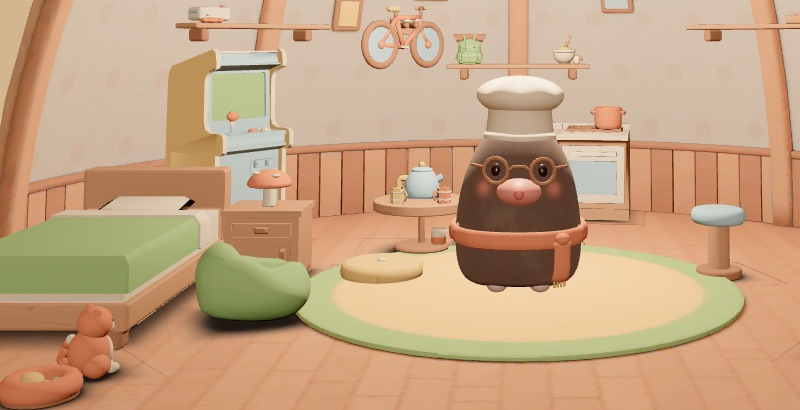
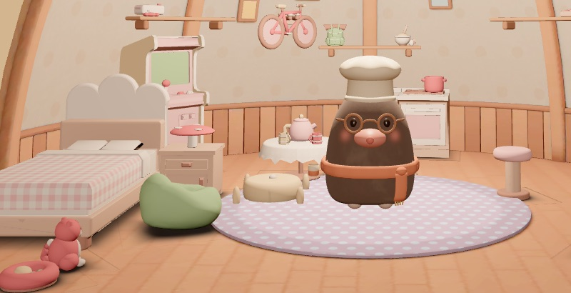
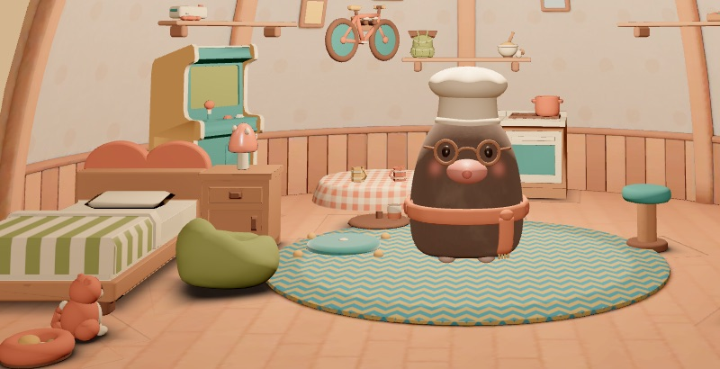
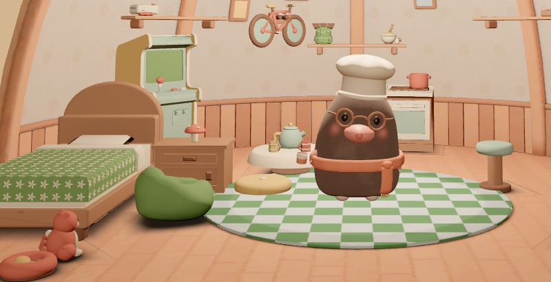
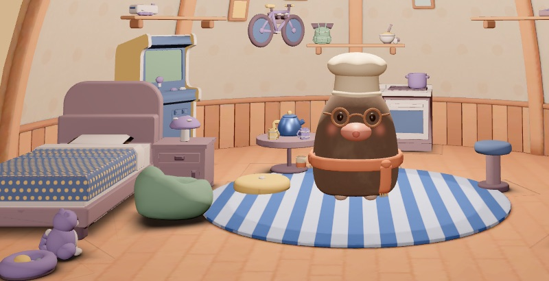
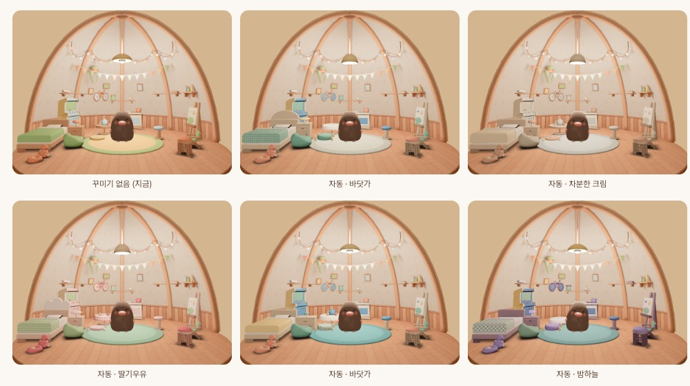
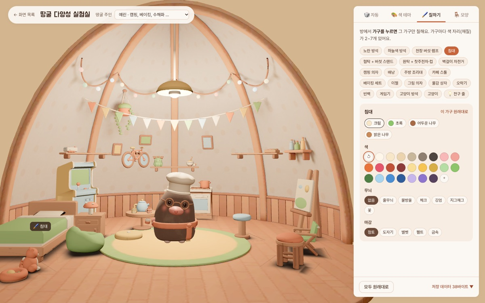

# 땅굴 다양성 실험: 같은 가구, 다른 땅굴 (2026-11-16)

> 2026-11-18: 이 실험의 자동 꾸미기를 **대분류 12개 색 묶음 + 껍데기(벽 · 바닥 · 나무) 칠하기**로 넓혀 앱 기본값으로 켬 → [room-diversity-2-2026-11-18.md](room-diversity-2-2026-11-18.md). 자동 꾸미기는 이제 도자기 · 금속 마감을 안 씀(저사양)

## 요청
> 땅굴의 다양성을 높여 보는 작업. 비슷한 가구를 가지고 있더라도 서로 다르게 디자인할 수 있고, 색칠할 수 있으면 좋겠어. 땅굴들이 너무 똑같아 보일 수 있으니까. 한번 다양하게 실험해 보고 알려줘

## 결론
- **새 모델 없이 꽤 많이 달라짐.** 디자이너 가구 glb는 모두 같은 팔레트 재질 8개(크림·초록·주황·하늘·노랑·밝은 나무·어두운 나무·돌)를 단색으로 쓰고, 음영(AO)은 텍스처로 따로 구워 둠. 그래서 **재질 색만 바꿔도 점토 음영이 그대로 남음**. 칠하기 비용이 거의 없는 구조
- 실험한 5가지: ① 방 색 테마(8자리 한꺼번에) ② 가구 칠하기(가구마다 색 자리 2~7개) ③ 무늬 6종·마감 5종 ④ 기본 가구 모양(크기, 머리판, 버섯 갓, 테이블보, 방석 술 등) ⑤ **자동 꾸미기(씨앗)**: 아무것도 안 꾸민 땅굴도 집마다 다르게
- 가장 효과가 큰 것은 **러그 + 색 테마 + 이불 무늬**. 화면에서 차지하는 면적이 커서, 섬네일로 봐도 다른 집으로 보임. 버섯 갓·방석 술 같은 모양 변형은 가까이서 볼 때 재미를 줌
- 저장 데이터는 JSON 40~500바이트(프로필에 `room_style`로 넣으면 됨)
- **추천**: 가입할 때 자동 꾸미기(씨앗 = 사용자 id)로 시작하고, 꾸미기 모드에 "칠하기" 탭을 붙임. 모양을 더 다양하게 하려면 디자이너에게 가구별 변형 모델을 요청(아래 "다음 단계")

## 실험실
- 경로 `/lab/style` (화면 목록 `/screens`의 땅굴 묶음에도 있음). `npm run dev` 후 열기
- 탭 4개: 🎲 자동 / 🎨 색 테마(+러그, 벽지 비교) / 🖌 칠하기(방에서 가구를 누름 → 색 자리 → 색·무늬·마감) / 🪑 모양
- 아래 "저장 데이터 N바이트"를 누르면 서버에 저장할 JSON이 보임
- "같은 관심사 땅굴 6개 나란히 보기": 같은 관심사(= 같은 가구)로 꾸미기 없음 1개 + 자동 5개를 한 장씩 그려서 비교

| 꾸미기 없음 (지금) | 봄 파스텔·딸기우유 |
|---|---|
|  |  |
| **레트로** | **숲속** |
|  |  |
| **밤하늘** | |
|  | |

- 딸기우유: 깅엄 이불, 구름 머리판, 베개 둘, 납작 표고 갓, 레이스 테이블보, 두툼한 방석 + 술, 물방울 러그
- 레트로: 줄무늬 이불, 봉긋 머리판, 낮은 침대, 높은 협탁 + 고깔 갓(도자기 마감), 깅엄 테이블보·넓은 상판·컵만, 청록 벨벳 납작 방석 + 술, 지그재그 러그
- 숲속: 꽃무늬 이불, 아치 머리판, 넓은 협탁 + 아기 버섯, 좌식 테이블 + 민무늬 테이블보, 체크 러그
- 밤하늘: 남색 물방울 이불, 둥근 머리판, 금속 찻주전자, 줄무늬 러그

같은 관심사 6집 (자동):

칠하기 (침대를 누른 상태):

## 어떻게 했나
- 데이터 `app/src/data/roomStyle.ts` (three.js 없음): 저장 모양 `RoomStyle`, 테마 9개, 견본 24색 + 나무색 8개, 무늬·마감·모양 목록, `autoStyle(seed)`
- 3D `app/src/three/roomStyle.ts` `createStyler(renderer)`
  - **색**: 메시의 재질 이름 `M_<자리>` → 가구마다 재질을 복제해서 색만 바꿈. glb 재질은 장면끼리 공유(캐시)라 원본은 안 건드림. 전구 줄(`M_bulb_*`)도 테마를 따라감
  - **무늬**: `onBeforeCompile`로 색 단계 뒤에 삼면 투영(triplanar) 무늬를 섞음. UV는 AO 아틀라스용이라 못 씀 → 좌표는 **가구 기준(m)**, 그래서 회전한 가구에서도 결이 가구를 따라감. 떨어지는 동안에는 프레임마다 기준을 갱신. 미분(fwidth)으로 가장자리를 부드럽게
  - **마감**: 점토(원래 Standard) / 도자기(clearcoat) / 금속(metalness) / 벨벳·펠트(sheen). 도자기·금속은 방 환경맵(`RoomEnvironment` PMREM)을 그 재질에만 씀 → 다른 가구·두더지 조명은 그대로
  - **모양**: 기본 가구 6개만. 노드 크기·위치(부품별 기준점), 숨기기·복제(베개 둘), 코드로 만든 점토 덧붙이(머리판 `ExtrudeGeometry` 4종, 테이블보 `LatheGeometry` + 레이스 물결, 방석 술). 덧붙이도 팔레트 재질이라 테마·칠하기를 같이 받음
  - **러그**: 껍데기에 구운 그림(emissive, 세기 8)이라 재질 색을 바꿀 수 없음 → 러그 메시만 재질을 복제하고, 구운 빛의 **밝기만 남겨 새 색을 곱함**(기준 = 원래 크림색 밝기). 가장자리 음영·가구 그림자가 그대로 남음
  - `apply(style)`은 매번 처음 상태로 되돌린 뒤 다시 적용 → 여러 번 불러도 결과가 같음
- `three/roomScene.ts`: 옵션 `style`, 핸들 `setStyle`·`styleTargets`·`setPickMode`(칠하기 모드: 가구를 누르면 걷지 않고 가구 id를 알림)·`snapshot`. 모양이 바뀌면 기본 가구 발자리·앉는 높이를 다시 잼(두툼한 방석에 앉으면 더 높이 앉음). 선명한 방(S) 캐시 키에 스타일 포함, 바뀌면 배경(A)·선명한 방을 다시 찍음
- `style`이 없으면(지금 앱의 모든 화면) 재질을 하나도 안 바꿈 → 기존 화면 영향 없음 (`/burrow` 걷기까지 확인)

### 자동 꾸미기 (씨앗)
- 씨앗 하나로: 테마(기본 제외 8개 중 하나), 기본 가구 모양 묶음마다 하나(30%는 기본), 이불 = 테마 강조색 + 60% 무늬, 방석 = 강조색(35% 무늬, 30% 벨벳), 버섯 갓 = 강조색(30% 도자기), 러그 = 강조색 + 50% 무늬
- 색은 **고른 테마 안의 색만** 씀 → 아무렇게나 섞어도 어울림. 씨앗 = `hashSeed(사용자 id)`면 같은 사람은 늘 같은 땅굴

## 판단한 것
- "이불 반 접기"는 넣어 봤는데 화면에서 차이가 거의 안 보여서 뺌. "하트" 머리판은 아래쪽이 침대에 가려 하트로 안 읽혀서 이름을 **봉긋**으로 바꿈
- 자동 꾸미기에서 기본 테마는 뺌 (꾸미기 없는 집과 똑같아 보여서)
- 관심사 가구는 모양을 안 바꿈 (슬롯 크기·선반 칸·앉는 자리가 디자이너 배치에 맞춰져 있음). 색·무늬·마감만
- 좌우 뒤집기(배치 반전)는 안 함: 음수 크기에서 앉는 방향 계산(sit point 회전)이 틀어짐

## 한계
- **칠하기 단위가 "색 자리"**: 한 가구 안에서 같은 재질을 쓰는 부품은 같이 칠해짐 (예: 침대 크림 = 시트 + 베개). 따로 칠하려면 디자이너가 재질을 나눠야 함
- 벽 장식(가랜드·액자·매달린 화분·벽 선반)은 한 장짜리 구운 텍스처라 자리별로 못 칠함
- 러그는 원래 테두리(초록)와 가운데(크림)가 같은 색이 됨 (밝기 차이만 남음). 두 색 러그가 필요하면 러그를 껍데기에서 떼어 팔레트 재질로 받는 게 깔끔함
- 무늬는 삼면 투영이라 둥근 면의 45° 근처에서 두 방향 무늬가 섞임 (점토 느낌에선 크게 안 거슬림)
- **저사양(WARP) PC 측정은 안 함.** 재질이 가구 수만큼 늘고(같은 셰이더라 프로그램은 그대로), 무늬·도자기·금속을 쓰면 셰이더 종류가 늘어남. 바꾸는 순간 셰이더 컴파일로 잠깐 멈출 수 있음
- 이 PC(M1, 헤드리스 크롬 Metal)에서만 봄

## 확인받을 것
1. 앱에 넣을 범위: 자동 꾸미기를 기본으로 켤지, 꾸미기 모드에 칠하기·테마 탭을 붙일지
2. 칠하기 자유도: 견본 색만 / 직접 고르기(색상환)까지
3. 디자이너 요청: 가구별 모양 변형 모델, 재질 나누기(베개·시트), 러그 분리

## 다음 단계
- 결정되면: 꾸미기 모드(`MyBurrow ?mode=decor`)에 탭 연결, 프로필에 `room_style` 저장(목업), 남의 땅굴도 그 사람 스타일로
- 저사양 PC에서 무늬·도자기 마감 비용 측정 (`explore/gpu/cdp-load.mjs`)
- 디자이너와: 기본 가구 변형 2~3종(침대·협탁·원탁), 재질 자리 규칙(부품별로 다른 자리)
