# 탐색 들판 v3.10 반영: 잔디 바닥 · 작물 5종 · 카메라 3단계(줌)

- 날짜: 2026-11-18
- 요청 (사용자): "design 폴더에 v10 집폴더를 넣었어. 아래 설명을 보고 적용해줘." + 디자이너 메시지 "[3D 인계 v3.10] 탐색 장면 업데이트"
  - 피드백 3가지 반영본: ① 흙이 너무 많음 → 바닥 전체 잔디, 흙은 길·구멍 둘레 띠만(잔디 덩어리 `grass_patch` 없어짐, 작은 풀은 `grass_tuft_small.glb`) ② 층 구분용 열매 대지 5종(호박·사과·딸기·고구마·당근) ③ 더 먼 카메라 near 12m / mid 24m / far 46m
  - 확인 요청: 층→작물은 개발 쪽이 정함 · 안 켠 구역은 잔디만 · 흙 노드 규칙(`soil_zoneN`, `soil_link_N_M`) · 줌 제안값은 화면 보고 조정해도 됨 · far 에서 구멍 중앙 정렬 막기 · 실제 화면에서 이상한 곳(경계 흙, 가장자리) 알려 주기
  - 답해 달라는 것: 자리 번호 재사용 규칙, 켜지 않은 구역 처리와 "내 땅굴로 돌아가기" 버튼 → [맨 끝 "디자이너에게 보낼 메시지"](#디자이너에게-보낼-메시지-그대로-복사)
- 자료: `design/digul_3d_handoff_v3_10/` (zip `design/digul_3d_handoff_v3_10_explore150_20261117.zip` 을 푼 것. 확인용 이미지 `images/` 는 zip 에만), 문서 `docs/explore_field_handoff_v3_10.md` · `docs/camera_zoom_spec_v1_1.md`
- 이전 구현: [explore-field-v3-9.md](explore-field-v3-9.md) (점프 이동·안내판·추천·단골 등은 그대로)

## 결론
- **바닥은 잔디, 흙은 켜진 구역의 길·구멍 둘레 띠만**. 디자이너 규칙 그대로 `soil_zoneN` 은 구역 N 을 켤 때, `soil_link_N_M` 은 두 구역이 다 켜졌을 때만 넣음. 안 켠 구역은 아무것도 안 놓아서 잔디만 보임 (v3.9 의 잔디색 덮개 평면은 없앰)
- **층마다 작물 한 종류**: 캠퍼스-층 목록 순서대로 호박 → 사과 → 딸기 → 고구마 → 당근을 돌려 씀 (내 들판 서울-2층 = 호박). 같은 캠퍼스 층끼리는 늘 다름
- **줌 3단계**: 휠(누적 ±80 이면 한 단계, 250ms 쉼) · `+`/`−` 키 · 화면 오른쪽 아래 버튼(+ / 점 3개 / −). 0.5초 동안 거리 로그 보간, 단계별 표시(꽃·풀 뭉치·작물·구멍·두더지 배율)는 표대로. **far 는 구멍 중앙 정렬을 막음**(켜진 구역 한계 안, 구역 하나면 맞춤 타깃 고정). 미니맵 "보이는 곳"도 줌을 따라감
- **가속 꺼진 PC**: 줌도 점프처럼 "도착 구도를 미리 굽고 그동안 지금 그림을 옮겨 그림" → 전환 도중에도 선명. 측정은 아래 [저사양 측정](#저사양-측정)
- 화면에서 찾은 것 중 우리 쪽에서 고친 것: 바깥 잔디 색 단차(앱에서 맞춤), far 에서 왼쪽 끝 구멍의 안내판이 화면 밖으로 잘림(오른쪽으로 놓음), far 말풍선이 40개 넘게 뜨던 것(가까운 순 8개). 디자이너에게 알릴 것은 [맨 끝](#디자이너에게-알릴-것)

## 바뀐 것 (v3.9 → v3.10)
| 항목 | v3.9 | v3.10 | 앱 |
|---|---|---|---|
| 바닥 | 흙 슬랩 + 잔디 덩어리 | 잔디 슬랩(정점 색) + 흙 노드 13개 | `explore_ground_150_v3.glb`. 흙 노드만 양자화해서 1.5MB → 0.94MB (`build-field-layout.mjs`) |
| 안 켠 구역 | 잔디색 덮개 평면 | 아무것도 안 놓음 (잔디 바닥 그대로) | 덮개 평면 코드 삭제 |
| 흙 | 없음 | `soil_zoneN` (구역 켜짐) · `soil_link_N_M` (두 구역 다 켜짐) | 규칙대로 노드를 장면에서 뺌 |
| 잔디 덩어리 | `grass_patch.glb` | 삭제 | 앱 파일도 삭제, 미니맵 잔디 덩어리 그림 없앰 |
| 작은 풀 | `grass_patch.glb` 안 노드 | `grass_tuft_small.glb` | |
| 작물 | 호박 1종 | 5종(`themes`), 호박 외에는 작물 전용 슬롯 | 그 층 작물 glb 하나만 따로 불러옴 |
| 카메라 | near 12m | near 12 / mid 24 / far 46m | `three/fieldCam.ts` (3D·미니맵 같이 씀) |

### 파일
- 3D: `app/src/three/holeField.ts` (바닥·흙(규칙·12m 칸 나누기 `splitSoil`)·바깥 잔디 색 `matchOuterGrass`·작물·LOD `applyLod`·줌 `zoomTo`/`stepZoom`), `app/src/three/fieldCam.ts` (새로: 단계 수치·타깃 한계·보이는 땅·전환 곡선·LOD 히스테리시스·두더지 배율), `HoleFieldCanvas.tsx`
- 화면: `screens/burrow/ExploreBurrow.tsx` (줌 버튼·키·휠, `?zoom=` 주소 기억, 안내판 왼쪽 끝이면 오른쪽), `Explore.module.css`, `Minimap.tsx` (보이는 곳 = 줌 단계), `explore-designs/fieldGeo.ts`·`FieldArt.tsx` (잔디 바닥 + 흙 띠 그림, 작물 색)
- 관심사 이펙트: `three/interestFx/fieldFx.ts` 에 말풍선 수 상한만 (카테고리 표는 안 건드림)
- 데이터: `data/field.ts` 에 `cropOf`·`CROPS` (층 → 작물). 사람 관심사 부분은 안 건드림
- 배치·모델: `node app/scripts/build-field-layout.mjs` → `app/src/data/fieldLayout150.json`(161KB) + `app/src/assets/models/field/*.glb`
- 테스트: `src/tests/field-cam.test.ts` (새로: 핸드오프 수치와 맞는지, 층→작물 규칙), `data-json.test.ts` (흙 노드·테마·카메라 단계)
- 측정: `explore/gpu/zoom/zoom-shots.mjs` (단계별·전환 도중 스크린샷), `explore/gpu/zoom/run-zoom.sh` + `cdp-scene.mjs zoom` 시나리오, 결과 `explore/gpu/results/zoom/*.json`

## 정한 것
### 층 → 작물 (디자이너가 정해 달라고 한 것)
**캠퍼스-층 목록 순서(캠퍼스-층 고르기 창 순서 = 캠퍼스 순서, 그 안에서 층 순서) 전체를 차례로 호박 → 사과 → 딸기 → 고구마 → 당근** (`data/field.ts` `cropOf`)

| 캠퍼스-층 | 서울-2 | 서울-3 | 서울-12 | 대전-1 | 대전-2 | 광주-1 | 구미-2 | 구미-3 | 부울경-1 |
|---|---|---|---|---|---|---|---|---|---|
| 작물 | 호박 | 사과 | 딸기 | 고구마 | 당근 | 호박 | 사과 | 딸기 | 고구마 |

- 이유: 같은 캠퍼스 층은 목록에서 붙어 있어서 5개 층까지는 **늘 작물이 다름** → 사다리로 층을 옮기면 바로 다른 들판인 걸 앎. 내 들판(서울-2층)이 호박이라 디자이너 예시 화면과 같음. 지금 목록이면 5종이 다 나옴
- 층 번호를 5로 나눈 나머지로 고르는 방법은 쓰지 않음: 서울 2층·12층이 같은 작물이 됨
- 학기가 바뀌어도 같은 캠퍼스-층은 같은 작물 (지난 학기 서울-12층 = 딸기). 목록에 없는 층은 캠퍼스-층 이름으로 고름
- **실서비스 제안**: 서버의 캠퍼스-층 설정에 작물 값을 둘 것 (목록 중간에 층이 생기면 뒤 층들 작물이 밀리므로). 백엔드에 넘길 것

### 줌 수치 (디자이너 제안값 그대로 + 조정한 것)
그대로 쓴 것: 거리 12 / 24 / 46m, 각도 45°·FOV 32.3° 고정, 전환 0.5초 `cubic-bezier(0.4,0,0.2,1)`·거리 로그 보간, 단계별 표시(꽃 전부 / 짝수 번째만 / 끔, 풀 뭉치 near 만, 작물·구멍 far ×1.25, 두더지 1 / 1.15 / 1.5), LOD 히스테리시스(올라갈 때 18.7 / 37.4, 내려갈 때 30.6 / 15.3), 휠 ±80 · 250ms, 점프 카메라 near·mid 0.4초 · far 0.35초 · 12m 넘으면 +0.1초, far 타깃 한계 공식과 구역 하나 맞춤(구역 가운데 x, 구역 남쪽 + 11.1m)

조정·보탠 것:
1. **near·mid 타깃 = v3.9 와 같은 켜진 구역 camRect 합집합** (들판 바깥 둘레에서만 멈춤 → 구멍이 거의 늘 화면 가운데). 문서의 "구역 1만 켬 x ±9.3"(near) · "±0.6"(mid) 한계를 near·mid 에도 걸면 구역 1 모서리 구멍(x ±14)이 mid 에서 화면 밖으로 나가서, "near·mid 구멍 중앙 정렬 허용"을 이렇게 읽음. far 만 한계 공식
2. **전환 중 타깃**: 매 프레임 그 거리의 한계로 다시 자르는 대신, 시작 타깃 → 새 단계 타깃을 같은 곡선으로 보간. 두 끝이 모두 한계 안이라 사이에서 슬랩 밖이 더 보이지 않고, 저사양이 미리 굽는 도착 구도와 끝 구도가 정확히 같아야 해서
3. **두더지 배율은 거리에 따라 부드럽게** (단계에 멈추면 표 값). 작물·구멍 배율과 꽃·풀은 LOD 전환 때 한 번에
4. **가속 꺼진 PC 는 도착 단계 LOD 를 전환 시작에 바로 적용** (도착 그림을 미리 구워야 해서). 가속 켬은 표대로 거리 히스테리시스
5. 줌·점프 중에는 입력 잠금 (저사양은 도착 그림을 다 굽기 전까지도). 휠은 3D 캔버스 위에서만 (미니맵·패널 위 휠은 그대로), 아래로 굴리면 멀리. `+`(= 키 포함) 가까이 · `−` 멀리
6. 줌 단계는 주소 `?zoom=mid|far` 에 기억 → 땅굴에 들어갔다 뒤로 오면 같은 단계, 캠퍼스-층을 바꿔도 유지
7. far 에서 구역 하나면 타깃이 고정이라 점프할 때 카메라가 안 움직임 → 배경을 다시 굽지 않고 두더지만 들어갔다 나옴 (camera 이동 0.35초는 두더지가 땅속에 있는 시간으로 그대로)
8. 카메라 near·far 면을 거리에 비례(near 0.5m → far 1.9m)해서 멀리서도 흙 띠(바닥 위 4~6mm)가 깜빡이지 않게. 해 그림자 상자도 거리에 비례(30m → 115m)
9. 구멍 번호 UI: 원래 구멍 번호를 늘 띄우지 않음(마우스 올린 구멍 이름표만, 내 구멍은 안내판에 "13번 자리") → far 권장(내 번호·마우스 올린 구멍만)과 같음
10. **관심사 이펙트 말풍선 상한**: 가까운 순으로 mid 14개 · far 8개 (등불 켠 땅굴·이정표·잘 맞는 이웃은 늘). far 한 화면 구멍이 약 42개라 다 띄우면 덮였음
11. **가속 꺼진 PC 의 줌 아웃은 도착 그림을 기다렸다 움직임** (강한 PC 0.35초 · 약한 PC 1.2초까지, 실제로는 16스레드 0.2초 · 2코어 0.6~0.76초). 줌 인은 바로. 이유·숫자는 [저사양 측정](#저사양-측정)
12. 흙 노드를 12m 칸으로 나눠 그림 (가속 꺼진 2코어에서 흙 때문에 점프가 느려진 것을 되돌림, 아래 표)

### 화면에서 보고 고친 것
- **바깥 잔디 색 단차**: 바닥 재질(`grass_floor`)은 정점 색 × 0.8 인데 바깥 잔디(`outer_grass`)는 0.8 곱이 없는 잔디색이라 약 10% 밝음 → far 구역 하나(들판 남쪽 끝이 보임)·가장자리 구멍에서 울타리 밖에 밝은 띠. **앱에서 바깥 잔디 색을 바닥 가장자리 정점 색 평균 × 바닥 재질 색으로 바꿈** (`holeField.ts` `matchOuterGrass`, `?fouter=0` 이면 원래대로). 바닥에 명암이 있어 곳에 따라 1~4% 단차는 남음 → 디자이너에게 알림
  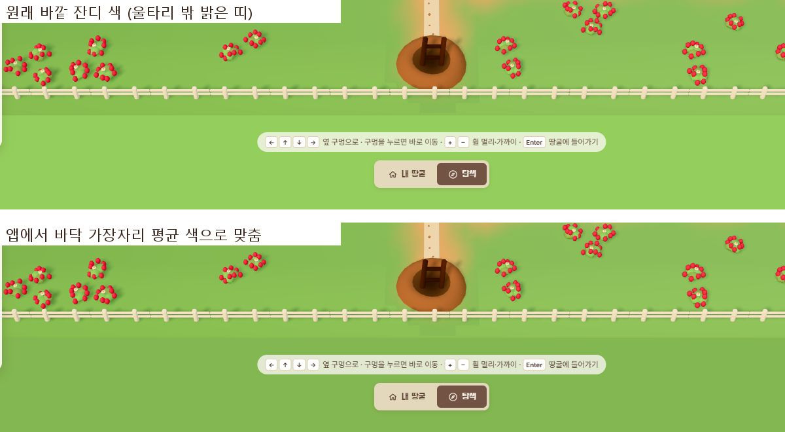
- **far 안내판 잘림**: 패널을 연 채 far 로 가면 왼쪽 끝 구멍(13번)의 안내판이 화면 밖으로 → 두더지가 화면 왼쪽 300px 안이면 안내판을 머리 오른쪽 위에
- **far 말풍선 수**: 위 10번

## 화면 확인 (헤드리스 크롬 1920×1080)
가속 켬(RTX) · 가속 끔(WARP) 둘 다, near·mid·far, 켠 구역·안 켠 구역 경계(서울-2층 구역 2개, 서울-3층 구역 3개, 서울-12층 구역 1개), 작물 5종, 패널 열고 키로 줌(near→mid→far→mid→near 왕복), 전환 도중(`?zoomfreeze=0_5`), 관심사 이펙트 켬. 최종 빌드로 가속 끔 27장 다시 찍음, 콘솔 에러 0 (`node explore/gpu/zoom/zoom-shots.mjs <주소> <폴더> gpu|hwoff`). 탐색 들판 정지 그림(WebGL 없을 때·불러오는 동안, `assets/stills/field.webp`)도 v3.10 바닥으로 다시 찍음

| near (내 땅굴 13번) | mid | far |
|---|---|---|
| 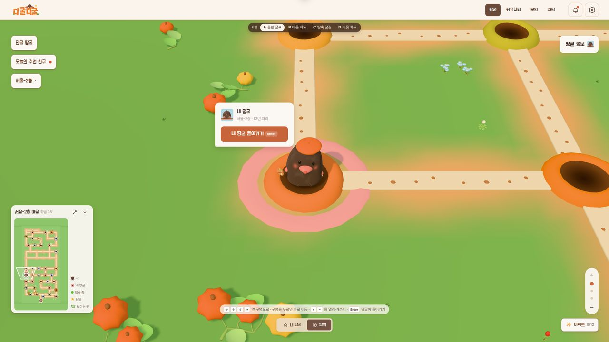 | 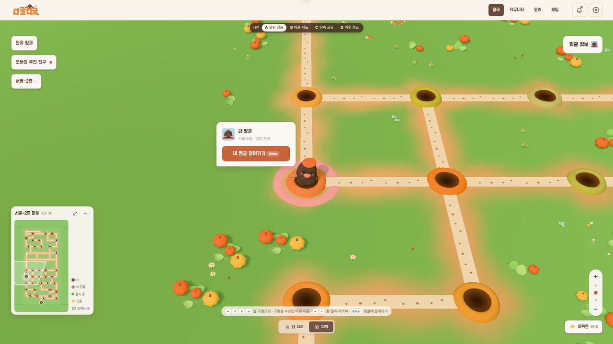 | 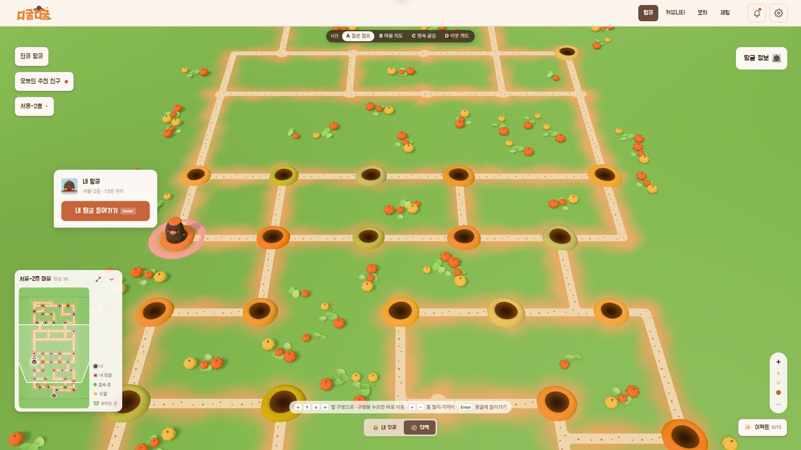 |

| far · 구역 1개 (서울-12층 딸기, 맞춤 타깃 고정) | far · 구역 3개 (서울-3층 사과) | far · 가속 끔 |
|---|---|---|
| 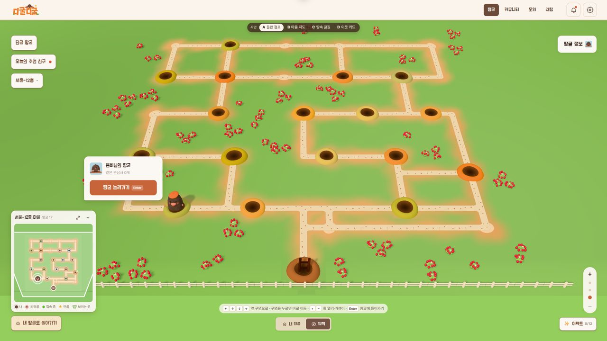 | 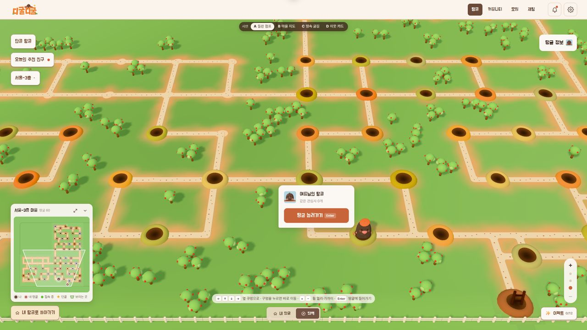 | 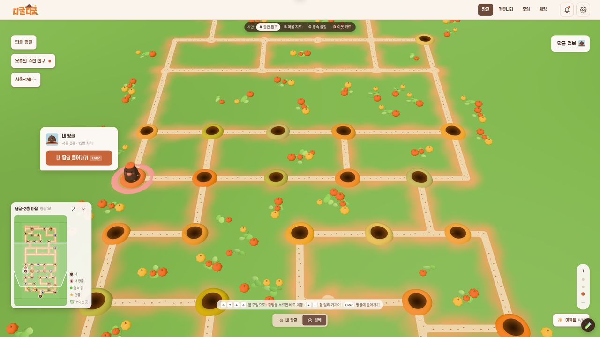 |

| 전환 도중 near → mid (가속 끔, 옮겨 그리는 중) | 전환 도중 mid → far (가속 끔) | 패널 열고 키로 far (가속 끔, 안내판 오른쪽) |
|---|---|---|
| 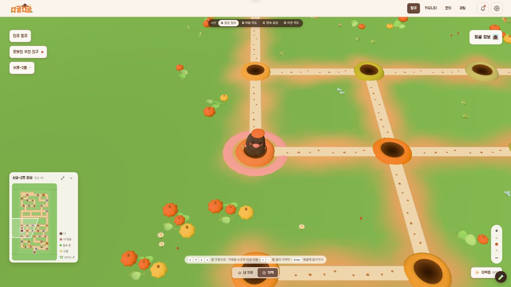 | 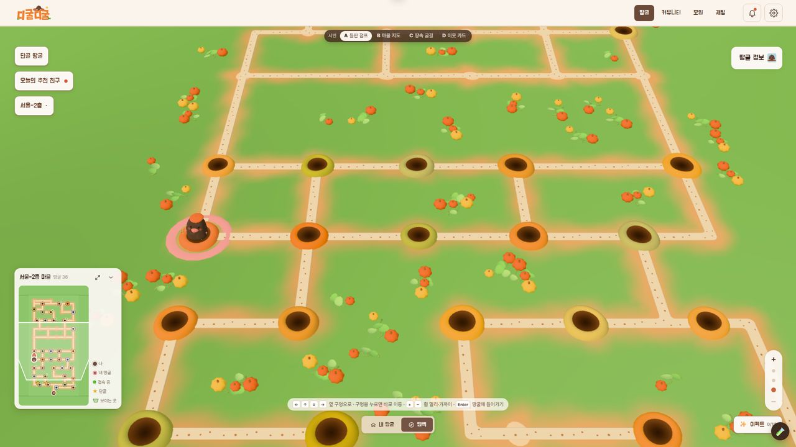 | 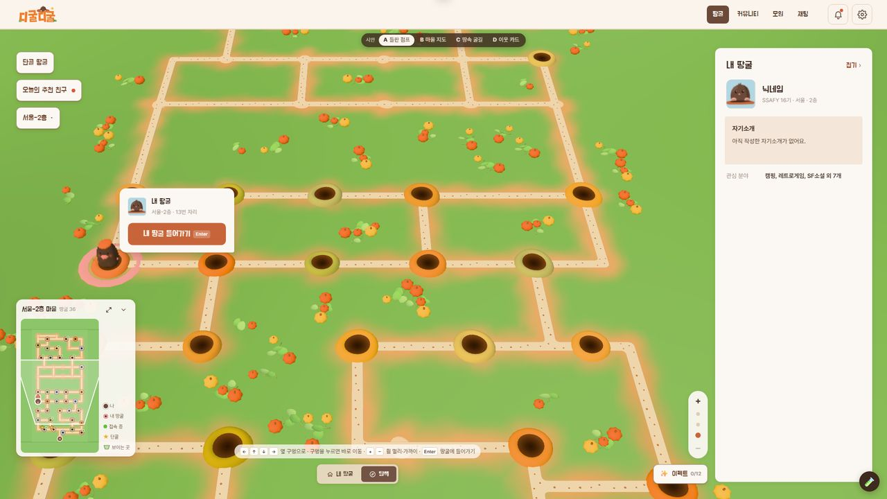 |

far · 관심사 이펙트 추천 묶음 (가속 끔, 말풍선 8개): 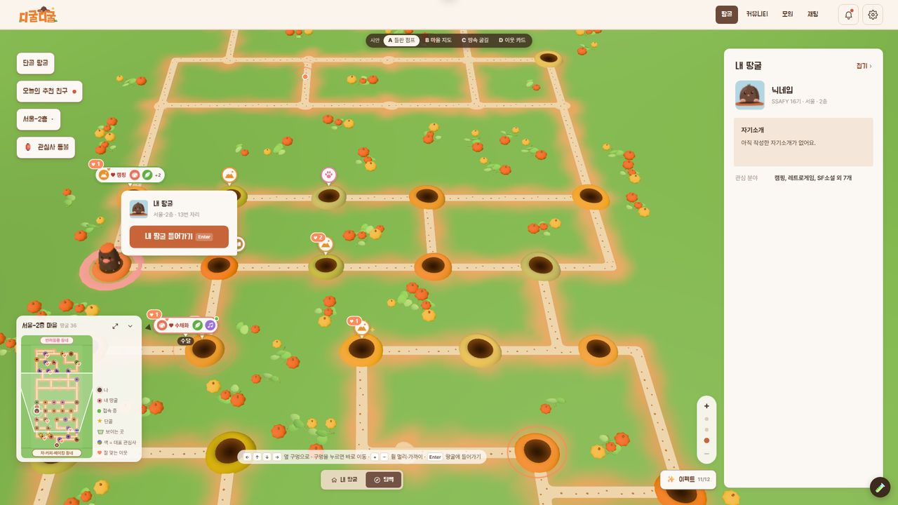

작물 5종 (mid): 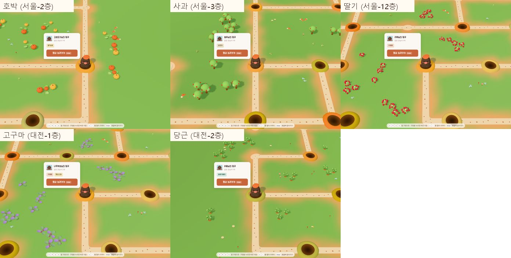

- 흙 경계: 흙을 뺀 같은 장면(`?fhide=soil`)과 픽셀 차이를 보면 흙 메시 가장자리는 잔디 바닥과 매끄럽게 이어짐(사각형 경계 없음). 구역 1·2, 1·3 경계 흙 띠도 끊기지 않음. 예외 하나: 구역 1 남쪽 끝 사다리 아래(울타리 밖) → [디자이너에게 알릴 것](#디자이너에게-알릴-것)
- 가속 켬 ↔ 끔 화면 차이(PSNR, 장면 부분): near 36.1 · mid 39.5 · far 40.3 · far 구역 3개 34.0dB (두더지 동작 차이 포함). 전환 가운데(k = 0.5) near→mid 36.2 · mid→far 34.6 · far→mid 29.0dB (far→mid 는 가속 끔이 도착 단계 LOD 를 먼저 적용해서 구멍 크기가 다름 + 옮겨 그린 그림의 높은 물체 시차)

## 저사양 측정
- 이 PC(i7-11700 16스레드, RTX 5060 Ti) 크롬 헤드리스 1920×1080, 새 프로필. 가속 끔 = WARP(`Microsoft Basic Render Driver`), "2코어" = 크롬을 CPU 2개에 묶음(`AFF=3`). 공유 빌드(`build:share` → `vite preview`, 해시 라우팅). 반복 3번 중앙값. **같은 PC 에서 다른 작업자가 스모크·측정을 돌리고 있어 숫자가 조금 흔들림**
- 줌 시나리오(`cdp-scene.mjs zoom`): 내 들판(서울-2층, 구역 2개) 13번 자리에서 near 가만히 → `−` (near→mid) → `−` (mid→far) → far 에서 방향키 점프 2번 → `+` (far→mid) → `+` (mid→near). 단계마다 "움직이기 시작"(키 → 카메라가 처음 움직인 프레임) · 전환 0.5초 동안 장면 fps · 그 안에서 가장 긴 프레임 간격 · "선명까지"(키 → 1배 선명한 배경이 다시 깔린 시각)
- 탐색 시나리오(예전과 같음, `cdp-scene.mjs explore`): 기준 = main(4304257, v3.9 들판) 공유 빌드를 같은 때 같은 방법으로
- 도구: `bash explore/gpu/zoom/run-zoom.sh` (+ `NEW`·`BASE` 주소), 표 `node explore/gpu/zoom/zoom-summary.mjs`, 결과 `explore/gpu/results/zoom/*.json`

### 줌 전환
칸마다 "움직이기 시작 ms · 전환 fps · 가장 긴 프레임 간격 ms · 선명까지 ms" (중앙값)

| | 다 보이기까지 ms | 첫 진입 가장 긴 멈춤 ms | near→mid | mid→far | far→mid | mid→near | far 점프 카메라 fps |
|---|---|---|---|---|---|---|---|
| 가속 켬 | 1973 | 234 | 바로 · 60 · 17 · - | 바로 · 60 · 18 · - | 바로 · 60 · 17 · - | 바로 · 60 · 17 · - | 55 |
| **가속 끔 16스레드 (최종)** | 1751 | 200 | 205 · **50** · 28 · 745 | 196 · **52** · 26 · 722 | 11 · **44** · 32 · 573 | 9 · **52** · 33 · 571 | 41.3 |
| **가속 끔 2코어 (최종)** | 4148 | 850 | 756 · **16** · 72 · 1510 | 611 · **22** · 68 · 1343 | 5 · **16** · 98 · 732 | 10 · **24** · 58 · 760 | 13.8 |
| 가속 끔 16스레드 (줌 아웃 기다림, 흙 칸 나누기 전) | 1877 | 200 | 220 · 46 · 32 · 740 | 217 · 42 · 39 · 732 | 14 · 40 · 34 · 540 | 10 · 52 · 35 · 560 | 38.8 |
| 가속 끔 2코어 (줌 아웃 기다림, 흙 칸 나누기 전) | 4180 | 700 | 653 · 20 · 61 · 1279 | 760 · 18 · 101 · 1500 | 20 · 16 · 133 · 886 | 6 · 20 · 67 · 852 | 15 |
| 가속 끔 16스레드 (처음: 바로 움직임) | 1771 | 200 | 바로 · 32 · 103 · 582 | 바로 · 30 · 127 · 590 | 바로 · 32 · 84 · 528 | 바로 · 42 · 86 · 541 | 38.8 |
| 가속 끔 2코어 (처음: 바로 움직임) | 3801 | 750 | 바로 · 4 · 266 · 1820 | 바로 · 5.3 · 198 · 1363 | 바로 · 18 · 229 · 789 | 바로 · 22 · 278 · 784 | 12.5 |

- **가속 켬**: 전환·가만히 모두 60fps. 그리는 양은 near 약 14만 → mid 19만 → far 22만 삼각형/프레임(그림자 포함), 그리기 호출 257 → 452 → 554
- **가속 끔, 처음 버전**(줌 키를 누르면 바로 움직이고 도착 그림은 그동안 굽기): 줌 아웃은 지금 그림이 사이 화면의 가운데만 덮어서 바깥을 매 프레임 3D(0.22~0.55배)로 메우고, 같은 프레임들에 도착 그림 굽기·깊이 굽기까지 겹쳐 **2코어 4~5fps, 한 번에 0.2~0.3초 멈춤**
- **최종** (`holeField.ts` `zoomTo`·`stepZoom`·`prepStep`):
  1. **줌 아웃은 도착 그림이 준비될 때까지 기다렸다 움직임** (강한 PC 0.35초 · 약한 PC 1.2초까지, 그동안 화면 그대로). 도착(더 넓은) 그림이 사이 화면을 다 덮어서 3D 로 메울 곳이 없음 → 16스레드 30 → 50fps, 2코어 4~5 → 16~22fps, 가장 긴 간격 0.1~0.27초 → 0.03~0.07초. 대신 키를 누른 뒤 움직이기까지 16스레드 0.2초 · 2코어 0.6~0.76초
  2. **줌 인은 바로 움직임** (지금 그림이 사이 화면을 다 덮음, 확대라 조금 흐려졌다가 도착 그림으로 바뀜)
  3. 도착 그림을 깊이보다 먼저 칸 1 에 넣고, **깊이 굽기(장면 전체를 한 번, 2코어 0.3~0.4초)는 카메라가 멈춘 뒤로** → 전환 도중 큰 멈춤 없음. 깊이를 굽는 동안은 옮긴 그림을 그대로 보여 줌
- 선명까지: 16스레드 0.57~0.75초, 2코어 0.73~1.5초 (전환 0.5초 포함). 그 사이에도 화면은 옮긴 1배 그림이라 흐린 0.33배 화면은 안 나옴 (전환 가운데 화면 PSNR 위 "화면 확인")
- 남은 것: 2코어 줌 아웃이 움직이기까지 0.6~0.76초, far 점프 카메라 2코어 약 14fps · 16스레드 41fps (near 점프는 아래 표). 아이디어: far 는 구멍이 화면 가운데 근처에 있으면 카메라를 안 옮기기(점프마다 굽기가 없어짐) → 디자이너 확인 필요라 이번엔 안 함

### 예전 탐색(near) — 바닥이 무거워진 영향
| 가속 끔 | 다 보이기까지 ms | 첫 진입 가장 긴 멈춤 ms | 방향키 점프 카메라 fps · 가장 긴 간격 ms | 클릭 점프 카메라 fps | 들판 바꾸기 ms |
|---|---|---|---|---|---|
| 기준(main, v3.9) 16스레드 | 1675 | 167 | 60 · 63 | 52.5 | 561 |
| v3.10 흙 통째로 16스레드 | 1921 | 233 | 57.5 · 71 | 47.5 | 780 |
| **v3.10 최종 (흙 12m 칸) 16스레드** | 1794 | 183 | **60** · 64 | **60** | 640 |
| 기준(main, v3.9) 2코어 | 3896 | 583 | 23.8 · 223 | 15 | 889 |
| v3.10 흙 통째로 2코어 | 4324 | 683 | 20 · 348 | 12.5 | 1172 |
| v3.10 흙 빼고(`?fhide=soil`, 비교용) 2코어 | 3676 | 783 | 28.1 · 250 | 22.5 | 974 |
| **v3.10 최종 (흙 12m 칸) 2코어** | 3935 | 717 | **26.3** · 275 | **20** | 919 |

- 처음엔 v3.10 바닥이 가속 끈 2코어에서 점프 23.8 → 20fps, 클릭 점프 15 → 12.5fps 로 느려졌음. 흙을 빼면 28fps 라 흙 메시가 원인
- 흙 노드는 구역마다 36m 한 덩어리(정점 약 5천)라, 띠로 나눠 굽기·이동 중 빈 곳 메우기를 할 때마다 화면 밖 부분까지 통째로 그렸음 → **정점은 함께 쓰고 삼각형 목록만 12m 칸으로 나눠**(다른 부품 인스턴싱 칸과 같은 크기) 칸 단위로 화면 밖은 안 그림 (`holeField.ts` `splitSoil`, `?soilsplit=0` 이면 예전). 그림은 같음(가속 켬 far 화면 PSNR 43.7dB, 차이는 두더지 동작). 결과 **2코어 점프 26.3fps · 클릭 20fps 로 기준보다 빠름** (잔디 덩어리가 없어진 덕도 있음)
- 첫 진입(다 보이기까지)은 바닥 glb 가 커서(1.5MB → 앱 0.94MB) 16스레드 약 0.1초 늘었음
- 측정 중 찾은 버그: 줌 뒤 깊이 굽기를 미룬 프레임에 선명한 배경으로 바꿔 끼우면 GL 지우기 색이 잔디색으로 남아 화면이 진한 초록으로 덮였음 → 바꿔 끼울 때 지우기 색을 투명으로 맞춤 (위 줌 표의 "최종" 숫자는 고치기 전 빌드로 잰 것이지만 지우기 한 번이라 성능 차이 없음, 화면은 고친 빌드로 다시 확인)

## 확인
- `npm test` 208개 통과(할 일 3개) — 새 `field-cam.test.ts` 16개(핸드오프 수치·far 맞춤이 구역 네 모서리를 덮음·LOD 히스테리시스·층→작물), `data-json.test.ts` 흙 노드·작물 테마·카메라 단계
- `npm run build` 통과. 스모크(포트 5341) 화면 96개: 가속 켬 OK 96 · 가속 끔 OK 96 · WebGL 없음 OK 96 (경고·실패 0)
- 번들: 일반 빌드 탐색 청크 61KB + 바닥 glb 파일 0.94MB, 작물 glb 는 층마다 하나(50~72KB). 공유 빌드 탐색 청크 471KB → 1.58MB(gzip 614KB, 공유 glb 청크 예산 1737KB 안), 작물 청크 따로 67~96KB, 배치 132KB → 157KB. 첫 화면 JS 는 +2KB(이미 있던 예산 초과 경고는 그대로)

## 다음 단계
- 디자이너 답·확인 (아래 메시지): 바깥 잔디 색, 사다리 아래 흙 네모, far 맞춤에서 남쪽 끝이 보이는 것, 바닥 glb 크기
- 실서비스: 캠퍼스-층 설정에 작물 값 (백엔드)
- 실제 브라우저(가속 켬·끔)로 줌 느낌 보기. 특히 2코어급에서 줌 아웃이 움직이기까지 0.6~0.76초가 답답한지
- far 점프가 약한 PC 에서 약 14fps: far 는 구멍이 화면 안 가운데쯤이면 카메라를 안 옮기는 방법(점프마다 굽기 없음) — 디자이너와 정할 것
- 줌 버튼 디자인 (지금은 임시: 흰 알약 + / 점 3개 / −)
- 시작 화면 둘러보기·랜딩은 아직 예전 밭 (v3.9 문서와 같음)

## 디자이너에게 알릴 것
1. **바깥 잔디(`outer_grass`)가 잔디 바닥보다 약 10% 밝음** (바닥 `grass_floor` 는 정점 색 × 0.8, 바깥 잔디는 잔디색 그대로). far 에서 구역 하나만 켠 층은 들판 남쪽 끝이 보여서 울타리 밖에 밝은 띠가 보였음. 앱에서는 바깥 잔디 색을 바닥 가장자리 평균 색으로 맞췄지만 바닥 명암 때문에 곳에 따라 아주 살짝 단차가 남음 → 바깥 잔디 색을 바닥과 맞추거나(같은 0.8 곱) 바깥 잔디에도 가장자리 색을 이어 받은 정점 색을 부탁
2. **`soil_zone1` 남쪽 끝(사다리 아래, 울타리 밖)에 잔디색이 살짝 진한 네모**가 보임 (RGB 136,187,85 ↔ 주변 142,194,87, far 구역 하나에서만 보임). 흙 메시가 슬랩이 둥글게 내려가는 가장자리 위까지 평평하게 있어서로 보임 → 흙 메시를 슬랩 윗면 안쪽에서 끝내거나 가장자리 정점 색을 바닥과 같게
   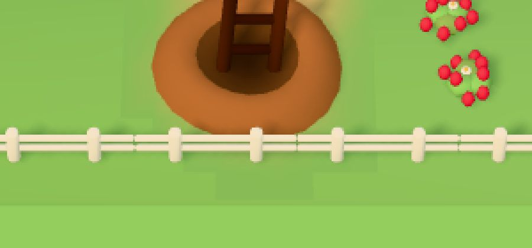
3. far 구역 하나 맞춤 타깃(남쪽 + 11.1m)이면 화면 아래 끝이 들판 남쪽 끝보다 3.5m 바깥까지 보임(울타리·슬랩 가장자리·바깥 잔디). 구역 1 이 늘 남쪽 끝이라 구역 하나인 층은 모두 해당. 문서의 "어느 단계에서도 슬랩 밖이 안 보임"과 다르지만 화면은 자연스러워서 그대로 둠 (1번만 고쳐지면 괜찮음)
4. 바닥 glb 가 14KB → 1.5MB (흙 삼각형 약 6.1만). 앱은 흙 노드를 양자화해서 0.94MB, 공유 링크(아티팩트) 탐색 청크는 471KB → 1.58MB(gzip 614KB). 흙 메시 해상도를 조금 낮출 수 있으면 좋겠음 (급하지 않음)
5. 오른쪽 정보 패널(372px)이 열려 있으면 화면 가로가 줄어 far 에서 구역 왼쪽 끝 구멍이 화면 가장자리에 붙음 (맞춤 수치는 16:9 전체 화면 기준). 앱은 안내판만 오른쪽으로 옮김
6. 위 "줌 수치 조정·보탠 것" 1~4번 (near·mid 타깃, 전환 중 타깃 보간, 두더지 배율 연속, 저사양 LOD 먼저)

## 디자이너에게 보낼 메시지 (그대로 복사)
```
[v3.10 반영 + 물어보신 것 답]

반영했어요: 잔디 바닥 + 흙 노드 규칙(soil_zoneN 은 구역 켜질 때, soil_link_N_M 은 두 구역 다 켜졌을 때), 작물 5종, 카메라 near·mid·far 줌(휠·+/− 키·버튼, 0.5초), 단계별 표시(꽃·풀·작물·구멍·두더지 배율), far 구멍 중앙 정렬 막기. 안 켠 구역은 잔디만 보여요.

층→작물은 캠퍼스-층 목록 순서대로 호박→사과→딸기→고구마→당근을 돌려 써요. 같은 캠퍼스 층끼리는 늘 달라요(지금 서울 2·3·12층 = 호박·사과·딸기). 실서비스에서는 서버의 층 설정에 작물 값을 두자고 백엔드에 제안할게요.

줌에서 조정한 것: near·mid 타깃은 v3.9 처럼 켜진 구역 camRect 안(구멍을 가운데로)이고 far 만 한계 공식이에요. 전환 중 타깃은 시작→끝을 같은 곡선으로 옮겨요. 두더지 배율은 거리 따라 부드럽게 바뀌어요. 그래픽 가속이 꺼진 PC 는 도착 그림을 미리 구워야 해서 도착 단계 표시(LOD)를 전환 시작에 바로 바꿔요.

화면에서 보인 것:
1) 바깥 잔디(outer_grass)가 잔디 바닥보다 10% 정도 밝아요(바닥은 정점 색 × 0.8). far 에서 구역 하나만 켠 층은 들판 남쪽 끝이 보여서 울타리 밖에 밝은 띠가 보였어요. 앱에서는 바닥 가장자리 평균 색으로 맞춰 뒀는데, 바깥 잔디 색을 바닥과 맞춰 주시면 좋겠어요.
2) soil_zone1 남쪽 끝(사다리 아래, 울타리 밖)에 잔디색이 살짝 진한 네모가 보여요. 흙 메시가 슬랩 둥근 가장자리 위까지 평평하게 와서인 것 같아요.
3) far 구역 하나 맞춤(남쪽 + 11.1m)이면 들판 남쪽 끝 밖이 3.5m 정도 보여요. 화면은 자연스러워서 그대로 뒀어요(1번만 고쳐지면 괜찮아요).
4) 경계 흙(soil_link)은 끊김 없이 잘 이어져요. 흙 메시 가장자리도 바닥과 매끄러워요(2번 자리만 빼고).
5) 바닥 glb 가 1.5MB 라 앱에서는 흙 노드를 양자화해서 0.94MB 로 쓰고 있어요. 흙 메시를 조금 가볍게 할 수 있으면 좋겠어요(급하지 않아요).

물어보신 것:
- 자리 번호 재사용: 비어 있는 가장 작은 번호부터 다시 쓰는 것에 동의해요. 다만 탈퇴로 빈 번호는 30일 동안 빈 자리(empty_pad)로 두고 그 뒤에 다시 쓰자고 제안해요. 이웃들이 익숙한 자리에 바로 낯선 사람이 들어오지 않게요(단골은 사람 기준이라 영향 없어요). 켜는 구역 수는 '가장 큰 배정 번호' 기준이라 중간에 빈 번호가 있어도 구멍이 잘리지 않아요.
- 켜지 않은 구역: 켜는 구역 수 = 가장 큰 배정 번호 ÷ 25 올림(최소 1), 번호 순서로 켜요. 안 켠 구역은 잔디만이고(작물·꽃·풀·길·울타리·흙 숨김), 켜진 구역 안에서 아직 배정 안 된 자리는 빈 자리(empty_pad)로 보여 줘요. 미니맵 크게 보기에서는 "아직 비어 있는 구역" 점선으로 표시해요.
- "내 땅굴로 돌아가기": 화면 왼쪽 아래 버튼이에요. 다른 캠퍼스-층에 가 있거나, 내 들판에서 내 구멍이 아닌 곳에 서 있을 때만 보여요(내 구멍 위에 있으면 숨김). 누르면 같은 들판이면 내 구멍으로 바로 점프하고(평소 점프 연출 그대로), 다른 들판이면 내 들판으로 옮겨 내 구멍에서 시작해요. 점프 중엔 눌리지 않고, 줌 단계는 그대로예요. 아이콘·문구·모양은 임시라 디자인 부탁드려요.
```
