# 디굴디굴 프론트엔드 개념 학습

디굴디굴 프론트엔드를 이해하는 데 필요한 개념을 이 프로젝트의 실제 코드로 설명하는 학습 문서다.

- 날짜: 2026-11-24 (2026-11-17 판을 지금 코드에 맞게 고침: Next.js `frontend/`, 백엔드 확정 API 명세 v1, 실시간 SSE. 1·3·5·6·7·10·11장을 다시 씀)
- 대상 독자: 이 프로젝트의 기획·관리자, 프론트엔드를 처음 보는 팀원
- 짝 문서: [frontend-guide.md](frontend-guide.md) (기술 선택의 이유, 사건 기록, 구조, 백엔드 연결, 용어집)
- 읽는 법: 장마다 **개념 → 이 프로젝트에서는 → 직접 해 볼 것** 순서. 코드 위치는 `frontend/src/` 기준(예전 Vite 앱은 `app/`이라고 따로 적음). 용어는 [가이드 8장 용어집](frontend-guide.md#8-용어집)

## 목차
1. [전체 그림: SPA](#1-전체-그림-spa)
2. [React 컴포넌트와 상태](#2-react-컴포넌트와-상태)
3. [라우팅: 주소와 화면](#3-라우팅-주소와-화면)
4. [스타일: 디자인 토큰과 CSS Modules](#4-스타일-디자인-토큰과-css-modules)
5. [TypeScript로 데이터 모양 정하기](#5-typescript로-데이터-모양-정하기)
6. [서버 데이터 다루기: TanStack Query](#6-서버-데이터-다루기-tanstack-query)
7. [실시간: SSE](#7-실시간-sse)
8. [3D를 React 앱에 넣기](#8-3d를-react-앱에-넣기)
9. [그래픽 성능의 기본 개념](#9-그래픽-성능의-기본-개념)
10. [빌드 · 환경 변수 · 배포](#10-빌드--환경-변수--배포)
11. [테스트](#11-테스트)

---

## 1. 전체 그림: SPA

### 개념
- **SPA(Single Page Application)**: 서버에서 HTML을 한 번만 받고, 그 뒤 화면 전환은 브라우저 안의 JavaScript가 처리한다. 메뉴를 눌러도 페이지가 새로고침되지 않는다
- 브라우저는 TypeScript·JSX를 바로 읽지 못한다. **빌드 도구**가 브라우저가 읽는 JavaScript로 바꾸고, 묶고(번들), 줄이고, 필요할 때 받을 조각(청크)으로 나눈다. 지금은 Next.js(안의 Turbopack)가, 예전 앱은 Vite가 이 일을 한다
- Next.js는 서버에서 첫 화면을 그려 보내는 기능(서버 렌더링)도 있지만, 이 앱은 화면을 모두 브라우저에서만 그린다. 그래서 동작은 SPA와 같다 ([nextjs-migration.md](nextjs-migration.md) 결정 1)

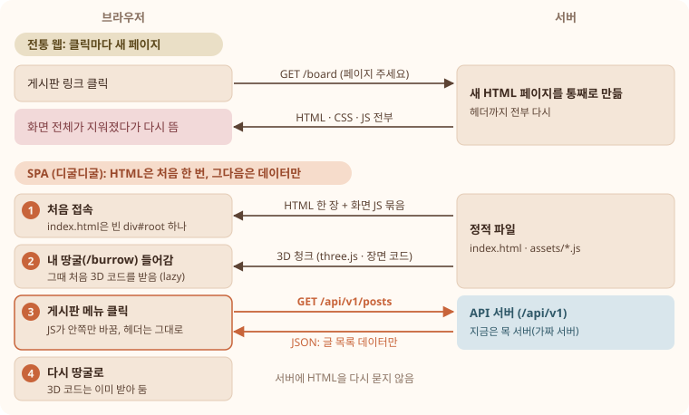

### 이 프로젝트에서는
```
브라우저
 └─ src/app/layout.tsx      <html> · 글꼴 · 전역 CSS
     └─ providers.tsx         브라우저에서만 그림 · 휴대폰 안내 · 데이터 캐시 · 가속 꺼짐 안내
         ├─ (pc)/…            시작 화면 · 로그인 · 가입
         ├─ onboarding/…      온보딩
         └─ (app)/layout.tsx  로그인 영역 틀(AppShell): 로그인 검사 · 헤더 · 실시간 소식 연결
             └─ …/page.tsx    주소마다 한 파일. 안에서 screens/ 의 화면 하나를 그림
                 ├─ screens/     화면 (땅굴, 게시판, 모임, 채팅, 알림, 설정 …)
                 │    └─ components/  여러 화면이 같이 쓰는 조각
                 ├─ api/         서버와 말하는 층 (영역 폴더 11개, 영역마다 목 서버 ↔ 실제 서버)
                 ├─ realtime/    실시간 소식(SSE) 연결 하나
                 ├─ data/        목 저장소(가짜 DB)와 관심사 · 가구 표
                 ├─ lib/         화면 이동 어댑터 · 환경 변수 · 날짜 · 글자 수 · 저사양 판단 같은 도구
                 ├─ styles/      디자인 토큰, 전역 CSS
                 └─ three/       3D (그 화면에 들어갈 때만 따로 내려받음)
```

| 도구 | 역할 | 한 줄 설명 |
|---|---|---|
| Next.js 16.4 | 틀 · 개발 서버 · 빌드 | `src/app/` 폴더 = 주소. 개발 중엔 저장하면 바로 반영, 빌드 땐 묶고 줄여서 `.next/` |
| React 19.3 | 화면 그리기 | "상태가 이러면 화면은 이렇게"를 컴포넌트로 |
| TypeScript 6.0 | 타입 검사 | 데이터 모양이 틀리면 빌드 전에 에러 |
| `lib/nav.tsx` | 화면 이동 | react-router와 같은 이름(`useNavigate`·`Link`…)을 Next 위에 |
| TanStack Query 5 | 서버 데이터 | 불러오는 중·오류·캐시·다시 받기 |
| CSS Modules | 스타일 | 파일마다 클래스 이름이 따로라 충돌이 없음 |
| three.js 0.165 | 3D | WebGL을 쉽게 쓰는 라이브러리 |
| vitest 5 · ESLint 9 | 단위 테스트 · 린트 | 함수가 규칙대로 답하는지 자동 채점 · 코드 모양 검사 |

### 직접 해 볼 것
- 개발 서버를 띄우고(`cd frontend && npm run dev` → http://localhost:3000) 메뉴를 눌러 가며 개발자 도구(F12) → Network 탭을 본다. 페이지 전체가 다시 받아지지 않고, 3D 화면에 처음 들어갈 때만 큰 JS 파일이 새로 받아지는 것을 확인한다
- 같은 탭에서 "페이지 소스 보기"를 열어 첫 HTML에 화면 내용이 없는 것을 본다(브라우저에서만 그리므로)

---

## 2. React 컴포넌트와 상태

### 개념
- **컴포넌트** = 화면 조각을 돌려주는 함수. 입력은 **props**(부모가 주는 값), 안에서 기억하는 값은 **state**
- state가 바뀌면 React가 그 컴포넌트를 다시 실행해 화면을 갱신한다. 직접 DOM(화면 요소)을 고치지 않는다
- **단방향 데이터 흐름**: 데이터는 부모 → 자식(props)으로 내려가고, 자식은 함수(콜백)를 불러 부모에게 알린다
- **"state는 최소로, 나머지는 계산"**: 같은 정보를 두 군데 두면 어긋난다
- **재사용과 key**: 같은 자리에 같은 종류의 컴포넌트가 다시 오면 React는 새로 만들지 않고 재사용한다. 그 안의 state도 그대로 남는다. 새로 만들게 하려면 `key`를 바꾼다

### 이 프로젝트에서는
`screens/burrow/MyBurrow.tsx` (내 땅굴)
- `panelOpen`(오른쪽 패널이 열렸나)은 state. 처음 값은 주소의 `?panel=closed`에서 읽는다 → 주소만 공유하면 같은 상태를 볼 수 있다
- `focusX`(3D 방을 화면 어디에 둘지)는 state로 두지 않고 **계산**한다: 패널이 보이면 0.403, 아니면 0.5
- `RoomView`는 `focusX`를 props로 받기만 한다. 패널이 열리면 부모가 0.403을 내려보내고 방이 왼쪽으로 밀린다
- `useMemo`는 계산 결과를 기억했다가 재료(관심사 목록)가 바뀔 때만 다시 계산한다

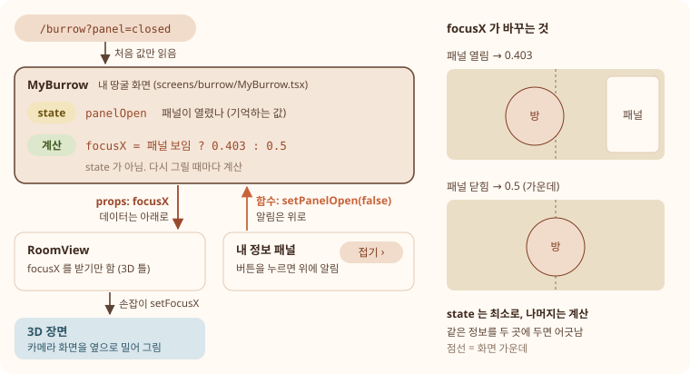

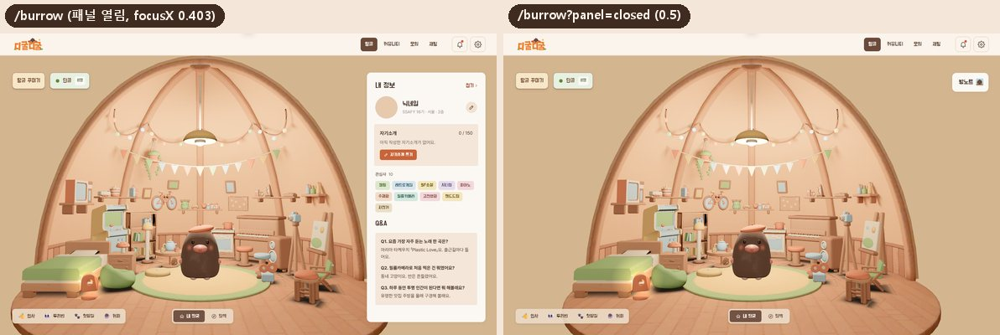

`key` 실제 사례: 채팅방 A → B로 바꿔도 메시지가 A 것으로 남던 버그는 `<RoomPane key={roomId}>`로 고쳤다. 반대로 Next에서는 주소 변수가 바뀌면 page를 새로 만들어, 남아야 할 입력이 사라지는 문제가 생겼다([가이드 사건 24](frontend-guide.md#사건-24-주소-변수가-바뀌면-화면을-새로-만듦-2026-11-23)) ([가이드 사건 13](frontend-guide.md#사건-13-채팅방을-바꿔도-이전-메시지가-남음))

| 공용 컴포넌트 | 배울 점 |
|---|---|
| `components/Pagination.tsx` | 규칙(번호 5개씩 묶음, 6–10 …)을 **계산으로** 표현. state 없이 props만 받는 "순수" 컴포넌트 |
| `components/Modal.tsx` | `createPortal`로 `body` 바로 밑에 그림(부모의 잘림에 안 걸림). Esc로 닫기, 팝업 안에서만 Tab이 돎, 뒤 화면은 `inert`(손 못 대게), 닫으면 연 버튼으로 초점 복귀. 닫기 함수는 ref에 둠 ([사건 16](frontend-guide.md#사건-16-팝업-입력칸이-초점을-빼앗김-2026-11-16)) |
| `components/InterestChip.tsx` | 같은 모양에 색 톤만 바꾸는 **변형(variant)** props |
| `lib/format.ts`의 `visibleGuestbook` | "서로 다른 3명이 신고한 방명록은 가림" 같은 **기획 규칙을 화면 밖 함수로** 빼서 테스트하기 쉽게 (`tests/format.test.ts`) |

### 직접 해 볼 것
- `/burrow?panel=closed`와 `/burrow`를 열어 방 위치가 다른 것을 보고, 그 차이를 만드는 계산을 `MyBurrow.tsx`에서 찾는다
- 채팅에서 대화방을 여러 번 바꿔 보며 입력 중이던 글이 어떻게 되는지 본다 (방마다 새로 만들어지므로 사라지는 것이 맞다)

---

## 3. 라우팅: 주소와 화면

### 3-1. 개념과 이 프로젝트
- 클라이언트 라우팅: 주소가 바뀌어도 서버에 새 HTML을 요청하지 않고 JavaScript가 화면만 바꾼다
- `<Link to="/board">`는 새로고침 없이 이동한다. 일반 `<a href>`를 쓰면 새로고침된다
- **중첩 레이아웃**: 공통 틀(헤더)을 한 번만 쓰고 안쪽만 바꾼다
- **Next App Router는 폴더가 곧 주소표**다. `page.tsx`가 있는 폴더가 주소가 되고, 같은 폴더의 `layout.tsx`가 그 아래 화면을 감싼다. `[userId]`처럼 대괄호 폴더는 주소 변수, `(app)`처럼 괄호 폴더는 주소에 안 나타나는 묶음이다

`src/app/` (줄여서)
```
src/app/
  layout.tsx                       맨 바깥 틀
  (app)/layout.tsx                 로그인 영역 틀 → components/AppShell.tsx (로그인 검사 · 헤더 · SSE 시작)
  (app)/burrow/page.tsx            /burrow              → <MyBurrow />
  (app)/burrow/(visit)/layout.tsx  /burrow/:userId 의 틀 → <VisitBurrow /> 를 여기서 그림
  (app)/burrow/(visit)/[userId]/page.tsx   빈 page (주소만 엶)
  (app)/meetups/[id]/page.tsx      /meetups/:id         → <MeetupDetail />
```
- 화면 코드는 Next를 직접 부르지 않고 `@/lib/nav`의 `useParams()`·`useNavigate()`·`Link`를 쓴다. react-router와 같은 이름이라 예전 앱의 화면 코드를 import 한 줄만 바꿔 옮겼다 (`/burrow/yerin` → `useParams().userId === 'yerin'`)
- 화면 상태를 주소에 담는다: `?panel=closed`, `?modal=guestbook`, `?page=3`. 시안 검토와 새로고침에 편하다. 전체 목록은 `/screens`(실험실 켠 빌드만)
- 남의 땅굴은 왜 page가 비어 있나: Next는 주소 변수가 바뀌면 page를 새로 만든다. 땅굴을 옮겨 다녀도 3D·패널을 이어 쓰려고 레이아웃이 화면을 그린다 ([가이드 사건 24](frontend-guide.md#사건-24-주소-변수가-바뀌면-화면을-새로-만듦-2026-11-23))

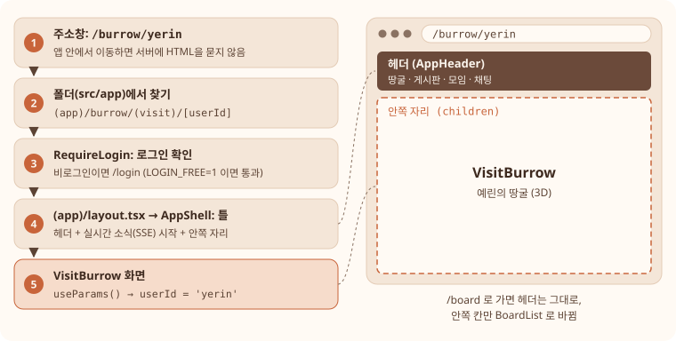

### 3-2. 새로고침하면 서버에 무엇이 가나
| | 주소 모양 | 새로고침하면 | 이 프로젝트 |
|---|---|---|---|
| Next 서버 (`next start`) | `/burrow` | 서버가 폴더로 주소를 알아 같은 화면. 없는 주소는 `not-found.tsx`(응답 404) | `frontend/` |
| 브라우저 라우터 + 정적 서버 | `/burrow` | 서버가 **어떤 주소로 와도 index.html을 돌려줘야** 함. 안 그러면 404 | 예전 Vite 앱의 일반 빌드 (Nginx `try_files` 필요) |
| 해시 라우터 | `#/burrow` | `#` 뒤는 서버로 안 가서 아무 정적 호스팅에서나 동작 | 예전 Vite 앱의 공유 빌드(아티팩트) |

- 새로고침 때 서버에 무엇이 가는지는 [가이드 사건 11의 그림](frontend-guide.md#사건-11-새로고침하면-404-브라우저-라우터)
- 함정: 환경 변수는 늘 문자열이라 `"0"`도 참으로 읽혔다. 지금은 `lib/env.ts`의 `flag()`가 `1·true·yes·on`만 참으로 읽는다 ([가이드 사건 11](frontend-guide.md#사건-11-새로고침하면-404-브라우저-라우터))

### 3-3. 에러 경계
- **개념**: 렌더링 중에 에러가 나면 React는 그 위 화면을 통째로 지운다. 에러 경계는 "여기까지만 지우고 안내를 보여 줘"라는 칸막이다. 단, 버튼 클릭 처리나 비동기 코드 안의 에러는 경계가 잡지 않는다. 그런 에러는 그 코드가 직접 처리한다(예: 쓰기 실패 토스트)
- **이 프로젝트**: Next는 폴더에 `error.tsx`를 두면 그 폴더 아래의 칸막이가 된다
  1. `src/app/error.tsx`(+ 루트 레이아웃까지 깨지면 `global-error.tsx`): 시작 화면·온보딩·관리자까지 모든 화면의 마지막 그물. 헤더(로그인 영역 틀)가 깨질 때도 여기서 잡는다(같은 폴더의 layout 바깥은 못 감싸서 한 단계 위)
  2. `src/app/(app)/error.tsx`: 화면 하나가 깨지면 헤더는 남기고 안쪽만 "잠시 문제가 생겼어요 · 다시 시도"
  3. 모임·설정은 안쪽에 하나 더(`(app)/meetups/(shell)/error.tsx`, `(app)/settings/error.tsx`): 탭·왼쪽 메뉴도 남음
  - 3D는 따로 `components/SceneBoundary.tsx`가 감싼다. 3D만 비우고 그 화면이 깔아 둔 정지 그림·2D 두더지를 보여 준다
  - 재배포 뒤 파일을 못 받은 에러(청크 404)면 한 번 새로고침한다 (`lib/chunkReload.ts` `isChunkLoadError`)
- 어디서 무엇이 잡히는지 전체 표는 [가이드 5-3](frontend-guide.md#5-3-에러가-났을-때-어디서-잡히나)

### 직접 해 볼 것
- 개발 서버에서 `/dev/crash`를 열어 헤더는 남고 안쪽만 안내가 나오는 것을 본다
- 없는 주소(`/abc`)와 없는 모임(`/meetups/없는id`)이 각각 무엇을 보여 주는지 비교한다
- `src/app/(app)/meetups/` 아래 폴더를 보고 `/meetups/m1/edit`가 어느 `page.tsx`인지 찾는다

---

## 4. 스타일: 디자인 토큰과 CSS Modules

### 개념
- **디자인 토큰** = 색·글자 크기·간격에 붙인 이름. 디자인과 코드가 같은 말을 쓰게 한다
- **CSS 변수**(`--brown-700`)로 토큰을 두면 한 곳만 고쳐도 전체가 바뀐다
- **CSS Modules**: `Board.module.css`의 `.title`은 빌드 때 `_title_9r79a_297` 같은 고유 이름이 된다(2026-11-17 예전 Vite 빌드에서 실제로 본 이름. 빌드 도구마다 이름 모양이 다르고 다시 빌드하면 바뀔 수 있음) → 다른 파일의 `.title`과 안 겹친다

### 이 프로젝트에서는
- `styles/tokens.css`: Figma 스크린샷에서 픽셀로 뽑은 색. 관심사 칩 8톤(`--tone-sage-bg` …)은 Figma 컴포넌트 이름(`Tone=Sage`)과 같은 이름
- 컴포넌트 CSS는 색을 직접 쓰지 않고 `var(--ink-700)`처럼 토큰만 쓴다

- 서체: 제목·버튼 Do Hyeon(Google Fonts), 본문 Pretendard(npm에서 받아 번들에 포함. 아티팩트가 외부 CSS를 막아서)
- `styles/global.css`의 `[hidden]{display:none!important}`는 지우지 않는다. 컴포넌트의 `display` 값이 `hidden` 속성을 덮어 모달 배경이 남던 버그가 있었다
- 같은 파일의 전역 클래스에 붙은 `:not(template)`도 지우지 않는다. Next는 전역 CSS를 모듈 CSS보다 먼저 불러와서, 명시도가 같으면 모듈이 이긴다. 예전 Vite 앱처럼 "같으면 전역이 이김"이 되도록 명시도를 요소 하나만큼 올린 것이다 ([가이드 사건 23](frontend-guide.md#사건-23-css-순서가-달라-버튼-높이가-바뀜-2026-11-23))
- 움직임 줄이기(운영체제 설정 `prefers-reduced-motion`)를 켜면 전역 CSS가 애니메이션을 거의 끄고, 땅굴은 입장 연출 없이 다 차려진 방으로 연다
- 색 대비가 기준보다 낮은 조합 목록은 [frontend-hardening.md](frontend-hardening.md) 4-6. 색은 디자인 결정이 필요해 아직 바꾸지 않았다

### 직접 해 볼 것
- 개발자 도구(F12) → Elements에서 클래스 이름이 `_title_xxxx` 식으로 바뀐 것을 확인한다
- 개발자 도구에서 `:root`의 `--brown-700` 값을 바꾸고 헤더의 활성 메뉴 색이 바뀌는지 본다

---

## 5. TypeScript로 데이터 모양 정하기

### 개념
- `interface User { nickname: string; interests: string[] }` → 이 모양이 아닌 데이터를 넣으면 빌드 전에 에러
- TypeScript는 "문자열인가"는 알지만 "UTC 시각 문자열인가"는 모른다. 값의 뜻은 규칙과 테스트로 지킨다

### 이 프로젝트에서는
- **두 가지 모양**을 나눴다
  - 서버 모양(DTO): `api/<영역>/types.ts`. 백엔드 명세 v1을 **그대로** 옮겼다: ID는 숫자(`Id`), 시각은 UTC 문자열(`UtcInstant`, "…Z"), 날짜만은 `DateString`, enum은 대문자, 값이 없으면 `null`
  - 앱 모양: 영역의 `mappers.ts`에 있는 `…VM` 타입과 `data/types.ts` (화면이 쓰는 모양. ID는 문자열, 시각은 ms 숫자)
  - 둘 사이 번역: 영역의 `mappers.ts` (숫자 ID → 문자열 `toAppId`, UTC → ms `parseIso`, 탈퇴한 사람 → `'gone'`, 칸 이름 바꾸기)
  - 이렇게 나누면 서버 응답 모양이 바뀌어도 그 영역의 `types.ts`와 `mappers.ts`만 고치고 화면은 그대로 둔다. 실제로 명세 v1에 맞출 때 ID가 문자열 → 숫자로 바뀌었는데 화면 주소(`/meetups/m1`)와 화면 코드는 그대로였다
  - 목 서버는 저장소 id가 `'m1'` 같은 글자라서, DTO를 만들 때 큰 번호로 바꿨다가(`toDtoId`) 매퍼가 되돌린다(`api/common/ids.ts`). 목 번호는 9×10¹¹ 위라 실제 id와 겹치지 않는다

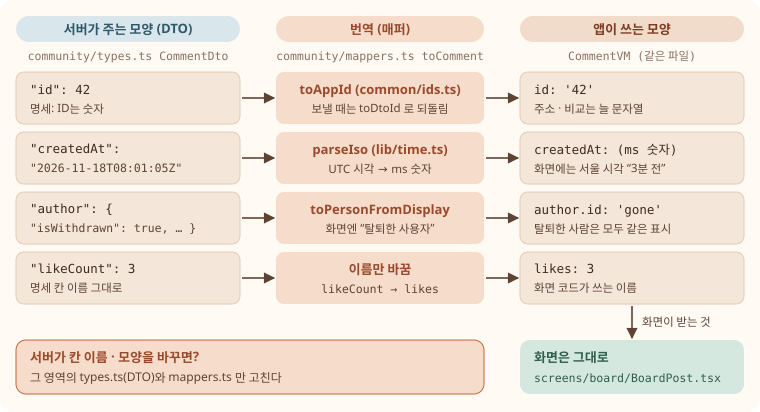
- `npm run typecheck`(`tsc --noEmit`)가 타입을 검사하고, `npm run build`(Next)도 빌드 중에 검사한다. 테스트 파일도 같이 검사한다
- TypeScript는 6.0이다. 예전 Vite 앱은 7.0을 썼는데, 7은 Next 빌드와 린트 도구가 쓰는 JS API가 없어 내렸다

### 직접 해 볼 것
- `api/meetups/types.ts`에서 모임 상세 DTO를 찾고, `api/meetups/mappers.ts`의 `toMeetupDetail`이 어떤 칸을 어떻게 바꾸는지 따라가 본다
- 같은 API를 명세 사본(`docs/backend/team-spec/api/07-meetup.md`)에서 찾아 칸 이름이 같은지 맞춰 본다

---

## 6. 서버 데이터 다루기: TanStack Query

### 개념
- 서버 데이터는 **비동기**다. 요청을 보내고 답이 올 때까지 기다린다. 그래서 화면은 늘 세 상태를 구분해야 한다: **불러오는 중 · 오류 · 받음**. 받았는데 비어 있는 것("없음", "빈 목록")도 따로다
- **캐시**: 받은 데이터를 이름(캐시 키)으로 기억한다. 같은 화면에 다시 오면 기억한 값을 먼저 보여 주고 뒤에서 새로 받는다
- **낙관적 업데이트**: "찜"을 누르면 서버 답을 기다리지 않고 화면을 먼저 바꾼다. 실패하면 되돌리고 알린다. 대부분 성공하니 사용자는 빠르다고 느낀다
- **캐시는 누구의 것인가**: 캐시는 탭 하나에 하나다. 다른 계정으로 로그인하면 이전 계정의 캐시를 버려야 한다. 날아가는 중인 요청도 마찬가지다

### 이 프로젝트에서는
화면 → 영역 훅 → 영역 API(목 또는 실제) → 매퍼 → 화면
```tsx
// api/meetups/queries.ts
export function useMeetupDetail(id: string, enabled = true) {
  return useQuery({ queryKey: meetupKeys.detail(id), enabled: enabled && !!id,
    queryFn: async ({ signal }) => toMeetupDetail(await meetupsApi.get(toDtoId(id), signal)) })
}
// screens/meetups/MeetupDetail.tsx
<QueryGate q={q} skeleton={<DetailSkeleton … />} notFound={<NotFound what="meetup" />}>
  {(d) => <MeetupDetailView d={d} />}
</QueryGate>
```
- `meetupsApi`는 `api/meetups/api.ts`가 `selectArea('meetups', real, mock)`으로 고른 것이다. 영역마다 목/실제를 따로 바꾼다 ([가이드 6-1](frontend-guide.md#6-1-목--실제-서버-전환))
- `QueryGate`(`components/AsyncState.tsx`): 오는 중이면 스켈레톤, 404면 없음 안내, 그 밖 오류면 "다시 시도". 잠깐 실패면 이미 받은 값을 계속 보여 주고, **404·410이면 가진 값보다 없음 안내가 먼저**다 ([가이드 사건 28](frontend-guide.md#사건-28-다시-받아-404인데-이전-값이-보임-2026-11-24-codex-p1-3건))
- 목록은 거르기를 바꿔도 이전 목록을 보여 주다 바꿔 끼운다(`keepPreviousData`) → 스켈레톤이 깜빡이지 않음
- 쓰기는 `useOptimistic()`(`api/optimistic.ts`): 캐시를 먼저 바꾸고(patches) → 서버 호출 → 실패하면 원래대로 + 빨간 토스트(문구는 영역 `errors.ts`의 code 표) + **바꿨던 캐시를 다시 받음** → 성공·실패 어느 쪽이든 끝나면 관련 캐시를 새로 받음. 찜·신청하기처럼 두 번 눌리면 안 되는 버튼은 진행 중에 잠근다(`isPending`)
- 쓰기 훅은 모두 `useSessionMutation`(`api/sessionMutation.ts`) 위에 있다. 요청을 보낸 뒤 계정이 바뀌면(세션 번호가 다르면) 끝난 뒤 처리를 건너뛴다 ([가이드 사건 26](frontend-guide.md#사건-26-계정이-바뀌어도-이전-계정의-데이터가-남음-2026-11-24-codex-p0-3건))
- 실제 서버용 `api/client.ts`: 주소 앞에 `/api/v1`, 10초 타임아웃, 쿠키 포함, 응답 틀 `{ success, data, error }`를 풀어 `data`만 돌려줌, 실패는 `ApiError{status, code, message, fields, detail}`, **401이면 바로 로그인 화면**(갱신 API가 없음), GET만 네트워크 오류·408·429·502~504일 때 두 번 재시도
- 분기는 `code`로만 한다(명세: message 글자로 분기 금지). 예: `isApiError(e) && e.code === 'MEETUP_FULL'`. 입력 오류는 400 `INVALID_INPUT` + `fields[{field, message}]`를 칸 밑에
- 목 서버 `api/mock/server.ts`: 요청마다 0.15~0.4초 기다림, 실패는 명세 code로(`notFound('MEETUP')` → 404 `MEETUP_NOT_FOUND`). 주소 손잡이 `?api=slow|fast|fail|flaky|writefail|empty|notfound|unauth`로 행동을 바꿈 (이 탭에 기억, 실험실 켠 빌드에서는 왼쪽 아래 배지의 ✕로 끔)

### 직접 해 볼 것
- `/meetups/m6?api=writefail`에서 찜을 눌러, 화면이 먼저 바뀌었다 되돌아오고 위쪽에 빨간 토스트가 뜨는 것을 본다
- `/board?api=slow`에서 스켈레톤을, `/board?api=empty`에서 빈 상태를 본다
- `src/tests/optimistic-rollback.test.ts`를 읽고 "되돌린 뒤 다시 받기"를 어떻게 확인하는지 본다
- 자세한 규칙: [backend/api-v1-foundation.md](backend/api-v1-foundation.md) 2장

---

## 7. 실시간: SSE

### 개념
- 일반 HTTP는 "물어보면 답한다"이다. 채팅·알림은 상대가 보낸 메시지를 서버가 **먼저** 알려 줘야 하므로 계속 열린 연결이 필요하다
- **SSE(Server-Sent Events)**: 브라우저가 연결 하나를 열어 두면 서버가 그 줄로 소식을 계속 보낸다. 서버 → 브라우저 한 방향이다. 보내기는 일반 API(`POST`)로 한다. 브라우저에는 `EventSource`가 들어 있다
- **WebSocket(예전)**: 양쪽이 같은 연결로 주고받는다. 이 앱은 11-16 ~ 22에 WebSocket + STOMP를 썼다가, 백엔드 명세가 SSE로 정해져 지웠다
- 연결이 계속 열려 있으면 새 문제가 생긴다: 끊김(와이파이 전환, 노트북 덮개), 다시 붙었을 때 놓친 소식, 같은 메시지 두 번, 로그인 만료, 계정 전환

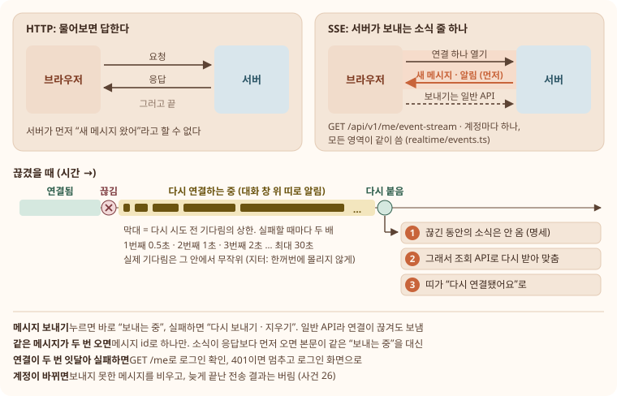

### 이 프로젝트에서는
```
화면 (Chat.tsx · 알림 · 헤더)       ← useChatEvents · useEventStream('NOTIFICATION_UNREAD_CHANGED', …)
  └ 영역 훅 (api/chat/queries.ts …)   ← 소식을 캐시에 붙임 · 다시 붙으면 다시 받기 · 보내는 중/실패
      └ realtime/events.ts            ← 앱 전체에 연결 하나 (startEventStream · stopEventStream)
          └ realtime/eventStream.ts   ← EventSource · 다시 연결 · 로그인 확인 (목은 mockEvents)
```
| 문제 | 이 프로젝트의 대응 (`frontend/src/realtime/`, `api/chat/`) |
|---|---|
| 끊김 | 지수 백오프 + 지터로 다시 시도 (0 ~ min(30초, 0.5초 × 2^n) 사이에서 무작위, 단 0.3초보다 짧게는 안 기다림, `backoff.ts`) |
| 놓친 소식 | 명세상 다시 오지 않는다 → 다시 붙으면 `useRefetchOnReconnect`가 그 영역 캐시를 조회 API로 다시 받음 |
| 두 번 보임 | 메시지 id로 한 번만. 내 메시지가 응답보다 먼저 소식으로 오면 본문·사진 수가 같은 가장 오래된 "보내는 중"을 대신 (명세에 보낸 쪽 id가 없어서) |
| 보내기 | 일반 API `POST /chat-rooms/{id}/messages`. 누르면 바로 "보내는 중"(`api/chat/outbox.ts`), 실패하면 "다시 보내기 · 지우기". 연결이 끊겨도 보낼 수 있음 |
| 로그인 만료 | `EventSource`는 상태 코드를 못 봐서, 두 번 잇달아 실패하면 `GET /me`로 확인해 401이면 멈추고 로그인 흐름으로 (`lib/authFlow.ts`) |
| 계정 전환 | 로그아웃하면 연결을 끊고(`lib/signOut.ts`), 로그아웃·401·로그인 성공 때 outbox를 비움. 세대 번호로 늦게 끝난 전송 결과를 버림 |

### 직접 해 볼 것
- `/chat/r-yerin?rt=flaky`(가끔 끊김)에서 메시지를 보내며 "다시 연결하는 중…" 띠와, 다시 붙은 뒤 놓친 메시지가 들어오는 것을 본다
- `?rt=down`(실시간 서버 없음)에서 메시지는 보내지지만 상대 답장이 화면에 안 오는 것을 본다
- 개발 서버 콘솔에서 `__digulChat.drop(3000)`으로 3초 끊어 보고, `__digulChat.incoming('r-yerin', '안녕')`으로 상대 메시지를 흉내 낸다 ([backend/api-v1/06-chat.md](backend/api-v1/06-chat.md) 2장)

---

## 8. 3D를 React 앱에 넣기

### 8-1. three.js 기본 구성
```
Renderer(그리는 기계, <canvas>) ← Scene(물체·조명) + Camera(어디서 보나)
매 프레임: 움직임 계산 → renderer.render(scene, camera)
```
| 요소 | 이 프로젝트 |
|---|---|
| 모델 | 디자이너 glb. 두더지는 뼈대 애니메이션(동작 여러 개), 액세서리 41개는 소켓 뼈에 붙임 (`moleActor.ts`, `moleDress.ts`) |
| 땅굴 방 | 조명을 Blender에서 **미리 구운** glb. 실시간 그림자·후처리 없음. 톤매핑은 Blender와 같은 AgX, 조명은 몇 개뿐 (`roomScene.ts`) |
| 탐색 들판 | 땅·구멍·꽃·풀을 코드로 만들고 같은 부품을 한꺼번에 그리는 인스턴싱. 12m 칸 단위로 화면 밖은 안 그림 (`holeField.ts`) |
| 랜딩 밭 | 예전 밭 장면. 후처리(N8AO 구석 그림자 + 색 보정)를 씀 (`fieldScene.ts`) |
| 그림자 | 땅굴은 구운 그림자 + 두더지 발밑 그림자 판 (바닥이 구운 텍스처라 실시간 그림자를 못 받음) |

### 8-2. React와 three.js의 경계
React는 "선언형"(상태 → 화면), three.js는 "명령형"(만들고, 바꾸고, 지움)이다. 둘을 섞는 요령은 **경계를 하나로 정하는 것**이다. 이 프로젝트의 경계는 `three/SceneCanvas.tsx`다.

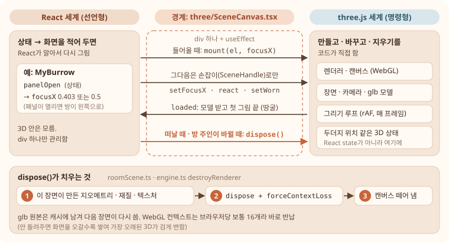

```tsx
useEffect(() => {
  const h = mount(el, focusX)   // 마운트: 렌더러·장면 만들기 (실패하면 3D 경계에 알림)
  return () => h.dispose()      // 언마운트: 전부 정리
}, [deps])                       // 방 주인이 바뀌면 새로 만들기
```
- 장면은 `SceneHandle`(손잡이 객체: `dispose`, `resize`, `setFocusX`, `react`, `setWorn`, `loaded` …)만 내놓는다. React는 이 손잡이로만 말한다. 두더지 위치 같은 3D 상태는 React state가 아니라 장면 안에 있어서, 매 프레임 React가 다시 그리지 않는다
- **정리(cleanup)가 중요한 이유**: WebGL 컨텍스트는 브라우저당 개수가 제한(보통 16개)되어 있다. 화면을 오갈 때마다 정리하지 않으면 결국 가장 오래된 3D가 검게 변한다. 장면은 자기가 만든 것(블록·먼지·그림자 판 등)을 해제하고, `engine.ts`의 `destroyRenderer`가 렌더러를 버리고 컨텍스트를 반납한다(`forceContextLoss`). glb 모델은 다음 장면에서 다시 쓰려고 캐시에 남긴다(GPU 쪽은 렌더러와 함께 풀림)
- **StrictMode**: 개발 중 React가 effect를 일부러 두 번 돌려 정리 누락을 드러낸다. 그래서 캔버스를 매번 새로 만든다
- **컨텍스트를 도중에 잃으면**(드라이버 재시작, GPU 메모리 부족): 1.5초 뒤 장면을 다시 만든다(최대 2번, 그 뒤엔 2D). 우리가 정리할 때 부르는 `forceContextLoss`도 같은 신호를 내므로 정리 전에 듣기를 끈다
- **장면 위 HTML**: 집주인 머리 위 말풍선 같은 것은 `overlay`로 장면과 같은 자리에 겹친다

### 8-3. 그리기 루프 — `engine.ts`의 `startLoop`
- `requestAnimationFrame`(rAF): 화면 주사율(보통 60Hz)에 맞춰 다음 그림 직전에 함수를 불러 준다
- `dt`(지난 프레임 이후 흐른 초)를 곱해서 움직이면 30fps든 144fps든 같은 속도로 움직인다. 한 프레임 dt는 최대 0.1초로 자른다(탭이 멈췄다 돌아와도 순간 이동하지 않게)
- 탭이 숨으면(`visibilitychange`) 멈춘다
- `ResizeObserver`로 컨테이너 크기가 바뀌면 캔버스와 카메라 비율을 다시 맞춘다
- 저사양에서는 장면이 "바쁘지 않음"을 알려 주면 1초 뒤 그리기를 멈추고(쉬면 멈춤), 몇 초마다 잠깐 깨워 숨쉬기를 보여 준다. fps 상한도 장면마다 줄 수 있다(예: 찻방 숨쉬기 15fps)

### 8-4. 지연 로딩 — `components/RoomView.tsx`
```tsx
const RoomCanvas = lazy(() => import('../three/RoomCanvas'))
```
- `import()`를 만나면 빌드 도구(Next의 Turbopack, 예전엔 Vite)가 그 아래를 **별도 파일(청크)** 로 나눈다. 땅굴 화면에 들어갈 때만 내려받는다. 예전 Vite 빌드에서 three.js 본체가 든 청크는 원본 608KB, gzip 157KB였다 ([testing-ci.md](testing-ci.md) 4장)
- 같은 방식: 탐색 들판 `HoleFieldCanvas`, 찻방 `ChatRoomCanvas`, 랜딩 밭 `FieldCanvas`
- 3D가 준비되는 동안: "땅굴 파는 중..." 로딩 애니메이션 → 다 차려지면(`loaded`) 0.6초 페이드 인. 랜딩 밭은 같은 구도의 정지 그림을 깔아 두고 3D를 겹쳐 띄운다. 가속 꺼진 PC의 두 번째 방문은 기억해 둔 선명한 그림을 먼저 보여 준다
- 화면(라우트): 예전 Vite 앱은 모든 화면을 처음에 한꺼번에 불러와 첫 화면 JS가 380KB(gzip)였다 ([testing-ci.md](testing-ci.md) 4장). Next는 주소(`page.tsx`)마다 파일을 나눈다. Next 빌드의 첫 화면 크기는 아직 재지 않았다 (확인 못 함)

### 8-5. 3D 위에 HTML 올리기
- 패널·버튼·이름표는 3D가 아니라 **HTML을 캔버스 위에 겹쳐서** 그린다. 글자가 선명하고 화면 읽기 프로그램이 읽을 수 있다
- 가구 이름표·말풍선 위치: 3D 좌표를 `vector.project(camera)`로 화면 좌표로 바꿔 CSS 위치에 넣는다 (`roomScene.ts`)
- 패널이 열리면 방을 왼쪽으로: 카메라 `setViewOffset`으로 "더 넓은 가상 화면의 일부"를 보여 준다 (`engine.ts`). 방 구도 숫자는 `three/roomFrame.ts`의 `ROOM_FRAME` 한 곳에 모았다

### 8-6. 입력: 클릭으로 땅 고르기, 키보드 조종
- **레이캐스트**: 클릭한 화면 점에서 카메라 방향으로 광선을 쏘아 바닥·가구와 만나는 점을 구한다 → 두더지가 그쪽으로 걸어감, 방석이면 앉음
- 키보드(`three/keys.ts` `bindDriveKeys`): 누른 키를 모아 방향을 합친다
- 단축키 공통 검사(`lib/a11y.ts` `shortcutAllowed`): 글 입력 중, 한글 조합 중, 팝업이 열렸을 때 등은 단축키가 쉰다. 그래야 채팅에 "w"를 쳤는데 두더지가 걷는 일이 없다

### 8-7. 데이터 → 3D (관심사 → 가구)
- 관심사 목록은 `data/interestTags.ts`(대분류 12 · 소분류 90 · 최대 10개, 2026-11-18 확정본), 가구는 `furnitureCatalog.json`, 자리는 `slots.json`
- `data/roomPlan.ts`의 `planRoom`이 three.js 없이 배치를 계산한다(어느 슬롯에 무엇, 떨어지는 순서·시각). 그래서 단위 테스트로 "무작위 조합 300개에서 슬롯이 안 겹친다"를 확인할 수 있다 (`tests/room-plan.test.ts`)
- `roomScene.ts`는 그 계획대로 모델을 받아 놓는다. 새 모델이 오면 glb와 JSON만 바꾸면 된다

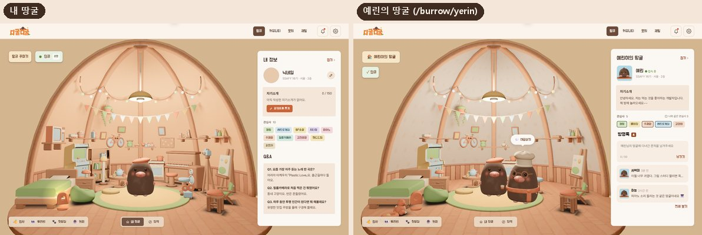

### 8-8. 원본은 한 곳에
- 처음 만든 코드 두더지·가구는 `explore/3d/lib/`에 원본이 있고, `node explore/3d/lib/build-app.js`가 예전 Vite 앱용 `app/src/three/mole.ts`, `furniture.ts`를 만든다. 이 두 파일은 직접 고치지 않는다
- 지금 장면은 디자이너 glb를 쓰고 이 두 파일을 불러오지 않아서, `frontend/`에서는 지웠다(2026-11-23). 두더지 모델은 `three/moleModel.ts`가 디자이너 glb 하나를 읽는다

### 직접 해 볼 것
- 개발자 도구 → Network에서 땅굴에 처음 들어갈 때 받는 파일(three 청크, glb)을 확인한다
- 땅굴 ↔ 게시판을 여러 번 오가도 3D가 잘 뜨는지 본다 (정리가 잘 되는지)
- 채팅 입력칸에 WASD를 쳐도 두더지가 안 움직이는지 본다

---

## 9. 그래픽 성능의 기본 개념

그래픽 가속이 꺼진 PC 대응([가이드 사건 2](frontend-guide.md#사건-2-그래픽-가속이-꺼진-pc에서-페이지-전체가-멈춤-2026-11-11--17-가장-큰-사건))을 이해하는 데 필요한 개념만 모았다.

### 9-1. 무엇이 느린가: 정점이냐 픽셀이냐
- 그림 한 장을 그리는 비용은 크게 둘이다. **정점**(모양의 꼭짓점 수, 그리기 호출 수)과 **픽셀**(화면 점 수 × 점마다 재질 계산)
- 어느 쪽이 병목인지에 따라 고칠 곳이 다르다. 탐색 들판은 해상도를 0.3배로 줄이면 프레임 시간이 거의 비례해 줄었고, 꽃·풀을 빼도 그대로였다. 화면 가득한 땅 한 장을 빼니 절반이 됐다 → **픽셀이 병목**. 그래서 그리기 호출 묶기 같은 정점 쪽 후보는 하지 않았다 ([rendering-experiments-2.md](rendering-experiments-2.md) 3장)
- 찾는 법: 하나씩 빼거나 줄여 보며 시간을 잰다

### 9-2. 메인 스레드와 긴 작업
- 브라우저 페이지에는 클릭·스크롤·화면 그리기를 처리하는 일꾼(메인 스레드)이 하나 있다. 이 일꾼이 50ms 넘게 한 일에 묶이면("긴 작업") 그동안 입력이 멈춘다
- 가속이 꺼지면 3D 그리기가 이 일꾼을 오래 붙잡아 페이지 전체가 멈췄다. 그래서 "3D를 덜 그리기"가 "3D를 예쁘게 줄이기"보다 먼저였다
- **Worker**: 메인 스레드와 따로 도는 일꾼. Draco 해독을 Worker로 옮겨 첫 진입 멈춤을 줄였다. 땅굴 전체를 Worker에서 그리는 시험판도 만들었지만 말풍선·이름표를 못 쓰고 공유 빌드에서 빈 화면이 돼 꺼 두었다

### 9-3. 덜 그리기
| 기법 | 생각 | 이 프로젝트 |
|---|---|---|
| 쉬면 멈춤 | 아무것도 안 움직이면 그리지 않는다 | 저사양에서 1초 쉬면 멈춤, 가끔 숨쉬기 |
| 배경 한 번 (A) | 움직이지 않는 것은 **렌더 타깃**(숨은 도화지)에 한 번 그려 두고, 매 프레임은 그 그림을 붙인 뒤 두더지만 그린다. 깊이(앞뒤 정보)도 같이 저장해 두더지가 꽃 뒤로 가면 가려진다 | `three/staticBackdrop.ts`. 2코어 WARP 탐색 걷기 페이지 8.7 → 60fps |
| 부분 그리기 (P) | 두더지 둘레 사각형만 지우고 다시 그린다(scissor) | 영역 계산이 틀리면 잔상 ([사건 7](frontend-guide.md#사건-7-저사양에서-두더지가-떨어질-때-머리가-잘리고-잔상이-남음-2026-11-12)) |
| 해상도 낮추기 | 0.55배로 그리고 CSS로 늘린다. 카메라 이동 중엔 더 낮게 | 저사양 기본. 대신 흐려짐 → 9-4 |

- 배경 한 번(A)과 선명한 배경(S)을 그림으로 보려면 [가이드 2-7](frontend-guide.md#2-7-3d-화면이-뜨기까지)

### 9-4. 선명하게
- **안티앨리어싱**: 사선의 계단을 부드럽게 하는 것. 슈퍼샘플(더 크게 그려 줄이기, 비쌈)과 **MSAA**(가장자리에서만 여러 점을 샘플링, GPU 화면과 같은 방식)가 있다
- **선명한 배경(S)**: 멈춰 있을 때 배경만 고해상도로 한 번 구워 2D 캔버스에 깔고, 위 WebGL 캔버스는 투명하게 두고 두더지만 낮은 해상도로 그린다. "배경은 선명하게, 두더지는 조금 낮춰도 된다"는 요청에서 나왔다
- **띠로 나눠 굽기**: 한 번에 다 그리면 그 순간 멈추므로 여러 프레임에 띠 하나씩 굽는다 (`three/sharpBake.ts`)
- **비동기 읽기(PBO + 펜스)**: GPU가 그린 그림을 꺼낼 때 "다 될 때까지 기다리기" 대신 "복사를 걸어 두고, 끝났다는 표시(펜스)가 오면 다음 프레임에 꺼내기" → 메인 스레드가 기다리지 않는다

### 9-5. 색 공간: 선형과 sRGB
- 화면에 보내는 색 눈금(sRGB)과 빛을 계산하기 좋은 색 눈금(선형)이 다르다. 같은 숫자라도 어느 눈금이냐에 따라 밝기가 다르다
- 반투명한 것을 바탕과 섞을 때 어느 눈금에서 섞느냐에 따라 결과가 달라진다. 선명한 배경을 선형 렌더 타깃에서 굽자 가구 밑 반투명 그림자가 사라졌고, 캔버스와 같은 sRGB로 굽자 돌아왔다 ([사건 5](frontend-guide.md#사건-5-선명하게-구운-배경에서-가구-밑-그림자가-사라짐-2026-11-17))
- 톤매핑: 실제 빛의 넓은 밝기 범위를 화면이 낼 수 있는 범위로 줄이는 변환. 땅굴은 Blender와 같은 AgX를 쓴다

### 9-6. 셰이더 컴파일과 예열
- **셰이더**는 그래픽카드에서 도는 작은 프로그램이다. 재질 조합마다 처음 쓰기 전에 컴파일(번역)·링크가 필요하고, 이때 화면이 멈칫한다
- **예열**: 화면에 보이기 전에 미리 컴파일하고, 텍스처를 올리고, 물체를 1×1 크기로 한 번씩 그려 둔다. 그동안 그리기 루프는 쉰다 (`three/warm.ts`)
- 함정: 기다리는 방법이 나쁘면 예열이 오히려 느려진다. 물체마다 따로 "다 됐나"를 계속 물었더니 GPU 프로세스를 붙잡아 느려졌고, 루프 하나로 한꺼번에 기다리게 바꿨다 ([사건 4](frontend-guide.md#사건-4-예열이-오히려-느리게-만듦-2026-11-16--17))

### 9-7. 화질을 숫자로: PSNR과 SSIM
- 같은 장면을 GPU 고화질과 저사양으로 찍어 비교한다
- **PSNR**(dB): 픽셀 값이 얼마나 같은지. 높을수록 같다(같은 그림이면 아주 큼, 이 문서들에서는 99로 표시)
- **SSIM**(0~1): 구조(모양·경계)가 얼마나 같은지. 1에 가까울수록 같다
- 이 프로젝트는 영역을 나눠 잰다: 배경, 두더지, **가장자리**(밝기가 크게 바뀌는 상위 10%, 계단·흐림이 드러나는 곳)
- 숫자만 보지 말고 차이 지도를 눈으로 본다 (사건 5는 숫자만으로는 원인을 몰랐다)

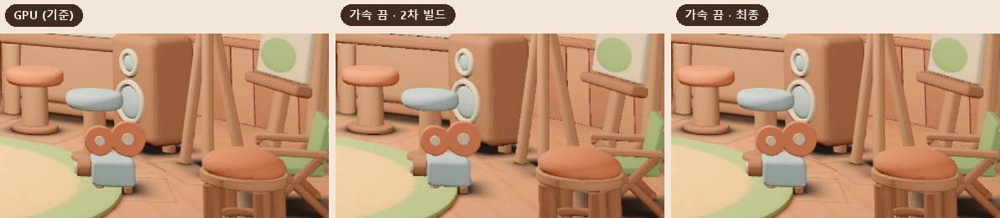

### 9-8. 측정하는 법
| 지표 | 뜻 |
|---|---|
| 장면 fps | 3D가 1초에 실제로 그린 그림 수 |
| 페이지 rAF fps | 페이지 전체가 얼마나 부드러운지(버튼·스크롤 반응) |
| 긴 작업 합 · 가장 긴 멈춤 | 메인 스레드를 50ms 넘게 막은 시간의 합 · 그중 가장 긴 것 |
| 다 보이기까지 | 들어와서 다 차려진 화면이 보이기까지 |
| 그리기 CPU | 가속 끈 크롬에서 그림을 그리는 GPU 프로세스의 CPU 사용률(100% = 코어 하나) |

- 같은 PC를 크롬을 CPU 2개에 묶어(약한 PC 흉내) 같이 잰다
- 기준과 개선을 번갈아(A/B/A/B) 여러 번 재고 중앙값을 쓴다. 소프트웨어 렌더러는 같은 설정도 ±30% 흔들렸다
- 도구: `explore/gpu/`(헤드리스 크롬을 CDP로 조종하는 측정 스크립트)

### 직접 해 볼 것
- 가속을 끈 크롬에서 🧪 저사양 실험실 패널(`?lowlab`)을 열고 A(배경 한 번)를 끄고 켜며, 두더지를 걷게 하고 오른쪽 패널을 스크롤해 본다
- `?tier=weak`와 `?tier=strong`으로 탐색 들판 점프를 비교한다

---

## 10. 빌드 · 환경 변수 · 배포

### 명령 (`frontend/`에서)
| 명령 | 하는 일 |
|---|---|
| `npm run dev` | 개발 서버 (http://localhost:3000). 저장하면 바로 반영. 실험실 켜짐, 목 서버 |
| `npm run build` | `next build`: 타입 검사 · 묶기 · 줄이기 · 파일명에 해시 → `.next/`. 실험실은 빠짐 |
| `npm run start` | 빌드 결과를 Next 서버로 띄우기 (포트 3000) |
| `npm run typecheck` / `npm run lint` | `tsc --noEmit` / ESLint |
| `npm test` / `npm run test:watch` | 단위 테스트 한 번 / 저장할 때마다 |
| `npm run smoke` | 빌드한 앱을 `next start -p 3100`으로 띄워 헤드리스 크롬으로 모든 화면 돌기 (`-- --gpu=off`로 가속 끔) |
| `npm run check:labs-off` | 실험실 끈 빌드를 만들어 실험실 주소 404 · 결과물에 실험실 코드 없음 확인 |

예전 Vite 앱(`app/`)의 명령: `npm run build:share`(팀 공유용: 상대 경로, 해시 라우터, glb를 JS 안에 → `dist-share/` + 아티팩트용 페이지), `npm run bundle-report`(청크별 크기)

### 파일 이름 해시와 캐시
- `RoomCanvas-ab12.js`처럼 내용이 바뀌면 이름도 바뀐다 → 브라우저가 옛 캐시를 쓰지 않는다. 그래서 해시 붙은 파일은 오래 캐시해도 안전하고, HTML만 캐시하지 않으면 된다. Next는 `/_next/static/` 아래 파일에 해시를 붙인다
- 대가: 열려 있던 옛 탭이 지워진 옛 이름을 찾는다 → 한 번 새로고침 ([가이드 사건 12](frontend-guide.md#사건-12-재배포-뒤-열려-있던-탭이-깨짐-청크-404))
- 3D 모델·이미지도 import 하면 해시 붙은 주소 문자열이 된다(`next.config.ts`의 Turbopack `type: 'asset'` 규칙). `public/`에 두면 해시가 없어 캐시를 못 깨므로 Draco 해독기(`public/draco/`) 말고는 쓰지 않는다

### 환경 변수
- 읽는 곳은 `src/lib/env.ts`의 `ENV` 하나. 목록과 설명은 `frontend/.env.example` (예외: 실험실을 빌드에서 빼는 `src/labs/index.ts`는 `process.env`를 직접 읽음)
- 값은 늘 문자열. 켜기/끄기는 `flag()`가 `1·true·yes·on`만 참으로 읽는다
- `NEXT_PUBLIC_`로 시작하는 값은 **빌드할 때** 결과 JS에 글자 그대로 들어가 누구나 볼 수 있다 → 비밀 키 금지. 바꾸면 다시 빌드하거나 개발 서버를 다시 켠다
- 서버 전용 값(`API_PROXY_TARGET`)은 `next.config.ts`가 읽고 브라우저 코드에는 안 들어간다. 다만 rewrites가 빌드 결과에 들어가 `next build` 때 정해진다
- 개인 설정은 `frontend/.env.local`(git에 안 올라감)

| 이름 | 기본 | 뜻 |
|---|---|---|
| `NEXT_PUBLIC_LABS` | dev 켬 · build 끔 | 실험실(🧪 패널 · 손잡이 배지 · `/screens` · `/dev/crash` …) 포함 여부 |
| `NEXT_PUBLIC_API_MODE` | `mock` | 모든 영역의 기본값 (`mock` · `real`) |
| `NEXT_PUBLIC_API_REAL_AREAS` / `_MOCK_AREAS` | 비움 | 이 영역만 실제 / 목 (실시간 연결은 `events`) |
| `NEXT_PUBLIC_LOGIN_FREE` | 비움(검사함) | `1`이면 로그인 없이 모든 화면 (시연용) |
| `API_PROXY_TARGET` | `http://localhost:8080` | `/api/v1/*`를 넘길 백엔드 (`off`면 안 넘김) |

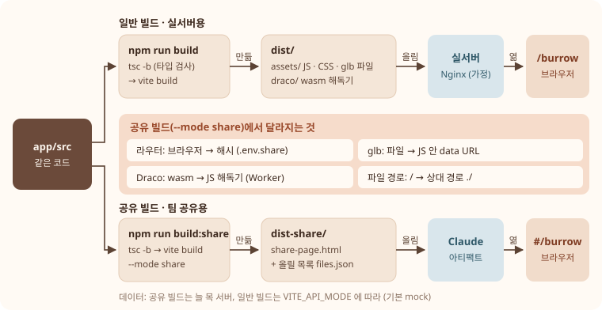

### 두 프로젝트
| | `frontend/` (Next.js) | `app/` (예전 Vite, 공유 빌드) |
|---|---|---|
| 쓰는 곳 | 실서비스 · 팀 리포 (PR #37) | 팀 공유 데모 (Claude 아티팩트) |
| 라우터 | Next App Router (`/burrow`) | 해시 라우터 (`#/burrow`) |
| 첫 화면 | `/` 랜딩 | `#/start`로 보냄 |
| glb 모델 | 파일로 | JS 안에 data URL로 (아티팩트가 .glb를 못 받음) |
| Draco 해독 | wasm (`public/draco/`) | JS 해독기를 Worker에서 (실패하면 메인 스레드) |
| 데이터 | 영역마다 목/실제 (`NEXT_PUBLIC_API_*`) | 늘 목 서버 |
| 로그인 검사 | 기본 켬 | 꺼짐 (누구나 둘러봄) |
| 명세 반영 | 최신 (리뷰 고침 포함) | 2026-11-23 명세 `35d107a`까지 |

### 직접 해 볼 것
- 개발자 도구 → Network에서 `/_next/static/` 아래 해시가 붙은 파일 이름을 찾아본다
- `frontend/.env.example`을 읽고 각 변수가 무엇을 바꾸는지 설명해 본다
- `NEXT_PUBLIC_LABS=0 npm run build && npm run start`로 띄워 `/screens`가 404인 것을 본다

---

## 11. 테스트

### 개념
- **단위 테스트**: 함수 하나에 입력을 넣고 답이 맞는지 자동으로 확인한다. 화면 없이 빠르게 돈다
- **스모크 테스트**: 앱을 켜 보고 "연기가 나는지"만 본다. 깊이 확인하지 않지만 넓게 훑는다
- **린트**: 코드 모양과 흔한 실수(훅 규칙 등)를 자동으로 찾는다
- **CI**: 코드를 올릴 때마다 위 검사를 자동으로 돌린다
- **리뷰**: 사람(또는 AI)이 바뀐 코드를 읽고 문제를 짚는다. 자동 검사가 못 잡는 "실제 모드에서만" 틀리는 것을 찾는다

### 이 프로젝트에서는
- 단위 테스트 661개(2026-11-24), `frontend/src/tests/`
  - 테스트 이름에 명세 번호를 적는다: "M7 마감 일시가 지나면 처리 안 된 신청은 자동 미승인", "M2 만들자마자 1명 확정 (주최자)"
  - **명세와 맞춰 보는 시험**: `api-v1-endpoints.test.ts`가 명세 사본(`docs/backend/team-spec/api/*.md`)의 API 제목 111개와 영역마다의 `ENDPOINTS`를 비교한다. 명세가 바뀌면 `spec-61e6c10.test.ts`처럼 그 판의 규칙을 시험으로 남긴다
  - 리뷰에서 나온 문제는 고칠 때 시험을 먼저 만든다: `auth-cache`, `session-mutation`(쓰기 훅이 모두 `useSessionMutation`을 쓰는지까지), `query-gate`, `optimistic-rollback`, `comment-order`, `chat-room-gone`, `notif-settings-save`, `guestbook-report-refresh`
  - 시간대는 서울로 고정한다(CI 서버는 UTC라 날짜 계산이 달라짐). 시계를 고정하고(`vi.setSystemTime`) 저장소를 처음 상태로 되돌린 뒤 검사한다
  - 화면 규칙을 화면 밖 함수로 빼 두었기 때문에 테스트하기 쉽다(모임 상태, 방 배치, 들판 자리, 비밀번호 규칙 등)
  - 한계: 목 서버로 도는 시험은 "목에서만 맞는 코드"를 못 잡는다 ([가이드 사건 25](frontend-guide.md#사건-25-나와-오늘을-목-상수로-정함-2026-11-24-로컬-리뷰))
- 스모크 `frontend/scripts/smoke.mjs`: `next build` 결과를 `next start -p 3100`으로 띄우고, `src/app` 파일 트리와 화면 목록에서 106개 주소를 만들어 하나씩 연다. 잡는 것: 처리 안 된 예외, `console.error`, 리소스 4xx/5xx, 빈 화면, 오류 화면, 캔버스가 WebGL을 얻었는지. 모드: 가속 켬 · 끔 · WebGL 없음 · SwiftShader
- 실험실 빠짐 검사 `frontend/scripts/check-labs-off.mjs`: 배포 빌드에 실험 화면·패널이 들어가지 않았는지
- CI `.github/workflows/frontend-ci.yml`: `frontend/`나 명세 사본이 바뀌면 설치 → 타입 → 린트 → 테스트 → 빌드 → 실험실 빠짐 검사. 스모크는 그래픽카드 없는 러너라 CI에서 돌리지 않고 로컬에서 돌린다
- 팀 리포로 옮길 때는 커밋 62개 하나하나마다 타입·린트·테스트·빌드를 돌렸다(커밋마다 빌드 통과 규칙)

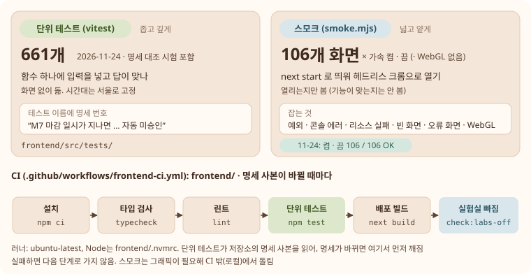

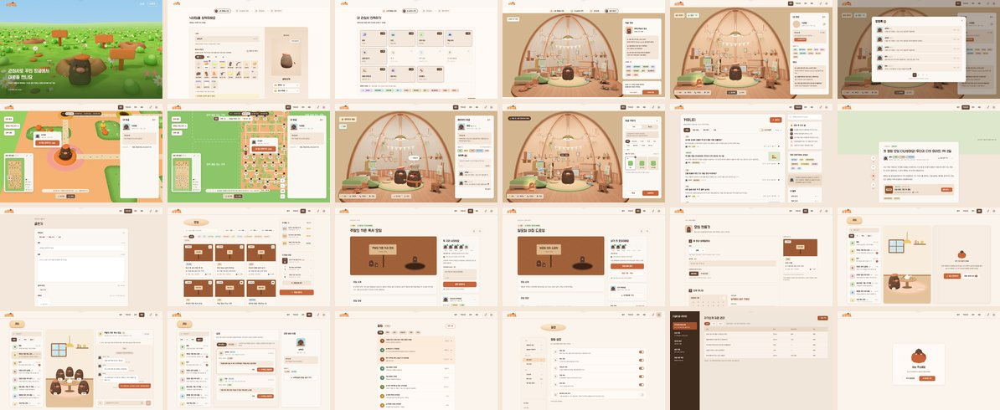

### 직접 해 볼 것
- `npm test`를 돌리고, `src/tests/meetup.test.ts`에서 명세 번호(M2, M5, M7 …)가 붙은 테스트 이름을 찾아 명세 문서([meetup-spec-review.md](meetup-spec-review.md))와 맞춰 본다
- `npm run smoke -- --only=meetups`처럼 일부 화면만 돌려 보고 `frontend/shots/smoke/<gpu>/report.md` 보고서를 연다
