# 디굴디굴 프론트엔드 가이드

디굴디굴 웹 앱의 프론트엔드(브라우저에서 도는 부분)를 어떤 기술로, 왜 만들었고, 만들면서 어떤 사고를 겪고 어떻게 풀었는지 정리한 안내서다.

- 날짜: 2026-11-24 (2026-11-17 판을 지금 코드에 맞게 고침: 앱이 Vite `app/` → Next.js `frontend/`로 옮겨 갔고, 백엔드 확정 API 명세 v1에 맞췄고, 채팅 실시간이 WebSocket + STOMP → SSE로 바뀜. 사건 22~31 추가)
- 대상 독자: 이 프로젝트의 기획·관리자와 백엔드 개발자. 코드를 직접 짜지 않아도 "무엇을, 왜, 어떤 대가를 치르고" 만들었는지 설명할 수 있게 하는 것이 목표. 2장은 그림만 따라가도 읽히게 썼다
- 짝 문서: [개념 학습 (frontend-guide-concepts.md)](frontend-guide-concepts.md). React·라우팅·스타일·타입·데이터·실시간·3D·빌드·테스트를 "개념 → 이 프로젝트에서는 → 직접 해 볼 것" 순서로 설명한다. 이 문서는 "왜"와 "사건"에 집중한다
- 숫자: 모두 링크한 문서에서 옮겼다. 측정한 PC·브라우저·빌드가 문서마다 달라서, 서로 다른 문서의 숫자를 바로 비교하면 안 된다. 그래픽 숫자(사건 1~9)는 예전 Vite 앱 `app/`에서 잰 것이다. 3D 코드는 `frontend/`로 그대로 옮겼다
- 그림: SVG는 `docs/guide-diagrams/`, 사진은 `docs/guide-images/`. 앱 사진은 2026-11-17 예전 Vite 앱 빌드를 헤드리스 크롬으로 찍은 것이다 (만든 방법 `tools/guide-page/make-images.py`). Next 앱과 화면 비교에서 정적인 화면은 픽셀이 같았다 ([nextjs-migration.md](nextjs-migration.md) "화면 비교")

## 목차
0. [이 문서를 읽는 법](#0-이-문서를-읽는-법)
1. [5분 요약](#1-5분-요약)
2. [그림으로 보는 프론트엔드 (기획자·백엔드 개발자용)](#2-그림으로-보는-프론트엔드-기획자백엔드-개발자용)
3. [기술 선택과 이유](#3-기술-선택과-이유)
4. [치명적인 문제와 해결 (사건 기록)](#4-치명적인-문제와-해결-사건-기록)
5. [이 앱의 구조 다시 보기](#5-이-앱의-구조-다시-보기)
6. [백엔드를 연결할 때 알아야 할 것](#6-백엔드를-연결할-때-알아야-할-것)
7. [직접 해 볼 것과 공부 순서](#7-직접-해-볼-것과-공부-순서)
8. [용어집](#8-용어집)

---

## 0. 이 문서를 읽는 법
- 처음이라면 1장(5분 요약) → 2장(그림) → 4장 맨 앞 표 → 관심 가는 사건 하나 → 3장 순서로 읽는다. 기획자·백엔드 개발자는 2장만 읽어도 된다
- 전문 용어는 처음 나올 때 괄호로 풀고, 8장 용어집에 모았다
- 코드 위치는 `frontend/src/...` 기준으로 적었다(따로 적지 않으면 `src/` 아래). 예전 Vite 앱은 `app/src/...`로 구분한다. 파일을 열 필요는 없다. "어디를 보면 되는지"를 알려 주는 표시다
- "확인 못 함"이라고 적은 것은 문서·코드로 사실을 확인하지 못한 것이다. "예전"이라고 적은 것은 지금 코드에는 없고 까닭을 남기려고 둔 것이다

---

## 1. 5분 요약

### 1-1. 한 장 그림

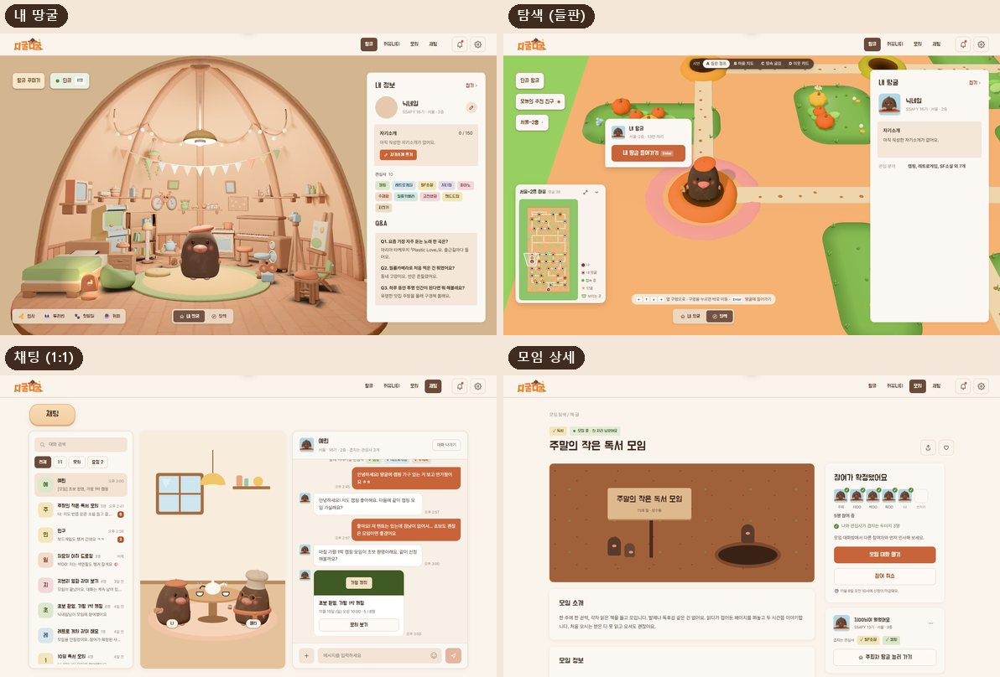

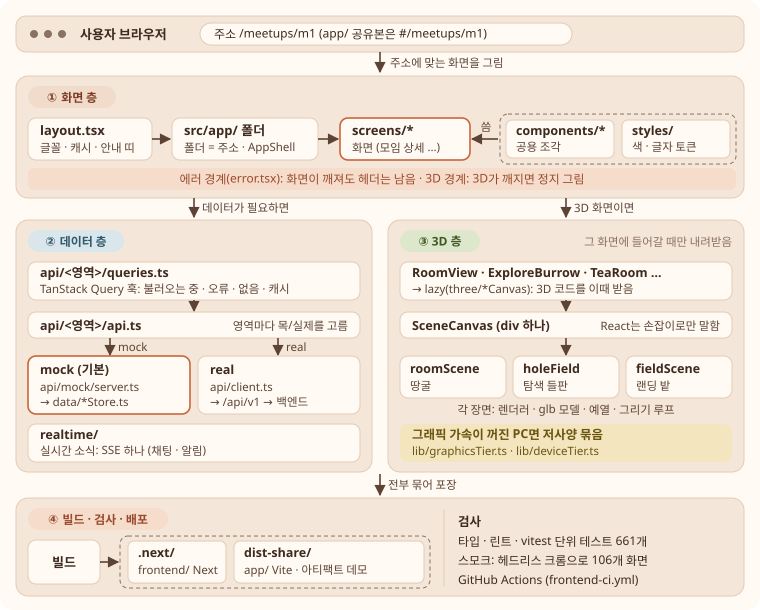

### 1-2. 다섯 줄 요약
1. **화면**: Next.js 16.4(App Router) + React 19.3 + TypeScript 6.0. `src/app/` 폴더 모양이 곧 주소다. 화면은 모두 브라우저에서만 그린다(첫 HTML은 빈 칸). 팀 공유 데모만 예전 Vite 앱 `app/`에서 `#` 주소로 만든다
2. **모양**: 색·글자 크기에 이름을 붙인 디자인 토큰 + 파일마다 따로 노는 CSS Modules. UI 라이브러리는 쓰지 않는다
3. **데이터**: 화면은 "훅"만 부른다. 백엔드 확정 API 명세 v1(API 111개)에 맞춘 영역 폴더 11개가 있고, 영역마다 목 서버(가짜 서버)와 실제 서버를 환경 변수로 바꿔 끼운다. 실시간 소식은 SSE 연결 하나
4. **3D**: three.js를 직접 쓴다. 디자이너가 만든 glb 모델에 조명을 미리 구워 넣었다. 그래픽 가속이 꺼진 PC를 위해 저사양 기법을 세 차례 다듬었다
5. **품질**: 타입 검사, 린트(오류 0), 단위 테스트 661개, 106개 화면 스모크(가속 켬·끔), 실험실 빠짐 검사, CI(`frontend-ci.yml`), 팀 리포 PR 리뷰(로컬 + Codex 9번)

### 1-3. 지금 상태 (2026-11-24)
- 백엔드는 공통·로그인 일부만 구현됐다. 나머지 영역은 명세 모양을 그대로 흉내 내는 목 서버로 돈다 ([backend/api-v1-alignment.md](backend/api-v1-alignment.md))
- 로그인 검사는 **기본으로 켜져 있다**(명세대로). 시연·디자인 확인 때만 `NEXT_PUBLIC_LOGIN_FREE=1`로 끈다. 예전 Vite 공유 빌드는 계속 열려 있다 ([team-import-decisions-2026-11-23.md](team-import-decisions-2026-11-23.md))
- 팀 리포(it-ting-team/it-ting)에 PR #37(KAN-64)로 올렸다. 서명 커밋 93개(2026-11-24 오후 기준), 병합은 사람이 한다
- 공유 링크(예전 Vite 앱): 팀 링크 https://claude.ai/artifact/Fd1hfXP3T6nzY2Zg4QXYAS, 시험판 https://claude.ai/artifact/NH6JiBu6qKJmr1SNRR1fJ9
- 큰 남은 일: 영역별 실제 백엔드 연결(다음 티켓), 백엔드 질문 답 받기([questions-for-backend.md](backend/api-v1/questions-for-backend.md)), 배포 형태 정하기, 실제 다른 PC와 인터넷 환경에서 그래픽 다시 재기

---

## 2. 그림으로 보는 프론트엔드 (기획자·백엔드 개발자용)

코드를 몰라도 "프론트엔드가 무슨 일을 하고, 왜 시간이 들고, 기획·백엔드와 어디서 맞물리는지"를 그림으로 보는 장이다. 그림마다 설명은 짧게 붙였고, 자세한 이유와 사건은 3장부터 있다.

### 2-1. 누가 무엇을 맡나: 브라우저 · 서버 · DB

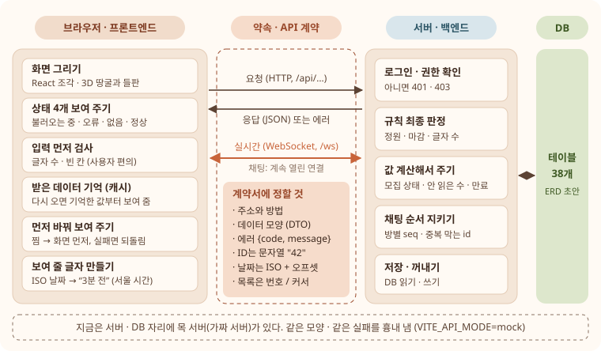

- 프론트엔드는 **브라우저 안에서 도는 모든 것**이다. 화면을 그리고, 기다리는 동안과 실패했을 때 무엇을 보여 줄지 정하고, 받은 데이터를 기억한다
- 백엔드는 **진짜 판정**을 한다. 정원·마감·글자 수를 프론트도 미리 검사하지만 사용자 편의용이다. 최종 판정과 모집 상태·버튼을 켤지(`can*`)·안 읽은 수 같은 계산은 서버가 해서 준다 ([backend/api-v1-alignment.md](backend/api-v1-alignment.md))
- 둘 사이의 약속이 **API 계약**이다. 2026-11-22 백엔드가 명세 v1(API 111개)을 확정했고, 프론트는 그 모양에 모두 맞췄다. 백엔드가 아직 안 만든 영역은 목 서버가 같은 모양으로 흉내 낸다 (6장)

### 2-2. 화면 하나가 만들어지기까지

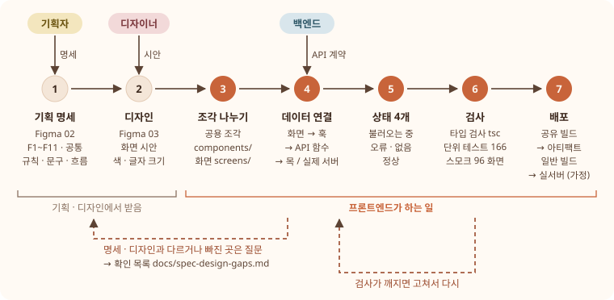

- 기획 명세와 디자인 시안이 보여 주는 것은 대개 **정상 화면 한 장**이다. 프론트는 그것을 조각(컴포넌트)으로 나누고, 데이터를 잇고, 나머지 상태를 채운다
- 백엔드와 맞물리는 곳은 ④ 데이터 연결이다. API 계약이 늦으면 목 서버로 먼저 만들고, 계약이 정해지면 `frontend/src/api/<영역>/` 한 곳만 고친다
- 명세와 디자인이 어긋나거나 비어 있는 곳은 따로 모아 묻는다 ([spec-design-gaps.md](spec-design-gaps.md))

### 2-3. 시안 한 장 밑에 숨은 일

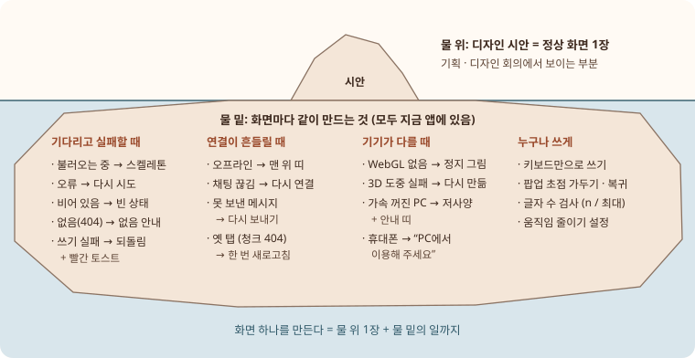

- 프론트 일정이 시안 장수보다 길어지는 가장 큰 까닭이다. 시안에 없는 화면도 사용자는 언젠가 본다
- 무엇이 어디서 잡히는지는 [5-3 표](#5-3-에러가-났을-때-어디서-잡히나)

### 2-4. 한 화면에 상태가 네 개인 이유

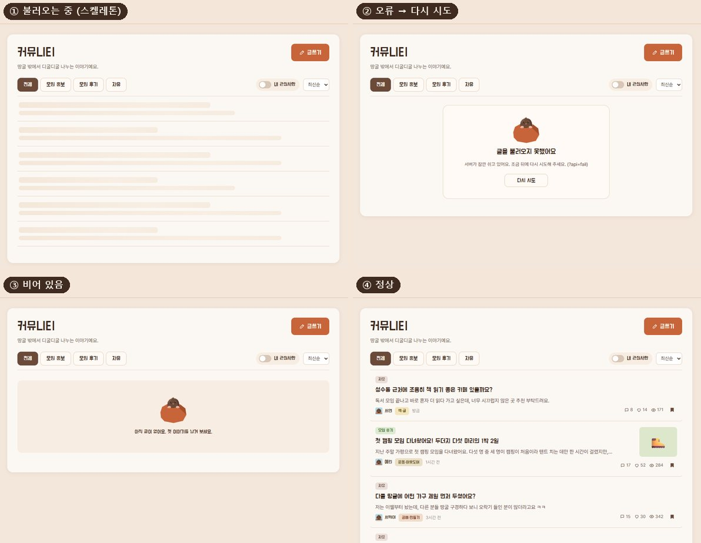

- 서버에서 데이터를 받는 화면은 적어도 이 네 모습을 가진다. 상세 화면은 하나 더 있다: **없음**(지워진 모임, 없는 땅굴)
- 기획에 부탁할 것: 화면마다 "비어 있을 때 문구"와 "실패했을 때 문구"를 같이 정해 주기
- 백엔드와 정한 것: "없음"은 404 + `…_NOT_FOUND` code, 실패는 응답 틀의 `error: { code, message, fields, detail }`. 둘을 섞으면 "아직 안 옴"을 "없음"으로 착각해 엉뚱한 화면을 보여 줄 수 있다 (사건 14). 반대로 다시 받아 404면 가진 값보다 "없음"을 먼저 보여 준다 (사건 28)

### 2-5. 버튼 한 번 누르면 일어나는 일

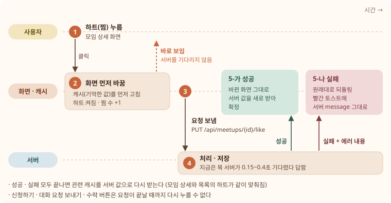

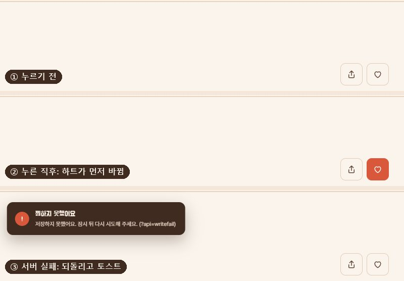

- 대부분의 요청은 성공하므로 기다리지 않고 먼저 보여 준다. 사용자는 빠르다고 느낀다
- 토스트의 제목("찜하지 못했어요")은 화면이 정하고, 설명은 에러 `code`로 영역의 문구 표(`api/<영역>/errors.ts`)에서 고른다. 명세가 "화면 문구는 프론트가 code로 정한다, message 글자로 가르지 않는다"로 정했다. 표에 없는 code만 서버 `message`를 쓴다
- 실패해 되돌린 뒤에는 서버에서 다시 받아 맞춘다. 그사이 끝난 다른 변경을 덮지 않게 (사건 29)

### 2-6. 실시간 소식: 서버가 보내는 줄 하나

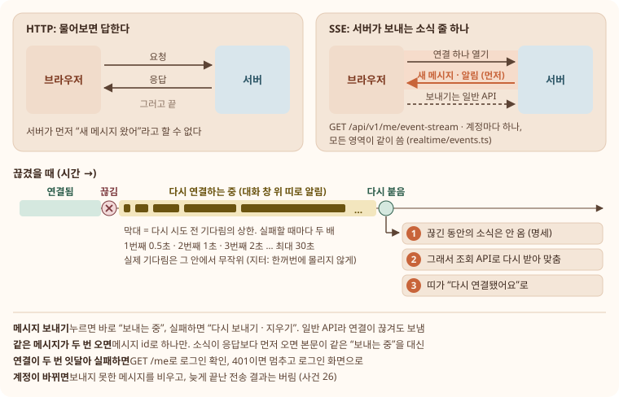

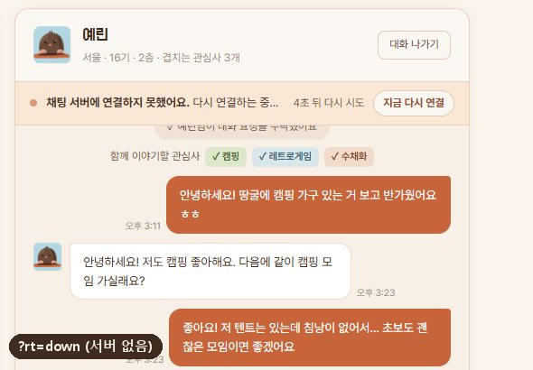

- 백엔드 명세: 연결은 계정마다 하나(`GET /api/v1/me/event-stream`), 채팅 새 메시지·대화 요청 수·알림 안 읽은 수가 이 줄로 온다. 끊긴 동안의 소식은 다시 주지 않는다 → 프론트가 다시 붙을 때 조회 API로 맞춘다
- 아직 묻는 것: 다시 보내기로 두 번 저장되지 않게 하는 멱등 키(`clientMessageId`), 놓친 소식을 `Last-Event-ID`로 다시 줄 계획, 연결이 열려 있는 동안 세션이 연장되는지 ([questions-for-backend.md](backend/api-v1/questions-for-backend.md))
- 예전(11-16 ~ 22)에는 WebSocket + STOMP를 가정해 방별 순서 번호(`seq`)·보낸 쪽 번호를 요청했었다 ([frontend-hardening.md](frontend-hardening.md) 1-4)

### 2-7. 3D 화면이 뜨기까지

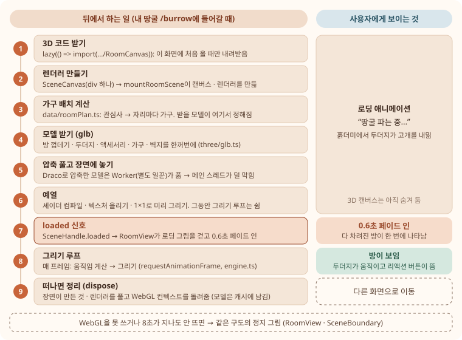

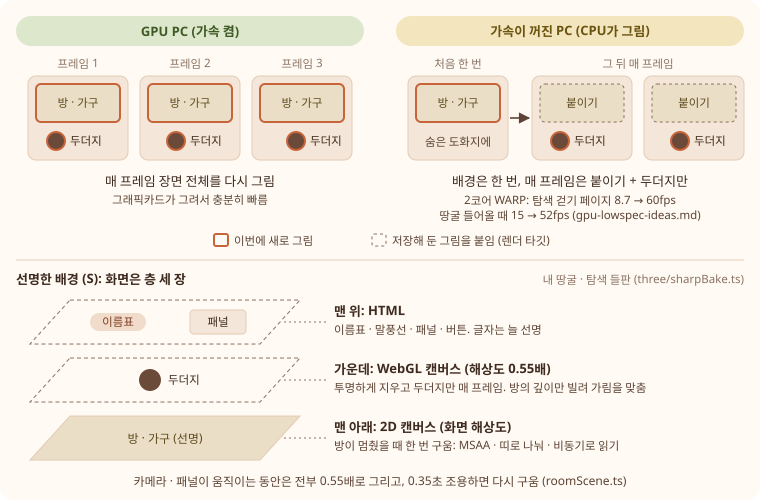

- 3D는 받고, 풀고, 데우고(예열), 그리는 단계가 있어 첫 진입에 시간이 든다. 이 시간을 줄인 이야기가 사건 3·4다
- SSAFY 교육장 PC는 크롬 그래픽 가속이 꺼져 있어 CPU가 그림을 그린다. 그래서 "덜 그리기"를 했다 (사건 2)

### 2-8. 기획이 바뀌면 프론트에서 바뀌는 것

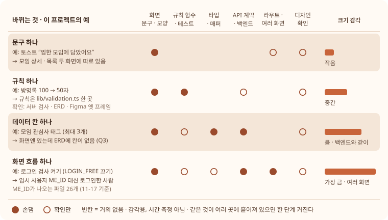

- 요청할 때 "어느 줄에 해당하는지"를 같이 적어 주면 작업 크기를 빨리 가늠할 수 있다
- 규칙을 화면 밖 함수로 빼 두고 명세 번호로 테스트를 붙여 둔 덕에, 규칙 하나가 바뀌면 그 테스트가 먼저 알려 준다 ([개념 11장](frontend-guide-concepts.md#11-테스트))

### 2-9. 백엔드와 정해진 약속

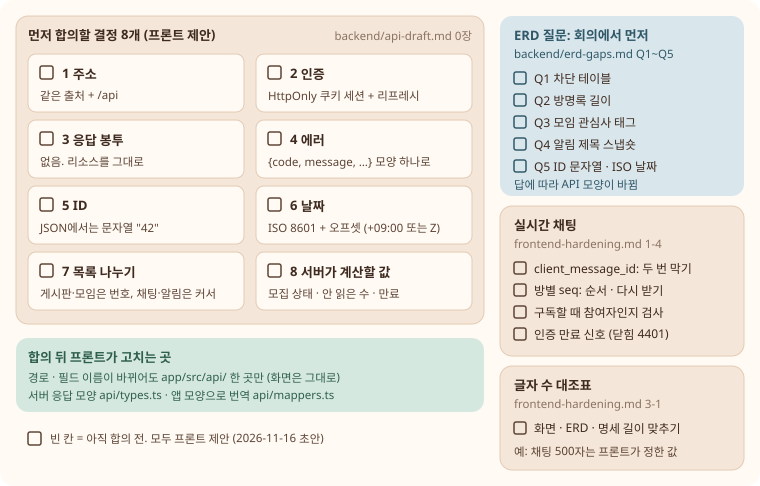

- 확정 명세 사본: [backend/team-spec/](backend/team-spec/README.md), 우리 초안과 달라진 것: [backend/api-v1-alignment.md](backend/api-v1-alignment.md)
- 영역 폴더 구조·작업 규칙: [backend/api-v1-foundation.md](backend/api-v1-foundation.md), 영역별 문서: `docs/backend/api-v1/`
- 백엔드 질문 모음: [backend/api-v1/questions-for-backend.md](backend/api-v1/questions-for-backend.md), 바뀐 기능: [backend/api-v1/feature-changes.md](backend/api-v1/feature-changes.md)
- 예전 초안(11-16): [backend/api-draft.md](backend/api-draft.md), [backend/erd-gaps.md](backend/erd-gaps.md)
- 표로 본 요약은 [6-2](#6-2-백엔드와-정해진-약속-명세-v1)

---

## 3. 기술 선택과 이유

### 3-0. 한눈에

| 기술 | 한 줄 비유 | 고른 이유 (요약) | 코드 위치 |
|---|---|---|---|
| React 19 | 화면을 레고 조각(컴포넌트)으로 조립 | 상태가 바뀌면 화면을 알아서 다시 그림 | `src/screens/`, `src/components/` |
| TypeScript 6 | 데이터 모양 검사기 | 실수를 실행 전에 잡음 | 모든 `.ts`·`.tsx` |
| Next.js 16.4 (App Router) | 폴더 = 주소인 틀 + 개발 서버 + 포장 기계 | 팀 리포의 `frontend/`가 Next.js로 정해져 있음 | `frontend/next.config.ts`, `src/app/` |
| `lib/nav.tsx` | react-router 모양의 얇은 손잡이 | 화면 코드를 거의 안 고치고 옮김 | `src/lib/nav.tsx` |
| CSS Modules + 디자인 토큰 | 색 이름표 + 파일마다 따로 쓰는 이름 | Figma와 같은 이름, 이름 충돌 없음 | `src/styles/tokens.css` |
| Pretendard(npm) · Do Hyeon | 서체 | 외부 CSS에 덜 기댐 | `src/app/layout.tsx` |
| three.js 0.165 | 그래픽카드로 그리는 도구 상자 | 세 엔진 비교 끝에 가장 가볍고 자료가 많음 | `src/three/` |
| glb + Draco·WebP·양자화 | 3D 모델 택배 상자 + 압축 | 디자이너 모델을 작게 받음 | `src/assets/models/`, `src/three/glb.ts` |
| TanStack Query | 서버 데이터 비서 | 불러오는 중·오류·캐시·낙관적 업데이트를 기본 제공 | `src/api/<영역>/queries.ts` |
| 영역 폴더 + 목 서버 | 명세대로 나눈 서랍 + 연습용 가짜 서버 | 백엔드가 만든 영역부터 하나씩 실제로 | `src/api/`, `src/api/mock/` |
| SSE | 서버가 보내는 소식 줄 | 백엔드 명세가 정함. 채팅·알림 소식 | `src/realtime/` |
| vitest | 규칙 채점기 | 명세 규칙을 자동 확인 | `src/tests/` |
| 스모크 테스트 | 모든 방에 불 켜 보기 | 106개 화면이 열리는지 매번 확인 | `frontend/scripts/smoke.mjs` |
| ESLint · GitHub Actions (CI) | 문법 검사 + 올릴 때마다 도는 검사 로봇 | 합친 뒤 깨진 것을 빨리 발견 | `frontend/eslint.config.mjs`, `.github/workflows/frontend-ci.yml` |
| Claude 아티팩트 (예전 Vite 앱) | 비공개로 시작하는 공유 페이지 | 팀원에게 데모를 보여 줌 | `app/scripts/share-page.mjs` |

### 3-1. React 19 · TypeScript · Next.js
- **무엇**: React는 "상태가 이러면 화면은 이렇게"를 함수(컴포넌트)로 적는 도구다. TypeScript는 JavaScript에 데이터 모양(타입) 검사를 더한다. Next.js는 React 앱의 틀이다. `src/app/` 폴더 모양이 주소가 되고(App Router), 개발 서버·빌드·백엔드로 넘기기(rewrites)를 맡는다
- **왜 처음엔 Vite였나 (예전)**: 2026-11-10 방향 전환 때 "Vite + React 19 + TypeScript + react-router 7, UI 라이브러리 없음"으로 시작했다 ([frontend-plan.md](frontend-plan.md)). 2026-11-23까지 모든 화면을 `app/`에서 만들었다
- **왜 Next.js로 옮겼나**: 팀 리포의 `AGENTS.md`가 `frontend/`를 Next.js로 정해 두었고, 팀 리포로 옮기기로 하면서 맞췄다(2026-11-22 사용자 결정, [team-repo-migration.md](team-repo-migration.md)). 라우트 48개를 같은 주소로 옮기고 화면 105개를 Vite 앱과 픽셀로 비교했다 ([nextjs-migration.md](nextjs-migration.md))
- **어떻게 옮겼나**: 화면은 모두 브라우저에서만 그린다(`src/app/providers.tsx`의 `ClientOnly`). 화면들이 처음부터 localStorage·window(목 서버·저사양 감지·3D)를 읽어서, 서버에서 그리면 브라우저 결과와 달라지기 때문이다. 그래서 첫 HTML은 Vite 때처럼 빈 칸이다. `page.tsx`는 `'use client'` + 화면 하나로 얇게 두고, 화면 코드는 `src/screens/`에 그대로 두었다
- **다른 후보**: Vite 그대로 두기(팀 규칙과 다름). 다른 프레임워크와 비교한 기록은 없다 (확인 못 함)
- **대가**
  - TypeScript 7은 Next 빌드와 린트 도구가 쓰는 JS API가 없어 **6.0으로 내렸다** ([nextjs-migration.md](nextjs-migration.md) 문제 1)
  - 서버 렌더링(첫 그림을 서버에서 빨리 그리기) 이득은 아직 안 쓴다. 다음 과제
  - Next가 react-router와 다르게 움직이는 곳을 하나씩 맞춰야 했다: 주소 변수가 바뀌면 화면을 새로 만듦(사건 24), 이동 state를 못 실음, 나가기 막기(`useBlocker`)가 없음, 전역 CSS 순서(사건 23), SSE 압축(사건 22)
  - React 개발 모드는 정리 누락을 드러내려고 effect(바깥과 주고받는 코드)를 일부러 두 번 돌린다. 그래서 3D 정리를 꼼꼼히 해야 한다 ([개념 8-2](frontend-guide-concepts.md#8-2-react와-threejs의-경계))
- **어디**: `src/app/layout.tsx`(맨 바깥 틀), `src/app/providers.tsx`, `frontend/next.config.ts`, `frontend/package.json`

### 3-2. 라우팅: Next App Router와 `lib/nav.tsx`
- **무엇**: 주소(`/burrow`, `/meetups/m1`)마다 어떤 화면을 그릴지 정한다. Next는 파일 위치로 정한다: `src/app/(app)/meetups/[id]/page.tsx` = `/meetups/:id`. 괄호 폴더 `(app)`은 주소에 안 나타나는 묶음이고, 그 안의 `layout.tsx`가 헤더 같은 공통 틀이다
- **왜 어댑터를 만들었나**: 화면 코드 수백 곳이 react-router의 `useNavigate`·`useParams`·`Link` 등을 쓰고 있었다. 같은 이름·모양을 Next 위에 얇게 만들어(`src/lib/nav.tsx`), 화면 파일은 import 한 줄만 바꿨다. Next에 없는 `useBlocker`(글쓰기 중 나가기 막기)와 이동 state도 어댑터가 흉내 낸다 (주소별로 sessionStorage에 기억)
- **해시 라우터는 예전 앱에만**: 팀 공유 데모는 아티팩트에 올리는데, 아티팩트는 주소 경로를 바꿀 수 없다. `#` 뒤는 서버에 가지 않으므로 예전 Vite 앱 `app/`의 공유 빌드만 `#/burrow`를 쓴다(`.env.share`). `frontend/`는 Next 서버가 주소를 알아서 새로고침 404 걱정이 없다 (사건 11)
- **에러 경계**: Next의 `error.tsx`가 그 폴더 아래 화면의 에러를 잡는다. 화면 하나가 깨져도 헤더는 남긴다 (5-3)
- **대가**: Next는 주소 변수(`[userId]`)가 바뀌면 page를 새로 만든다(react-router는 같은 컴포넌트를 둠). 상태를 이어야 하는 화면은 레이아웃이 그리게 바꿨다 (사건 24). 화면 이동 때 Next 기본대로 맨 위로 스크롤한다
- **어디**: `src/app/`, `src/lib/nav.tsx`, `src/lib/env.ts`

### 3-3. CSS Modules + 디자인 토큰, 서체
- **무엇**: 디자인 토큰은 색·글자 크기에 붙인 이름(`--brown-700`)이다. CSS Modules는 파일마다 클래스 이름을 고유하게 바꿔 서로 겹치지 않게 한다
- **왜**: 토큰 값은 Figma 스크린샷에서 픽셀로 뽑았고, 관심사 칩 8톤은 Figma 컴포넌트 이름(`Tone=Sage`)과 같은 이름을 쓴다. 디자인과 코드가 같은 말을 쓰면 수정이 빠르다 ([frontend-plan.md](frontend-plan.md))
- **서체**: 제목·버튼은 Do Hyeon(Google Fonts `<link>`, `src/app/layout.tsx`), 본문은 Pretendard(npm 패키지를 레이아웃에서 import). Pretendard를 CDN 대신 npm으로 넣은 처음 이유는 아티팩트가 외부 CSS를 막기 때문이었다 ([dev-deploy-risks.md](dev-deploy-risks.md) D5·F6). `next/font`로 바꾸면 글꼴 이름이 바뀌어 토큰을 고쳐야 해서 아직 안 했다
- **다른 후보**: UI 라이브러리(버튼·모달 묶음)는 쓰지 않기로 계획에 적었다. 이유를 적은 기록은 없다 (확인 못 함)
- **대가**
  - 전역 CSS와 모듈 CSS의 순서가 Vite와 Next에서 달라 버튼 높이가 바뀌었다 → 전역 클래스에 `:not(template)`을 붙여 맞췄다 (사건 23). 지우면 안 된다
  - 색 대비가 웹 접근성 기준(WCAG)보다 낮은 조합이 여럿 있다. 디자인 결정이 필요해 색은 바꾸지 않고 목록만 만들었다 ([frontend-hardening.md](frontend-hardening.md) 4-6)
  - 제목 서체는 외부 망에 기대므로, 망이 막히면 기본 글꼴로 보인다
- **어디**: `src/styles/tokens.css`, `src/styles/global.css`, 화면마다 `*.module.css`

### 3-4. three.js (3D 엔진)
- **무엇**: WebGL(브라우저가 그래픽카드로 그림을 그리는 통로)을 쉽게 쓰게 해 주는 라이브러리. 장면·카메라·조명·모델을 다룬다
- **왜**: 같은 두 장면(땅굴 방, 탐색하기)을 three.js · Babylon.js · PlayCanvas 세 엔진으로 따로 만들어 비교했다 ([3d-engine-candidates.md](3d-engine-candidates.md), [playcanvas-vs-threejs.md](playcanvas-vs-threejs.md))
  - 결과가 비슷한 수준에서 멈췄다. 남은 차이(보송한 털, 말랑한 곡면, 빛 번짐)는 엔진이 아니라 "코드로 만든 도형 + 실시간 조명" 방식의 한계였다
  - PlayCanvas가 가장 좋아 보인 이유는 엔진이 아니라 조명 기법 세 가지(그라데이션 환경광, 부드러운 그림자, 구석 그림자)였다. three.js로 옮기니 거의 같은 느낌이 났다 (조명 코드 약 40줄 + 라이브러리 2개)
  - 엔진 크기: three.js gzip 167KB, PlayCanvas gzip 655KB (약 4배). Babylon.js는 실험 빌드에서 약 8.7MB
  - npm 주간 다운로드: three 약 3,480만, PlayCanvas 약 18만. 자료와 사람이 많아 막혔을 때 풀기 쉽다
- **다른 후보와 안 고른 이유**: Babylon.js(완성형이지만 무거움), PlayCanvas(웹 에디터가 장점이지만 비공개 프로젝트는 유료, React 연동이 아직 0.x), Spline(관심사별 가구를 코드로 바꿔 끼우기 어려움), Unity·Godot 웹 내보내기(무겁고 첫 로딩이 김)
- **React Three Fiber(R3F)를 쓰지 않은 것**: 11-10 문서에는 "앱에 R3F로 옮기기"가 다음 단계로 적혀 있었다. 지금 앱은 R3F 없이 three.js를 직접 쓴다. 옮기지 않기로 한 결정 기록은 찾지 못했다 (확인 못 함)
  - 지금 구조: React는 div 하나만 관리하고, 그 안은 three.js 모듈이 그린다. React는 `SceneHandle`(손잡이 객체)의 메서드로만 3D에 말을 건다
  - 이 구조 덕에 생긴 일 (문서로 확인한 사실): 그리기 루프를 직접 세우고 줄이는 저사양 기법을 넣을 수 있었고(사건 2), 땅굴 장면 코드 `roomScene.ts`를 고치지 않고 그대로 Worker(별도 스레드)에서 돌리는 시험도 했다 ([gpu-lowspec-ideas.md](gpu-lowspec-ideas.md) D). Next로 옮길 때도 3D 코드는 거의 그대로 옮겨졌다
- **대가**: 조명·후처리를 직접 골라 조합해야 한다. three가 자주 바뀌어, 올릴 때 Draco 해독기 파일도 같은 버전으로 다시 복사해야 한다 ([3d-handoff-v3-integration.md](3d-handoff-v3-integration.md)). 화면을 떠날 때 GPU 자원을 직접 정리해야 한다. 정리를 빠뜨리면 브라우저의 WebGL 컨텍스트 개수 제한(보통 16개)에 걸려 3D가 검게 변한다
- **어디**: `src/three/engine.ts`(렌더러·루프·품질 묶음), `roomScene.ts`(땅굴), `holeField.ts`(탐색 들판), `fieldScene.ts`(랜딩·둘러보기 밭), `ChatRoomCanvas.tsx`(채팅 찻방), `MolePreviewCanvas.tsx`(온보딩 두더지), `moleActor.ts`·`moleDress.ts`(두더지 동작·액세서리)

### 3-5. 3D 모델: glb · 구운 조명 · Draco · WebP · 양자화
- **무엇**
  - glb: 3D 모델 한 파일. 모양·재질·텍스처·뼈대·동작이 다 들어 있다. 디자이너가 Blender에서 만들어 "핸드오프"로 보낸다 (`design/digul_3d_handoff_*`)
  - 구운 조명(bake): 빛과 그림자를 미리 계산해 텍스처에 그려 넣는 것. 실시간으로 계산하지 않으니 가볍고, 디자이너 렌더와 같은 느낌이 난다
  - 텍스처 WebP(이미지 압축), 메시 양자화(좌표 숫자를 짧은 형식으로 저장), Draco(모양 데이터 압축. 풀려면 해독기가 필요)
- **왜**: 코드 도형으로는 Figma 그림체를 못 따라가서(사건 1) 두더지·방·가구를 디자이너 glb로 바꿨다. 방은 조명을 구워 실시간 그림자와 후처리를 없앴다 → GPU에서 가볍고 가속이 꺼진 PC에서도 유리하다 ([3d-handoff-v2-integration.md](3d-handoff-v2-integration.md))
- **크기 예**: 방 껍데기 4.0MB → 0.63MB, 두더지 6.8MB → 0.95MB (v2 변환). 이후 두더지는 Draco + WebP 판 0.68MB ([3d-handoff-v3-integration.md](3d-handoff-v3-integration.md)). Next 빌드의 `.next/static`은 약 21MB(모델·텍스처 약 14MB)
- **데이터로 배치**: 어떤 관심사에 어떤 가구를 어느 자리에 둘지는 데이터(`data/interestTags.ts`, `furnitureCatalog.json`, `slots.json`)가 정한다. 그래서 디자이너가 새 모델을 보내면 glb와 데이터만 바꿔 넣으면 된다. v3.1 패치는 코드 변경 없이 반영했다
- **Draco를 쓰기까지**: v2에서는 쓰지 않았다(해독기 wasm을 아티팩트에 올려야 해서). v3부터 일반 빌드는 wasm 해독기, 공유 빌드는 JS 해독기를 번들에 넣었다(사건 3·10). 지금 `frontend/`는 wasm 해독기(`public/draco/`, 주소 `/draco/`)만 쓰고, JS 해독기는 공유 빌드가 있는 `app/`에만 남았다
- **대가**: 해독에 시간이 든다(첫 진입 때 0.58초를 차지한 적 있음, 사건 3). CC-BY 라이선스 모델은 앱에 작가를 표기해야 한다(설정 › 3D 모델 크레딧)
- **어디**: `src/assets/models/`, `src/three/glb.ts`, `frontend/public/draco/`, `src/data/roomPlan.ts`(배치 계산)

### 3-6. TanStack Query와 영역별 목 서버 / 실제 서버
- **무엇**: TanStack Query는 서버에서 받은 데이터를 기억(캐시)하고, "불러오는 중 · 오류 · 받음" 상태를 자동으로 관리하는 도구다. 목 서버는 메모리 저장소를 "가짜 서버"처럼 감싸서 실제 서버와 같은 모양·같은 실패를 낸다
- **왜**
  - 예전 화면은 목 데이터를 직접 import해서, 데이터가 처음부터 있다고 가정했다. 서버로 바꾸면 "아직 안 옴"을 "없음"으로 오해해 다른 화면으로 튕겨 내는 문제가 생긴다 (사건 14). TanStack Query는 이 세 상태를 기본으로 나눠 준다
  - 위험 분석에서 react-router의 `loader`와 비교해 "채팅·알림의 캐시 갱신과 낙관적 업데이트가 편하다"는 이유로 추천했다 ([dev-deploy-risks.md](dev-deploy-risks.md) 6장)
  - 목 서버를 두면 백엔드 없이도 느린 서버·고장·빈 목록·404를 주소 손잡이(`?api=slow` 등)로 바로 보여 줄 수 있다
- **API v1에 맞춘 구조 (2026-11-22 ~ 23)**: 백엔드 리포의 확정 명세(API 111개)를 기준으로 `src/api/`를 영역 폴더 11개(common · auth · settings · onboarding · burrow · explore · chat · meetups · community · notifications · admin)로 나눴다. 폴더마다 `types.ts`(명세 그대로의 DTO) · `real.ts`(실제 호출, `ENDPOINTS`) · `mock.ts`(목) · `mappers.ts` · `queries.ts`(훅) · `errors.ts`(code → 문구) · `api.ts`(고르기). 작업자 7명이 자기 폴더만 고치며 병렬로 맞췄다 ([backend/api-v1-foundation.md](backend/api-v1-foundation.md))
  - 명세에 있는데 없던 기능은 만들고, 명세에서 뺀 기능(차단, 접속 중 표시, 모임 신고, 꾸미기 소품·색 탭 등)은 화면에서도 뺐다 ([바뀐 기능 목록](backend/api-v1/feature-changes.md))
  - 완성도 검사 `src/tests/api-v1-endpoints.test.ts`가 명세의 API 제목과 영역마다의 `ENDPOINTS`를 비교한다. 빠지거나 오타가 있으면 실패
- **바꿔 끼우기**: 영역마다 `api.ts`가 `selectArea('<영역>', real, mock)`으로 고른다(`src/api/config.ts`). 기본은 모두 목, `NEXT_PUBLIC_API_REAL_AREAS=common,auth`처럼 백엔드가 만든 영역만 실제로 돌린다 (6-1)
- **대가**: 목 서버는 요청마다 0.15~0.4초를 일부러 기다려서, 그래픽 측정의 "다 보이기까지" 시간에 섞여 들어갔다 ([rendering-experiments-3.md](rendering-experiments-3.md) 6장). 목 모드에서만 맞는 코드가 숨기 쉽다: "나"와 "오늘"을 목 상수로 정한 곳은 목 테스트로 안 잡혔다 (사건 25)
- **어디**: `src/api/`(client · config · optimistic · sessionMutation · queryClient · 영역 폴더), `src/api/mock/server.ts`, `src/components/AsyncState.tsx`(스켈레톤·오류·빈 상태·`QueryGate`)

### 3-7. SSE (실시간 소식)
- **무엇**: SSE(Server-Sent Events)는 브라우저가 연결 하나를 열어 두면 서버가 그 줄로 소식을 계속 내려보내는 방식이다. 받기만 하고, 보내기는 일반 API로 한다
- **왜**: 백엔드 확정 명세가 실시간을 `GET /api/v1/me/event-stream` 연결 하나로 정했다. 채팅 새 메시지 · 대화 요청 수 · 알림 안 읽은 수가 모두 이 줄로 온다 ([backend/api-v1/06-chat.md](backend/api-v1/06-chat.md))
- **예전 (2026-11-16 ~ 22)**: 백엔드를 Spring Boot로 가정하고 WebSocket + STOMP를 직접 구현했었다(메시지 고유 번호 clientId, 방별 순서 seq, 끊긴 동안 쥐고 있다 보내기). 명세가 SSE로 정해져 `realtime/hub.ts`·`stompTransport.ts` 등을 지웠다
- **어떻게**
  - 연결은 계정마다 하나(`src/realtime/events.ts`), 로그인 영역 틀(`components/AppShell.tsx`)에서 연다. 영역은 `useEventStream('CHAT_MESSAGE_CREATED', …)`으로 소식만 받는다
  - 끊기면 점점 길게 기다렸다 다시 붙는다(지수 백오프 + 지터, 0.5초에서 시작해 최대 30초). **끊긴 동안의 소식은 오지 않으므로** 다시 붙으면 `useRefetchOnReconnect`가 조회 API로 화면을 맞춘다
  - 연결이 두 번 잇달아 실패하면 `GET /me`로 로그인을 확인해, 401이면 멈추고 로그인 화면으로 보낸다 (`EventSource`는 상태 코드를 못 봐서)
  - 메시지 보내기는 `POST /chat-rooms/{id}/messages`. 누르면 바로 "보내는 중"으로 그리고(`api/chat/outbox.ts`), 실패하면 "다시 보내기 · 지우기". 명세에 보낸 쪽 id가 없어서, 내 메시지가 응답보다 먼저 소식으로 오면 본문이 같은 가장 오래된 "보내는 중"을 대신한다
- **대가**: Next 개발 서버의 압축이 SSE를 모아 두는 문제가 있었다 (사건 22). 다시 보내기로 두 번 저장될 수 있어 백엔드에 멱등 키(`clientMessageId`)를 묻고 있다. 실제 서버로는 아직 시험하지 못했다(목과 가짜 SSE 서버로만 확인)
- **어디**: `src/realtime/`(eventStream · events · useEventStream · backoff), `src/api/chat/`(queries · outbox), `src/components/ConnectionStrip.tsx`

### 3-8. vitest · 스모크 테스트 · 린트 · GitHub Actions
- **무엇**
  - vitest: 함수가 규칙대로 답하는지 자동으로 채점한다. 661개(2026-11-24). 테스트 이름에 명세 번호를 적었다. 명세 사본이 바뀌면 그 시험이 먼저 깨진다(`spec-61e6c10.test.ts` 등)
  - 스모크 테스트(smoke test): "전원을 켜면 연기가 나는지"만 보는 얕은 검사. `next build` 결과를 `next start -p 3100`으로 띄우고 헤드리스 크롬(창 없는 크롬)으로 106개 화면을 돌며 예외·빈 화면·오류 화면·WebGL을 확인한다. Node + 시스템 크롬을 CDP(크롬 원격 조종 규약)로 직접 조종한다
  - 실험실 빠짐 검사(`npm run check:labs-off`): 배포 빌드에 실험 화면·패널 코드가 없는지 본다
  - 린트(ESLint): Next 기본 설정. 오류 0, 경고 55(대부분 React Compiler용 규칙을 경고로 둔 것)
  - CI(지속 통합): `frontend/`가 바뀌면 GitHub Actions가 설치 → 타입 → 린트 → 테스트 → 빌드 → 실험실 빠짐 검사를 돈다 (`.github/workflows/frontend-ci.yml`)
- **왜**: 여러 작업자가 동시에 고치고 합치기 때문에, 합친 뒤 깨진 것을 사람이 하나하나 열어 보지 않고 찾으려고. 팀 리포로 옮길 때는 커밋 62개마다 타입·린트·테스트·빌드를 돌려 "커밋마다 빌드 통과" 규칙을 지켰다 ([team-import-decisions-2026-11-23.md](team-import-decisions-2026-11-23.md))
- **대가**: 화면 컴포넌트 테스트는 아직 적다. 스모크는 "열리는지"만 본다. 목 서버로 도는 테스트는 실제 모드에서만 틀리는 코드를 못 잡는다 (사건 25). 큰 PR은 사람·AI 리뷰도 여러 번에 나눠 문제를 찾았다 (사건 31)
- **어디**: `frontend/vitest.config.ts`, `src/tests/`, `frontend/scripts/smoke.mjs`, `frontend/scripts/check-labs-off.mjs`, `.github/workflows/frontend-ci.yml`

### 3-9. 배포와 공유
- **팀 리포**: `frontend/`를 팀 리포 `it-ting-team/it-ting`의 `frontend/`로 옮겼다. 예전 이력(이 리포 커밋 300여 개)은 옮기지 않고, 화면·기능 하나에 서명된 커밋 하나씩 다시 쌓아 PR #37 하나로 올렸다 ([team-repo-migration.md](team-repo-migration.md))
- **실서비스 배포**: 아직 정하지 않았다. 후보는 `next start` + 앞단 Nginx 또는 `output: 'standalone'` ([nextjs-migration.md](nextjs-migration.md) "다음 단계"). [deploy-config.md](deploy-config.md)의 Nginx 예시는 정적 SPA + `/ws` 기준이라 Next·SSE에 맞게 다시 써야 한다
- **팀 공유 데모 (예전 Vite 앱)**: 저장소가 비공개이고 GitHub CLI 로그인이 없어 GitHub Pages 대신 Claude 아티팩트를 쓴다. `cd app && npm run build:share` → `scripts/share-page.mjs`가 `dist-share/share-page.html`과 `files.json`을 만듦 → 같은 아티팩트 주소로 publish. 공유 빌드는 Next로 옮기지 않았다(# 주소·glb를 JS에 넣기·JS 해독기가 필요해서)
- **대가**: 아티팩트는 파일 형식·외부 자원에 제약이 많다 (사건 10). 데모(`app/`)와 실제 앱(`frontend/`)이 갈라져, 2026-11-23 뒤 명세 반영과 리뷰 고침은 `frontend/`에만 있다

---

## 4. 치명적인 문제와 해결 (사건 기록)

모든 사건을 같은 틀로 적었다: **무슨 일 → 왜 → 어떻게 고쳤나(숫자) → 배운 점 → 근거**. "예방"은 실제로 터지기 전에 막은 것이다.

### 4-0. 한눈에

| # | 사건 | 증상 | 원인 | 해결 | 상태 | 심각도 |
|---|---|---|---|---|---|---|
| 1 | Figma 그림체를 코드로 재현 못 함 | 3D가 장난감처럼 매끈함 | 점토 질감·간접광은 코드 도형 + 실시간 조명의 한계 | 엔진 3개 비교 → 디자이너 glb + 구운 조명 | 해결 | 높음 |
| 2 | 그래픽 가속이 꺼진 PC에서 페이지 전체가 멈춤 | 땅굴 3fps, 버튼·스크롤까지 멈춤 | 크롬이 CPU(WARP)로 그림, 메인 스레드가 막힘 | 감지 → 저사양 모드 → 배경 한 번 → 선명한 배경 → 기기 단계 | 대부분 해결, 약한 PC 일부 남음 | 높음 |
| 3 | 처음 들어갈 때 화면이 0.7초 멈춤 | 로딩 애니메이션까지 멈춤 | 셰이더 컴파일·Draco 해독·base64 풀기 | 예열, Draco Worker, 내장 해독 | 해결 | 중간 |
| 4 | 예열이 오히려 느리게 만듦 | 들판 바꾸기 0.4 → 1.65초 | 물체마다 따로 기다리며 GPU를 붙잡음 | 컴파일을 한꺼번에, 기다리기는 루프 하나 | 해결 | 중간 |
| 5 | 선명하게 구운 배경에서 가구 밑 그림자가 사라짐 | 화질 숫자는 좋은데 그림자가 없음 | 선형 색 공간에서 반투명을 섞음 | 캔버스와 같은 sRGB로 굽기 | 해결 | 중간 |
| 6 | 기기 단계 판정이 흔들림 | 같은 PC가 강함 ↔ 약함을 오감 | 첫 측정값·다른 3D가 끼어 값이 들쭉날쭉 | 88번 측정으로 규칙을 다시 고름 | 해결 | 중간 |
| 7 | 두더지가 떨어질 때 머리가 잘리고 잔상이 남음 | 공중에 모자 조각이 남음 | 다시 그릴 영역을 발밑 기준으로 계산 | 뼈대·액세서리마다 영역 계산 | 해결 | 중간 |
| 8 | WebGL이 없으면 흐린 그림이 늘어나 보임 | 636px 그림이 1300px로 | 자리표시 그림이 작음 | GPU로 찍은 2048px 정지 그림 + 3D 경계 | 해결 | 낮음 |
| 9 | 첫 화면이 번잡하게 깜빡임 | 그림 → 사라짐 → 가구 → 이름표 먼저 | 모델을 받기 전에 자리표시를 치움 | 다 차려질 때까지 로딩 애니메이션, 한 번에 페이드 인 | 해결 | 낮음 |
| 10 | 아티팩트 배포 제약 | glb 업로드 불가, 외부 CSS·wasm 막힘, 공개 공유 거절 | 아티팩트 보안 정책 | glb를 JS에 넣기, JS 해독기, npm 서체, avif 제거 | 해결 (Worker 동작은 확인 못 함) | 높음 |
| 11 | 새로고침하면 404 | 깊은 주소에서 "없는 페이지" | 서버에 그 주소의 파일이 없음 | 공유본은 해시 라우터, Next는 서버가 주소를 앎 | 해결 | 높음 |
| 12 | 재배포 뒤 열려 있던 탭이 깨짐 | 3D 화면에 들어가면 에러 화면 | 옛 파일 이름을 찾는데 서버에서 지워짐 | 한 번만 자동 새로고침 + 에러 경계 | 해결 | 중간 |
| 13 | 채팅방을 바꿔도 이전 메시지가 남음 | 헤더는 B방, 메시지는 A방 | React가 컴포넌트를 재사용 | `key`로 방마다 새로 만들기 | 해결 | 높음 |
| 14 | 데이터가 비동기가 되면 "없음"으로 튕겨 냄 | 모르는 id면 다른 사람 땅굴이 보임 | "아직 안 옴"과 "없음"을 구분 안 함 | 404일 때만 없음, `QueryGate` | 예방 | 높음 |
| 15 | 날짜 형식이 섞이고 시간대가 어긋날 위험 | "NaN일 전", 9시간 차이 | ISO와 표시 문자열이 섞임 | `lib/time.ts` 한 곳, 서울 시간 | 예방 (일부 남음) | 높음 |
| 16 | 팝업 입력칸이 초점을 빼앗김 | 한 글자 치면 커서가 사라짐 | 다시 그릴 때마다 상자에 초점을 다시 줌 | 닫기 함수를 ref로 | 해결 | 중간 |
| 17 | 모달 배경이 계속 떠 있음 | 닫았는데 어두운 막이 남음 | CSS `display`가 `hidden` 속성을 덮음 | `[hidden]{display:none!important}` | 해결 (예전 시안) | 중간 |
| 18 | 자동 검사가 앱의 2D 캔버스를 망가뜨림 | 가속 끔 스모크에서 예외 | 검사가 모든 캔버스에 WebGL을 요청 | 검사 범위 좁힘 + 앱 방어 | 해결 | 중간 |
| 19 | 여러 작업자 병합 충돌 | 같은 파일을 동시에 고침 | worktree 병렬 작업 | 영역 나누기, 겹칠 파일 목록, 합친 뒤 재검사 | 운영 규칙 | 중간 |
| 20 | 밤사이 PC 절전·재시작으로 작업이 멈춤 | 두 작업이 도중에 끊김 | 절전 30분, Windows 업데이트 재시작 | 단계마다 커밋, 작업 중 절전 막기 | 운영 규칙 | 중간 |
| 21 | 작업 도구의 함정 | 파일이 잘림, 명령이 엉뚱하게 실행 | 문자열 표시 없음, 백틱 치환 등 | 확인 후 자르기, 스크립트 파일로 실행 | 운영 규칙 | 낮음 |
| 22 | 실시간 소식(SSE)이 Next를 거치면 오지 않음 | 5초 동안 10바이트, 소식 0개 | Next 압축이 소식을 모아 둠 | 압축 끔, 프록시 대기 1시간 | 해결 (배포는 확인 못 함) | 높음 |
| 23 | CSS 순서가 달라 버튼 높이가 바뀜 | 모임 화면 0.8~1%, 모달 3.4% 다름 | 전역·모듈 CSS를 불러오는 순서 | 전역 선택자에 `:not(template)` | 해결 | 중간 |
| 24 | 주소 변수가 바뀌면 화면을 새로 만듦 | 온보딩 다음 단계에서 입력이 사라짐 | Next는 page를 새로 만듦 | 레이아웃이 화면을 그림 | 해결 | 중간 |
| 25 | "나"와 "오늘"을 목 상수로 정함 | 실제 모드에서만 내 프로필·D-day가 틀림 | `ME_ID` · `TODAY` | `GET /me`, 서울 날짜 | 해결 | 높음 |
| 26 | 계정이 바뀌어도 이전 계정의 데이터가 남음 | 다른 계정 캐시·안 보낸 메시지가 보임 | 캐시·메모리·늦은 응답이 계정을 모름 | `dropUserData`, 세션 번호, outbox 세대 | 해결 | 높음 |
| 27 | 온보딩을 마친 뒤 계정 갱신을 기다리지 않음 | 확정했는데 온보딩 1로 돌아감 | 옛 `nextStep` | 다시 받기를 기다린 뒤 이동 | 해결 | 중간 |
| 28 | 다시 받아 404인데 이전 값이 보임 | 지운 글·나간 방이 보임 | "가진 값 먼저" 규칙 | 404·410은 없음 안내 먼저 | 해결 | 중간 |
| 29 | 낙관적 되돌리기가 그 사이 바뀐 것을 덮음 | 지운 댓글이 다시 보임 | 옛 스냅숏으로 되돌림 | 되돌린 뒤 다시 받기, 저장 중 잠금 | 해결 | 중간 |
| 30 | 댓글을 다 받기 전에 쓰면 순서가 깨짐 | 새 댓글이 중간에 낌 | 이어 받는 목록 끝에 붙임 | 남은 페이지를 받은 뒤 끝에 | 해결 | 낮음 |
| 31 | 큰 PR에 자동 리뷰가 오지 않음 | 33분 넘게 리뷰 없음 | 파일 590개 PR (원인 확인 못 함) | `@codex review` 직접 요청 | 운영 규칙 | 낮음 |

### 4-1. 그래픽 · 성능

#### 사건 1. Figma 그림체를 코드만으로는 재현하지 못함 (2026-11-10 ~ 11)
- **무슨 일**: Figma의 땅굴은 점토 재질, 벽에 은은하게 번지는 빛, 구석의 부드러운 그림자가 핵심인데, 코드로 만든 3D는 표면이 매끈해 장난감처럼 보였다
- **왜**: Figma 그림은 3D 데이터가 아니라 한 장짜리 PNG였다(일부는 AI 시안). 이 그림체를 좌우하는 것은 모양보다 **빛과 재질**이다. 빛이 벽에 튕겨 번지는 효과(간접광)와 털·말랑한 곡면은 "코드 도형 + 실시간 조명"으로는 한계가 있다
- **어떻게**
  1. 조사: 다섯 가지 길(three.js 강화, glb 모델, 미리 렌더한 2.5D, 매번 AI 그림, Spline)을 비교 → "three.js로 시작하고 핵심 에셋만 glb로" 추천 ([3d-tech-research.md](3d-tech-research.md))
  2. 코드만으로 시험판: 돔 모양·색감·배치는 가까워졌지만 털·곡면·간접광은 달랐다 ([3d-figma-reproduction.md](3d-figma-reproduction.md))
  3. 엔진 3개 비교: 결과가 비슷한 데서 멈춤 → 엔진 탓이 아님 (3-4)
  4. 디자이너 glb 핸드오프(v1 ~ v3.x): 두더지(동작 19개 → 이후 25개), 액세서리 41개, 조명을 구운 방, 관심사 가구. 방은 실시간 그림자·후처리를 없앴다 ([3d-handoff-v2-integration.md](3d-handoff-v2-integration.md), [3d-handoff-v3-integration.md](3d-handoff-v3-integration.md))
  - 덤으로 three.js 내장 구석 그림자(GTAO)는 두더지 뒤에 네모난 얼룩이 생겨 N8AO 라이브러리로 바꿨다 ([playcanvas-vs-threejs.md](playcanvas-vs-threejs.md) 6장)
- **배운 점**: 그림체 차이를 엔진 탓으로 돌리기 전에 조명·재질부터 본다. 디자이너가 Blender에서 굽는 쪽이 코드로 흉내 내는 것보다 빠르고 가볍다. 배치 규칙을 JSON으로 빼 두면 모델이 와도 코드를 안 고친다

#### 사건 2. 그래픽 가속이 꺼진 PC에서 페이지 전체가 멈춤 (2026-11-11 ~ 17, 가장 큰 사건)
- **무슨 일**: SSAFY 교육장 PC는 크롬 "그래픽 가속 사용"이 꺼져 있다. 이 상태로 열면 땅굴 **3fps**, 탐색하기 **1.1fps**. 측정 16초 중 15초 넘게 메인 스레드가 막혀 **3D뿐 아니라 버튼·패널·스크롤까지 같이 멈췄다**. 키를 누르고 화면에 나오기까지 0.4~0.6초 ([gpu-fallback-research.md](gpu-fallback-research.md) 2장)
- **왜**
  - 가속을 끄면 크롬은 그래픽카드 대신 CPU로 그리는 WARP("Microsoft Basic Render Driver")를 쓴다. 그림은 GPU와 픽셀 단위로 거의 같다. **"깨짐"의 정체는 그림이 망가지는 게 아니라 끊기고 멈추는 것**이었다
  - 비유: 메인 스레드는 가게 계산대 직원 한 명이다. 이 직원이 3D 그림을 손으로 그리느라 바쁘면 손님(클릭·스크롤·입력)은 줄을 서서 기다린다
  - 웹페이지는 `chrome://settings`를 어떤 방법으로도 열 수 없다(링크·새 탭·location·window.open 네 가지 모두 막힘, 실측)

  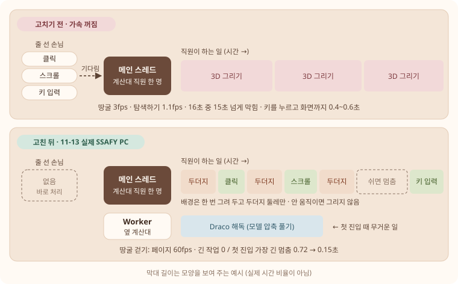
- **어떻게 (단계별)**

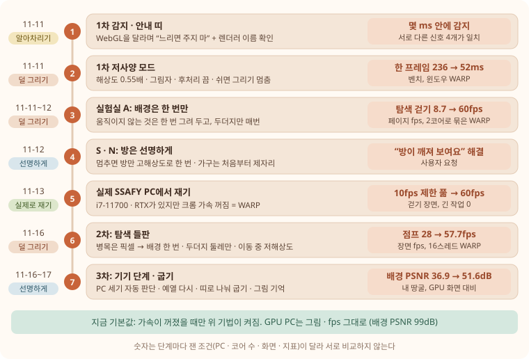

| 단계 | 한 일 | 효과 (측정 조건) |
|---|---|---|
| 1차 감지·안내 (11-11) | `failIfMajorPerformanceCaveat`(성능이 크게 떨어지면 WebGL을 주지 말라는 요청)로 몇 ms 안에 감지 + 렌더러 이름 확인. 안내 띠는 "주소 복사" 방식 | 신호 4개가 모두 일치 (`lib/graphicsTier.ts`, `components/GpuNotice.tsx`) |
| 1차 저사양 모드 (11-11) | 해상도 0.55배, 안티앨리어싱·그림자·후처리 끔, 가만히 있으면 그리기 멈춤, 땅굴은 두더지 둘레만 다시 그림, GPU라도 2초 평균 50ms가 넘으면 저사양으로 | 벤치 한 프레임 236 → 52ms (윈도우 WARP). 쉬는 중 페이지 60fps (맥 SwiftShader로 흉내) |
| 저사양 실험실 (11-11 ~ 12) | 아이디어 9개를 🧪 패널에서 켜고 끔. **A: 움직이지 않는 배경은 한 번만 그리고 두더지만 매 프레임** | 2코어로 묶은 WARP: 탐색하기 걷기 페이지 8.7 → 60fps, 땅굴 들어올 때 15 → 52fps ([gpu-lowspec-ideas.md](gpu-lowspec-ideas.md)) |
| S·N (11-12) | S: 멈춰 있을 때 방만 고해상도로 한 번 그려 뒤에 깔기("방은 선명하게"), N: 저사양에선 가구 낙하 없이 처음부터 제자리 | 사용자 요청 "방 인테리어가 깨져 보인다"를 해결 |
| 실제 SSAFY PC (11-13) | i7-11700(16스레드), RTX가 있지만 크롬 가속 꺼짐 = WARP. 걷기는 이미 매끄러움 → 10fps 제한을 풂 | 걷기 장면 60fps, 페이지 60fps, 긴 작업 0 ([rendering-experiments.md](rendering-experiments.md) 8장) |
| 2차 (11-16) | 탐색 들판 원인을 찾음: 정점이 아니라 **픽셀**(화면 가득한 땅 + 고급 재질·환경맵). 배경 한 번 + 두더지 둘레만 + 예열 + 이동 중 저해상도 + 배경 선명(비동기 읽기) | 점프 28 → 57.7fps (2코어 8.4 → 39.8), 배경 가장자리 SSIM 0.830 → 0.952 ([rendering-experiments-2.md](rendering-experiments-2.md)) |
| 3차 (11-16 ~ 17) | 기기 단계 자동 판단(gpu / strong / weak), 예열 다시 짜기, 선명한 배경을 띠로 나눠 굽기(sRGB + MSAA), 구운 배경을 IndexedDB에 기억, 정지 그림 6장 | 땅굴 배경 PSNR 36.9 → 51.6dB, 가장자리 SSIM 0.924 → 0.998. 랜딩 첫 화면 가장 긴 멈춤 547 → 217ms. 다시 오면 0.62초에 선명한 그림 ([rendering-experiments-3.md](rendering-experiments-3.md)) |

- **지금 기본값**: 가속이 꺼졌으면 저사양 묶음 + 기기 단계 자동 + 예열 + 선명한 배경 굽기 + 구운 그림 기억 + 정지 그림. **GPU PC는 그림·fps가 그대로**(저사양 기능은 저사양 품질에서만 켜짐, 배경 PSNR 99dB로 확인)
- **남은 것**: 2코어급 약한 PC에서 땅굴 첫 진입 0.9~1.1초 멈춤, 탐색 점프 끊김 0.21~0.29초, 카메라 이동 20fps. 실제 다른 PC·인터넷 환경에서는 안 쟀다. 맥처럼 가속을 끄면 WebGL 자체가 없는 경우는 대응하지 않기로 했다(사용자 결정)
- **배운 점**
  - "깨져 보인다"는 말을 그대로 믿지 말고 재 본다 (그림이 아니라 속도 문제였다)
  - 무엇이 무거운지 하나씩 빼 보며 찾는다. 탐색 들판은 꽃·풀을 빼도 그대로였고 땅 한 장을 빼니 절반이 됐다 → 정점이 아니라 픽셀이 병목
  - 화질과 성능은 숫자 둘(PSNR·SSIM과 fps·긴 작업)로 같이 본다
  - 측정은 같은 조건에서 번갈아(A/B/A/B) 여러 번 재고 중앙값을 쓴다. 소프트웨어 렌더러는 같은 설정도 ±30% 흔들렸다

#### 사건 3. 처음 들어갈 때 화면이 멈춤 (2026-11-13 ~ 17)
- **무슨 일**: 실제 SSAFY PC(가속 꺼짐)에서 공유 빌드로 땅굴에 처음 들어가면 가장 긴 멈춤이 0.77초. 이 동안 "땅굴 파는 중" 로딩 애니메이션과 버튼도 멈췄다 ([rendering-experiments.md](rendering-experiments.md) 1장)
- **왜**: CPU 프로필(함수별 시간)로 나눠 보니 셰이더(그래픽카드용 작은 프로그램) 링크 대기 587ms, glb가 든 큰 JS 청크 읽기 593ms, Draco 해독 576ms, base64(글자로 바꾼 이진 데이터) 풀기 328ms, 텍스처 올리기 158ms. 모두 메인 스레드에서 일어났다
- **어떻게**
  1. base64는 브라우저 내장 해독(`Uint8Array.fromBase64`)으로
  2. Draco 해독은 Worker(별도 스레드)로. 못 만들면 메인 스레드로 돌아감
  3. `compileAsync`(셰이더 미리 컴파일)만으로는 효과가 없었다. 이유 둘: 저사양 방은 배경용 렌더 타깃과 캔버스 두 곳에 그려 셰이더 종류가 달랐고, 이미 돌던 그리기 루프가 컴파일을 기다리지 않고 먼저 그려 버렸다
  4. **예열**: 셰이더 미리 컴파일 + 텍스처 나눠 올리기 + 물체를 1×1 크기로 미리 한 번씩 그리기. 그동안 루프는 쉰다
  - 결과: 가장 긴 멈춤 **0.72 → 0.15초**, 긴 작업 합 1.9 → 0.4초. 대신 다 차려지는 시각이 0.1~0.2초 늦어졌다(일을 잘게 나눠서). 로딩 애니메이션이 끊기지 않는 쪽을 골랐다. GPU에서도 0.32 → 0.15초
  - 이후 같은 예열을 탐색 들판(첫 진입 0.60 → 0.17초, 땅굴 → 탐색 전환의 가장 긴 멈춤 1.38 → 0.14초), 랜딩 밭(547 → 217ms), 찻방(233 → 99ms)에 넣었다 ([rendering-experiments-2.md](rendering-experiments-2.md), [rendering-experiments-3.md](rendering-experiments-3.md))

  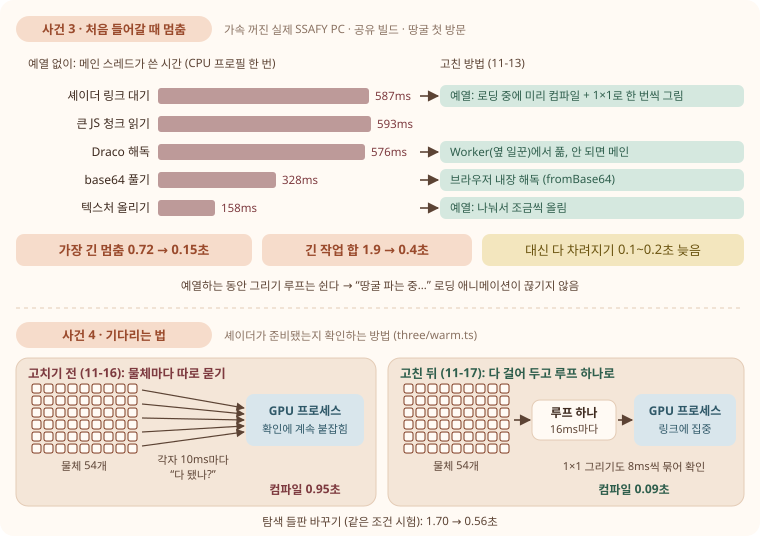
- **배운 점**: "느리다"를 시간표(프로필)로 쪼개 보면 고칠 곳이 보인다. 총 시간보다 "가장 긴 멈춤"이 사용자가 느끼는 끊김에 가깝다

#### 사건 4. 예열이 오히려 느리게 만듦 (2026-11-16 → 17)
- **그림**: 사건 3 그림의 아래 칸
- **무슨 일**: 3차에서 예열을 더 꼼꼼히 했더니 멈춤은 줄었지만 **다 보이기까지가 길어졌다**. 남의 땅굴 2.46 → 3.15초, 탐색 들판 바꾸기 0.40 → **1.65초**
- **왜**: 물체마다 컴파일을 따로 기다리느라 확인 루프 54개가 따로 돌았다. 확인할 때마다 부르는 동기 호출이 셰이더를 링크하는 GPU 프로세스를 계속 붙잡았다. 비유: 요리사에게 54명이 따로 "다 됐어요?"를 계속 물어 요리가 더 늦어진 것
- **어떻게**: 그려지는 곳마다 컴파일을 다 걸어 두고, 렌더러의 프로그램 전부를 **루프 하나로** 기다린다(`three/warm.ts` `programsReady`). 1×1 그리기는 8ms씩 묶어 확인 한 번 → 컴파일 0.95 → **0.09초**, 들판 바꾸기 1.70 → **0.56초**. 텍스처 올리기도 묶어 봤지만 GPU 탐색 들판이 0.35초 늦어져 되돌렸다. GPU에서는 2차 예열 방식을 그대로 쓴다 ([rendering-experiments-3.md](rendering-experiments-3.md) 2-2)
- **배운 점**: 한 숫자(가장 긴 멈춤)를 고치다 다른 숫자(다 보이기까지)가 나빠질 수 있다. 측정 항목을 처음부터 여러 개로 잡는다. 가속 끈 PC와 GPU PC를 둘 다 잰다

#### 사건 5. 선명하게 구운 배경에서 가구 밑 그림자가 사라짐 (2026-11-17)
- **무슨 일**: 3차 개선 빌드는 화질 숫자 중 SSIM(구조가 얼마나 같은지)은 좋아졌는데 PSNR(픽셀 값이 얼마나 같은지)이 오히려 조금 낮았다. GPU 화면과의 차이 지도를 보니 **가구 밑 반투명 그림자 판이 사라져 있었다**
- **왜**: 선명한 배경을 "선형" 색 공간의 렌더 타깃(화면 대신 그리는 숨은 도화지)에 굽고 마지막에 화면 색(sRGB)으로 바꿨다. 반투명한 그림자를 바탕과 섞는 계산은 어느 색 공간에서 하느냐에 따라 결과가 다르다. 비유: 물감을 섞을 때 눈금이 다른 컵으로 재면 같은 비율이라도 다른 색이 나온다. 캔버스는 sRGB에서 섞는데 굽기는 선형에서 섞어 그림자가 거의 안 보이게 됐다

  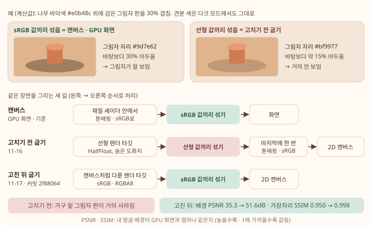
- **어떻게**: 굽는 렌더 타깃을 캔버스와 같은 sRGB로 바꿨다(커밋 2f88064). 내 땅굴 배경 PSNR 35.3 → **51.6dB**, 가장자리 SSIM 0.950 → **0.998** ([rendering-experiments-3.md](rendering-experiments-3.md) 5장)

  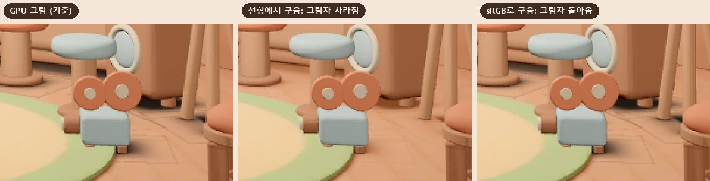
- **배운 점**: 화질 숫자 하나만 보면 놓친다. 차이 지도(어디가 다른지 그린 그림)를 눈으로 본다. "같은 그림을 다른 방법으로 그릴 때"는 색 공간을 원래 경로와 맞춘다

#### 사건 6. 기기 단계 판정이 흔들림 (2026-11-16 ~ 17)
- **무슨 일**: 실제 그리기 시간으로 PC를 strong(CPU 넉넉)·weak(약함)로 나누는데, 같은 2코어 환경이 strong ↔ weak를 오갔다. weak로 잘못 보면 화질(MSAA)이 내려가고, strong으로 잘못 보면 끊김이 남는다
- **왜**: 첫 측정값은 텍스처 올리기가 끼어 늘 컸다. 다른 3D가 같이 돌면(랜딩의 밭 + 방, 화면 전환) 16스레드 PC도 느린 값이 나왔다
- **어떻게**: 측정 88번의 실제 값으로 규칙 후보를 비교했다 ([rendering-experiments-3.md](rendering-experiments-3.md) 4-1)

| 규칙 | 16스레드를 weak로 잘못 (48번 중) | 2코어를 strong으로 잘못 (40번 중) |
|---|---|---|
| 가장 작은 값 > 110 (11-16) | 0 | 14 |
| 첫 값 뺀 중앙값 > 90 (11-17 오전) | 7 | 1 |
| **가장 작은 값 > 50 이고 첫 값 뺀 두 번째 > 110 (최종)** | **0** | **1** |

- 결과는 브라우저에 기억(`localStorage digul.tier.v1`)해서 다음 방문은 처음부터 그 단계. 실험실 패널과 `?tier=strong|weak`로 덮어쓸 수 있다
- **배운 점**: 자동 판정 규칙은 감으로 정하지 말고 실제 측정값을 모아 "틀린 횟수"로 고른다. 애매하면 손해가 작은 쪽(strong, 화질 유지)으로 둔다

#### 사건 7. 저사양에서 두더지가 떨어질 때 머리가 잘리고 잔상이 남음 (2026-11-12)
- **무슨 일**: 땅굴에 들어와 두더지가 천장에서 떨어질 때 머리가 잘리고, 공중에 베레모 쓴 머리 조각이 그대로 남았다
- **왜**: 저사양 "부분 그리기"는 매 프레임 두더지를 덮는 사각형만 지우고 다시 그린다. 이 사각형을 두더지의 기준점(발밑) 둘레로 계산했는데, 떨어지기 동작은 기준점은 바닥에 두고 **뼈대만** 천장에서 내려오게 움직였다. 사각형 밖 두더지는 잘렸고, 지우지 않은 자리는 이전 그림이 남았다

  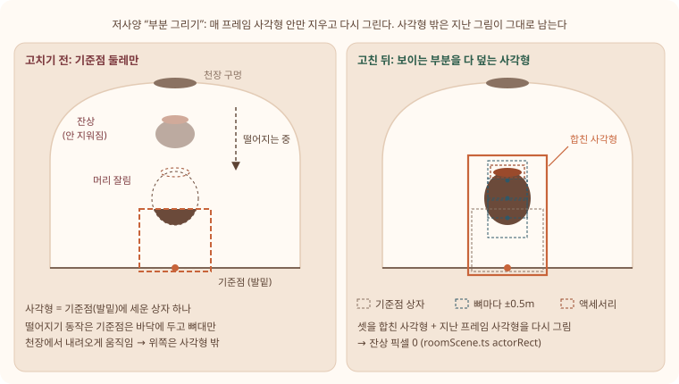
- **어떻게**: 사각형을 "기준점 상자 + 뼈대마다 ±0.5m 상자 + 액세서리마다 경계 상자"를 합쳐 계산(`three/roomScene.ts` `actorRect`). WebGL 캔버스만 꺼내 잔상 픽셀이 0인 것을 확인 ([gpu-lowspec-ideas.md](gpu-lowspec-ideas.md) "버그")
- **배운 점**: "일부만 다시 그리기"는 빠르지만, 영역 계산이 틀리면 잔상이 남는다. 애니메이션은 기준점이 아니라 실제로 보이는 부분 기준으로 계산한다

#### 사건 8. WebGL이 없으면 흐린 그림이 늘어나 보임 (2026-11-11 → 17)
- **무슨 일**: WebGL을 아예 못 쓰는 브라우저에서는 자리표시 그림(636px)이 약 1300px로 늘어나 뭉개져 보였다. 실제 내 방과 가구도 달랐다 ([gpu-fallback-research.md](gpu-fallback-research.md) 결론 1-B)
- **어떻게**: 디자이너 렌더 1200px 그림으로 1차 교체 → 3차에 GPU로 직접 찍은 2048px 정지 그림 6장(446KB)을 빌드에 넣고 3D 에러 경계(`components/SceneBoundary.tsx`)와 이었다. 3D를 못 만들면 8초를 기다리지 않고 바로 정지 그림 ([rendering-experiments-3.md](rendering-experiments-3.md) 2-5·7장, [frontend-hardening.md](frontend-hardening.md) 2-3)

  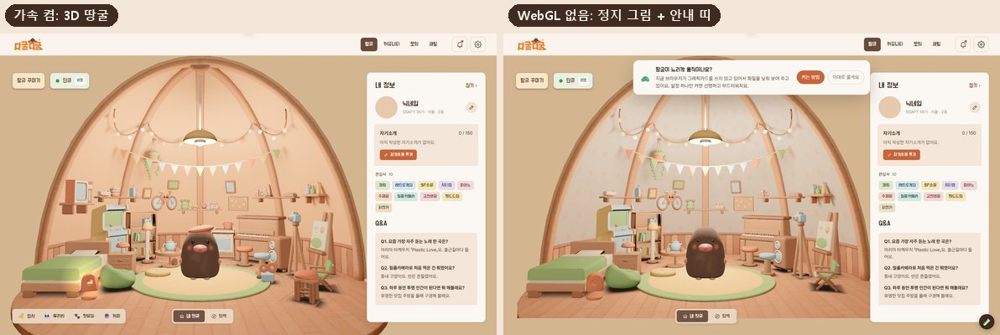
- **배운 점**: 실패했을 때 보이는 화면도 화면이다. 대체 그림의 해상도와 구도를 실제 화면에 맞춘다

#### 사건 9. 첫 화면이 번잡하게 깜빡임 (2026-11-12)
- **무슨 일**: 사이트에 들어가면 그림이 떴다 사라지고, 가구가 3D로 하나씩 뜨고, 가구보다 이름표가 먼저 나왔다 (사용자 제보)
- **왜**: 3D 캔버스가 **만들어지자마자**(모델을 받기 전) 자리표시 그림을 치워서 빈 화면이 잠깐 보였다. 이름표는 3D와 상관없이 0.3초에 떴다
- **어떻게**: 장면이 "다 차려졌다"는 신호(`SceneHandle.loaded`)를 만들고, 그때까지 흙더미 두더지 로딩 애니메이션 + "땅굴 파는 중..."을 보여 준 뒤 0.6초에 한 번에 페이드 인. 이름표는 방이 뜬 뒤 차례로 ([landing-loading.md](landing-loading.md))

  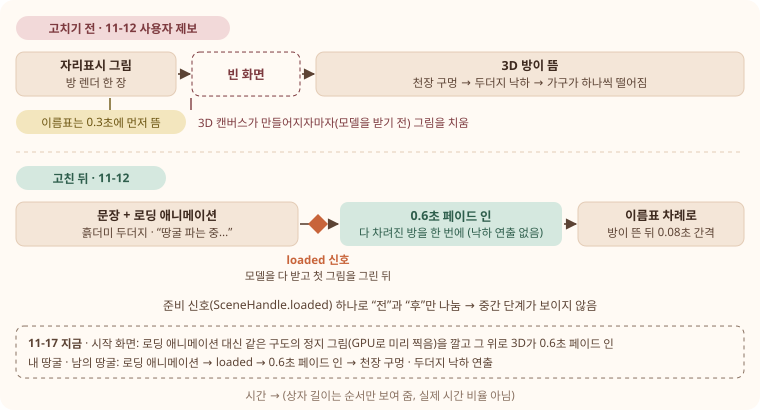
- **그 뒤 (11-17)**: 3차 그래픽 작업에서 시작 화면은 로딩 애니메이션 대신 같은 구도의 정지 그림을 깔고, 그 위로 다 차려진 3D를 0.6초에 페이드 인한다(`Landing.tsx` `loadingStill`, [rendering-experiments-3.md](rendering-experiments-3.md)). 내 땅굴·남의 땅굴은 로딩 애니메이션 그대로다. "준비 신호 하나, 그 전과 후만"이라는 원칙은 같다
- **배운 점**: 로딩 중 화면을 "여러 단계"로 보여 주면 번잡하다. 준비 완료 신호를 하나 정하고 그 전후만 나눈다

### 4-2. 배포

#### 사건 10. 아티팩트 배포의 제약 (2026-11-11 ~ 13)
- **무슨 일과 해결**

| 제약 | 증상 | 해결 | 근거 |
|---|---|---|---|
| `.glb` 파일을 올릴 수 없음 | 3D 모델이 안 올라감 | 공유 빌드에서만 glb를 data URL(파일 내용을 글자로 바꿔 코드 안에 넣은 주소)로 JS에 넣음(`vite.config.ts` `assetsInlineLimit`), `three/glb.ts`가 fetch 없이 직접 풂 | `CLAUDE.md` |
| 그 결과 청크가 커짐 | 땅굴 청크 약 12MB, 같은 모델이 두 청크에 중복 | 모델을 한꺼번에 넣던 것(`eager`)을 빼고 파일마다 따로 불러옴 → `roomScene` 11.7 → 3.7MB, `RoomCanvas` 8.6 → 0.57MB, 관심사 10개 방 받는 양 7.1 → 5.5MB | [rendering-experiments.md](rendering-experiments.md) 5장 |
| wasm·별도 파일 fetch·blob 워커가 막힐 수 있음 | Draco 해독기(wasm)를 못 씀 | v2는 Draco 안 씀 → v3는 JS 해독기를 번들에 넣어 메인 스레드(wasm·워커를 막는 보안 정책으로 로컬에서 띄워 땅굴이 뜨는 것을 확인) → 11-13 module Worker(실패하면 메인) | [3d-handoff-v3-integration.md](3d-handoff-v3-integration.md), [rendering-experiments.md](rendering-experiments.md) 2장 |
| 외부 CSS 차단 | CDN 서체가 안 뜸 | Pretendard를 npm으로 번들. Google Fonts만 예외 | `app/src/main.tsx` |
| 공개 공유 검토가 svg·avif data URL을 거절 | "링크가 있는 모든 사용자" 공유가 안 됨 | CSS에 svg data URL을 쓰지 않음. three.js가 avif 지원을 확인하려고 넣는 작은 avif 그림을 빌드 때 뺌(`stripAvifProbe`) | `app/vite.config.ts`, `CLAUDE.md` (2026-11-11 시험) |
| 주소 경로를 바꿀 수 없음 | 새로고침 404 | 해시 라우터 (사건 11) | |

- **아직 모르는 것**: 아티팩트 안에서 Draco Worker가 실제로 도는지 확인 못 함 (막혀도 메인 스레드로 넘어가 깨지지는 않음). 땅굴 전체를 Worker에서 그리는 시험판(D)은 공유 빌드에서 빈 화면이 돼서 꺼 두었다(원인 미상)
- **배운 점**: 배포 환경의 제약을 먼저 시험한다(작은 시험 페이지로 "이 형식이 올라가는가"). 제약을 피하는 코드는 공유 빌드에만 넣고 실서버 빌드와 섞지 않는다

#### 사건 11. 새로고침하면 404 (브라우저 라우터)
- **무슨 일**: 브라우저 라우터로 배포하면 `/burrow/yerin`에서 새로고침하거나 그 주소를 바로 열 때 "없는 페이지"가 뜬다
- **왜**: 새로고침하면 브라우저가 서버에 `/burrow/yerin`이라는 **파일**을 달라고 한다. 정적 서버에는 `index.html`과 `assets/`뿐이라 404를 준다. 앱 안에서 메뉴로 이동할 때는 서버에 묻지 않아서 멀쩡해 보인다
- **어떻게**: 공유본은 해시 라우터(`#/burrow/yerin`, `#` 뒤는 서버로 안 감). 예전 Vite 앱의 실서버 계획은 Nginx가 모르는 주소에 `index.html`을 돌려주게 설정(`try_files`)이었다 ([deploy-config.md](deploy-config.md) 1장)
- **지금 (Next)**: `frontend/`는 Next 서버가 `src/app/` 폴더로 모든 주소를 알아서 새로고침해도 같은 화면이 뜬다. 없는 주소는 `not-found.tsx`가 응답 404로 답한다(Vite는 200 + 화면)

  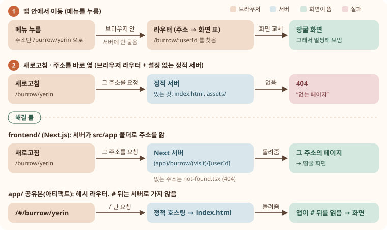
  - 덤으로 찾은 함정: 해시 라우터를 끄려고 `VITE_HASH_ROUTER=0`을 넣어도 꺼지지 않았다. 환경 변수는 늘 문자열이고 `"0"`은 빈 문자열이 아니라서 참으로 읽혔다 → `lib/env.ts`의 `flag()`가 `1·true·yes·on`만 참으로 읽게 고침 ([frontend-hardening.md](frontend-hardening.md) 2-5). 같은 규칙이 `frontend/`의 `NEXT_PUBLIC_*`와 `next.config.ts`에도 있다
- **배운 점**: "앱 안에서는 되는데 새로고침하면 안 된다"는 서버 설정 문제일 때가 많다. 설정 값은 문자열이라는 것을 잊지 않는다

#### 사건 12. 재배포 뒤 열려 있던 탭이 깨짐 (청크 404)
- **무슨 일**: 사용자가 앱을 열어 둔 채 새 버전이 배포되면, 그 탭에서 처음 땅굴에 들어갈 때 3D 파일을 못 받아 앱 전체가 에러 화면이 될 수 있었다 ([dev-deploy-risks.md](dev-deploy-risks.md) D2)
- **왜**: 빌드 파일 이름에는 내용이 바뀌면 바뀌는 해시가 붙는다(`RoomCanvas-ab12.js`). 옛 탭은 옛 이름을 기억하는데, 배포 때 옛 파일을 지우면 그 이름이 없다
- **어떻게 (예전 Vite 앱)**: `vite:preloadError`(파일을 못 받았다는 Vite 신호)가 오면 **한 번만** 새로고침(`lib/chunkReload.ts`). 30초 안에 또 실패하면 새로고침하지 않고 안내 화면(무한 새로고침 방지). 3D 경계는 "새 버전이 나왔어요 · 새로고침" 버튼. 서버는 옛 assets를 두 번 배포하는 동안 남긴다. 청크 파일을 일부러 숨기고 확인했다 ([frontend-hardening.md](frontend-hardening.md) 2-1)
- **지금 (Next)**: Next에는 `vite:preloadError`가 없다. 페이지를 옮기다 파일을 못 받으면 Next가 스스로 그 주소로 새로 불러온다. 화면 안 지연 로딩(3D 등)이 실패하면 에러가 경계까지 올라오고, `error.tsx`·`SceneBoundary`가 `isChunkLoadError`로 가려 같은 "한 번만 새로고침"을 한다

  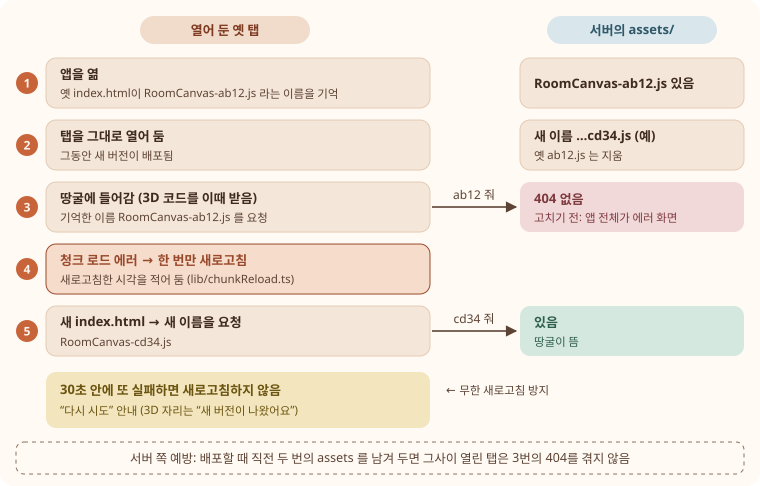
- **남은 것**: 온보딩 중간에 일어나면 입력이 날아갈 수 있다
- **배운 점**: 파일 이름에 해시를 붙이는 캐시 전략에는 "옛 탭" 문제가 따라온다. 자동 복구는 꼭 한 번으로 제한한다

### 4-3. 화면 · 데이터

#### 사건 13. 채팅방을 바꿔도 이전 메시지가 남음
- **무슨 일**: 채팅방 A에서 B로 넘어가면 헤더는 B인데 메시지 목록은 A 것으로 남았다. 남의 땅굴을 옮겨 다닐 때 방명록 입력값도 남았다 ([dev-deploy-risks.md](dev-deploy-risks.md) B4)
- **왜**: React는 같은 자리에 같은 종류의 컴포넌트가 오면 **새로 만들지 않고 재사용**한다. 예전 코드(`Room` 컴포넌트)는 메시지 목록의 처음 값(`useState(room.messages)`)을 처음 만들 때 한 번만 읽었으므로, 방이 바뀌어도 그대로였다. 지금 `RoomPane`은 메시지를 조회 훅으로 읽고, 방마다 새로 만들어진다
- **어떻게**: `key`(이 컴포넌트가 누구인지 알려 주는 이름표)를 방 id로 줬다. 키가 바뀌면 React가 새로 만든다. 채팅은 `<RoomPane key={roomId}>`(처음 고친 커밋 0360cc7), 남의 땅굴은 `<VisitBurrowView key={userId}>`(커밋 aa83db0). Next로 옮긴 뒤에는 반대로 "남아야 할 것이 사라지는" 문제가 생겼다 (사건 24)

  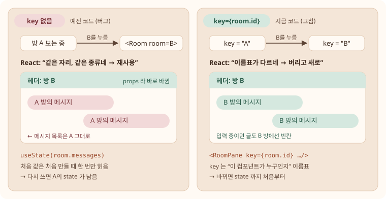
- **배운 점**: "주소의 id만 바뀌는 화면"에서는 화면 안의 상태가 남는지 꼭 본다. 개념은 [개념 2장](frontend-guide-concepts.md#2-react-컴포넌트와-상태)

#### 사건 14. 데이터가 비동기가 되면 "없음"으로 튕겨 냄 (예방)
- **무슨 일 (터지기 전)**: 예전 코드는 데이터가 처음부터 있다고 가정해 "못 찾으면 목록으로 이동"했다. 서버를 붙이면 데이터가 오기 전에 이동해 버린다. 땅굴 방문은 모르는 id면 다른 사람(예린)의 땅굴을 보여 줬다 ([dev-deploy-risks.md](dev-deploy-risks.md) B1)
- **어떻게**: 화면이 API 훅을 쓰게 바꾸고, `QueryGate`가 "불러오는 중 → 스켈레톤 / 404 → 없음 안내 / 그 밖 오류 → 다시 시도"로 나눈다. **없음은 서버가 404를 줄 때만**. 다른 사람으로 대체하지 않는다 ("없는 땅굴이에요") ([backend/frontend-data-layer.md](backend/frontend-data-layer.md) 5장). 짝이 되는 규칙 "다시 받아 404면 가진 값보다 없음이 먼저"는 사건 28
- **배운 점**: 가짜 데이터로는 절대 재현되지 않는 버그가 있다. 목 서버에 일부러 지연·실패를 넣어 미리 본다(`?api=slow|fail|notfound`)

#### 사건 15. 날짜 형식이 섞이고 시간대가 어긋날 위험 (예방, 일부 남음)
- **무슨 일 (터지기 전)**: 날짜 칸에 `2026-11-03T07:12:00Z` 같은 ISO 값과 `'2시간 전'` 같은 표시 문자열이 섞여 있었다. 서버를 붙이면 "NaN일 전"이 보이거나, 서버 시간대(UTC)와 9시간 어긋나 "방금 쓴 글"이 "9시간 전"으로 보일 수 있었다 ([dev-deploy-risks.md](dev-deploy-risks.md) B2)
- **어떻게**: 데이터에는 표시 문자열을 넣지 않는다. 서버와는 ISO 시각(확정 명세 v1은 UTC `…Z`, 날짜만은 `YYYY-MM-DD`), 앱 안 계산은 ms 숫자, 화면 문구("방금", "3분 전", "어제")는 `lib/time.ts` 한 곳에서 서울 시간 기준으로 만든다(`parseIso`·`toIso`). 브라우저 시간대와 관계없다. 테스트와 CI도 서울 시간대로 고정했다
- **남은 것 (11-17 기준)**: 영역마다 "방금 / 방금 전"처럼 문구가 조금 다른데, 명세 하나로 맞출지는 정해야 한다 ([testing-ci.md](testing-ci.md) 할 일 1). 그 뒤 바뀌었는지는 확인 못 함. 비슷한 종류로, 모임의 "오늘"을 목 데이터 날짜로 정한 곳이 리뷰에서 나왔다 (사건 25)
- **배운 점**: 날짜는 "저장할 값"과 "보여 줄 글자"를 나눈다. 시간대 규칙은 백엔드와 문서로 합의한다

#### 사건 16. 팝업 입력칸이 초점을 빼앗김 (2026-11-16)
- **무슨 일**: 대화 요청 인사·신고 사유·모임 신청 같은 팝업 입력칸에 한 글자 치면 커서가 입력칸에서 빠졌다
- **왜**: 팝업은 열릴 때 상자에 초점을 준다. 그런데 이 코드가 "닫기 함수가 바뀔 때마다" 다시 돌게 짜여 있었다. 한 글자 칠 때마다 부모 화면이 다시 그려지며 닫기 함수가 새로 만들어졌고, 그때마다 초점이 상자로 옮겨 갔다
- **어떻게**: 닫기 함수를 ref(다시 그려도 그대로인 상자)에 넣어 초점 코드가 다시 돌지 않게 했다. 예전 코드로 같은 시험을 돌려 초점이 빠지는 것을 먼저 확인했다. 같이 팝업 안에서만 Tab이 돌고, 닫으면 연 버튼으로 초점이 돌아가게 했다 ([frontend-hardening.md](frontend-hardening.md) 4-1)
- **배운 점**: "다시 그려질 때마다 도는 코드"는 의도보다 자주 돈다. 고치기 전에 버그를 재현하는 시험부터 만든다

#### 사건 17. 모달 배경이 계속 떠 있음 (예전 시안)
- **무슨 일**: 예전 단일 HTML 시안에서 모달을 닫았는데 어두운 배경 막이 남았다 (`CLAUDE.md` "주의할 점")
- **왜**: HTML의 `hidden` 속성은 "숨겨라"라는 뜻이지만, 컴포넌트 CSS가 `display: flex` 같은 값을 주면 그 값이 이긴다
- **어떻게**: 전역 CSS에 `[hidden]{display:none!important}`. 지금 앱에도 같은 규칙이 있다(`src/styles/global.css`). 지우면 안 된다
- **배운 점**: 숨기기·보이기가 이상하면 CSS 우선순위부터 본다

### 4-4. 검사 도구

#### 사건 18. 자동 검사(스모크)가 앱의 2D 캔버스를 망가뜨림 (2026-11-17)
- **무슨 일**: 모든 작업을 합친 뒤 가속 끔 모드로 스모크를 돌리자 남의 땅굴 화면 등에서 예외가 났다(`putImageData`가 null에 불림)
- **왜**: 캔버스는 처음 요청한 그리기 방식(2D 또는 WebGL) 하나로 굳는다. 스모크가 "WebGL을 얻었나"를 보려고 **모든 캔버스**에 WebGL을 요청했는데, 그중에 앱이 나중에 2D로 쓸 "선명한 배경" 캔버스가 있었다. 그 캔버스가 WebGL로 굳어 앱이 2D를 못 얻었다
- **어떻게**: 스모크는 three.js 렌더러 캔버스(`data-engine` 표시)만 보게 고쳤다. 앱도 2D를 못 얻으면 굽기를 그만두고 선명한 배경 없이 원래대로 그리게 했다(`three/sharpBake.ts` `broken`). 브라우저 확장 프로그램이 같은 일을 해도 멈추지 않게. 고친 뒤 96개 화면 세 모드 모두 통과 ([testing-ci.md](testing-ci.md) 2장, [rendering-experiments-3.md](rendering-experiments-3.md) 끝)
- **배운 점**: 검사 도구도 앱을 건드릴 수 있다. 도구 탓으로 끝내지 말고, 앱이 같은 상황을 견디는지도 본다

### 4-5. 개발 과정

#### 사건 19. 여러 작업자 병합 충돌
- **무슨 일**: 작업을 git worktree(같은 저장소를 폴더 여러 개로 나눠 동시에 작업하는 기능)로 나눠 동시에 진행했다. 11-16에는 명세 영역마다 작업자 다섯이 따로 만들고 메인이 합쳤다 ([spec-all-2026-11-16.md](spec-all-2026-11-16.md)). 같은 파일을 동시에 고친 곳이 생겼다
- **실제 예**
  - 11-13 다른 PC의 탐색 작업(걷기·줌)과 11-16 새 탐색(구멍 점프)이 겹침 → 탐색 화면은 새 구현으로, 집주인 머리 위 말풍선 등은 양쪽을 살림 (커밋 e186ec6, [explore-field-v3-9.md](explore-field-v3-9.md))
  - 3D 에러 경계(다른 작업자)와 그래픽 3차 정지 그림이 `SceneCanvas`·`RoomView`·`FieldView`·`ExploreBurrow`에서 만남 → 두 기능을 이어 합침 (커밋 96954d0)
  - API 계층이 들어오며 모임 데이터 필드 이름이 바뀌어 테스트가 깨짐 → 테스트를 고침 (커밋 dfce746)
- **그 뒤**: 11-22 API v1 맞추기도 작업자 7명이 "자기 영역 폴더 `api/<영역>/`만 고친다"는 규칙으로 병렬로 했고, 공통 파일은 먼저 만들어 두었다 ([backend/api-v1-foundation.md](backend/api-v1-foundation.md) 2장)
- **어떻게 줄였나**: 영역을 화면·폴더 단위로 나눔. 각 작업자가 "다른 작업자와 겹칠 수 있는 파일" 목록을 문서에 적음([frontend-hardening.md](frontend-hardening.md) 8장). 합친 뒤 타입 검사·테스트·빌드·스모크를 다시 돌림
- **배운 점**: 동시 작업은 빠르지만 합치는 비용이 든다. 겹칠 파일을 미리 적고, 합친 뒤 자동 검사를 꼭 돌린다

#### 사건 20. 밤사이 PC 절전·재시작으로 작업이 멈춤 (2026-11-16 ~ 17)
- **무슨 일**: 11-16 18:30에 PC가 절전 모드로 들어갔다. 11-17 00:59에 Windows 업데이트로 깨어난 뒤 01:01·01:03에 재시작됐다. Claude Code가 꺼져 "테스트·CI"와 "그래픽 3차" 작업이 도중에 멈췄다 ([prep-work-2026-11-17.md](prep-work-2026-11-17.md))
- **왜**: 이 PC는 키보드·마우스 입력이 30분 없으면 절전한다. 백그라운드 작업은 입력으로 치지 않는다
- **어떻게**: worktree에 파일이 남아 있어 잃은 것은 없었다. 아침에 중간 저장 커밋(ca91a47, c51642d)을 하고 이어서 끝냈다. 이후 오래 맡기는 작업은 도는 동안만 절전을 막고(설정은 바꾸지 않음), 작업자가 단계마다 커밋한다
- **배운 점**: 긴 작업은 "중간에 끊겨도 이어 갈 수 있게" 단계마다 저장한다

#### 사건 21. 작업 도구의 함정
- **큰 파일을 문자열 표시로 자르다 파일이 잘림** (예전 시안): 표시 문자열이 없으면 위치 찾기가 -1을 돌려 파일 뒷부분이 날아갔다 → 자르기 전에 표시가 있는지 먼저 확인 (`CLAUDE.md` "주의할 점")
- **명령 안의 백틱**: Bash에서 `node -e "..."` 안에 백틱(`` ` ``)을 쓰면 셸이 그 부분을 명령으로 실행해 버린다 → 스크립트를 파일로 저장해 실행 (`CLAUDE.md`)
- **헤드리스 브라우저는 애니메이션을 거의 안 돌림** (헤드리스 Edge): 스크린샷만으로는 낙하·걷기 같은 움직임을 확인할 수 없다 → 실제 브라우저로 따로 본다 ([3d-handoff-v2-integration.md](3d-handoff-v2-integration.md) "확인")
- **`node_modules`를 작업자끼리 같이 씀**: 같은 PC의 작업자들이 설치 폴더를 공유해서, 한 작업자가 `npm ci`를 돌리지 않았다 ([testing-ci.md](testing-ci.md) 3장). 공유 폴더는 함부로 지우거나 다시 설치하지 않는다. 실제로 지워진 사고 기록은 없다 (확인 못 함)
- **배운 점**: 도구가 하는 일을 정확히 모를 때는 작은 데서 먼저 시험한다. 공유 자원은 건드리기 전에 누가 쓰는지 확인한다

### 4-6. Next.js 전환 (2026-11-23)

Vite 앱을 Next.js로 옮기며 생긴 일이다. 라우트 48개를 같은 주소로 옮긴 뒤, 두 앱의 화면 105개를 같은 조건으로 찍어 픽셀을 비교하고 SSE·화면 이동을 따로 시험해 찾았다 ([nextjs-migration.md](nextjs-migration.md) "문제와 해결")

#### 사건 22. 실시간 소식(SSE)이 Next를 거치면 오지 않음 (2026-11-23)
- **무슨 일**: 개발 서버(Next)를 거쳐 백엔드로 넘긴 실시간 소식이 오지 않았다. 1초마다 소식을 보내는 가짜 SSE 서버로 재 보니, `next start`에서 gzip을 받는 요청은 **5초 동안 10바이트(소식 0개)**였다
- **왜**: Next의 gzip 압축(`compress`)이 `text/event-stream` 응답을 모아 두었다가 한꺼번에 보내려 했다. 비유: 편지를 한 장씩 부쳐야 하는데 우체국이 상자가 찰 때까지 모아 둔 것. 또 rewrite(백엔드로 넘기기) 프록시의 기본 대기 30초가 지나면 열린 연결이 끊긴다
- **어떻게**: `next.config.ts`에 `compress: false`(배포는 앞단 Nginx가 압축), `experimental.proxyTimeout` 1시간. 압축을 끄니 1초마다 왔다. `next dev`·`next start` 둘 다 확인. 끊겨도 `realtime/events.ts`가 다시 연결한다
- **배운 점**: 계속 열린 연결은 중간에 있는 것(압축·프록시·대기 시간)이 막기 쉽다. 가짜 서버를 세워 중간 단계를 재 본다. 배포 Nginx도 같은 점(버퍼링·대기 시간)을 봐야 한다 (아직 확인 못 함)

#### 사건 23. CSS 순서가 달라 버튼 높이가 바뀜 (2026-11-23)
- **무슨 일**: Vite 앱과 Next 앱의 같은 화면을 비교하니 모임 화면 전부가 0.8~1%, 방명록 모달이 3.4% 달랐다. 예: 모임 옆 "캘린더로 보기" 버튼이 36px → 46px
- **왜**: CSS는 명시도(선택자가 얼마나 구체적인가)가 같으면 **나중에 불러온 것이 이긴다**. Vite 앱은 화면들의 모듈 CSS를 먼저, `global.css`를 나중에 불러 전역 `.btn-sm`(36px)이 이겼다. Next는 루트 레이아웃의 전역 CSS가 먼저라 모듈 `.calBtn`(46px)이 이겼다
- **어떻게**: 처음엔 `.btn.btn`처럼 클래스를 겹쳤더니, 반대로 원래 지던 곳(확인 창 버튼)이 틀어졌다. 그래서 전역 클래스 선택자에 `:not(template)`을 붙여 명시도를 **요소 하나만큼만** 올렸다. "같으면 전역이 이김"과 정확히 같은 결과가 나와 이 화면들의 차이가 0%가 됐다 (`src/styles/global.css` 주석)
- **배운 점**: 옮기기 전후를 픽셀로 비교하면 눈으로 못 본 차이가 잡힌다. CSS 우선순위는 선택자뿐 아니라 "불러온 순서"에도 기댄다

#### 사건 24. 주소 변수가 바뀌면 화면을 새로 만듦 (2026-11-23)
- **무슨 일**: 온보딩(`/onboarding/:step`)에서 다음 단계로 넘어가면 앞에서 입력한 이름·관심사가 사라졌다. 사건 13과 반대 방향의 문제다
- **왜**: react-router는 같은 자리의 같은 컴포넌트를 두고 재사용하지만(그래서 사건 13이 났다), Next는 주소 변수(`[step]`)가 바뀌면 page를 **새로 만든다**. 안의 state도 같이 사라진다
- **어떻게**: 화면을 주소 변수 바깥의 묶음 레이아웃이 그리게 하고 page는 비웠다(`src/app/onboarding/(steps)/layout.tsx`). 같은 방법으로 채팅(대화방을 바꿔도 목록·3D 찻방 유지), 남의 땅굴(`/burrow/:userId`), 게시판 내 활동 탭. `frontend/scripts/nav-check.mjs`로 앱 안 링크·뒤로가기 막기·이동 state·온보딩 입력 유지 6가지를 크롬에서 확인
- **배운 점**: 프레임워크를 바꾸면 "언제 새로 만드나" 규칙이 바뀐다. 화면마다 "남아야 할 것"과 "사라져야 할 것"을 정하고(사건 13·24), 그대로 되는지 시험한다

### 4-7. 팀 리포 PR 리뷰 (2026-11-24)

`frontend/`를 팀 리포에 PR #37로 올리기 전에 영역 넷(인증·설정 / 땅굴·탐색 / 채팅·알림 / 모임·게시판)으로 나눠 로컬 리뷰를 하고(P1 10개), PR을 연 뒤 Codex(AI 리뷰어) 리뷰를 9번 받았다(2026-11-24 오후 기준). 리뷰마다 다른 곳을 1~2건씩 짚었고, 대부분 **목 서버로 도는 시험에서는 드러나지 않는 것**이었다 ([team-import-decisions-2026-11-23.md](team-import-decisions-2026-11-23.md) "리뷰 · PR"). P0는 "꼭 고칠 것", P1은 "고치는 게 맞는 것"이다

#### 사건 25. "나"와 "오늘"을 목 상수로 정함 (2026-11-24, 로컬 리뷰)
- **무슨 일**: 실제 서버 모드에서만 틀리는 곳들이 있었다. 프로필 팝업이 내 프로필을 "나"로 못 알아봤고, 모임의 "오늘"(D-day·지난 모임 가르기)이 목 데이터의 날짜 2026-11-03 기준이었고, 찻방·들판의 내 두더지 모습이 목 값이었다. 로컬 리뷰 P1 10개 중 4개가 같은 원인이었다
- **왜**: "나"를 목 계정 id `'me'`(`data/mock.ts` `ME_ID`)로, "오늘"을 목 데이터의 오늘(`TODAY = '2026-11-03'`)로 정한 코드가 남아 있었다. 목 모드에서는 맞으니 목 서버로 도는 단위 테스트·스모크가 잡지 못했다
- **어떻게**: 내 id는 `GET /me`의 `userId`로(`api/auth`의 `useMe`, 채팅 `useMyId`), 모임의 오늘은 실제 모드면 페이지를 연 때의 서울 날짜로(`data/meetupStore.ts` `TODAY`), 내 두더지는 실제 모드면 내 땅굴 조회 값으로 맞춤(`api/burrow`의 `MyWornSync`, 로그인 영역 틀에 한 번). 커밋 13dc95a
- **배운 점**: 영역을 실제 서버로 바꿀 때는 `ME_ID` · `TODAY` · `getMyWorn`부터 찾아본다. 목 서버는 "응답 모양"만이 아니라 "내가 누구인지 · 지금이 언제인지"도 몰래 정하고 있었다

#### 사건 26. 계정이 바뀌어도 이전 계정의 데이터가 남음 (2026-11-24, Codex P0 3건)
- **무슨 일**: 같은 탭에서 세션이 끝난 뒤 다른 계정으로 로그인하면
  1. 이전 계정의 캐시(내 땅굴 · 계정 · 대화 목록)가 보였다
  2. 이전 계정이 보내지 못한 채팅 메시지(탭 메모리의 outbox)가 남았다
  3. 쓰기를 보낸 뒤 응답 전에 계정이 바뀌면, 늦게 끝난 요청의 되돌리기·성공 처리가 이전 계정 데이터를 새 계정 캐시에 넣었다
- **왜**: 서버 데이터 캐시, 탭 메모리 저장소, 날아가는 중인 요청 세 곳 모두 "지금 누구의 것인지"를 몰랐다. 로그아웃 버튼은 정리를 했지만(`lib/signOut.ts`), 401로 끊기거나 바로 다른 계정으로 로그인하는 길은 정리하지 않았다. 비유: 공용 사물함을 다음 사람에게 넘기며 사물함(캐시)만 비우고 책상 위 쪽지(outbox)와 오는 중인 택배(늦은 응답)는 그대로 둔 것
- **어떻게**
  - 401과 로그인 성공 때 `lib/authFlow.ts`의 `dropUserData()`가 계정마다 다른 캐시를 모두 버리고(내 계정과 공개 목록만 남김) outbox를 비운다. outbox는 세대 번호를 올려 늦게 끝난 전송 결과를 버린다 (커밋 fa97b92 · 87aa945)
  - 세션 번호(`api/queryClient.ts`의 `sessionGeneration`, 계정이 바뀔 때 `newSession`) + 쓰기 훅을 모두 `useSessionMutation`(`api/sessionMutation.ts`)으로 바꿨다. 시작할 때와 끝날 때 번호가 다르면 끝난 뒤 처리를 건너뛴다. 테스트 `session-mutation`은 쓰기 훅이 모두 이것을 쓰는지도 검사한다 (커밋 3397eef)
- **배운 점**: 계정 전환은 서버 캐시만이 아니라 탭 메모리 저장소와 "날아가는 중인 요청"까지 본다. 규칙은 공통 부품 하나에 넣고, 모두가 그 부품을 쓰는지 테스트로 지킨다

#### 사건 27. 온보딩을 마친 뒤 계정 갱신을 기다리지 않음 (2026-11-24, Codex P1)
- **무슨 일**: 온보딩 "관심사 확정" 뒤 내 땅굴로 이동할 때, 로그인 검사(`RequireLogin`)가 아직 옛 `GET /me` 값(다음 단계 `nextStep` = 온보딩)을 보고 온보딩 1로 되돌릴 수 있었다
- **왜**: 확정 뒤 캐시를 "새로 받으라"고만 하고, 받기가 끝나기를 기다리지 않고 바로 이동했다
- **어떻게**: 새로 받기의 Promise를 돌려줘 끝난 뒤에 이동한다 (`api/onboarding/queries.ts` `useCompleteOnboarding`, 커밋 fa97b92)
- **배운 점**: "다시 받아"와 "다시 받은 뒤에"는 다르다. 다음 화면이 그 값을 보고 판단하면 기다린다. 이 문제는 로컬 리뷰에서 "확인 필요"로 적어 두었던 것이다

#### 사건 28. 다시 받아 404인데 이전 값이 보임 (2026-11-24, Codex P1 3건)
- **무슨 일**: 받아 둔 글을 다시 불러와 404(지워짐·가려짐)를 받아도 이전 본문이 보였다. 글을 지운 뒤 뒤로 가기로 돌아오면 지운 글이 보였다. 나간 대화방에 돌아오면 404인데도 이전 메시지가 보였다
- **왜**: `QueryGate`에는 "이미 받은 값이 있으면 다시 받다 실패해도 그 값을 계속 보여 준다"는 규칙이 있다(잠깐 끊긴 네트워크에는 좋은 규칙). 그런데 404는 "잠깐 실패"가 아니라 "이제 없음"인데 같은 규칙을 탔다. 채팅은 `QueryGate`를 쓰지 않아 따로 같은 문제가 있었다
- **어떻게**: `QueryGate`가 404·410을 이전 값보다 먼저 본다(일시적 실패만 이전 값 유지, `components/AsyncState.tsx`). 글을 지우면 상세·댓글 캐시를 만료만 해 두고 다음에 열 때 새로 받는다(`api/community/queries.ts`). 채팅은 `screens/chat/Chat.tsx`의 `roomPaneView`로 404 먼저. 같은 패턴이 남은 화면이 없는지 확인했다. 테스트 `query-gate` · `chat-room-gone` (커밋 5d4f3c2 · 0d502c1 · f7804e7)
- **배운 점**: 사건 14의 "없음은 404일 때만"에는 짝이 있다: "404면 가진 값보다 없음이 먼저". 실패를 일시적인 것과 영구적인 것으로 나눠 다르게 다룬다

#### 사건 29. 낙관적 되돌리기가 그 사이 바뀐 것을 덮음 (2026-11-24, Codex P1 2건)
- **무슨 일**: ① 알림 설정에서 한 스위치를 저장하는 중에 다른 스위치를 누르면, 앞 요청이 실패해 되돌릴 때 뒤 변경까지 덮었다 ② 댓글 좋아요가 실패하면 요청 전 목록으로 되돌려, 그 사이 지운 댓글이 다시 보였다
- **왜**: 낙관적 업데이트(2-5)는 요청 전 캐시를 사진(스냅숏)으로 찍어 두었다가 실패하면 그 사진으로 되돌린다. 그 사이 다른 일이 끝났으면 사진은 이미 옛것이다
- **어떻게**
  - 알림 설정: 저장하는 동안 스위치를 잠그고, 끝나면 설정을 다시 받는다 (`api/settings/queries.ts`, `screens/settings/SettingsInfo.tsx`, 테스트 `notif-settings-save`, 커밋 55e70ad)
  - 같은 종류라 공통 부품 `useOptimistic`(`api/optimistic.ts`)에서 한 번에: 실패해 되돌린 뒤에는 바꿨던 캐시를 항상 서버에서 다시 받는다 (테스트 `optimistic-rollback`, 커밋 b5b80e0)
  - 아홉 번째 리뷰도 같은 결이었다: 내 땅굴에서 방명록 글을 신고해 가려져도 목록·글 수를 다시 받지 않았다(방문자 뷰는 이미 함) → 같이 다시 받기 (`screens/burrow/MyBurrow.tsx`, 테스트 `guestbook-report-refresh`, 커밋 e64acf9)
- **배운 점**: 되돌린 값은 "지금의 진실"이 아니라 "옛 사진"이다. 되돌린 뒤 서버 값으로 다시 맞춘다. 같은 종류의 지적은 화면마다 고치지 말고 공통 부품에서 고친다

#### 사건 30. 댓글을 다 받기 전에 쓰면 순서가 깨짐 (2026-11-24, Codex P1)
- **무슨 일**: 댓글은 등록순으로 10개씩 이어 받는다(커서 목록). 다 받기 전에 새 댓글을 쓰면 받아 둔 목록 끝에 붙어, 나중에 남은 페이지를 받으면 새 댓글이 중간에 끼었다
- **어떻게**: 남은 페이지를 다 받은 뒤 맨 끝에 붙인다 (`api/community/queries.ts` `appendTopComment`, 테스트 `comment-order`, 커밋 87aa945)
- **배운 점**: 이어 받는 목록에 낙관적으로 끼워 넣을 때는 "아직 안 받은 부분"이 어디에 있는지 먼저 본다. 이것도 로컬 리뷰의 "확인 필요"였다

#### 사건 31. 큰 PR에 자동 리뷰가 오지 않음 (2026-11-24)
- **무슨 일**: PR #37을 연 뒤 33분이 넘도록 Codex 자동 리뷰가 오지 않았다. 앞 PR들은 2~7분 만에 왔다. 이번 PR은 파일 590개였다 (원인은 확인 못 함)
- **어떻게**: 사용자 요청으로 PR에 `@codex review`를 직접 남겼더니 10분 만에 P0 1 · P1 1이 왔다(사건 26·27). 그 뒤 고칠 때마다 다시 요청해 9번째 리뷰까지 받았다. 고친 것은 이 리포 `frontend/`와 팀 브랜치에 똑같이 넣었다(팀 브랜치 서명 커밋 93개)
- **배운 점**: 자동화가 "조용히 안 도는" 경우는 시간으로 알아챈다. 큰 PR은 리뷰를 여러 번 받는 시간을 일정에 넣는다

### 4-8. 사건에서 나온 공통 교훈
1. **재고 나서 고친다.** 가속 꺼진 PC의 "깨짐"은 속도 문제였고, 탐색 들판의 병목은 정점이 아니라 픽셀이었다. 짐작으로 고쳤다면 엉뚱한 곳을 손댔다
2. **숫자는 여러 개를 같이 본다.** 가장 긴 멈춤 · 다 보이기까지 · fps · 화질(PSNR·SSIM). 하나만 보면 다른 것이 나빠진다 (사건 4·5)
3. **실패 화면도 설계한다.** 불러오는 중 · 오류 · 없음 · WebGL 없음 · 옛 탭 · 오프라인. 실패도 종류(잠깐 / 영구)를 나눈다 (사건 28)
4. **환경 차이를 먼저 의심한다.** 개발 서버 ↔ 공유 빌드 ↔ 실서버, Vite ↔ Next, GPU PC ↔ 가속 꺼진 PC, 목 ↔ 실제 서버 (사건 22·23·25)
5. **자동 검사가 사람보다 먼저 본다.** 합친 뒤 깨진 테스트, 숨은 굽기 버그, 옮긴 뒤 CSS 차이를 스모크·단위 테스트·픽셀 비교가 찾았다
6. **목 서버에서만 맞는 코드를 의심한다.** 목은 응답 모양뿐 아니라 "나 · 오늘"까지 정해 준다. 실제 모드로만 갈리는 곳은 리뷰와 실제 서버 연결로 확인한다 (사건 25)
7. **계정과 시간의 경계를 본다.** 계정이 바뀌는 순간, 요청이 날아가는 동안, 되돌리는 사이에 다른 일이 끝날 수 있다. 공통 부품 하나에서 막는다 (사건 26·29)

---

## 5. 이 앱의 구조 다시 보기

### 5-1. 폴더 지도 (`frontend/src/`)

| 폴더·파일 | 하는 일 | 대표 파일 |
|---|---|---|
| `app/` | 주소 = 폴더 (Next App Router). 화면 코드는 거의 없고 `screens/`를 불러옴 | `layout.tsx`(글꼴·전역 CSS), `providers.tsx`(브라우저에서만 그림·데이터 캐시·가속 꺼짐 안내), `(pc)/`(시작 화면들), `(app)/`(로그인 영역), `onboarding/`, `error.tsx`·`global-error.tsx`·`not-found.tsx` |
| `screens/` | 화면. `start`(랜딩·로그인), `onboarding`, `burrow`(내 땅굴·남의 땅굴·탐색), `board`, `meetups`, `chat`, `notifications`, `settings`, `admin`, `lab`(실험실) | `burrow/MyBurrow.tsx`, `chat/Chat.tsx` |
| `components/` | 여러 화면이 같이 쓰는 조각 | `AppShell`(로그인 영역 틀), `AppHeader`, `Modal`, `Pagination`, `RoomView`(3D 땅굴 틀), `SceneBoundary`(3D 경계), `AsyncState`(스켈레톤·오류·빈 상태·`QueryGate`), `NotFound`, `ConnectionStrip`, `MoleAvatar`(2D 두더지) |
| `api/` | 서버와 말하는 층. 영역 폴더 11개 + 공통 | `client.ts`(fetch·응답 틀·에러), `config.ts`(영역별 목/실제), `optimistic.ts`, `sessionMutation.ts`, `queryClient.ts`, `<영역>/`(types · real · mock · mappers · queries · errors · api), `mock/server.ts`(목 서버 바탕) |
| `realtime/` | 실시간 소식(SSE) 연결 하나 | `eventStream.ts`, `events.ts`, `useEventStream.ts`, `backoff.ts` |
| `data/` | 목 저장소(가짜 DB), 관심사 표, 방 배치 규칙 | `mock.ts`, `meetupStore.ts`, `boardStore.ts`, `chat.ts`, `auth.ts`, `interestTags.ts`, `roomPlan.ts`, `furnitureCatalog.json`, `slots.json` |
| `lib/` | 화면과 상관없는 도구 | `nav.tsx`(화면 이동 어댑터), `env.ts`(환경 변수), `time.ts`(날짜), `validation.ts`(글자 수), `authFlow.ts`·`signOut.ts`(인증), `chunkReload.ts`, `network.ts`, `a11y.ts`, `graphicsTier.ts`·`deviceTier.ts`·`lowLab.ts`(저사양) |
| `three/` | 3D | `engine.ts`, `roomScene.ts`, `holeField.ts`, `fieldScene.ts`, `moleActor.ts`, `glb.ts`, `warm.ts`(예열), `sharpBake.ts`(선명한 배경), `staticBackdrop.ts`(배경 한 번), `stills.ts`(정지 그림), `worker/`(시험판), `*Canvas.tsx`(React와 잇는 껍데기) |
| `labs/` | 실험실 조각을 빌드 때 넣거나 뺌 | `index.ts` |
| `styles/` | 디자인 토큰과 전역 CSS | `tokens.css`, `global.css` |
| `assets/` | glb 모델, 액세서리 아이콘, 벽지, 정지 그림 (import 하면 주소 문자열) | `models/`, `stills/` |
| `tests/` | 단위 테스트 (vitest) | `api-v1-endpoints.test.ts`, `auth-cache.test.ts`, `meetup-api.test.ts` 등 |

`frontend/src` 밖: `frontend/next.config.ts`(실험실 스위치·rewrites·에셋 규칙), `frontend/public/draco/`(Draco 해독기), `frontend/scripts/`(스모크·실험실 빠짐 검사·화면 이동 검사), `.github/workflows/frontend-ci.yml`. 저장소 맨 위: `app/`(예전 Vite 앱, 공유 데모 빌드), `explore/`(3D 엔진 비교·그래픽 측정 도구 `explore/gpu/`), `design/`(Figma 자료·3D 핸드오프), `docs/backend/team-spec/`(백엔드 명세 사본), `legacy/`(방향 전환 전 시안)

### 5-2. 화면 하나가 뜨기까지

**일반 화면: 모임 상세 `/meetups/m1`**
1. `src/app/layout.tsx`: 글꼴·전역 CSS를 붙이고 `providers.tsx`로 넘긴다. 여기서 브라우저에서만 그리기(`ClientOnly`), 휴대폰이면 "PC에서 이용해 주세요"(`DeviceGate`), 데이터 캐시(`QueryClientProvider`), 가속 꺼짐 안내를 붙인다
2. Next가 폴더에서 `(app)/meetups/[id]/page.tsx`를 찾는다 → `(app)/layout.tsx` → `components/AppShell.tsx`: 로그인 검사(`RequireLogin`, 비로그인이면 `/login`), 헤더, 실시간 소식 연결 시작, 목 서버 동기화 → `MeetupDetail`
3. `MeetupDetail`: `useMeetupDetail('m1')` 훅을 부른다(`api/meetups/queries.ts`)
4. 훅 → `meetupsApi.get` → 영역 스위치가 목이면 `api/meetups/mock.ts`(0.15~0.4초 기다렸다가 `data/meetupStore.ts` 값을 명세 모양 DTO로), 실제면 `api/client.ts`가 `GET /api/v1/meetups/{숫자 id}` → 응답 틀을 풀어 `data`만 → `mappers`가 앱 모양으로(숫자 id → 문자열, UTC → ms)
5. `QueryGate`: 오는 중이면 스켈레톤, 404면 "삭제된 모임이에요"(가진 값이 있어도 404가 먼저, 사건 28), 그 밖 오류면 "다시 시도", 받으면 화면
6. 사용자가 "찜"을 누르면 `useOptimistic`: 화면을 먼저 바꾸고 → `PUT /api/v1/meetups/{id}/like` → 실패하면 되돌리고 빨간 토스트, 그리고 다시 받기(사건 29). 쓰기 훅은 모두 `useSessionMutation` 위라, 그사이 계정이 바뀌면 끝난 뒤 처리를 건너뛴다(사건 26)

**3D 화면: 내 땅굴 `/burrow`**
1. 1~2는 같다 → `(app)/burrow/page.tsx` → `MyBurrow`
2. `RoomView`가 3D 경계(`SceneBoundary`)와 로딩 애니메이션("땅굴 파는 중...")을 깔고, `lazy(() => import('../three/RoomCanvas'))`로 3D 코드를 **이때 처음** 내려받는다
3. `SceneCanvas`(div 하나)가 `mountRoomScene(div)`를 부른다 → 렌더러(그리는 기계)를 만들고 → 관심사로 가구 배치를 계산해 받을 모델을 정하고(`data/roomPlan.ts`) → glb 모델을 받아(Draco wasm 해독) → 예열 → 그리기 루프 시작 (그림은 [2-7](#2-7-3d-화면이-뜨기까지))
4. 다 차려지면 `loaded` 신호 → 로딩 애니메이션을 걷고 0.6초 페이드 인
5. 가속이 꺼진 PC면 같은 흐름에 저사양 묶음이 끼어든다: 배경은 한 번만 그리고, 멈춰 있을 때 선명하게 굽고, 두 번째 방문이면 IndexedDB에 기억한 그림을 3D보다 먼저 보여 준다
6. 화면을 떠나면 `dispose`: 장면이 만든 것과 렌더러를 해제하고 WebGL 컨텍스트를 반납. glb 모델은 다음 장면에서 다시 쓰려고 캐시에 남긴다

### 5-3. 에러가 났을 때 어디서 잡히나

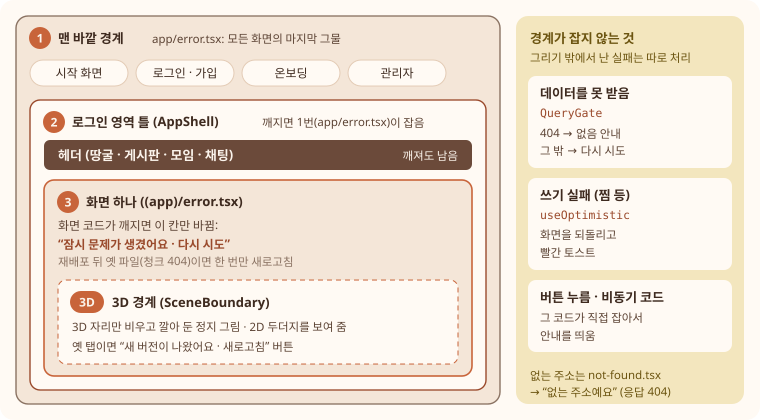

| 무엇이 잘못됐나 | 어디서 잡나 | 사용자에게 보이는 것 |
|---|---|---|
| 화면 코드가 던진 에러 | `src/app/(app)/error.tsx` (모임·설정은 안쪽 `error.tsx`가 하나 더) | 헤더는 그대로(모임 탭·설정 왼쪽 메뉴도), 안쪽만 "잠시 문제가 생겼어요 · 다시 시도" |
| 헤더(로그인 영역 틀)가 깨짐 | `src/app/error.tsx` (Next의 error.tsx는 같은 폴더 layout 바깥을 못 감싸서 한 단계 위) | 전체 안내 |
| 시작 화면·온보딩·관리자 | `src/app/error.tsx`, 루트 레이아웃까지 깨지면 `global-error.tsx` | 같은 안내 |
| 없는 주소 | `src/app/not-found.tsx` (헤더를 씌움, 응답 404) | "없는 주소예요" |
| 재배포 뒤 청크 404 | 에러 경계가 `lib/chunkReload.ts`의 `isChunkLoadError`로 가려냄 | 한 번 새로고침, 30초 안에 또 실패하면 안내 |
| 데이터 404 / 오류 | `QueryGate` (채팅은 `roomPaneView`) | 없음 안내 / "불러오지 못했어요 · 다시 시도" (잠깐 실패면 이미 받은 값은 계속 보임) |
| 쓰기 실패 | `useOptimistic` | 되돌림 + 빨간 토스트(문구는 영역 `errors.ts`의 code 표) + 다시 받기 |
| 입력 오류 (400 `INVALID_INPUT`) | 화면이 `fields`를 칸 밑에 | 칸마다 안내 문구 |
| 401 (로그인 풀림) | `api/client.ts` → `lib/authFlow.ts` `handleUnauthorized` | 바로 로그인 화면 + 이전 계정 데이터 버림(사건 26). `NEXT_PUBLIC_LOGIN_FREE=1`이면 기록만 |
| 403 `ONBOARDING_INCOMPLETE` | 공용 `queryClient` → `handleOnboardingIncomplete` | 온보딩 1로 |
| 오프라인·서버에 닿지 않음 | `components/NetworkBanner.tsx` | 화면 맨 위 띠 |
| 실시간 연결 끊김 | `realtime/events.ts` → `ConnectionStrip` | "다시 연결하는 중…", 다시 붙으면 조회 API로 맞춤 |
| WebGL 없음·3D 실패 | `SceneCanvas` → `SceneBoundary` | 고해상도 정지 그림 (찻방은 2D 두더지) |
| WebGL 컨텍스트를 도중에 잃음 | `SceneCanvas` | 1.5초 뒤 장면을 다시 만듦(최대 2번), 그 뒤 2D |
| 그래픽 가속 꺼짐 | `lib/graphicsTier.ts` → 저사양 묶음 | 안내 띠 (🧪 실험실 패널은 실험실 켠 빌드에서만) |

에러 경계(error boundary)는 "이 아래에서 에러가 나면 여기까지만 지우고 안내를 보여 줘"라고 표시한 칸막이다. 칸막이가 없으면 에러 하나에 앱 전체가 하얘진다. Next에서는 폴더마다 `error.tsx`를 두면 그 폴더의 칸막이가 된다. 자세한 개념은 [개념 3-3](frontend-guide-concepts.md#3-3-에러-경계)

---

## 6. 백엔드를 연결할 때 알아야 할 것

### 6-1. 목 → 실제 서버 전환

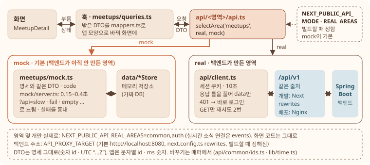

- 영역마다 따로 바꾼다. 백엔드가 만든 영역만 이름을 적는다 (`frontend/.env.local`, 커밋 안 됨)
  ```
  NEXT_PUBLIC_API_REAL_AREAS=common,auth,events
  API_PROXY_TARGET=http://localhost:8080
  ```
  - 영역 이름: `common auth settings onboarding burrow explore chat meetups community notifications admin`, 실시간 소식 연결은 `events`
  - 모두 실제로는 `NEXT_PUBLIC_API_MODE=real`, 그중 아직 안 만든 영역만 목으로 두려면 `NEXT_PUBLIC_API_MOCK_AREAS=chat`
- **백엔드로 넘기기**: 브라우저는 같은 출처의 `/api/v1/...`만 부르고, Next가 `next.config.ts`의 rewrites로 `API_PROXY_TARGET`(기본 `http://localhost:8080`, `off`면 끔)에 넘긴다. 브라우저 입장에선 같은 출처라 CORS(다른 출처 요청 차단)·쿠키 문제가 없다. 개발 포트 3000은 백엔드 CORS 허용 출처와 같다
- **빌드할 때 정해지는 값**: `NEXT_PUBLIC_*`는 빌드 결과 JS에 글자 그대로 박혀 누구나 볼 수 있다(비밀 키 금지). `API_PROXY_TARGET`도 `next build` 때 정해져서, 바꾸면 다시 빌드해야 한다(`next start`만 다시 해서는 안 바뀜). 개발 서버는 켤 때 읽는다
- **로그인 검사**: 기본은 명세대로(비로그인 → 로그인, 온보딩 안 끝남 → 온보딩, 401 → 다시 로그인). 시연·디자인 확인으로 다 열어 보려면 `NEXT_PUBLIC_LOGIN_FREE=1`
- 목록과 설명: `frontend/.env.example`, `frontend/README.md`, 읽는 곳은 `src/lib/env.ts`의 `ENV` 하나 ([backend/api-v1-foundation.md](backend/api-v1-foundation.md) 2장 "실제 서버로 바꾸기")

### 6-2. 백엔드와 정해진 약속 (명세 v1)


11-16에 프론트가 제안한 초안([backend/api-draft.md](backend/api-draft.md))과 11-22 백엔드 확정 명세가 다른 점이다. 프론트는 확정 명세에 맞췄다 ([backend/api-v1-alignment.md](backend/api-v1-alignment.md), 명세 사본 [backend/team-spec/](backend/team-spec/README.md))

| # | 결정 | 우리 초안 (예전) | 확정 명세 v1 | 프론트가 한 일 |
|---|---|---|---|---|
| 1 | 주소 | 같은 출처 + `/api` | `/api/v1/...`, 자원은 복수형, 내 것은 `/me/...` | 영역마다 `ENDPOINTS`에 명세 제목 그대로, 완성도 시험 |
| 2 | 인증 | HttpOnly 쿠키 + 리프레시 | 세션 쿠키 `ITTING_SESSION`(14일, 쓸 때마다 연장), **갱신 API 없음** | 401이면 바로 로그인 화면 |
| 3 | 응답 | 봉투 없음 | `{ success, data, error }`, 목록은 `data.items` | `api/client.ts`가 풀어서 `data`만 돌려줌 |
| 4 | 에러 | `{code, message, status, traceId, fieldErrors}` | `error: {code, message, fields, detail}`, 입력 오류는 400 `INVALID_INPUT` + `fields`. 화면 문구는 **프론트가 code로** 정함 | `ApiError`, 영역마다 `errors.ts` code → 문구 표 |
| 5 | ID | JSON 문자열 `"42"` | **숫자** | DTO는 숫자, 앱은 문자열 (`api/common/ids.ts` `toAppId`·`toDtoId`) |
| 6 | 시각 | ISO + 오프셋(서울) | **UTC `…Z`**, 날짜만은 `YYYY-MM-DD` | 읽기 `parseIso`, 보내기 `toIso`, 표시는 서울 시각 (`lib/time.ts`) |
| 7 | 목록 | 번호 / 커서 | 페이지 `{items,page,size,totalItems,totalPages}`(1부터) / 커서 `{items,nextCursor,hasNext}` | 목 서버 `paginate`·`cursorPage` |
| 8 | 실시간 | WebSocket + STOMP | **SSE 하나** `GET /api/v1/me/event-stream`. 끊긴 동안 소식은 다시 안 줌 | 다시 붙으면 조회 API로 맞춤 (3-7) |

- 백엔드 질문 모음: [backend/api-v1/questions-for-backend.md](backend/api-v1/questions-for-backend.md) (공통 6 + 영역별. 관심사 `code` 칼럼, SSE 동안 세션 연장, `Last-Event-ID`, 채팅 멱등 키 등). 프론트는 지금 각 항목의 "지금은"대로 동작한다
- 명세에 맞추며 더하거나 뺀 기능(기획 확인용): [backend/api-v1/feature-changes.md](backend/api-v1/feature-changes.md)
- 화면 쪽 "서버가 계산할 값"(모집 상태·버튼 켜기·안 읽은 수)은 명세가 `can*`·`myStatus` 같은 값으로 준다. 프론트는 계산하지 않고 그 값을 쓴다

### 6-3. 배포 서버 설정 (아직 정하지 않음)
- 형태 후보: `next start` + 앞단 Nginx, 또는 `output: 'standalone'` ([nextjs-migration.md](nextjs-migration.md) "다음 단계")
- 앞단이 할 일: 압축(Next는 `compress: false`), `/api`를 Spring으로 전달. SSE 경로는 계속 열린 연결이라 대기 시간·버퍼링을 확인해야 한다 (확인 못 함, 사건 22)
- 새로고침 404는 Next 서버가 주소를 알아 생기지 않는다(사건 11). 옛 탭을 위해 직전 배포의 파일을 잠시 남기는 것은 같다(사건 12)
- 브라우저 알림 서비스 워커 `/push-sw.js`를 맨 위 경로에 둬도 되는지는 백엔드 질문에 있다
- 예전 예시: [deploy-config.md](deploy-config.md) (정적 SPA + `/ws` 기준이라 다시 써야 함)

### 6-4. 아직 남은 연결 작업
- 영역별로 실제 백엔드에 붙여 확인한다(다음 티켓). 먼저 `NEXT_PUBLIC_API_REAL_AREAS=common,auth,events`로 로그인·SSE
- 영역을 실제로 바꿀 때마다 `ME_ID` · `TODAY` · `getMyWorn`처럼 목 상수에 기대는 곳을 찾는다 (사건 25)
- 백엔드 질문 답이 오면 해당 영역 문서와 코드를 고친다. 명세 사본이 바뀌면 `api-v1-endpoints.test.ts`가 새 API·없어진 API를 알려 준다
- 백엔드가 OpenAPI(Swagger)를 열면 DTO 타입을 자동 생성으로 바꾸는 것을 검토한다

---

## 7. 직접 해 볼 것과 공부 순서

### 7-1. 주소 손잡이로 상태 보기
로컬(`cd frontend && npm run dev` → http://localhost:3000, 목 서버·실험실 켜짐)에서 주소 끝에 붙인다. 로그인 없이 둘러보려면 `NEXT_PUBLIC_LOGIN_FREE=1 npm run dev`.

| 해 볼 것 | 주소 | 보이는 것 |
|---|---|---|
| 모든 화면 목록 | `/screens` (실험실 켠 빌드만) | 화면 바로가기 |
| 느린 서버 | `/meetups/m1?api=slow` | 스켈레톤 |
| 서버 고장 | `/burrow/yerin?api=fail` | "불러오지 못했어요 · 다시 시도" |
| 쓰기 실패 | `/meetups/m6?api=writefail` 에서 찜 누르기 | 바뀌었다 되돌아옴 + 빨간 토스트 |
| 빈 목록 / 없음 | `/board?api=empty`, `/meetups/m1?api=notfound` | 빈 상태, "삭제된 모임이에요" |
| 로그인 풀림 | `?api=unauth` | 401 → 로그인 화면 (`LOGIN_FREE`면 기록만) |
| 실시간 끊김 | `/chat/r-yerin?rt=flaky`, `?rt=down` | "다시 연결하는 중…", 다시 붙으면 놓친 메시지를 조회로 받음 |
| 남이 한 일 흉내 | 개발 서버 콘솔 `__digulMock`, `__digulChat.incoming(방, 글)` | 알림 빨간 점, 상대 메시지 |
| 에러 경계 | `/dev/crash` (실험실 켠 빌드만) | 헤더는 남고 "잠시 문제가 생겼어요" |
| 저사양 흉내 | `/burrow?gpu=software` | 저사양 묶음 |
| 약한 PC 흉내 | `/burrow/explore?tier=weak` | 이동 중 더 흐리지만 덜 끊김 |
| 저사양 실험실 | `?lowlab` 또는 Ctrl+Shift+L (실험실 켠 빌드만) | 기법을 하나씩 켜고 끔 |

실험실(🧪 패널·손잡이 배지·`/screens`·`/dev/crash`)은 `next dev`에서만 기본으로 켜지고 배포 빌드에서는 코드째 빠진다(`NEXT_PUBLIC_LABS`). 진짜 가속 꺼짐을 보려면 크롬 `chrome://settings/system`에서 "가능한 경우 그래픽 가속 사용"을 끄고 다시 시작한다 (다 보면 다시 켠다).

### 7-2. 공부 순서

| 단계 | 읽을 것 | 해 볼 것 |
|---|---|---|
| 1 | [개념 1~3장](frontend-guide-concepts.md#1-전체-그림-spa), `src/app/layout.tsx` → `src/app/(app)/layout.tsx` → `components/AppShell.tsx` | `/meetups/:id`가 어느 폴더의 `page.tsx`인지 찾아 화면 파일까지 따라가기 |
| 2 | `components/Pagination.tsx`, `InterestChip.tsx` | props만 받는 컴포넌트가 무엇인지 설명해 보기 |
| 3 | [개념 6장](frontend-guide-concepts.md#6-서버-데이터-다루기-tanstack-query), `api/meetups/`(types → real → mock → mappers → queries), `components/AsyncState.tsx` | 7-1 표의 `?api=` 손잡이를 모두 눌러 보기 |
| 4 | `api/client.ts`, `api/common/ids.ts`, `lib/time.ts` | 명세의 응답 하나를 골라 화면에 보이기까지 바뀌는 칸을 적어 보기 |
| 5 | [개념 4장](frontend-guide-concepts.md#4-스타일-디자인-토큰과-css-modules), `styles/tokens.css` | 개발자 도구(F12)에서 토큰 값을 바꿔 보기 |
| 6 | [개념 8장](frontend-guide-concepts.md#8-3d를-react-앱에-넣기), `three/SceneCanvas.tsx` → `engine.ts` | 화면을 오갈 때 무엇이 만들어지고 버려지는지 설명해 보기 |
| 7 | [개념 9장](frontend-guide-concepts.md#9-그래픽-성능의-기본-개념), 4장 사건 2~5 | 🧪 패널에서 A를 끄고 켜며 차이 보기 |
| 8 | 4장 사건 25~30, `api/optimistic.ts`, `api/sessionMutation.ts` | `src/tests/session-mutation.test.ts`를 읽고 무엇을 지키는지 말해 보기 |
| 9 | [개념 11장](frontend-guide-concepts.md#11-테스트), `src/tests/api-v1-endpoints.test.ts` | `npm test` 돌려 보고 테스트 이름에서 명세 번호 찾기 |

---

## 8. 용어집

| 용어 | 뜻 |
|---|---|
| SPA | HTML 한 장을 받은 뒤 화면 전환을 JavaScript가 처리하는 웹 앱 |
| 컴포넌트 · props · state | 화면 조각을 돌려주는 함수 · 부모가 주는 값 · 컴포넌트가 기억하는 값 |
| effect | 그리기 말고 바깥과 주고받는 일(구독, 3D 마운트, 타이머). 끝낼 때 정리 함수를 부름 |
| key | React가 "같은 컴포넌트인가"를 판단하는 이름표. 바뀌면 새로 만듦 (사건 13) |
| 라우팅 · 라우터 | 주소와 화면을 잇는 것 · 그 표 |
| App Router | Next.js의 라우팅. `src/app/` 폴더 모양이 주소가 되고, `layout.tsx`가 공통 틀, `error.tsx`가 에러 경계 |
| rewrites | Next가 받은 요청을 다른 서버로 넘기는 설정. `/api/v1/*` → 백엔드 (`API_PROXY_TARGET`) |
| 해시 라우터 | 주소의 `#` 뒤로 화면을 고르는 방식. `#` 뒤는 서버로 안 가서 새로고침 404가 없음. 지금은 `app/` 공유 데모만 씀 |
| 에러 경계 | 그 아래에서 난 에러를 잡아 그 칸만 안내로 바꾸는 칸막이 |
| 디자인 토큰 | 이름 붙은 디자인 값(색·간격·글자 크기) |
| CSS Modules | 파일마다 클래스 이름을 고유하게 바꿔 충돌을 막는 방식 |
| 번들 | 여러 코드 파일을 묶어 브라우저가 받기 좋게 만든 결과 |
| 청크 | 번들 중 따로 떨어진 조각. 필요할 때 받음 |
| 지연 로딩 | 그 화면에 들어갈 때만 청크를 내려받는 것 (`lazy(() => import(...))`) |
| 해시(파일 이름) | 내용이 바뀌면 바뀌는 파일 이름 꼬리표. 옛 캐시를 안 쓰게 함 |
| 환경 변수 | 빌드할 때 넣는 설정 값. `NEXT_PUBLIC_`로 시작하면 브라우저 코드에 박힘 (예전 Vite 앱은 `VITE_`) |
| 목 서버 | 실제 서버처럼 응답하는 가짜 서버 |
| DTO | 서버가 주고받는 데이터 모양. 명세 그대로(숫자 id, UTC 시각). 영역마다 `mappers.ts`가 앱 모양으로 바꿈 |
| 응답 틀(봉투) | 모든 응답을 감싸는 겉 모양. 명세 v1은 `{ success, data, error }` |
| 영역 (API) | 명세 문서 단위로 나눈 API 묶음. `src/api/<영역>/` 폴더 하나, 영역마다 목/실제를 바꿈 |
| 세션 쿠키 | 로그인하면 서버가 주는 쿠키(`ITTING_SESSION`). 브라우저가 요청마다 자동으로 실음 |
| 캐시 · 캐시 키 | 받은 데이터를 기억해 두는 곳 · 그 데이터의 이름(`['meetups','detail',id]`) |
| 낙관적 업데이트 | 서버 답을 기다리지 않고 화면을 먼저 바꾸고, 실패하면 되돌리는 방식 |
| 스켈레톤 | 데이터가 오기 전에 보여 주는 회색 뼈대 |
| SSE | Server-Sent Events. 연결 하나를 열어 두면 서버가 그 줄로 소식을 계속 보내는 방식. 받기만 함 |
| WebSocket · STOMP (예전) | 양쪽이 주고받는 계속 열린 연결 · 그 위의 메시지 규칙. 명세가 SSE로 정해져 지움 |
| 세션 번호 · 세대 번호 | 계정이 바뀔 때마다 올리는 숫자. 늦게 끝난 요청이 다른 계정 데이터를 건드리지 않게 비교함 (사건 26) |
| 백오프 · 지터 | 다시 시도할 때 기다리는 시간을 점점 늘리기 · 여럿이 동시에 몰리지 않게 조금씩 흩기 |
| 멱등 | 같은 요청을 두 번 보내도 결과가 한 번 보낸 것과 같음 |
| WebGL · WebGL 컨텍스트 | 브라우저가 그래픽카드로 그리는 통로 · 캔버스 하나가 GPU와 연결된 통로(개수 제한 있음) |
| three.js | WebGL을 쉽게 쓰게 해 주는 3D 라이브러리 |
| glb | 3D 모델 한 파일(모양·재질·텍스처·뼈대·동작) |
| Draco · 양자화 · WebP | 모양 데이터 압축 · 좌표 숫자를 짧게 저장 · 이미지 압축 형식 |
| 구운 조명(bake) | 빛·그림자를 미리 계산해 텍스처에 그려 넣은 것 |
| 셰이더 | 그래픽카드에서 도는 작은 프로그램. 처음 쓰기 전에 컴파일(번역)이 필요 |
| 예열 | 셰이더 컴파일·텍스처 올리기·첫 그리기를 화면에 보이기 전에 미리 해 두는 것 |
| 렌더러 | 장면을 캔버스에 그리는 기계 (three.js `WebGLRenderer`) |
| 렌더 타깃 | 화면 대신 그리는 숨은 도화지. 배경을 한 번 그려 두는 데 씀 |
| 드로우 콜 | CPU가 GPU에 "이것 그려"라고 하는 요청 한 번 (그리기 호출) |
| 정점 · 픽셀(조각) | 모양의 꼭짓점 · 화면 점. 무엇이 많아서 느린지에 따라 고칠 곳이 다름 |
| 후처리 | 다 그린 그림에 한 번 더 씌우는 효과(구석 그림자, 색 보정) |
| MSAA | 가장자리 계단을 부드럽게 하는 안티앨리어싱 방식 (여러 점을 샘플링) |
| 톤매핑 · sRGB · 선형 | 밝기를 화면에 맞게 줄이는 변환 · 화면용 색 눈금 · 계산용 색 눈금 (사건 5) |
| PBO · 펜스 | GPU 그림을 기다리지 않고 꺼내는 버퍼 · "여기까지 끝났나"를 확인하는 표시 |
| scissor (부분 그리기) | 화면의 사각형 하나만 지우고 다시 그리기 |
| fps | 1초에 그리는 그림 수. 60이면 매끄러움 |
| 메인 스레드 | 클릭·스크롤·화면 그리기를 처리하는 브라우저의 일꾼 하나. 막히면 페이지가 멈춤 |
| 긴 작업 (long task) | 메인 스레드를 50ms 넘게 막은 작업. 이 동안 입력이 멈춤 |
| rAF | requestAnimationFrame. 화면 주사율에 맞춰 다음 그림 직전에 함수를 부르는 장치 |
| Worker | 메인 스레드와 따로 도는 일꾼. 무거운 계산을 맡기면 페이지가 안 멈춤 |
| WARP | 윈도우가 그래픽카드 대신 CPU로 그리는 소프트웨어 렌더러. 그림은 같고 느림 |
| SwiftShader | 크롬의 CPU 렌더러(맥·리눅스 측정에 씀) |
| `failIfMajorPerformanceCaveat` | "성능이 크게 떨어지는 환경이면 WebGL을 주지 마"라는 요청. 가속 꺼짐 감지에 씀 |
| 기기 단계 | 이 앱의 gpu / strong / weak 구분. 실제 그리기 시간으로 정함 |
| PSNR · SSIM | 두 그림이 얼마나 같은지 재는 숫자. PSNR은 dB가 높을수록, SSIM은 1에 가까울수록 같음 |
| IndexedDB | 브라우저 안의 작은 데이터베이스. 구운 배경 그림을 기억하는 데 씀 |
| data URL · base64 | 파일 내용을 글자로 바꿔 코드 안에 넣은 주소 · 이진 데이터를 글자로 바꾸는 방식(약 33% 커짐) |
| HMR (Fast Refresh) | 개발 중 파일을 저장하면 새로고침 없이 바로 반영 |
| 헤드리스 브라우저 | 창 없이 도는 브라우저. 자동 검사·스크린샷에 씀 |
| CDP | 크롬을 프로그램으로 조종하는 규약(Chrome DevTools Protocol) |
| 단위 테스트 | 함수 하나가 규칙대로 답하는지 확인하는 자동 검사 |
| 스모크 테스트 | 켜 보기만 하는 얕은 검사. 이 앱에서는 106개 화면이 열리는지 |
| 린트 | 코드 모양·흔한 실수를 자동으로 찾는 검사 (ESLint) |
| P0 · P1 | 리뷰 지적의 무게. P0 꼭 고칠 것, P1 고치는 게 맞는 것 |
| Codex 리뷰 | PR에 다는 AI 코드 리뷰. 이 PR에서는 `@codex review`로 직접 불렀음 (사건 31) |
| CI | 코드를 올릴 때마다 검사를 자동으로 돌리는 것 (GitHub Actions) |
| git worktree | 같은 저장소를 폴더 여러 개로 나눠 동시에 작업하는 기능 |
| 아티팩트 | Claude에 올리는 공유 페이지. 예전 Vite 앱의 팀 공유 데모 |

---

## 이 문서를 고칠 때
- 새 기술을 넣으면 3-0 표와 3장에 "무엇 · 왜 · 다른 후보 · 대가 · 어디"를 같은 틀로 더한다
- 큰 문제를 겪으면 4-0 표와 4장에 "무슨 일 · 왜 · 어떻게(숫자) · 배운 점 · 근거"로 더한다. 숫자는 측정 문서를 먼저 쓰고 링크한다
- 영역을 실제 백엔드에 붙이면 1-3 "지금 상태", 3-6, 6장을 고친다. 명세 사본이 바뀌면 6-2 표를 본다
- 코드 위치는 `frontend/src/` 기준이다. 경로를 적기 전에 파일이 있는지 확인한다
- 그림을 고치면 `node tools/guide-page/build.mjs`로 페이지를 다시 만들어 밝게·어둡게 확인한다 (`tools/guide-page/README.md` "그림(SVG) 규칙")
