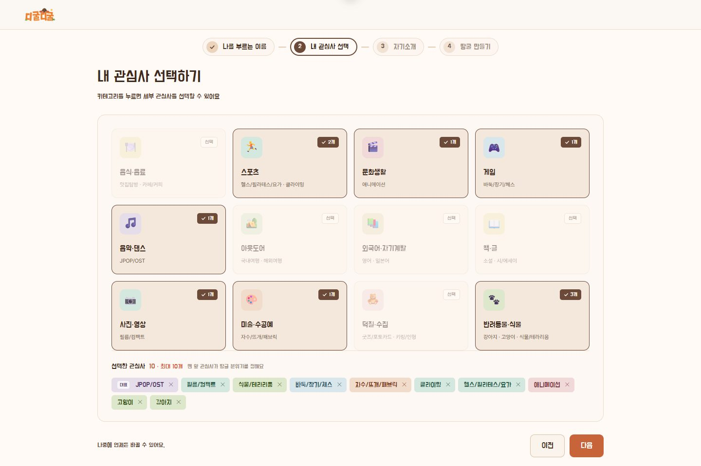
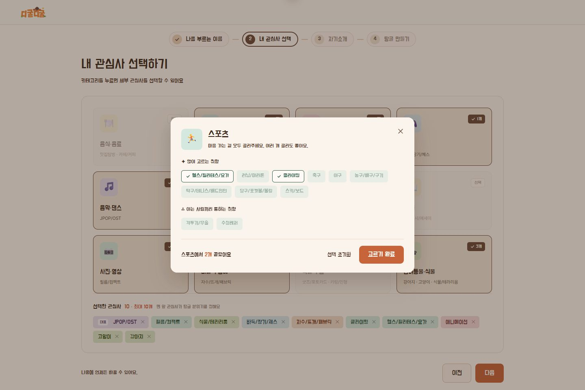
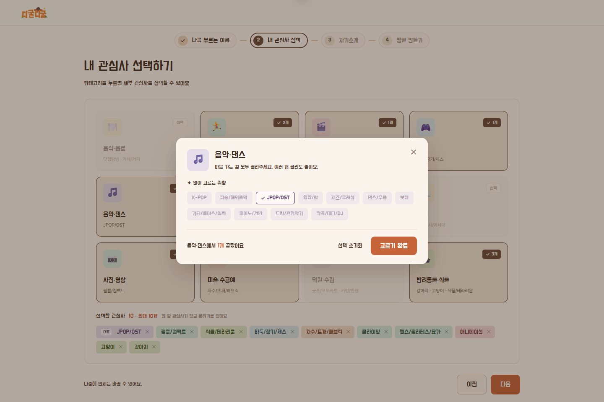
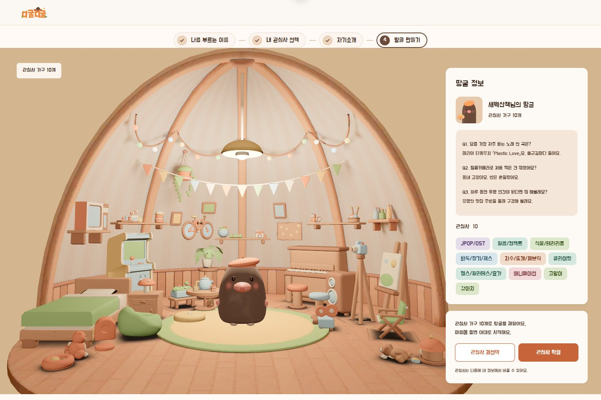
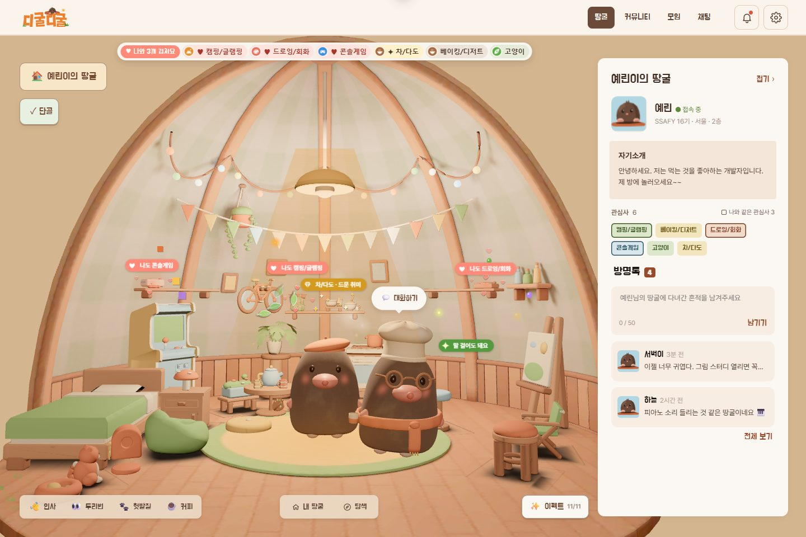
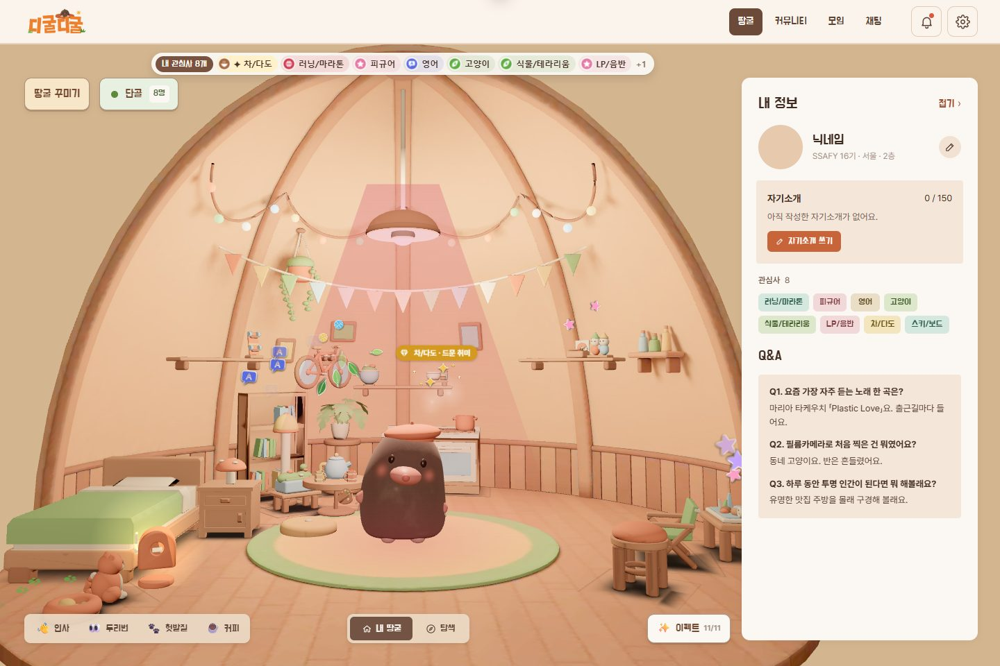
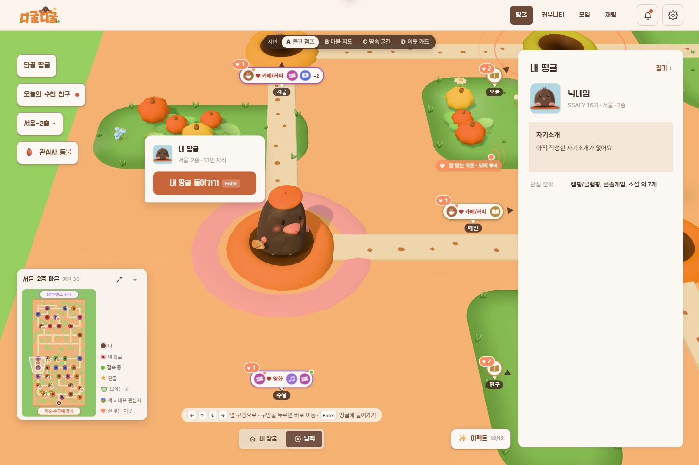
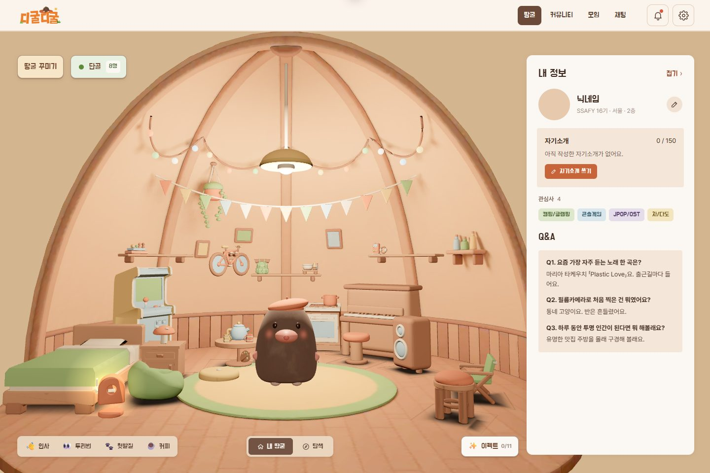

# 관심사 태그 확정본 반영 (대분류 12 · 소분류 90)

- 날짜: 2026-11-18
- 요청 (그대로): "관심사 태그들을 확정했어. 이대로 적용해줘."
- 받은 목록 (그대로):

```
관심사 태그 (대분류 12개 / 소분류 90개)
🍽️ 음식·음료 (7) │ 맛집탐방, 카페/커피, 주류/와인/위스키, 다이어트/건강식, 요리/레시피, 베이킹/디저트, 차/다도
🏃 스포츠 (11) │ 헬스/필라테스/요가, 러닝/마라톤, 클라이밍, 축구, 야구, 농구/배구/구기, 탁구/테니스/배드민턴, 당구/포켓볼/볼링, 스키/보드, 격투기/무술, 수상레저
🎬 문화생활 (7) │ 영화, 드라마/예능, 애니메이션, 콘서트/페스티벌, 미술관/전시, 연극/뮤지컬, 사주/타로
🎮 게임 (8) │ PC게임, 모바일게임, 보드게임, 방탈출/추리, 콘솔게임, VR/아케이드, 큐브/퍼즐/두뇌, 바둑/장기/체스
🎵 음악·댄스 (11) │ K-POP, 팝송/해외음악, JPOP/OST, 힙합/락, 재즈/클래식, 댄스/무용, 보컬, 기타/베이스/일렉, 피아노/건반, 드럼/관현악기, 작곡/미디/DJ
🏕️ 아웃도어 (6) │ 국내여행, 해외여행, 등산/트레킹, 캠핑/글램핑, 자전거/바이크/드라이브, 낚시
📚 외국어·자기계발 (7) │ 영어, 일본어, 중국어, 스페인어, 기타언어, 금융/투자/재테크, 봉사
📖 책·글 (7) │ 소설, 시/에세이, 웹툰/만화, 웹소설, 시사/경제, 역사/철학/인문, 글쓰기/필사/블로그
📷 사진·영상 (6) │ 스마트폰촬영, 영상제작/편집, 보정/포토샵, 미러리스/DSLR, 필름/컴팩트, 액션캠/드론
🎨 미술·수공예 (7) │ 드로잉/회화, 자수/뜨개/패브릭, 캔들/디퓨저/석고, 가죽/도예/목공, 캘리그라피, 플라워아트, 액세서리/기타
🧸 덕질·수집 (6) │ 굿즈/포토카드, 키링/인형, 다꾸/소품/문구, 피규어, 프라모델/레고, LP/음반
🐾 반려동물·식물 (7) │ 강아지, 고양이, 설치류/소동물, 물고기, 새, 곤충/파충류/기타, 식물/테라리움
```

## 결론
- 앱의 관심사는 이제 **이 목록 하나**다. 분류(이름·순서·이모지·소속)는 **`app/src/data/interestTags.ts` 한 파일**에 있고, 온보딩·내 정보 수정·땅굴·탐색·모임·커뮤니티·채팅·이펙트가 모두 이걸 쓴다. 이름·개수·이모지는 받은 그대로 (시험이 받은 글을 그대로 읽어 비교함, `tests/interest-tags.test.ts`).
- **id 는 영어 소문자** (`food` · `cafe_coffee` …). 백엔드 code 후보라 표로 넘김 → [backend/interest-enum.md](backend/interest-enum.md).
- **3D 가구는 아직 예전 모델 11세트뿐**이라 새 대분류에 이어 붙였다. 9개 대분류는 뜻이 맞는 세트를 그대로 쓰고(음식·음료 = 차·커피 세트, 문화생활 = 영화 세트, 반려동물·식물 = 자연 세트 + 반려동물 자리 …), **스포츠 · 외국어·자기계발 · 덕질·수집 3개는 가까운 세트를 빌려 씀**(임시): 스포츠 → 아웃도어 세트, 외국어·자기계발 → 책 세트, 덕질·수집 → 과학 세트의 진열 벤치. 두 대분류가 같은 가구를 쓰면 방에는 한 번만 놓인다. 연결표는 **`app/src/data/interest3d.ts` 한 파일** (디자이너 모델이 오면 이 표만 바꿈).
- 선반 소품: 예전 세부 65개의 소품 중 뜻이 맞는 것을 새 소분류에 이었다 → **소분류 90개 중 51개에 소품**(그중 8개는 뜻이 가까워 빌린 임시), **39개는 소품 없음**(대분류 가구만 놓임). 소품 하나는 소분류 하나에만.
- **목 인원수**: 예전 같은 취미가 이어지는 31개는 예전 값 그대로, 나머지 59개는 **목(임시)** 값 (코드 주석과 아래 표에 표시). 데모는 그대로 산다: **예린 땅굴 = 나와 3개 겹침(캠핑/글램핑 · 드로잉/회화 · 콘솔게임) + 가장 드문 관심사 "차/다도" 190명 + 고양이**.
- 예전 이름(시티팝 · 레트로게임 …)으로 브라우저에 저장된 내 관심사·가구 선택·추천 설정은 **새 이름으로 옮김**(합쳐지면 한 번, 맞는 게 없으면 버림, 3개 미만이 되면 목 데이터로).
- 관심사 이펙트(✨ 이펙트 패널)도 12개에 맞춤: **스포츠 통통 튀는 공 · 외국어·자기계발 말풍선 · 덕질·수집 반짝 별**을 새로 만들고, 반려동물·식물은 잎 + 동물 발자국, 글리프 6개(그릇·공·표·말풍선 A·별·발바닥 뚫린 잎)를 새로 그림.

## 바뀐 화면 · 데이터
| 어디 | 무엇이 | 파일 |
|---|---|---|
| 온보딩 2 관심사 | 분야 카드 12개(4칸 × 3줄, 좁으면 2칸), 분야 팝업에 소분류(최대 11개), "많이 고르는 / 아는 사람끼리 통하는 취향" 나눔은 그대로(550명 미만), 최대 10개 · 최소 3개 그대로 | `screens/onboarding/Onboarding.tsx` (데모 값만 새 이름), `data/mock.ts CATEGORIES` |
| 온보딩 3a · 4 | 땅굴 무드 이름 12개(예: 수집 진열장 무드), 가구 = 소품 있는 소분류 | `data/myBurrow.ts MOOD_NAMES` |
| 자기소개 질문 | 대분류마다 2~4개 (스포츠 · 외국어·자기계발 · 덕질·수집 · 음식 질문 새로). 저장된 예전 질문 id 는 새 질문으로 이어짐 | `data/questions.ts` |
| 내 정보 수정 · 관심사 고르기 | 왼쪽 분야 12개 | `screens/burrow/InterestPickPage.tsx` (데이터만) |
| 땅굴 3D | 대분류 가구(빌려 쓰면 한 번만) · 소분류 소품 · 반려동물 짝 · 벽지(대분류의 3D 세트로) | `data/roomPlan.ts`, `data/wallpapers.ts`, `data/interest3d.ts` |
| 꾸미기 가구 탭 | 소품 있는 소분류만, 후보는 같은 대분류 선반 소품 | `data/myBurrow.ts furnitureCandidates` |
| 두더지 액세서리 잠금 | 예전 카테고리 전용 액세서리를 새 대분류로 옮김 (스포츠 = 땀 밴드, 아웃도어 = 캐리어 · 밀짚모자 …) | `data/interest3d.ts accessories` |
| 탐색 들판 · 시안 B~D · 미니맵 | 주민 관심사는 새 목록에서 인원수 비례로 뽑힘 (코드 변경 없음, `data/field.ts` 그대로) | `data/mock.ts` |
| 모임 | 목 모임 대표 관심사·태그를 새 소분류로 (예: 독서 → 소설, 러닝 → 러닝/마라톤, 지브리 → 애니메이션), 분야 필터 12개 | `data/mock.ts MEETUPS`, `data/meetupStore.ts` |
| 커뮤니티 | 글 관심사 태그 = 대분류 이름 12개 (목 글 26개 태그를 옮김: 운동·아웃도어 → 스포츠 또는 아웃도어 …) | `data/boardStore.ts` |
| 채팅 | 대화방 "겹치는 관심사" 칩 새 이름 | `data/chat.ts` |
| 관리자 질문 | 대분류 이름 | `data/admin.ts` |
| 견본 방 · 랜딩 | 같은 3D 세트·소품이 되게 새 이름으로 (랜딩 가구 이름표 자리 그대로) | `data/guestRooms.ts`, `screens/start/Landing.tsx` |
| 관심사 이펙트 | 색 12 · 입자 12 · 글리프 12 | `data/interestFx.ts FX_COLORS · FX_STYLE`, `three/interestFx/roomFx.ts`, `three/interestFx/icons.ts` |
| 지운 것 | `app/src/data/interestCatalog.json` (예전 복사본. 원본은 `design/digul_3d_handoff_v3/docs/interest_catalog.json`), 쓰지 않던 `getMyFurniture` | |

## 판단한 것
- **이모지**: 화면은 원래 대분류 이모지를 분야 카드·글 썸네일·탐색 시안에 썼으므로 받은 이모지를 그대로 씀 (외국어·자기계발 📚 · 책·글 📖). 3D 위 캔버스 이펙트는 공유 빌드 제약과 그림체 때문에 이모지 대신 직접 그린 글리프.
- **칩 색**: 색 토큰이 8개라 12개 중 넷은 다른 대분류와 같은 색 (음식·음료 = 책·글 버터, 스포츠 = 사진·영상 민트, 문화생활 = 덕질·수집 로즈, 아웃도어 = 반려동물·식물 세이지). 이펙트 색은 12개 모두 다름.
- **같은 가구를 두 대분류가 쓰면 먼저 고른 대분류 몫**: 이름표·관심사 카드가 그 대분류 이름으로 뜸. 빌려 쓰는 쪽만 고르면 그쪽 이름.
- **소품 하나는 소분류 하나에만**: 지구본을 해외여행과 영어에 같이 주면 방에 하나만 놓여 가구 탭이 꼬여서, 뜻이 가장 가까운 한 곳에만 줌 (지구본 = 해외여행). 외국어 5개는 소품 없음.
- **인원수 "이어짐"의 기준**: 새 소분류가 예전 태그와 같은 취미를 가리키면(클라이밍 · 보드게임 · 고양이 · 캠핑 → 캠핑/글램핑 …) 그 값. 뜻이 크게 넓어진 것(고전영화 → 영화, SF소설 → 소설, 사진산책 → 미러리스/DSLR …)은 예전 값이 작아 이상하므로 목(임시). **차/다도는 홍차(680)와 다도(190)가 합쳐졌지만 다도 값을 이음** (드문 관심사 데모 유지).
- **우주·과학**이 없어져서 예전 과학 관심사는 대부분 버림 (지도·지구본 → 해외여행, 곤충표본 → 곤충/파충류/기타, 공룡 → 피규어만 옮김). 망원경은 쓰지 않음.
- 예전 대분류 id 와 같은 글자인 새 id(`game` · `outdoor` · `book`)는 뜻이 이어지므로 그대로 둠. 3D 세트 id(카탈로그의 `category`)는 디자이너 값이라 바꾸지 않고 `kit` 으로 따로 부름.

## 스크린샷 (가속 켬, 1440×960, `docs/screenshots/interest-tags/`)
| 화면 | 그림 |
|---|---|
| 온보딩 분야 카드 12개 (데모 10개 고름, 4칸 × 3줄) |  |
| 분야 팝업 · 스포츠 11개 (많이 고르는 9 · 아는 사람끼리 2) |  |
| 분야 팝업 · 음악·댄스 11개 (두 줄로 담김) |  |
| 온보딩 미리보기 (관심사 가구 10개) |  |
| 예린 땅굴 + 이펙트 모두 켬: 나와 3개 겹침 · 차/다도 드문 취미 · 대분류 글리프 |  |
| 새 대분류 입자: 스포츠 공 · 외국어 말풍선(A) · 덕질·수집 별 · 잎 (러닝/마라톤 · 피규어 · 영어 · 고양이 · 식물/테라리움 · LP/음반 · 차/다도 · 스키/보드) |  |
| 탐색 들판 + 이펙트: 그릇(음식) · 표(문화생활) 말풍선, "음악·댄스 동네" |  |
| 예전 이름으로 저장된 내 관심사(캠핑 · 레트로게임 · 시티팝 · 운석수집 · 다도) → 캠핑/글램핑 · 콘솔게임 · JPOP/OST · 차/다도 |  |

## 표 (코드에서 만든 것)
아래 표는 `data/interestTags.ts` · `data/interest3d.ts` · `data/mock.ts` 에서 바로 뽑았다 (손으로 옮기지 않음).

### 새 분류 (id)

| 순서 | 대분류 | id | 소분류 (id) |
|---|---|---|---|
| 1 | 🍽️ 음식·음료 (7) | `food` | 맛집탐방 `restaurant_tour` · 카페/커피 `cafe_coffee` · 주류/와인/위스키 `liquor` · 다이어트/건강식 `healthy_food` · 요리/레시피 `cooking` · 베이킹/디저트 `baking_dessert` · 차/다도 `tea` |
| 2 | 🏃 스포츠 (11) | `sports` | 헬스/필라테스/요가 `fitness_yoga` · 러닝/마라톤 `running` · 클라이밍 `climbing` · 축구 `soccer` · 야구 `baseball` · 농구/배구/구기 `ball_sports` · 탁구/테니스/배드민턴 `racket_sports` · 당구/포켓볼/볼링 `billiards_bowling` · 스키/보드 `ski_board` · 격투기/무술 `martial_arts` · 수상레저 `water_sports` |
| 3 | 🎬 문화생활 (7) | `culture` | 영화 `movie` · 드라마/예능 `drama_variety` · 애니메이션 `animation` · 콘서트/페스티벌 `concert_festival` · 미술관/전시 `exhibition` · 연극/뮤지컬 `theater_musical` · 사주/타로 `fortune_tarot` |
| 4 | 🎮 게임 (8) | `game` | PC게임 `pc_game` · 모바일게임 `mobile_game` · 보드게임 `board_game` · 방탈출/추리 `escape_room` · 콘솔게임 `console_game` · VR/아케이드 `vr_arcade` · 큐브/퍼즐/두뇌 `puzzle_cube` · 바둑/장기/체스 `go_chess` |
| 5 | 🎵 음악·댄스 (11) | `music_dance` | K-POP `kpop` · 팝송/해외음악 `pop_song` · JPOP/OST `jpop_ost` · 힙합/락 `hiphop_rock` · 재즈/클래식 `jazz_classical` · 댄스/무용 `dance` · 보컬 `vocal` · 기타/베이스/일렉 `guitar_bass` · 피아노/건반 `piano_keys` · 드럼/관현악기 `drums_orchestra` · 작곡/미디/DJ `compose_dj` |
| 6 | 🏕️ 아웃도어 (6) | `outdoor` | 국내여행 `domestic_travel` · 해외여행 `overseas_travel` · 등산/트레킹 `hiking` · 캠핑/글램핑 `camping` · 자전거/바이크/드라이브 `cycling_drive` · 낚시 `fishing` |
| 7 | 📚 외국어·자기계발 (7) | `language_selfdev` | 영어 `english` · 일본어 `japanese` · 중국어 `chinese` · 스페인어 `spanish` · 기타언어 `other_language` · 금융/투자/재테크 `finance` · 봉사 `volunteer` |
| 8 | 📖 책·글 (7) | `book` | 소설 `novel` · 시/에세이 `poem_essay` · 웹툰/만화 `webtoon_comics` · 웹소설 `web_novel` · 시사/경제 `current_affairs` · 역사/철학/인문 `humanities` · 글쓰기/필사/블로그 `writing` |
| 9 | 📷 사진·영상 (6) | `photo_video` | 스마트폰촬영 `smartphone_photo` · 영상제작/편집 `video_editing` · 보정/포토샵 `photo_retouch` · 미러리스/DSLR `mirrorless_dslr` · 필름/컴팩트 `film_compact` · 액션캠/드론 `actioncam_drone` |
| 10 | 🎨 미술·수공예 (7) | `art_craft` | 드로잉/회화 `drawing_painting` · 자수/뜨개/패브릭 `needlework` · 캔들/디퓨저/석고 `candle_diffuser` · 가죽/도예/목공 `leather_pottery_wood` · 캘리그라피 `calligraphy` · 플라워아트 `flower_art` · 액세서리/기타 `accessory_etc` |
| 11 | 🧸 덕질·수집 (6) | `fandom_collect` | 굿즈/포토카드 `goods_photocard` · 키링/인형 `keyring_doll` · 다꾸/소품/문구 `deco_stationery` · 피규어 `figure` · 프라모델/레고 `plamodel_lego` · LP/음반 `lp_album` |
| 12 | 🐾 반려동물·식물 (7) | `pet_plant` | 강아지 `dog` · 고양이 `cat` · 설치류/소동물 `small_animal` · 물고기 `fish` · 새 `bird` · 곤충/파충류/기타 `insect_reptile` · 식물/테라리움 `plant_terrarium` |

### 예전 → 새 (관심사 v2 세부 65개)

| 예전 대분류 | 예전 세부 관심사 (id) | 새 소분류 (id) | 새 대분류 |
|---|---|---|---|
| 음악 | 시티팝 `city_pop` | JPOP/OST `jpop_ost` | 음악·댄스 |
| 음악 | LP수집 `lp_collecting` | LP/음반 `lp_album` | 덕질·수집 |
| 음악 | 재즈 `jazz` | 재즈/클래식 `jazz_classical` | 음악·댄스 |
| 음악 | 인디밴드 `indie_band` | 힙합/락 `hiphop_rock` | 음악·댄스 |
| 음악 | 기타연주 `guitar_play` | 기타/베이스/일렉 `guitar_bass` | 음악·댄스 |
| 음악 | 신스·작곡 `synth_compose` | 작곡/미디/DJ `compose_dj` | 음악·댄스 |
| 음악 | 피아노 `piano` | 피아노/건반 `piano_keys` | 음악·댄스 |
| 음악 | 드럼 `drums` | 드럼/관현악기 `drums_orchestra` | 음악·댄스 |
| 음악 | 올드팝 `oldies` | 팝송/해외음악 `pop_song` | 음악·댄스 |
| 사진 | 필름카메라 `film_camera` | 필름/컴팩트 `film_compact` | 사진·영상 |
| 사진 | 사진산책 `photo_walk` | 미러리스/DSLR `mirrorless_dslr` | 사진·영상 |
| 자연·식물 | 테라리움 `terrarium` | 식물/테라리움 `plant_terrarium` | 반려동물·식물 |
| 자연·식물 | 식물키우기 `houseplants` | 식물/테라리움 `plant_terrarium` | 반려동물·식물 |
| 자연·식물 | 열대어 `tropical_fish` | 물고기 `fish` | 반려동물·식물 |
| 자연·식물 | 분재 `bonsai` | 식물/테라리움 `plant_terrarium` | 반려동물·식물 |
| 자연·식물 | 다육식물 `succulents` | 식물/테라리움 `plant_terrarium` | 반려동물·식물 |
| 자연·식물 | 버섯재배 `mushroom_grow` | 식물/테라리움 `plant_terrarium` | 반려동물·식물 |
| 게임·놀이 | 레트로게임 `retro_game` | 콘솔게임 `console_game` | 게임 |
| 게임·놀이 | 기계식키보드 `mech_keyboard` | PC게임 `pc_game` | 게임 |
| 게임·놀이 | 피규어 `figures` | 피규어 `figure` | 덕질·수집 |
| 게임·놀이 | 보드게임 `board_game` | 보드게임 `board_game` | 게임 |
| 게임·놀이 | PC조립 `pc_build` | PC게임 `pc_game` | 게임 |
| 게임·놀이 | 아케이드 `arcade` | VR/아케이드 `vr_arcade` | 게임 |
| 게임·놀이 | 건프라 `gunpla` | 프라모델/레고 `plamodel_lego` | 덕질·수집 |
| 게임·놀이 | 체스 `chess` | 바둑/장기/체스 `go_chess` | 게임 |
| 게임·놀이 | 스피드큐브 `speed_cube` | 큐브/퍼즐/두뇌 `puzzle_cube` | 게임 |
| 게임·놀이 | 마술 `magic` | 연극/뮤지컬 `theater_musical` | 문화생활 |
| 공예·만들기 | 뜨개질 `knitting` | 자수/뜨개/패브릭 `needlework` | 미술·수공예 |
| 공예·만들기 | 수채화 `watercolor` | 드로잉/회화 `drawing_painting` | 미술·수공예 |
| 공예·만들기 | 도자기 `pottery` | 가죽/도예/목공 `leather_pottery_wood` | 미술·수공예 |
| 공예·만들기 | 자수 `embroidery` | 자수/뜨개/패브릭 `needlework` | 미술·수공예 |
| 공예·만들기 | 재봉 `sewing` | 자수/뜨개/패브릭 `needlework` | 미술·수공예 |
| 공예·만들기 | 철도모형 `model_railway` | 프라모델/레고 `plamodel_lego` | 덕질·수집 |
| 책·글 | SF소설 `sf_novel` | 소설 `novel` | 책·글 |
| 책·글 | 시집 `poetry` | 시/에세이 `poem_essay` | 책·글 |
| 책·글 | 필사 `transcription` | 글쓰기/필사/블로그 `writing` | 책·글 |
| 책·글 | 타자기 `typewriter` | 글쓰기/필사/블로그 `writing` | 책·글 |
| 우주·과학 | 천체관측 `stargazing` | — (버림) | — |
| 우주·과학 | 별자리 `constellations` | — (버림) | — |
| 우주·과학 | 화석수집 `fossils` | — (버림) | — |
| 우주·과학 | 광물수집 `minerals` | — (버림) | — |
| 우주·과학 | 지도·지구본 `map_globe` | 해외여행 `overseas_travel` | 아웃도어 |
| 우주·과학 | 아마추어무선 `ham_radio` | — (버림) | — |
| 우주·과학 | 운석수집 `meteorites` | — (버림) | — |
| 우주·과학 | 곤충표본 `insect_specimens` | 곤충/파충류/기타 `insect_reptile` | 반려동물·식물 |
| 우주·과학 | 공룡 `dinosaurs` | 피규어 `figure` | 덕질·수집 |
| 차·커피·베이킹 | 홍차 `black_tea` | 차/다도 `tea` | 음식·음료 |
| 차·커피·베이킹 | 핸드드립 `hand_drip` | 카페/커피 `cafe_coffee` | 음식·음료 |
| 차·커피·베이킹 | 베이킹 `baking` | 베이킹/디저트 `baking_dessert` | 음식·음료 |
| 차·커피·베이킹 | 에스프레소 `espresso` | 카페/커피 `cafe_coffee` | 음식·음료 |
| 차·커피·베이킹 | 다도 `tea_ceremony` | 차/다도 `tea` | 음식·음료 |
| 운동·아웃도어 | 캠핑 `camping` | 캠핑/글램핑 `camping` | 아웃도어 |
| 운동·아웃도어 | 자전거 `cycling` | 자전거/바이크/드라이브 `cycling_drive` | 아웃도어 |
| 운동·아웃도어 | 클라이밍 `climbing` | 클라이밍 `climbing` | 스포츠 |
| 운동·아웃도어 | 요가 `yoga` | 헬스/필라테스/요가 `fitness_yoga` | 스포츠 |
| 운동·아웃도어 | 스케이트보드 `skateboard` | 스키/보드 `ski_board` | 스포츠 |
| 영화·애니 | 고전영화 `classic_film` | 영화 `movie` | 문화생활 |
| 영화·애니 | 애니메이션 `animation` | 애니메이션 `animation` | 문화생활 |
| 영화·애니 | 만화책 `comics` | 웹툰/만화 `webtoon_comics` | 책·글 |
| 영화·애니 | VHS수집 `vhs` | 영화 `movie` | 문화생활 |
| 반려동물 | 고양이 `cat` | 고양이 `cat` | 반려동물·식물 |
| 반려동물 | 강아지 `dog` | 강아지 `dog` | 반려동물·식물 |
| 반려동물 | 앵무새 `parrot` | 새 `bird` | 반려동물·식물 |
| 반려동물 | 도마뱀 `lizard` | 곤충/파충류/기타 `insect_reptile` | 반려동물·식물 |
| 반려동물 | 개미사육 `ant_farm` | 곤충/파충류/기타 `insect_reptile` | 반려동물·식물 |

### 대분류 → 3D 가구 · 액세서리 · 무드 · 이펙트 (벽지는 아래 "표 보충")

| 대분류 | 3D 세트(예전 카테고리) | 가구 | 빌려 쓰는 이유 | 액세서리 잠금 | 무드 | 이펙트 색 · 입자 · 글리프 |
|---|---|---|---|---|---|---|
| 🍽️ 음식·음료 | 차·커피·베이킹 `tea_coffee` | 주방 조리대 `kitchen_counter` · 카페 스툴 `cafe_stool` | 그대로 | hat_chef, prop_cup | 골목 카페 무드 | #A8693F · 김 · 김 나는 그릇 (새로) |
| 🏃 스포츠 | 운동·아웃도어 `outdoor` | 벽걸이 자전거 `bike_rack_wall` · 캠핑 의자 `camp_chair` | **임시**: 스포츠 가구가 없어 아웃도어 세트(벽걸이 자전거·캠핑 의자)를 같이 씀. 카탈로그의 러닝머신·덤벨 랙은 모델이 없음(unused) | headband_sport | 운동장 무드 | #D23C54 · 통통 튀는 공 (새로) · 공 (새로) |
| 🎬 문화생활 | 영화·애니 `movie` | TV + 벽 선반 `tv` · 영사기 `projector` | 그대로 | glasses_3d | 작은 극장 무드 | #B5509E · 팝콘 · 표 (새로) |
| 🎮 게임 | 게임·놀이 `game` | 오락기 `arcade` · 빈백 `bean_bag` | 그대로 | prop_gamepad | 동네 오락실 무드 | #3E8EDE · 픽셀 · 게임패드 |
| 🎵 음악·댄스 | 음악 `music` | 피아노 `piano` · 스피커 `speaker` · 피아노 의자 `piano_stool` | 그대로 | headphones | 레코드 가게 무드 | #9C6FD6 · 음표 · 음표 |
| 🏕️ 아웃도어 | 운동·아웃도어 `outdoor` | 벽걸이 자전거 `bike_rack_wall` · 캠핑 의자 `camp_chair` | 그대로 | prop_suitcase, hat_straw | 캠핑장 무드 | #E8902B · 모닥불 불티 · 산과 해 |
| 📚 외국어·자기계발 | 책·글 `book` | 책장 `bookshelf` · 독서등 `reading_lamp` | **임시**: 외국어·자기계발 가구가 없어 책 세트(책장·독서등)를 같이 씀 (공부하는 자리) | — | 작은 공부방 무드 | #5B6CE0 · 말풍선 (새로) · 말풍선 A (새로) |
| 📖 책·글 | 책·글 `book` | 책장 `bookshelf` · 독서등 `reading_lamp` | 그대로 | prop_book | 다락 서재 무드 | #B98A3E · 종이 · 펼친 책 |
| 📷 사진·영상 | 사진 `photo` | 사진 게시판 `photo_board` · 삼각대 카메라 `tripod_camera` | 그대로 | camera_neck | 작은 암실 무드 | #33A3A4 · 플래시 반짝 · 카메라 |
| 🎨 미술·수공예 | 공예·만들기 `craft` | 이젤 `easel` · 그림 의자 `drawing_stool` | 그대로 | prop_palette, hat_beret | 작업실 무드 | #E8705A · 물감 방울 · 팔레트 |
| 🧸 덕질·수집 | 우주·과학 `science` | 광물 진열 벤치 `mineral_bench` | **임시**: 덕질·수집 가구가 없어 우주·과학 세트의 광물 진열 벤치만 진열대로 씀 (망원경은 안 씀) | — | 수집 진열장 무드 | #E57AA6 · 반짝 별 (새로) · 별 (새로) |
| 🐾 반려동물·식물 | 자연·식물 `nature` | 화분 받침대 + 식물 `plant_stand` · 이끼 벤치 `terrarium_bench` | 그대로 | hat_sprout | 포근한 온실 무드 | #5FAE45 · 잎 + 동물 발자국 · 발바닥이 뚫린 잎 (새로) |

### 소분류 → 선반 소품

| 대분류 | 소분류 | 소품 (id) | 가져온 곳 (예전 세부 관심사) |
|---|---|---|---|
| 음식·음료 | 맛집탐방 | 없음 |  |
| 음식·음료 | 카페/커피 | 핸드드립 세트 `drip_kettle` | 핸드드립 |
| 음식·음료 | 주류/와인/위스키 | 없음 |  |
| 음식·음료 | 다이어트/건강식 | 없음 |  |
| 음식·음료 | 요리/레시피 | 없음 |  |
| 음식·음료 | 베이킹/디저트 | 베이킹 세트 `baking_set` | 베이킹 |
| 음식·음료 | 차/다도 | 다도 세트 `tea_bowl_set` | 다도 |
| 스포츠 | 헬스/필라테스/요가 | 요가 매트 `yoga_mat` | 요가 |
| 스포츠 | 러닝/마라톤 | 없음 |  |
| 스포츠 | 클라이밍 | 초크 가방 `chalk_bag` | 클라이밍 |
| 스포츠 | 축구 | 없음 |  |
| 스포츠 | 야구 | 없음 |  |
| 스포츠 | 농구/배구/구기 | 없음 |  |
| 스포츠 | 탁구/테니스/배드민턴 | 없음 |  |
| 스포츠 | 당구/포켓볼/볼링 | 없음 |  |
| 스포츠 | 스키/보드 | 스케이트보드 `skateboard` | 스케이트보드 (임시: 보드) |
| 스포츠 | 격투기/무술 | 없음 |  |
| 스포츠 | 수상레저 | 없음 |  |
| 문화생활 | 영화 | 팝콘 `popcorn` | 고전영화 |
| 문화생활 | 드라마/예능 | VHS 테이프 `vhs_tapes` | VHS수집 (임시: 녹화 테이프) |
| 문화생활 | 애니메이션 | 클래퍼보드 `clapperboard` | 애니메이션 |
| 문화생활 | 콘서트/페스티벌 | 없음 |  |
| 문화생활 | 미술관/전시 | 없음 |  |
| 문화생활 | 연극/뮤지컬 | 마술 모자 `magic_hat` | 마술 (임시: 무대 소품) |
| 문화생활 | 사주/타로 | 별자리판 `star_chart` | 별자리 (임시: 별자리 운세) |
| 게임 | PC게임 | 기계식 키보드 `mech_keyboard` | 기계식키보드 |
| 게임 | 모바일게임 | 없음 |  |
| 게임 | 보드게임 | 보드게임 `board_game_box` | 보드게임 |
| 게임 | 방탈출/추리 | 없음 |  |
| 게임 | 콘솔게임 | 게임기 `game_console` | 레트로게임 |
| 게임 | VR/아케이드 | 아케이드 스틱 `arcade_stick` | 아케이드 |
| 게임 | 큐브/퍼즐/두뇌 | 스피드큐브 `speed_cube` | 스피드큐브 |
| 게임 | 바둑/장기/체스 | 체스 `chess_set` | 체스 |
| 음악·댄스 | K-POP | 없음 |  |
| 음악·댄스 | 팝송/해외음악 | 빈티지 라디오 `vintage_radio` | 올드팝 |
| 음악·댄스 | JPOP/OST | 카세트 워크맨 `cassette_walkman` | 시티팝 |
| 음악·댄스 | 힙합/락 | 미니 앰프 `mini_amp` | 인디밴드 |
| 음악·댄스 | 재즈/클래식 | 트럼펫 `trumpet` | 재즈 |
| 음악·댄스 | 댄스/무용 | 없음 |  |
| 음악·댄스 | 보컬 | 없음 |  |
| 음악·댄스 | 기타/베이스/일렉 | 기타 `guitar` | 기타연주 (바닥 자리) |
| 음악·댄스 | 피아노/건반 | 메트로놈 `metronome` | 피아노 |
| 음악·댄스 | 드럼/관현악기 | 스네어 드럼 `snare_drum` | 드럼 |
| 음악·댄스 | 작곡/미디/DJ | 미니 신디사이저 `mini_synth` | 신스·작곡 |
| 아웃도어 | 국내여행 | 없음 |  |
| 아웃도어 | 해외여행 | 지구본 `globe` | 지도·지구본 |
| 아웃도어 | 등산/트레킹 | 쌍안경 `binoculars` | 천체관측 (임시: 쌍안경) |
| 아웃도어 | 캠핑/글램핑 | 배낭 `backpack` | 캠핑 |
| 아웃도어 | 자전거/바이크/드라이브 | 자전거 헬멧 `bike_helmet` | 자전거 |
| 아웃도어 | 낚시 | 없음 |  |
| 외국어·자기계발 | 영어 | 없음 |  |
| 외국어·자기계발 | 일본어 | 없음 |  |
| 외국어·자기계발 | 중국어 | 없음 |  |
| 외국어·자기계발 | 스페인어 | 없음 |  |
| 외국어·자기계발 | 기타언어 | 없음 |  |
| 외국어·자기계발 | 금융/투자/재테크 | 없음 |  |
| 외국어·자기계발 | 봉사 | 없음 |  |
| 책·글 | 소설 | SF 책 `sf_books` | SF소설 |
| 책·글 | 시/에세이 | 책 더미 `book_stack` | 시집 |
| 책·글 | 웹툰/만화 | 만화책 `comic_stack` | 만화책 |
| 책·글 | 웹소설 | 없음 |  |
| 책·글 | 시사/경제 | 없음 |  |
| 책·글 | 역사/철학/인문 | 없음 |  |
| 책·글 | 글쓰기/필사/블로그 | 타자기 `typewriter` | 타자기 |
| 사진·영상 | 스마트폰촬영 | 없음 |  |
| 사진·영상 | 영상제작/편집 | 없음 |  |
| 사진·영상 | 보정/포토샵 | 없음 |  |
| 사진·영상 | 미러리스/DSLR | 카메라 가방 `camera_case` | 사진산책 |
| 사진·영상 | 필름/컴팩트 | 필름 카메라 `film_camera` | 필름카메라 |
| 사진·영상 | 액션캠/드론 | 없음 |  |
| 미술·수공예 | 드로잉/회화 | 물감 상자 `paint_box` | 수채화 |
| 미술·수공예 | 자수/뜨개/패브릭 | 털실 바구니 `yarn_basket` | 뜨개질 |
| 미술·수공예 | 캔들/디퓨저/석고 | 없음 |  |
| 미술·수공예 | 가죽/도예/목공 | 도자기 `pottery_vase` | 도자기 |
| 미술·수공예 | 캘리그라피 | 없음 |  |
| 미술·수공예 | 플라워아트 | 작은 화분 `small_pot` | 다육식물 (임시: 작은 화분) |
| 미술·수공예 | 액세서리/기타 | 재봉 상자 `sewing_kit` | 재봉 |
| 덕질·수집 | 굿즈/포토카드 | 없음 |  |
| 덕질·수집 | 키링/인형 | 공룡 피규어 `dino_figure` | 공룡 (임시: 작은 인형) |
| 덕질·수집 | 다꾸/소품/문구 | 필사 노트 `writing_notebook` | 필사 (임시: 다이어리) |
| 덕질·수집 | 피규어 | 피규어 `figure_pair` | 피규어 |
| 덕질·수집 | 프라모델/레고 | 건프라 `gunpla_robot` | 건프라 |
| 덕질·수집 | LP/음반 | LP 턴테이블 `record_player` | LP수집 |
| 반려동물·식물 | 강아지 | 강아지 집 `dog_house` | 강아지 + 짝 동물 |
| 반려동물·식물 | 고양이 | 고양이 방석 `cat_bed` | 고양이 + 짝 동물 |
| 반려동물·식물 | 설치류/소동물 | 없음 |  |
| 반려동물·식물 | 물고기 | 어항 `fish_bowl` | 열대어 |
| 반려동물·식물 | 새 | 앵무새 횃대 `parrot_perch` | 앵무새 + 짝 동물 |
| 반려동물·식물 | 곤충/파충류/기타 | 도마뱀 사육장 `lizard_tank` | 도마뱀 + 짝 동물 |
| 반려동물·식물 | 식물/테라리움 | 테라리움 병 `terrarium_jar` | 테라리움 |

소품 있는 소분류 51/90 (그중 뜻이 가까워 빌린 임시 8개), 없는 소분류 39개
안 쓰는 예전 소품 14개: 물뿌리개 `watering_can` · 분재 `bonsai_pot` · 버섯 재배목 `mushroom_log` · PC 케이스 `pc_case` · 자수 수틀 `embroidery_hoop` · 철도 모형 `model_train` · 암모나이트 화석 `ammonite_fossil` · 광물 결정 `crystal_cluster` · 무전기 `ham_radio` · 운석 `meteorite` · 곤충 표본 액자 `specimen_frame` · 홍차 틴 `tea_tins` · 에스프레소 머신 `espresso_machine` · 개미집 `ant_farm_case`

### 목 인원수

| 대분류 | 소분류 | 인원 (목) | 값 출처 |
|---|---|---|---|
| 음식·음료 | 맛집탐방 | 3300 | 목(임시) |
| 음식·음료 | 카페/커피 | 3000 | 목(임시) |
| 음식·음료 | 주류/와인/위스키 | 1500 | 목(임시) |
| 음식·음료 | 다이어트/건강식 | 1200 | 목(임시) |
| 음식·음료 | 요리/레시피 | 2000 | 목(임시) |
| 음식·음료 | 베이킹/디저트 | 1700 | 예전 "베이킹" 값 이음 |
| 음식·음료 | 차/다도 | 190 | 예전 "다도 (홍차 680 도 여기로 합쳐졌지만 다도 값을 이음: 드문 관심사 데모)" 값 이음 |
| 스포츠 | 헬스/필라테스/요가 | 3100 | 목(임시) |
| 스포츠 | 러닝/마라톤 | 2500 | 목(임시) |
| 스포츠 | 클라이밍 | 880 | 예전 "클라이밍" 값 이음 |
| 스포츠 | 축구 | 2200 | 목(임시) |
| 스포츠 | 야구 | 2800 | 목(임시) |
| 스포츠 | 농구/배구/구기 | 1300 | 목(임시) |
| 스포츠 | 탁구/테니스/배드민턴 | 1600 | 목(임시) |
| 스포츠 | 당구/포켓볼/볼링 | 1000 | 목(임시) |
| 스포츠 | 스키/보드 | 1100 | 목(임시) |
| 스포츠 | 격투기/무술 | 340 | 목(임시) |
| 스포츠 | 수상레저 | 160 | 목(임시) |
| 문화생활 | 영화 | 3400 | 목(임시) |
| 문화생활 | 드라마/예능 | 3100 | 목(임시) |
| 문화생활 | 애니메이션 | 2400 | 예전 "애니메이션" 값 이음 |
| 문화생활 | 콘서트/페스티벌 | 2400 | 목(임시) |
| 문화생활 | 미술관/전시 | 1900 | 목(임시) |
| 문화생활 | 연극/뮤지컬 | 1300 | 목(임시) |
| 문화생활 | 사주/타로 | 240 | 목(임시) |
| 게임 | PC게임 | 3200 | 목(임시) |
| 게임 | 모바일게임 | 2900 | 목(임시) |
| 게임 | 보드게임 | 1900 | 예전 "보드게임" 값 이음 |
| 게임 | 방탈출/추리 | 1500 | 목(임시) |
| 게임 | 콘솔게임 | 640 | 예전 "레트로게임" 값 이음 |
| 게임 | VR/아케이드 | 450 | 예전 "아케이드" 값 이음 |
| 게임 | 큐브/퍼즐/두뇌 | 190 | 예전 "스피드큐브" 값 이음 |
| 게임 | 바둑/장기/체스 | 260 | 예전 "체스" 값 이음 |
| 음악·댄스 | K-POP | 3000 | 목(임시) |
| 음악·댄스 | 팝송/해외음악 | 2300 | 목(임시) |
| 음악·댄스 | JPOP/OST | 1600 | 목(임시) |
| 음악·댄스 | 힙합/락 | 2800 | 목(임시) |
| 음악·댄스 | 재즈/클래식 | 2100 | 예전 "재즈" 값 이음 |
| 음악·댄스 | 댄스/무용 | 700 | 목(임시) |
| 음악·댄스 | 보컬 | 1200 | 목(임시) |
| 음악·댄스 | 기타/베이스/일렉 | 2700 | 예전 "기타연주" 값 이음 |
| 음악·댄스 | 피아노/건반 | 1320 | 예전 "피아노" 값 이음 |
| 음악·댄스 | 드럼/관현악기 | 980 | 예전 "드럼" 값 이음 |
| 음악·댄스 | 작곡/미디/DJ | 640 | 예전 "신스·작곡" 값 이음 |
| 아웃도어 | 국내여행 | 3350 | 목(임시) |
| 아웃도어 | 해외여행 | 3000 | 목(임시) |
| 아웃도어 | 등산/트레킹 | 1700 | 목(임시) |
| 아웃도어 | 캠핑/글램핑 | 2600 | 예전 "캠핑" 값 이음 |
| 아웃도어 | 자전거/바이크/드라이브 | 2400 | 예전 "자전거" 값 이음 |
| 아웃도어 | 낚시 | 450 | 목(임시) |
| 외국어·자기계발 | 영어 | 3300 | 목(임시) |
| 외국어·자기계발 | 일본어 | 1900 | 목(임시) |
| 외국어·자기계발 | 중국어 | 520 | 목(임시) |
| 외국어·자기계발 | 스페인어 | 230 | 목(임시) |
| 외국어·자기계발 | 기타언어 | 70 | 목(임시) |
| 외국어·자기계발 | 금융/투자/재테크 | 2900 | 목(임시) |
| 외국어·자기계발 | 봉사 | 600 | 목(임시) |
| 책·글 | 소설 | 2600 | 목(임시) |
| 책·글 | 시/에세이 | 540 | 예전 "시집" 값 이음 |
| 책·글 | 웹툰/만화 | 1800 | 예전 "만화책" 값 이음 |
| 책·글 | 웹소설 | 1400 | 목(임시) |
| 책·글 | 시사/경제 | 1100 | 목(임시) |
| 책·글 | 역사/철학/인문 | 700 | 목(임시) |
| 책·글 | 글쓰기/필사/블로그 | 1500 | 목(임시) |
| 사진·영상 | 스마트폰촬영 | 2700 | 목(임시) |
| 사진·영상 | 영상제작/편집 | 1500 | 목(임시) |
| 사진·영상 | 보정/포토샵 | 800 | 목(임시) |
| 사진·영상 | 미러리스/DSLR | 1700 | 목(임시) |
| 사진·영상 | 필름/컴팩트 | 720 | 예전 "필름카메라" 값 이음 |
| 사진·영상 | 액션캠/드론 | 95 | 목(임시) |
| 미술·수공예 | 드로잉/회화 | 1600 | 예전 "수채화" 값 이음 |
| 미술·수공예 | 자수/뜨개/패브릭 | 420 | 예전 "뜨개질" 값 이음 |
| 미술·수공예 | 캔들/디퓨저/석고 | 210 | 목(임시) |
| 미술·수공예 | 가죽/도예/목공 | 350 | 예전 "도자기" 값 이음 |
| 미술·수공예 | 캘리그라피 | 150 | 목(임시) |
| 미술·수공예 | 플라워아트 | 130 | 목(임시) |
| 미술·수공예 | 액세서리/기타 | 85 | 목(임시) |
| 덕질·수집 | 굿즈/포토카드 | 1600 | 목(임시) |
| 덕질·수집 | 키링/인형 | 900 | 목(임시) |
| 덕질·수집 | 다꾸/소품/문구 | 1300 | 목(임시) |
| 덕질·수집 | 피규어 | 1300 | 예전 "피규어" 값 이음 |
| 덕질·수집 | 프라모델/레고 | 820 | 예전 "건프라" 값 이음 |
| 덕질·수집 | LP/음반 | 860 | 예전 "LP수집" 값 이음 |
| 반려동물·식물 | 강아지 | 3100 | 예전 "강아지" 값 이음 |
| 반려동물·식물 | 고양이 | 3300 | 예전 "고양이" 값 이음 |
| 반려동물·식물 | 설치류/소동물 | 90 | 목(임시) |
| 반려동물·식물 | 물고기 | 380 | 예전 "열대어" 값 이음 |
| 반려동물·식물 | 새 | 160 | 예전 "앵무새" 값 이음 |
| 반려동물·식물 | 곤충/파충류/기타 | 120 | 예전 "도마뱀" 값 이음 |
| 반려동물·식물 | 식물/테라리움 | 2300 | 예전 "식물키우기" 값 이음 |

이어진 값 31개 · 목(임시) 59개 · 아주 드묾(100명 미만) 4 · 드묾(250명 미만) 14 · 흔치 않음(700명 미만) 26 · 온보딩 "통하는 취향"(550명 미만) 23

표 보충
- 반려동물·식물은 자연 세트 가구(화분 받침대 · 이끼 벤치)에 더해 **반려동물 자리**(`interest_pet_v1` glb)를 그대로 씀: 강아지 · 고양이 · 새 · 곤충/파충류/기타를 고르면 동물 + 용품이 짝으로 같이 떨어짐. 예전 개미(개미집)는 곤충/파충류/기타가 도마뱀을 써서 지금은 안 씀
- 두 대분류가 같은 가구를 쓰는 곳: 스포츠 ↔ 아웃도어 (벽걸이 자전거 · 캠핑 의자), 외국어·자기계발 ↔ 책·글 (책장 · 독서등). 같이 고르면 한 번만, 먼저 고른 쪽 이름으로
- 벽지(무드)는 대분류의 3D 세트로 정함: 음식·음료 05 체크 · 게임 06 도트 · 음악·댄스 08 줄무늬 · 외국어·자기계발과 책·글 04 모던 · 미술·수공예 03 꽃무늬 · 덕질·수집 02 별자리 · 반려동물·식물 07 숲 · 나머지(스포츠 · 문화생활 · 아웃도어 · 사진·영상) 01 기본

## 디자이너에게 필요한 것 (3D)
우선순위 순. 모두 지금 카탈로그 형식(`furniture_catalog.json` 행 + `slots.json` 자리 + glb)으로 오면 `app/src/data/interest3d.ts` 표만 바꾸면 됨.
1. **새 대분류 가구 세트 3개** (지금 빌려 쓰는 것)
   - 스포츠: 바닥 주 가구 1 + 낮은 가구 1 (예: 러닝머신·덤벨 랙(카탈로그에 이미 `unused` 행이 있음), 공 바구니, 운동 매트 + 아령). 아웃도어와 다른 자리(슬롯)여야 둘 다 고른 방에 같이 놓임
   - 외국어·자기계발: 주 가구 1 + 낮은 가구 1 (예: 공부 책상 + 지구본 스탠드, 단어 카드 보드, 저금통 선반)
   - 덕질·수집: 주 가구 1 + 낮은 가구 1 (예: 유리 진열장, 포토카드 바인더 선반, 굿즈 벽걸이 보드). 지금은 과학 세트의 광물 진열 벤치만 씀
2. **대분류 세트를 다시 볼 것** (그대로 쓰지만 이름이 넓어짐)
   - 음식·음료: 차·커피·베이킹 세트 → 맛집·요리·주류까지 (예: 와인 랙, 냄비가 올라간 조리대는 이미 있음)
   - 문화생활: 영화 세트(TV · 영사기) → 공연·전시·사주/타로까지 (예: 공연 포스터 액자, 타로 카드 탁자)
   - 반려동물·식물: 자연 세트 + 반려동물 자리 → 합쳐진 대분류라 그대로 써도 무리 없음
   - 우주·과학 세트의 망원경은 쓸 곳이 없어짐
3. **소분류 선반 소품 39개** (지금 소품 없음, 아래 표의 "없음")
   - 음식·음료: 맛집탐방 · 주류/와인/위스키 · 다이어트/건강식 · 요리/레시피
   - 스포츠: 러닝/마라톤 · 축구 · 야구 · 농구/배구/구기 · 탁구/테니스/배드민턴 · 당구/포켓볼/볼링 · 격투기/무술 · 수상레저
   - 문화생활: 콘서트/페스티벌 · 미술관/전시
   - 게임: 모바일게임 · 방탈출/추리
   - 음악·댄스: K-POP · 댄스/무용 · 보컬
   - 아웃도어: 국내여행 · 낚시
   - 외국어·자기계발: 7개 모두 (영어 · 일본어 · 중국어 · 스페인어 · 기타언어 · 금융/투자/재테크 · 봉사)
   - 책·글: 웹소설 · 시사/경제 · 역사/철학/인문
   - 사진·영상: 스마트폰촬영 · 영상제작/편집 · 보정/포토샵 · 액션캠/드론
   - 미술·수공예: 캔들/디퓨저/석고 · 캘리그라피
   - 덕질·수집: 굿즈/포토카드
   - 반려동물·식물: 설치류/소동물 (반려동물 자리 → 동물 + 용품 짝, 예: 햄스터 + 케이지)
4. **뜻이 가까워 빌린 소품 8개를 맞는 것으로** (임시): 스키/보드(스케이트보드) · 드라마/예능(VHS 테이프) · 연극/뮤지컬(마술 모자) · 사주/타로(별자리 지도) · 등산/트레킹(쌍안경) · 플라워아트(작은 화분) · 키링/인형(공룡 피규어) · 다꾸/소품/문구(공책)
5. 선반은 12칸, 고를 수 있는 관심사는 최대 10개라 칸은 지금도 충분. 바닥 소품은 기타(기타/베이스/일렉) 하나뿐
6. 전용 액세서리가 없는 대분류: 외국어·자기계발 · 덕질·수집 (원하면 예: 안경·단어장, 응원봉·포토카드 목걸이)

## 백엔드에 넘길 것
- code 표(대분류 12 · 소분류 90)와 칼럼 제안 → [backend/interest-enum.md](backend/interest-enum.md). `interest_category.code` · `interest.code` VARCHAR(30) UNIQUE, `sort_order`, 대분류 `emoji`
- `GET /interest-categories` 응답에 `code` · `emoji` · `sortOrder` 추가 제안 ([backend/api-draft.md](backend/api-draft.md) 2.2)
- 이름 길이: 최장 12자 (`자전거/바이크/드라이브`) → `name VARCHAR(20)` 그대로 충분 ([backend/erd-gaps.md](backend/erd-gaps.md) 2장)
- 커뮤니티 글 태그 = 대분류(최대 5), 모임 대표 관심사 · 태그 = 소분류 (Q3 그대로)
- 예전 목록은 서버에 저장된 적이 없어 옮기기 작업 없음

## 확인
- `npm test`: **9 파일 · 216 통과** (+ todo 3). 새 `tests/interest-tags.test.ts` 27개: 받은 목록 글 그대로와 이름·이모지·순서·개수 비교, id 영어 소문자·겹침 없음, 모든 소분류가 대분류에 속함, **모든 대분류에 3D 가구·이펙트 색·입자·글리프·무드·블록 색·질문이 있음**, 소품 표 90개·소품 겹침 없음·카탈로그에 있음, 스포츠+아웃도어 가구 한 번만, 예전 65개 옮기기(디자이너 원본 카탈로그와 대조), 목 데이터(사람·견본 방·모임·게시글)가 모두 새 이름, 예린 데모. 기존 시험(`room-plan` · `interest-fx` · `rules` · `data-json`)은 새 이름·id 로 옮김
- `npm run build` 통과. 첫 화면 JS gzip 390.1 → 392.2KB (+2KB, 분류표·연결표. 예산 360KB 초과는 전부터)
- 스모크 (포트 5351): 가속 켬 **96/96 OK** (231초) · 가속 끔 **96/96 OK** (234초) · WebGL 없음 **96/96 OK** (164초)
- 직접 찍어 본 것 (헤드리스 크롬, `app/shots/interest-tags/`, 콘솔 에러 0): 온보딩 분야 카드 12개는 1440 폭 4칸 × 3줄, 860 폭 2칸(가로 넘침 없음 scrollWidth 860), 분야 팝업 11개는 두 줄. 이펙트를 모두 켠 예린 땅굴 · 새 대분류 땅굴 · 탐색 들판. 예전 이름 저장값(캠핑 · 레트로게임 · 시티팝 · 운석수집 · 다도)이 새 이름 4개로 옮겨지고 방이 깨지지 않음

## 남은 문제 · 물어볼 것
- **표기 확인**: "기타언어"(붙여 씀)와 "액세서리/기타" · "곤충/파충류/기타"의 "기타"는 받은 그대로 둠. "기타/베이스/일렉"의 기타(악기)와 글자가 같아 검색·칩에서 헷갈릴 수 있음 → 그대로 둘지, "그 밖의 언어"처럼 바꿀지
- **이모지**: 받은 이모지를 화면(분야 카드 · 글 썸네일 · 탐색 시안)에 그대로 씀. 외국어·자기계발 📚 과 책·글 📖 이 비슷해 보임 → 바꿀지
- **빌려 쓰는 3D 가구**: 스포츠 → 아웃도어 세트, 외국어·자기계발 → 책 세트, 덕질·수집 → 진열 벤치로 정함. 다른 규칙(예: 모델이 없으면 가구 없이 소품만)을 원하면 `data/interest3d.ts` 만 바꾸면 됨
- **목 인원수 59개는 임시 값**: 드문 관심사 이펙트·온보딩 "아는 사람끼리 통하는 취향"·벽지 가중치가 이 숫자로 정해짐. 실제 인원이 생기면 다시 정할 것 (`data/mock.ts TAG_COUNTS`, 기준은 `data/rarity.ts`)
- **추천 친구 설정**(탐색 "오늘의 추천 친구")에 저장된 예전 관심사 이름은 설정 창을 열 때만 새 이름으로 보임 (`data/field.ts` 는 다른 작업자가 고치는 중이라 저장값 자체는 안 건드림). 설정을 한 번 바꾸면 새 이름으로 저장됨. 점수 계산에서는 예전 이름이 안 맞아 0점일 뿐 깨지지 않음 → 2026-11-21: 추천 설정에서 관심사가 없어져서 이 항목은 해당 없음
- 소품이 없는 소분류만 고르면 그 대분류 가구만 놓여 방이 비어 보일 수 있음 (예: 영어 · 일본어 · 봉사 → 책장 · 독서등뿐)
- 탐색 들판 장면(`three/holeField.ts`)과 들판 배치는 같은 시간에 다른 작업(3D 인계 v3.10)이 바꾸는 중이라 건드리지 않음. 들판 이펙트는 대분류 색·글리프만 쓰므로 그대로 맞음
