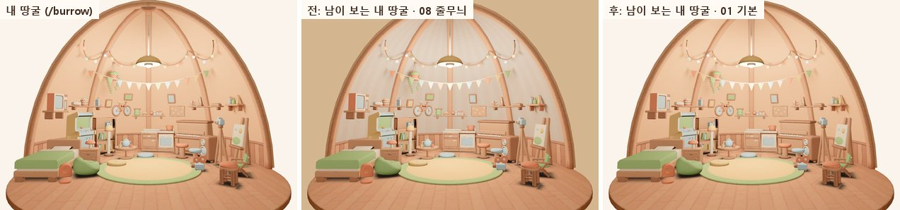
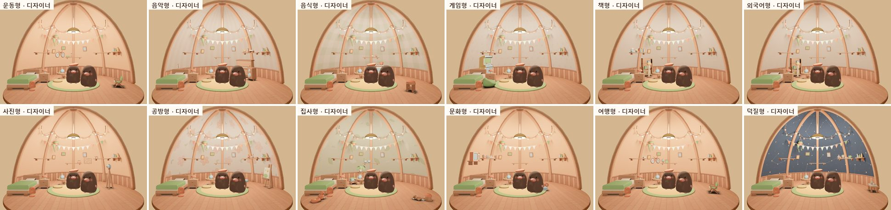
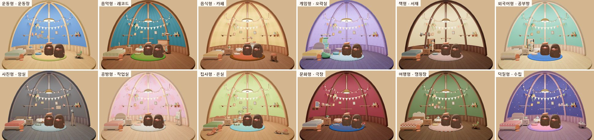
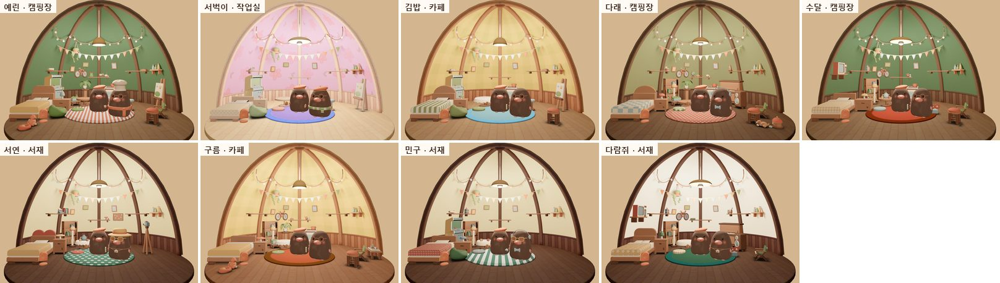
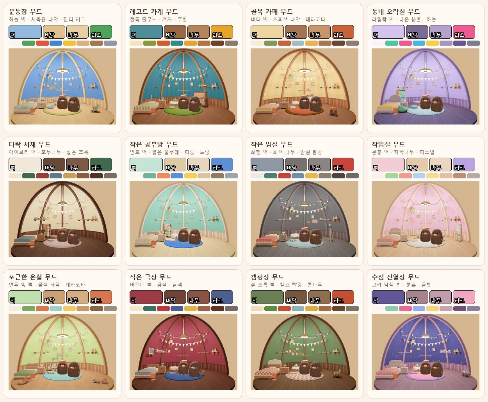
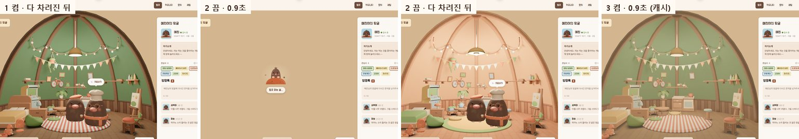

# 땅굴 다양성 2: 벽지 문제 고치기 + 방이 사람마다 달라 보이게 (2026-11-18)

- 날짜: 2026-11-18
- 요청 (그대로): "벽지 문제를 고친다음, 땅굴 다양성을 늘리는 작업을 진행해. 백그라운드에서"
- 앞 작업: [room-diversity-2026-11-18.md](room-diversity-2026-11-18.md) (지금 상태 재기: 벽지를 같게 놓으면 방 넓이의 83%가 26개 방 모두 같음), [burrow-diversity.md](burrow-diversity.md) (11-16 꾸미기 실험)

## 1단계: 벽지 문제 (고침)

### 원인
- 같은 사람의 땅굴이 **내가 볼 때와 남이 볼 때 벽지가 달랐음**. 규칙이 둘이었고, 집주인이 저장한 방도 남에게 전해지지 않았음
  - 내 땅굴(`MyBurrow`): 맨 앞 관심사의 대분류 (`myBurrow.ts moodWallpaper`) + 온보딩 때 계산해서 sessionStorage 에 저장해 둔 벽지
  - 남의 땅굴(`VisitBurrow`): 벽지를 안 넘겨서 `roomScene` 이 **가장 무거운 대분류**(드문 취미 가중치 Σ 1 + 1000/인원, `wallpapers.ts topCategoryOf`)로 다시 계산
  - `BurrowDto.room`(저장한 벽지·가구)은 타입에만 있고 목 서버 · `toBurrow` · `VisitBurrow` 가 안 씀 → 꾸미기에서 고른 가구도 남에게는 기본 가구로 보였음
- 예: "나"(관심사 10개, 맨 앞 캠핑/글램핑)는 내 화면에서 01 기본, 남이 보면 08 줄무늬
- 명세는 대표 관심사 쪽: 00 공통 5 · F3 3a "땅굴 무드 = 대표 관심사(맨 앞)의 대분류", 온보딩 문구 "맨 앞 관심사가 땅굴 분위기를 정해요", spec-design-gaps G-31 "예전 규칙(드문 취미 가중치)은 없어짐". 다르게 정할 근거는 못 찾음

### 고친 것
- **방 모습을 정하는 함수 하나** `app/src/data/roomLook.ts roomLookOf(집주인 id, 관심사, 저장한 방)` → `{ 벽지, 가구 선택, 대표 대분류 }`
  - 저장한 방(서버 `room`, 내 것은 sessionStorage)에 값이 있으면 그 값, 없으면 대표 관심사(맨 앞)의 대분류로 계산
  - 가구 선택은 지금 관심사에 맞는 후보만 남김 (뺀 관심사의 가구, 모르는 id 는 버림 → 기본 가구)
- 이 함수를 쓰는 곳: 내 땅굴 · 남의 땅굴 · 온보딩 3a(땅굴 무드 벽지)·4(미리 보기) · 탐색 시안의 방 미리보기(`explore-designs/parts.tsx`) · 비교 실험실 `/lab/rooms`. 벽지를 안 넘기는 화면(시작 화면 등)은 `roomScene` 이 같은 규칙(`moodWallpaper`)으로
- 저장한 방 전달: 목 서버 `GET /burrows/{id}` 가 `room` 을 채움(나는 꾸민 값, 다른 목 주민은 꾸민 적 없어 `null`) → `api/mappers.ts toBurrow` 가 `BurrowVM.room` 으로(`member_interest.furniture` 도 읽음) → `VisitBurrow` 가 `roomLookOf` → `RoomView` → `roomScene`
- 계산 값은 저장하지 않음: 예전엔 온보딩·관심사 수정 때 계산한 벽지를 `digul.myWallpaper` 에 저장했는데, 이제 **직접 고른 것만** `digul.myRoom.v1`(`myBurrow.ts getMyRoomPick`)에. 관심사를 바꾸면 계산 값이 따라감
- 예전 가중치 규칙(`topCategoryOf` · `wallpaperForPicks`)과 계산 벽지 저장(`getMyWallpaper` · `setMyWallpaper`)은 지움
- `/lab/rooms?user=…` 는 방문자 뷰와 같은 길(땅굴 API → `toBurrow` → `roomLookOf`)로 바꿈 → `?user=me` = 남이 보는 내 땅굴
- 백엔드에 넘길 것: `docs/backend/api-draft.md` 2.3 "땅굴 응답의 `room`" (모양 · 규칙 · 없을 때)

### 확인
- 시험 `app/src/tests/room-look.test.ts` (새로 12개): 맨 앞 관심사 규칙 · 내 땅굴과 방문자 뷰(목 서버 → `toBurrow` → `roomLookOf`)가 같은 값(꾸민 게 없을 때 · 가구와 벽지를 고른 뒤 · 관심사를 바꾼 뒤) · 다른 사람이 저장한 방이 방문자 뷰에 그대로 · 모르는 벽지 id · 후보가 아닌 가구 버림 · `member_interest.furniture`. `room-plan.test.ts` 의 할 일(`it.todo`) 하나를 실제 시험으로
- 찍어서 확인 (`node tools/room-diversity/capture.mjs --me`, `--me=decor`): "나"를 내 땅굴 `/burrow` 와 남이 보는 내 땅굴 `/lab/rooms?user=me` 로 같은 크기에 찍고(두더지 숨김, 캔버스만, 내 땅굴 입장 연출은 "움직임 줄이기"로 끔, 우체통은 읽음으로 맞춤) `check.py` 로 비교 → **다른 픽셀 0.00%** (꾸민 게 없을 때 · 가구 하나와 벽지 07 을 고른 뒤 둘 다). 둘 다 `window.__roomLook` 이 같음. 2단계를 다 한 뒤(색 묶음 켬, `--me=decor` 는 색 테마 오락실까지 고른 뒤) 다시 찍어도 0.00%
- (처음엔 우체통 깃발만 0.74% 달랐음: 내 땅굴은 "새 방명록"이면 깃발이 올라감. 방 모습과 상관없는 상태라 읽음으로 맞춤)

## 2단계: 땅굴 다양성 늘리기

### 결론 (찍고 잰 숫자, 같은 26명 · 같은 구도 · 같은 계산)
| 재는 것 (ΔE76 10 넘으면 "다름") | 전 | 후 |
|---|---|---|
| 벽지 그림을 같게 놓아도 **26개 방 모두 빈 방(관심사 0개)과 똑같은 넓이** | **82.9%** | **2.6%** |
| 보이는 그대로(벽지 포함) 26개 방 모두 빈 방과 똑같은 넓이 | 47.6% | 2.6% |
| 방 하나가 빈 방과 다른 넓이 (가운데 값) | 37.1% | 92.5% |
| 보이는 그대로 "평균 방"과 다른 넓이 (가운데 값) | 5.5% | 86.5% |
| 둘씩 비교(325쌍): 서로 다른 넓이 가운데 값 | 11.0% | 93.8% |
| 둘씩 비교: 10%도 안 다른 쌍 | 46.2% (150쌍) | 0.3% (1쌍: 음식형 · 구름, 둘 다 카페 묶음 8.0%) |
| **대분류가 다른 쌍(296쌍)**: 다른 넓이 가운데 값 · 가장 작은 값 | 11.2% · 0.3% | **94.6% · 50.0%** |
| 대분류가 같은 쌍(29쌍): 다른 넓이 가운데 값 · 가장 작은 값 | 8.4% · 0.3% | 17.6% · 8.0% |
| **운동형 · 여행형** (아웃도어 세트를 같이 씀) | **0.3%** | **95.4%** |
| 외국어형 · 책형 (책 세트를 같이 씀) | 0.4% | 95.8% |
| 같은 사람의 방이 전과 후에 다른 넓이 (26명 가운데 값) | - | 91.1% (47.6~96.3%) |

- 늘 같던 물건(빈 방과 비교, 물건 상자 안 2% 넘게 다른 방 수, 26개 방 중): 러그 0 → 26, 침대 4 → 26, 원탁 7 → 26, 방석 15 → 26, 협탁 16 → 26, 바닥 앞쪽 0 → 25
- 전후 차이가 작은 방: 집사형 48% · 책형 57% · 민구 57% · 서연 58% (온실 · 서재 묶음은 벽이 원래 벽지와 가까운 연한 색이라 벽 쪽 차이가 작음)
- 후 묶음은 벽지 그림을 01 로 같게 놓아도 숫자가 거의 같음 (2.6%): 벽 색이 이제 벽지 그림이 아니라 색 묶음에서 나와서
- **숫자는 색 차이**라 벽 · 바닥 색이 바뀌면 넓이가 크게 잡힘. 가구 종류 · 배치는 그대로라 사람이 느끼는 "다른 방"은 이 숫자보다 작을 수 있음 (판단). 같은 대분류끼리는 17.6%로 여전히 비슷한 편 (벽 결이 같음)

대분류마다 한 사람씩 12명 (왼쪽부터 운동 · 음악 · 음식 · 게임 · 책 · 외국어 / 사진 · 공방 · 집사 · 문화 · 여행 · 덕질)

전 (다양성 작업 전):

후 (기본값):

들판 이웃 9명 (후, 자리 1~10번 중 빈 7번 빼고): 같은 묶음(캠핑장 3 · 서재 3 · 카페 2)끼리도 벽 · 바닥 빛깔, 이불 · 러그 무늬, 침대 머리판이 달라요

### 정한 규칙
- **방 모습 = `roomLookOf(집주인 id, 관심사, 저장한 방)` 한 곳** (1단계 함수에 꾸미기 값 `style` 을 더함). 내 땅굴 · 남의 땅굴 · 온보딩 미리 보기 · 시작 화면 둘러보기 · 탐색 시안 방 미리보기 · `/lab/rooms` 가 같은 값을 씀
- **색 묶음 = 대표 관심사(맨 앞)의 대분류** (온보딩 문구 "맨 앞 관심사가 땅굴 분위기를 정해요"와 같은 기준). 대분류 12개마다 하나 (`data/roomStyle.ts CATEGORY_THEMES`, 이름은 땅굴 무드 이름)
  - 묶음 하나 = 벽 · 바닥 · 나무 뼈대(갈빗대 · 벽판 · 돔 테두리) · 러그 색 + 가구 팔레트 8자리(크림 · 초록 · 주황 · 하늘 · 노랑 · 밝은 나무 · 어두운 나무 · 돌) + 다른 벽 빛깔 · 다른 바닥 빛깔 하나씩
  - 가구 팔레트는 기본 가구 · 관심사 가구 · 나무 선반 · 전구 줄에 다 입힘 (glb 가 팔레트 재질 8개를 단색으로 쓰고 음영은 따로 구워 둬서 색만 바꿔도 점토 느낌 그대로, burrow-diversity.md). **동물은 안 칠함** (보라 고양이 방지)
  - 벽지 그림(무늬)은 디자이너 표(대분류 → 벽지) 그대로 두고 색만 묶음 색으로 물들임 → 연한 벽지 6가지도 대분류마다 다른 색
- **사람마다 (씨앗 = 회원 id, 같은 사람은 늘 같은 방)**: 다른 벽 빛깔 40% · 다른 바닥 빛깔 40%, 이불 색(강조색 중 하나) + 60% 무늬, 방석 색 · 35% 무늬 · 25% 벨벳, 버섯 갓 색, 러그(묶음 러그 색 55% 또는 강조색) + 50% 무늬, 기본 가구 모양 묶음마다 하나(침대 크기 · 머리판 5가지 · 베개, 협탁 · 버섯 갓, 원탁 테이블보 · 찻잔 · 크기, 방석 두께 · 술, 천장 램프 갓). 11-16 자동 꾸미기(`autoStyle`)를 묶음 안에서 돌림
- **집주인이 고른 것이 먼저**: 저장한 방(`room`)의 벽지 · 가구 선택 · **색 테마(`themeId`, 새로)**. 꾸미기에 "색" 탭을 작게 더함 (자동 = 대표 관심사 묶음 · 12개 묶음 · 디자이너 기본). 무늬 · 모양은 씨앗 그대로, 색만 바뀜. 명세에 없는 탭이라 확인받을 것
- **대표 관심사가 없으면**(관심사 0개 · 시작 화면 견본) 꾸미기 없음 = 디자이너 원래 모습. 시작 화면 랜딩의 방도 그대로 (빌드에 넣은 정지 그림과 같은 방이어야 해서)
- **실험 스위치**: 땅굴 화면 "✨ 이펙트" 패널 맨 위 "🎨 땅굴 색 다양하게" (기본 켬, `lib/roomLookLab.ts`, localStorage 기억). 끄면 장면을 다시 만들지 않고 디자이너 원래 색으로. 주소 손잡이 `?look=designer` · `?look=auto`

### 대분류별 묶음 (색은 "화면에 보이는 색")
| 대분류 | 무드 | 벽 | 바닥 | 나무 | 러그 | 다른 벽 · 바닥 | 느낌 |
|---|---|---|---|---|---|---|---|
| 음식·음료 | 골목 카페 무드 | `#EED6A0` (05 체크) | `#A57452` | `#C8946A` | `#C8623A` | 벽 `#E6CC90` · 바닥 `#B08A64` | 버터 벽 · 커피색 바닥 · 테라코타 |
| 스포츠 | 운동장 무드 | `#92B8DC` (01 기본(단색)) | `#E0C08E` | `#E6CFA6` | `#4FA35A` | 벽 `#6E9AD0` · 바닥 `#D9B888` | 하늘 벽 · 체육관 바닥 · 잔디 러그 |
| 문화생활 | 작은 극장 무드 | `#9A3B46` (01 기본(단색)) | `#6E4234` | `#8A5444` | `#4D5F8E` | 벽 `#44507E` · 바닥 `#704634` | 버건디 벽 · 금색 · 남색 |
| 게임 | 동네 오락실 무드 | `#D4C3EC` (06 도트) | `#7A6C92` | `#B4A2CC` | `#EE5A8F` | 벽 `#9C88C8` · 바닥 `#857B9E` | 라일락 벽 · 네온 분홍 · 하늘 |
| 음악·댄스 | 레코드 가게 무드 | `#4F8E96` (08 줄무늬) | `#9A6844` | `#B2845C` | `#E8A42A` | 벽 `#3E6E78` · 바닥 `#A06A40` | 청록 줄무늬 · 겨자 · 주황 |
| 아웃도어 | 캠핑장 무드 | `#6B7F55` (01 기본(단색)) | `#76563C` | `#8E6E50` | `#C4502F` | 벽 `#A39A6C` · 바닥 `#8E6C4C` | 숲 초록 벽 · 캠프 빨강 · 통나무 |
| 외국어·자기계발 | 작은 공부방 무드 | `#C6E5D6` (04 모던) | `#DDC9A4` | `#E6D6BE` | `#5C8FD6` | 벽 `#A8D4C0` · 바닥 `#CDB490` | 민트 벽 · 밝은 물푸레 · 파랑 · 노랑 |
| 책·글 | 다락 서재 무드 | `#F1E8DA` (04 모던) | `#684836` | `#7E5A46` | `#3F6A4E` | 벽 `#E8D8B8` · 바닥 `#806050` | 아이보리 벽 · 호두나무 · 짙은 초록 |
| 사진·영상 | 작은 암실 무드 | `#8E97A3` (01 기본(단색)) | `#77706C` | `#8C8480` | `#C9453B` | 벽 `#6E6A6C` · 바닥 `#7C7672` | 회청 벽 · 회색 나무 · 암실 빨강 |
| 미술·수공예 | 작업실 무드 | `#F2CCD4` (03 꽃무늬) | `#E2CAAA` | `#ECD6C0` | `#B9A3E0` | 벽 `#F4C0B0` · 바닥 `#D8B896` | 분홍 벽 · 자작나무 · 파스텔 |
| 덕질·수집 | 수집 진열장 무드 | `#625596` (02 별자리) | `#A6848F` | `#BE9CAC` | `#F2A7C3` | 벽 `#84588C` · 바닥 `#8E7080` | 보라 남색 별 · 분홍 · 금빛 |
| 반려동물·식물 | 포근한 온실 무드 | `#C2E0AE` (07 숲) | `#CBA072` | `#D6AE82` | `#D8774E` | 벽 `#D0DE9C` · 바닥 `#B88A5C` | 연두 잎 벽 · 꿀색 바닥 · 테라코타 |

### 어떻게 칠했나 (코드)
- `three/roomStyle.ts registerShell`: 껍데기(바닥 · 갈빗대 · 벽판 · 난간 · 돔 테두리)는 조명을 구운 그림 하나를 같이 쓰는 재질 → 이 장면 메시에만 재질을 복제하고 **구운 빛(emissive)에 곱할 색**을 넣음. 셰이더는 원래와 같아서 새로 컴파일할 것이 없고, 구운 음영 · 나뭇결이 그대로 남음
- 벽(벽지 재질 MeshBasic)은 `color` 를 곱함: 단색 01 은 그 색, 무늬 벽지는 타일 평균색이 목표 색이 되는 배율
- **AgX 를 거꾸로**: 땅굴은 AgX 톤 매핑이라 넣은 값이 화면에서 눌리고 채널끼리 섞임. 처음엔 "목표 ÷ 원래" 비율을 곱했더니 하늘 · 민트 벽이 회색, 빨강 벽이 형광 산호색으로 나옴. three.js r165 AgX 식을 그대로 옮겨(`agx`) 원하는 화면 색이 나오는 빛 값을 가우스-뉴턴으로 풀어(`agxInverse`) 기준(원래 빈 방 사진에서 잰 화면 색)과의 비율을 넣음. 시험: 모든 묶음 색이 2/255 안으로 되돌아옴 (AgX 가 못 내는 진한 밝은 노랑은 묶음에서 뺌)
- 무늬 없는 러그도 구운 빛 배율로 (원래 크림 가운데 · 초록 테두리가 목표 색의 밝고 어두운 두 톤으로). 무늬가 있으면 11-16 의 러그 셰이더
- 저장 값(`RoomStyle`)에 `floor` · `wall`(사람마다 다른 빛깔)을 더함. 구운 방 그림 캐시 키에 `STYLE_VERSION`(2) · 무늬 켜짐을 넣음 → 묶음 색을 고치면 판을 올려 예전 그림이 안 남음

### 저사양 (그래픽 가속 꺼진 PC)
측정: `explore/gpu/cdp-scene.mjs room`(남의 땅굴 예린, 입장 연출 있음 → 가만히 6초 → 걷기 8초 → 가만히 6초), 공유 빌드, 헤드리스 크롬 1920×1080, **반복 3번 가운데 값**, 전 · 후를 번갈아 같은 시간대에 잼. 결과 `explore/gpu/results/room-diversity-2/*.json`, 요약 `tools/room-diversity/perf.json`

| 조건 | 첫 진입 가장 긴 멈춤 | 다 보이기까지 | 걷기 장면 fps | 가만히 있을 때 CPU |
|---|---|---|---|---|
| 가속 켬 (RTX 5060 Ti) | 127 → 162ms | 2714 → 2923ms | 60 → 59.9 | 63 → 58% |
| 가속 끔 · 16스레드 (WARP) | 176 → 276ms | 2657 → 3310ms | 59.4 → 59.9 | 120 → 119% |
| 가속 끔 · 16스레드 · 무늬 없이 (`?stylepat=0`) | 176 → 263ms | 2657 → 3064ms | 59.4 → 59.9 | - |
| 가속 끔 · 16스레드 · 마지막 빌드로 다시 | 176 → 270ms | 2657 → 3154ms | 59.4 → 59.7 | - |
| 가속 끔 · CPU 2코어 | 991 → 1437ms | 6372 → 6912ms | 29.9 → 38.9 | 67 → 64% |
| 가속 끔 · CPU 2코어 · 무늬 없이 (실제 2코어 PC 기본) | 991 → **849ms** | 6372 → 6850ms | 29.9 → 34.8 | - |

- **걷기 · 가만히 있을 때는 그대로** (가속 끔은 방을 한 번 선명하게 구워 두고 두더지만 그려서, 재질 색이 바뀌어도 매 프레임 일은 같음. 그리기 호출 수 398 → 397 · 58 → 58)
- **첫 진입이 0.1초쯤 · 다 보이기가 0.3~0.65초 늘었음** (16스레드). CPU 프로필로 보면 가장 긴 연속 작업은 전 · 후 모두 셰이더 컴파일(약 150ms)이 대부분 → 판마다 113~288ms 로 흔들림 (전 113/176/225, 후 122/270/288). 무늬를 꺼도(263ms) · 덧붙이 재질을 가구 재질 복제로 바꿔 셰이더 종류를 줄여도 · 꾸미기를 두 번에서 한 번만 입혀도(270ms) 가운데 값은 거의 그대로라, 늘어난 0.1초의 원인은 못 찾음 (재질 수가 늘어 처음 그릴 때 준비가 길어진 것으로 짐작, 판단)
- **2코어는 판마다 크게 흔들림**: 같은 전 빌드를 다른 시간에 재면 가장 긴 멈춤 735 · 1162 · 991ms, 걷기 35 · 28.5 · 29.9fps. 그래서 2코어 숫자는 방향만 봄. 실제 2코어 PC 는 기기 단계가 weak 로 잡혀 **무늬 · 벨벳 없이** 그리고(`stylePatterns`), 그때 가장 긴 멈춤 849ms 로 전(991ms)보다 길지 않았음
- 같은 PC 에서 다른 작업자도 측정 · 스모크를 돌리고 있었음 (같은 임시 폴더에 다른 작업의 결과 파일이 생김) → 숫자가 그만큼 흔들렸을 수 있음
- 이 측정에서 2코어 크롬은 `hardwareConcurrency` 가 16 으로 나와 기기 단계가 처음엔 strong(무늬 켬)으로 잡힘 → 그래서 무늬 켬 · 끔을 둘 다 잼
- **구운 방 그림 캐시**(가속 끔, IndexedDB): 같은 프로필로 ① 켬 → ② `?look=designer` → ③ 다시 켬 (`tools/room-diversity/cache-check.mjs`). ②는 예전(켬) 그림이 먼저 깔리지 않고 로딩 → 디자이너 색으로 새로 구움, ③은 ① 그림이 0.9초에 바로 깔리고 다시 굽지 않음 → 키에 꾸미기 값(`s2p` + 꾸미기 JSON)이 들어감 확인

### 전 · 후 비교 페이지
- `tools/room-diversity/out/room-diversity.html` + `out/files.json` (게시는 메인 세션, 같은 주소 https://claude.ai/artifact/7WKmPmpkapceCdXreAszCn 에 다시). 맨 위 "보는 것"으로 전 · 후 · 나란히 → 차이 지도 · 방 카드가 바뀜. 전후 숫자 표, 대분류 색 묶음 12개, 둘 골라 비교(전후 섞어서), 저사양 표
- 전 = 11-18 1차 때 찍은 그림(같은 PC, 다양성 작업 전 앱 코드 c229285 와 같음)을 그대로 씀, 후 = 이번 앱. 빈 방(관심사 0개)은 둘 다 디자이너 원래 색이라 같은 기준
- 사진 226장 약 11.9MB, 페이지 247KB. 1366px(라이트) · 390px(다크) 헤드리스 크롬으로 찍어 봄: 가로 넘침 없음(scrollWidth = 창 폭), 스크립트 문법 검사 통과, 나란히 보기에서 카드 26장 모두 전 · 후 사진
- 다시 만들기: [tools/room-diversity/README.md](../tools/room-diversity/README.md) (capture → analyze → perf-summary → build)

### 관심사 이펙트와 같이
- 이펙트 모두 켜고(`?fx=all`) 들판 이웃 9명 방을 찍어 봄 (`capture.mjs --fx=all --set=fx`): 예외 · 콘솔 에러 없음, 요약 줄 · 입장 이름표 · 대표 관심사 빛줄기 · 나와 같은 관심사 배지가 새 색 묶음 위에서 그대로. 예린 데모(나와 3개 겹침 · 가장 드문 "차/다도")도 그대로

## 디자이너에게 부탁할 것
1. **관심사 가구 · 소품 채우기** (이미 [interest-tags-2026-11-18.md](interest-tags-2026-11-18.md) "디자이너에게 필요한 것"): 빌려 쓰는 세트 3개(스포츠 · 외국어·자기계발 · 덕질·수집), 소품 없는 소분류 39개. 색으로 방 전체가 달라졌어도 "무슨 관심사인지"는 여전히 작은 가구로만 보임
2. **재질 나누기**: 한 가구 안에서 같은 팔레트 재질을 쓰는 부품이 같이 칠해짐 (침대 크림 = 시트 + 베개, 협탁 몸통 · 서랍). 부품마다 다른 자리로 나눠 주면 이불 · 시트 · 베개를 따로 칠할 수 있음
3. **러그를 껍데기에서 떼기**: 러그가 껍데기에 구워져 있어 무늬 러그는 한 색 + 무늬만 됨. 팔레트 재질의 따로 된 러그 모델(+ 그림자 판)이면 테두리 · 가운데를 따로 칠할 수 있음
4. **장식 칠하기**: 가랜드 · 액자 · 매달린 화분 · 벽 선반(구운 판)은 구운 그림 한 장이라 묶음 색을 못 받음. 가랜드 깃발만이라도 팔레트 재질이면 방마다 다른 색 깃발
5. **관심사 액자 그림**: 벽 액자 3개(`frame_01~03_picture`)에 넣을 관심사 그림(특히 소품 없는 소분류용). 받으면 코드는 그림만 끼우면 됨 (이번엔 임시 그림을 만들지 않음, 아래 "남은 문제")
6. **기본 가구 변형 모델 2~3종** (침대 · 협탁 · 원탁): 지금 모양 변형은 크기 · 덧붙이(머리판 · 테이블보 · 술)뿐
7. **묶음 색 12개 검토**: 이번 색은 개발자가 찍어 보며 고른 것 (판단). 디자이너 팔레트로 바꾸면 `data/roomStyle.ts CATEGORY_THEMES` 표만 고치고 `STYLE_VERSION` 을 올리면 됨

## 백엔드에 넘길 것
- `docs/backend/api-draft.md` 2.3 "땅굴 응답의 `room`": `schemaVersion` · `wallpaperId` · `furniture` · **`themeId`(새로, 꾸미기 색 탭)**. 없으면 `null`(프론트가 계산)
- **씨앗 = 회원 id**: 나머지 꾸미기 값(무늬 · 모양 · 다른 빛깔)은 프론트가 회원 id 로 계산 → 내 땅굴도 목의 `'me'` 가 아니라 실제 회원 id 를 써야 남이 볼 때와 같음 (서버를 붙일 때 프론트에서 바꿀 곳: `MyBurrow` · 온보딩 미리 보기의 `ME_ID`)
- 서버가 꾸미기 값을 그대로 저장하고 싶으면(디자이너가 묶음을 바꿔도 옛 방이 그대로 남게) `room.style`(JSON 수백 바이트, `data/roomStyle.ts RoomStyle`)을 더하는 길도 있음 → 지금은 안 함 (판단: 묶음을 고치면 모두가 같이 바뀌는 쪽이 지금은 편함)

## 사용자에게 물어볼 것
1. 꾸미기 "색" 탭을 정식으로 넣을지 (02 명세 F4 에는 가구 · 두더지 탭만)
2. 묶음 색감 (특히 진한 벽: 극장 버건디 · 레코드 청록 · 캠핑 숲 · 암실 회청 · 수집 보라) — 너무 진하거나 탁한 묶음이 있으면 표만 고치면 됨
3. 같은 대분류 이웃끼리 얼마나 달라야 하는지 (지금 다른 벽 · 바닥 빛깔 각 40%)
4. 시작 화면 랜딩의 견본 방도 색 묶음을 입힐지 (지금은 디자이너 원래 색: 빌드에 넣은 정지 그림과 같아야 해서)

## 사용자 답 (2026-11-18 저녁)
- **배포**: "둘다 올려줘" → 시험판 version 5 · 팀 링크 version 36 (main 9bd0e09 공유 빌드). 팀 35 는 게시 때 roomLook 청크를 빠뜨려서 36 에서 바로 고침 (두 링크 모두 파일 목록 186개 = 빌드와 같음 확인)
- **꾸미기 "색" 탭**: "팀원들에게 물어보고 결정할게" → 지금은 그대로 두고 팀 답을 기다림
- **묶음 색감 (진한 벽 포함)**: "괜찮아" → 지금 색 12개 유지 (디자이너 검토는 따로)
- **시작 화면 견본 방**: "그건 그대로 놔둬" → 디자이너 원래 색 유지

## 남은 문제
- **관심사 자체는 여전히 작은 가구로만 보임**: 색 묶음이 "대표 관심사가 무엇인지"는 방 전체로 보여 주지만, 나머지 관심사(2~10번째)는 벽 아래 띠의 작은 가구 · 선반 소품뿐. 소품 없는 소분류 39개는 아무것도 안 생김 (디자이너 1번)
- **관심사 액자 · 포스터(선택 3번)는 안 함**: 액자 3개가 화면에서 30px 안팎이라 임시 그림으로는 효과가 작고, 디자이너 그림이 오면 바로 끼울 수 있게 남김 (판단)
- **같은 대분류끼리는 벽 결이 같음**: 같은 묶음 쌍의 다른 넓이 가운데 값 17.6% (대분류가 다르면 94.6%). 들판 이웃은 캠핑 · 책 · 카페가 많아서 이웃끼리 같은 묶음이 자주 나옴
- **아주 느린 PC(기기 단계 weak)는 무늬 · 벨벳 없이** 색 · 모양만 → 같은 사람의 방이라도 그런 PC 에서는 이불 · 러그 무늬가 안 보임
- 가랜드 · 액자 · 매달린 화분, 두더지 · 우체통은 그대로 (구운 그림 · 따로 정한 색)
- 시작 화면 랜딩의 견본 방, 탐색 들판(구멍 · 미니맵)은 색 묶음을 안 씀 (탐색 시안 B · C · D 의 2D 방 미리보기만 벽 · 바닥 · 러그 색을 따름)
- 묶음 색은 개발자가 26개 방을 찍어 보며 고른 값 (판단, 디자이너 검토 전). 이 PC(RTX 5060 Ti, 1440×900)에서만 봄. 모바일 폭은 PC 전용 화면이라 안 봄
- 2코어 측정은 같은 빌드도 판마다 크게 흔들림 (아래 저사양 표의 주석)

## 확인
- `npm test`: 12 파일 · **258 통과** + 할 일 2 (전 236 + 할 일 3). 새로 `room-look.test.ts` 12개(1단계) · `room-style.test.ts` 11개(묶음 12개 다 있음 · 벽 · 바닥이 묶음끼리 ΔE 25 넘게 다름 · 빌려 쓰는 대분류끼리도 다름 · 팔레트 색 계열 · 같은 사람 같은 방 · 대표 관심사 없으면 꾸미기 없음 · 도자기 · 금속 마감 안 씀 · 고른 테마가 먼저 · AgX 거꾸로 2/255)
- `npm run build` · `npm run build:share` 통과. 첫 화면 JS(공유 빌드 gzip) 399.1 → 401.3KB (원래도 예산 360KB 넘음)
- 스모크 (`--port=5371`): 가속 켬 **98/98 OK** (233초) · `--gpu=off` **98/98 OK** (236초) · `--gpu=none` **98/98 OK** (163초), 경고 0 · 실패 0
- 비교 도구로 "나" 두 화면 같음(0.00%), 이펙트 모두 켬 확인, 구운 방 그림 캐시 확인 (위)
- 데모: 예린(나와 3개 겹침 · 가장 드문 "차/다도") 이펙트 배지 그대로, 서벅이 방문자 뷰 그대로 (방명록 · 대화 요청 화면은 손대지 않음)

## 바꾼 파일
- 앱: `data/roomLook.ts`(새로) · `data/roomStyle.ts`(묶음 12개 · `autoStyleFor` · `STYLE_VERSION`) · `data/myBurrow.ts`(직접 고른 방 값 `getMyRoomPick`) · `data/wallpapers.ts`(예전 규칙 지움) · `lib/roomLookLab.ts`(새로, 🎨 스위치) · `api/mappers.ts`(`toSavedRoom`) · `api/burrows.ts`(목 `room`) · `api/types.ts`(`themeId`) · `three/roomStyle.ts`(껍데기 · AgX 거꾸로 · 무늬 없는 러그 · 가벼운 꾸미기 · 덧붙이 재질) · `three/roomScene.ts`(껍데기 · 나무 선반 등록, 동물 안 칠함, 캐시 키, 한 번만 입히기, `?stylepat`) · `three/RoomCanvas.tsx` · `three/engine.ts` · `components/RoomView.tsx`(`style`) · `components/FxPanel.tsx`(🎨 줄) · 화면 `MyBurrow` · `VisitBurrow` · `DecorPanel`(색 탭) · `Onboarding` · `LookAround` · `RoomsLab` · 탐색 시안 `parts.tsx` · `ExploreCards` · `ExploreTunnel`
- 시험: `tests/room-look.test.ts` · `tests/room-style.test.ts` · `tests/room-plan.test.ts`
- 도구: `tools/room-diversity/`(capture `--set` · `--me` · `--look` · `--fx`, analyze 전 · 후, build, 페이지, check · sheet · montage · themes-image · perf-summary · cache-check)
- 문서: 이 문서, `docs/backend/api-draft.md` · `erd-gaps.md` Q8, `docs/spec-design-gaps.md` G-31, `docs/testing-ci.md`
