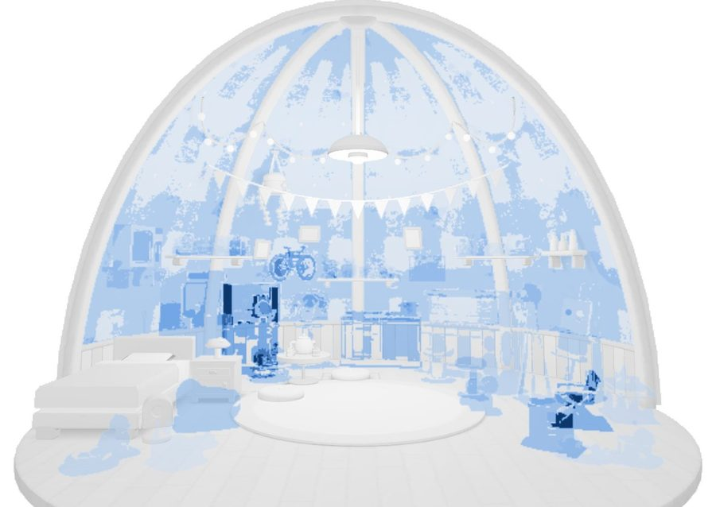
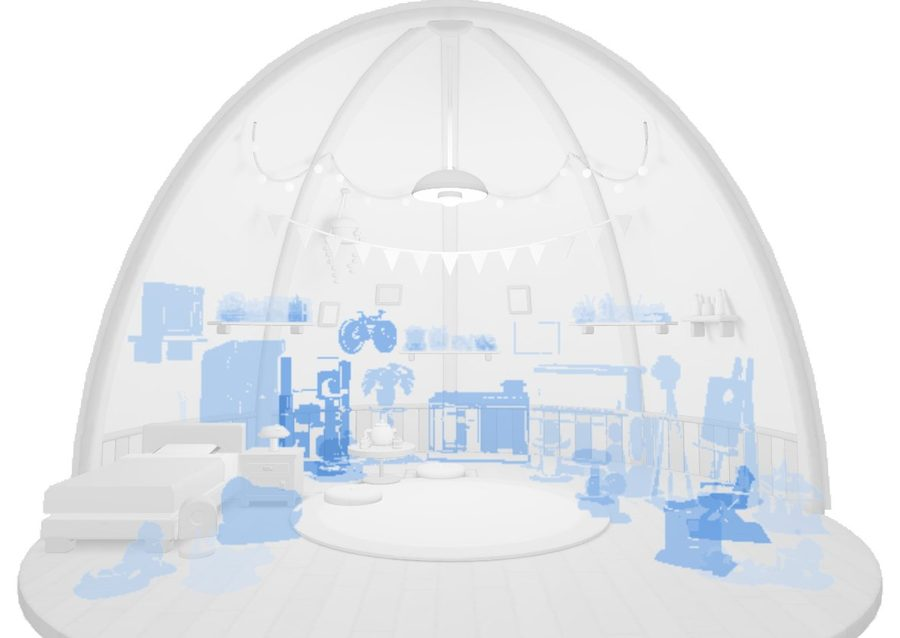
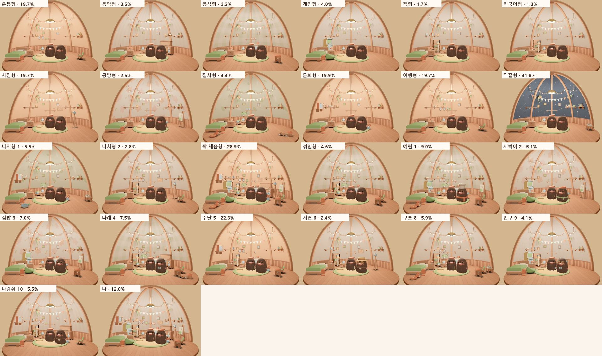
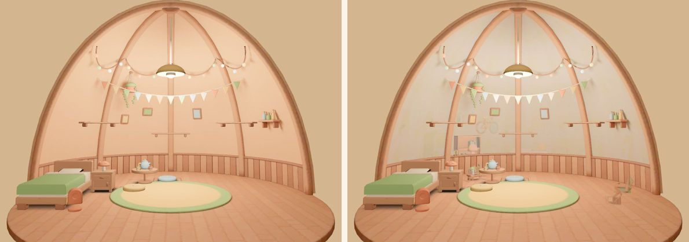
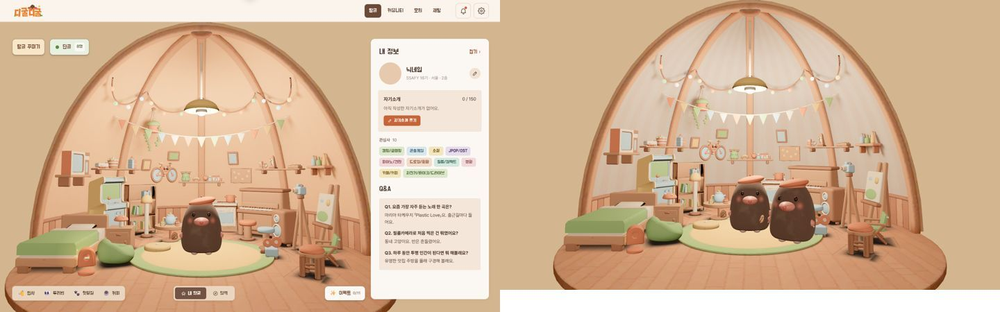
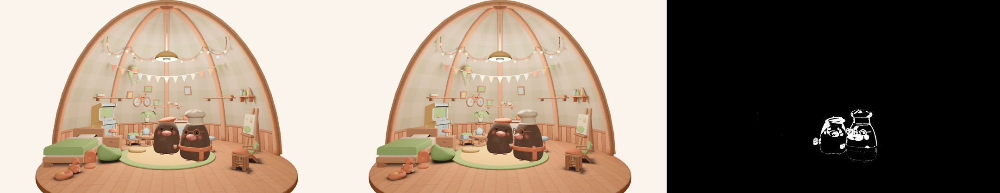

# 땅굴 다양성 비교: 관심사가 달라도 방이 비슷해 보이나 (2026-11-18)

- 날짜: 2026-11-18
- 요청 (그대로): "지금 탐색화면에서 다른 사용자들의 땅굴을 들어가보면 다양성이 적은 것 같아. 방이 다 똑같아 보인다는 단점이 있어. 일단 한눈으로 확인해볼 수 있게, 사용자들이 서로 다른 관심사를 선택하도록 하고, 그 방이 각각 어떻게 보이는지 비교할 수 있게 아티팩트를 만들어줘."
- "일단"이라 이번에는 **지금 상태를 정확히 보여 주는 것**만 함. 방을 바꾸는 개선은 안 함 (후보만 아래에)
- 비교 페이지: `tools/room-diversity/out/room-diversity.html` (게시는 메인 세션, 만드는 법 [tools/room-diversity/README.md](../tools/room-diversity/README.md))

## 결론 (찍고 잰 숫자)
26개 땅굴(일부러 다르게 고른 16명 + 지금 탐색 들판 이웃 10명)을 방문자 뷰와 같은 구도로 찍어 비교함. 숫자는 모두 **방 넓이 대비**(방 바깥 흙색 배경 뺌), 두더지를 숨기고 찍은 그림으로 잼.

- **벽지를 같게 놓으면 방 넓이의 82.9%는 26개 방 어디에도 관심사 물건이 놓이지 않음** (관심사 0개 빈 방과 똑같음). 한 방에라도 놓인 넓이 17.1%, 절반 넘는 방에 놓인 넓이 0.4%
- 방 하나에서 관심사 가구·소품이 차지하는 넓이: **가운데 값 2.9%** (외국어형 · 사진형처럼 0.7%부터 10개 꽉 채운 방 13.7%까지)
- 벽지까지 보이는 그대로 놓고 "평균 방"(칸마다 26개 방의 가운데 값)과 비교: 방마다 다른 넓이 **가운데 값 5.5%** (1.3~41.8%). 어느 방에서도 평균과 안 다른 넓이 47.9%, 절반 넘는 방에서 다른 넓이 1.0%
- 둘씩 비교(325쌍): 다른 넓이 가운데 값 11.0%, **46%의 쌍이 10%도 안 다름**. 벽지를 같게 놓으면 가운데 값 5.7%, 87%의 쌍이 10% 미만
- 가장 비슷한 쌍: **운동형 · 여행형 0.3%** (스포츠가 아웃도어 세트를 빌려 써서 가구가 같고 선반 소품만 다름). 가장 다른 쌍: 덕질형 · 꽉 채움형 50.4% (02 별자리 벽지 + 가구 9세트)
- 방마다 숫자가 큰 방은 거의 **벽지** 때문: 01 기본(진한 살구색) 6개 방이 19.7~28.9%, 02 별자리 1개 방이 41.8%. 가구·소품만 보면 이 방들도 0.7~13.7%
- 늘 있는 물건(벽지 같게, 빈 방과): 천장 램프 · 전구 줄 · 가랜드 · 러그 · 바닥 앞쪽은 **26개 방 모두 같음**. 침대 4개 · 원탁 7개 · 방석 15개 · 협탁 16개 방에서 일부가 바뀐 것은 모두 옆·앞에 선 관심사 가구에 가려진 것 (침대 = 고양이·강아지가 놓인 방, 협탁 = 게임 또는 책 세트가 있는 방, 원탁 = 자연 세트가 있는 방, 방석 = 책 또는 자연 세트가 있는 방. 방 목록과 세트를 하나씩 맞춰 봄)

### 차이 지도
| 보이는 그대로(벽지 포함): 칸마다 평균 방과 다른 방 비율 | 벽지 같게: 칸마다 관심사 물건이 놓인 방 비율 |
|---|---|
|  |  |

- 흰 곳 = 26개 방 모두 같음, 파랄수록 많은 방에서 다름. 관심사 물건은 **벽 아래쪽 띠(벽면 가구 · 선반 줄)와 바닥 가장자리**에만 놓임. 침대 · 러그 · 원탁 · 램프 · 가랜드 · 바닥은 하얌
- 벽면이 군데군데 파란 것은 벽지(01 기본 · 02 별자리와 나머지 연한 무늬의 차이)

### 26개 방 (보이는 그대로, 숫자 = 평균 방과 다른 넓이)

## 고른 사람
- **A 일부러 다르게 16명**: 대분류 12개를 모두 덮게. 한 분류만 고른 12명(대분류마다 1명) · 니치 3개 2명 · 10개 꽉 1명 · 섞임 1명. 관심사 이름은 확정본(`data/interestTags.ts`) 그대로, 3~10개. 이름은 설명형 별명. 집주인 두더지는 액세서리 없음
- **B 지금 들판 이웃 10명**: 내 들판(2026 하반기 서울-2층) 자리 1~10번(빈 7번 빼고, `data/field.ts` 목 데이터 그대로) + 내 땅굴(내 관심사 10개를 남이 볼 때). 서벅이 · 민구는 목 데이터에 관심사가 2개(3개 규칙보다 적음)라 그대로 둠
- 목록: `tools/room-diversity/personas.json`

| 방 | 유형 | 관심사 | 벽지 | 가구 세트 (빌림 = 다른 대분류 세트를 빌려 씀) | 선반 소품 · 동물 | 소품 없는 관심사 | 평균 방과 | 관심사 물건 |
|---|---|---|---|---|---|---|---|---|
| 운동형 | 한 분류만 | 헬스/필라테스/요가 · 러닝/마라톤 · 클라이밍 · 축구 · 스키/보드 | 01 기본 | 벽걸이 자전거/캠핑 의자(빌림) | 3 | 러닝/마라톤 · 축구 | 19.7% | 1.3% |
| 음악형 | 한 분류만 | K-POP · 재즈/클래식 · 기타/베이스/일렉 · 피아노/건반 · 작곡/미디/DJ · 보컬 | 08 줄무늬 | 피아노/스피커/피아노 의자 | 3 (+ 바닥 기타) | K-POP · 보컬 | 3.5% | 2.1% |
| 음식형 | 한 분류만 | 맛집탐방 · 카페/커피 · 요리/레시피 · 베이킹/디저트 · 주류/와인/위스키 | 05 체크 | 주방 조리대/카페 스툴 | 2 | 맛집탐방 · 요리/레시피 · 주류/와인/위스키 | 3.2% | 2.3% |
| 게임형 | 한 분류만 | PC게임 · 콘솔게임 · 보드게임 · 방탈출/추리 · 모바일게임 | 06 도트 | 오락기/빈백 | 3 | 방탈출/추리 · 모바일게임 | 4.0% | 3.0% |
| 책형 | 한 분류만 | 소설 · 시/에세이 · 웹툰/만화 · 역사/철학/인문 · 글쓰기/필사/블로그 | 04 모던 | 책장/독서등 | 4 | 역사/철학/인문 | 1.7% | 1.6% |
| 외국어형 | 한 분류만 | 영어 · 일본어 · 중국어 · 금융/투자/재테크 | 04 모던 | 책장/독서등(빌림) | 0 | 4개 모두 | 1.3% | 1.2% |
| 사진형 | 한 분류만 | 스마트폰촬영 · 미러리스/DSLR · 필름/컴팩트 · 영상제작/편집 | 01 기본 | 삼각대 카메라/사진 게시판 | 2 | 스마트폰촬영 · 영상제작/편집 | 19.7% | 0.7% |
| 공방형 | 한 분류만 | 드로잉/회화 · 자수/뜨개/패브릭 · 가죽/도예/목공 · 캘리그라피 | 03 꽃무늬 | 이젤/그림 의자 | 3 | 캘리그라피 | 2.5% | 1.6% |
| 집사형 | 한 분류만 | 고양이 · 강아지 · 식물/테라리움 · 물고기 | 07 숲 | 화분 받침대 + 식물/이끼 벤치 | 2 · 강아지 · 고양이 | - | 4.4% | 2.7% |
| 문화형 | 한 분류만 | 영화 · 드라마/예능 · 애니메이션 · 콘서트/페스티벌 · 연극/뮤지컬 | 01 기본 | TV + 벽 선반/영사기 | 4 | 콘서트/페스티벌 | 19.9% | 1.8% |
| 여행형 | 한 분류만 | 국내여행 · 해외여행 · 등산/트레킹 · 캠핑/글램핑 · 낚시 | 01 기본 | 벽걸이 자전거/캠핑 의자 | 3 | 국내여행 · 낚시 | 19.7% | 1.3% |
| 덕질형 | 한 분류만 | 굿즈/포토카드 · 키링/인형 · 다꾸/소품/문구 · 피규어 · 프라모델/레고 | 02 별자리 | 광물 진열 벤치(빌림) | 4 | 굿즈/포토카드 | 41.8% | 0.9% |
| 니치형 1 | 니치 3개 | 사주/타로 · 곤충/파충류/기타 · LP/음반 | 07 숲 | TV + 벽 선반/영사기 · 화분 받침대 + 식물/이끼 벤치 · 광물 진열 벤치(빌림) | 2 · 도마뱀 | - | 5.5% | 3.9% |
| 니치형 2 | 니치 3개 | 수상레저 · 기타언어 · 액션캠/드론 | 04 모던 | 벽걸이 자전거/캠핑 의자(빌림) · 책장/독서등(빌림) · 삼각대 카메라/사진 게시판 | 0 | 3개 모두 | 2.8% | 2.9% |
| 꽉 채움형 | 10개 꽉 | 카페/커피 · 러닝/마라톤 · 영화 · 보드게임 · 재즈/클래식 · 캠핑/글램핑 · 소설 · 필름/컴팩트 · 드로잉/회화 · 고양이 | 01 기본 | 9세트 (아웃도어는 스포츠와 같은 가구라 한 번만) | 8 · 고양이 | 러닝/마라톤 | 28.9% | 13.7% |
| 섞임형 | 섞임 | 베이킹/디저트 · 차/다도 · 헬스/필라테스/요가 · 웹툰/만화 · 웹소설 · 식물/테라리움 | 05 체크 | 주방 조리대/카페 스툴 · 벽걸이 자전거/캠핑 의자(빌림) · 책장/독서등 · 화분 받침대 + 식물/이끼 벤치 | 5 | 웹소설 | 4.6% | 5.1% |
| 예린 (자리 1) | 들판 이웃 | 캠핑/글램핑 · 베이킹/디저트 · 드로잉/회화 · 콘솔게임 · 고양이 · 차/다도 | 05 체크 | 5세트 | 5 · 고양이 | - | 9.0% | 9.2% |
| 서벅이 (자리 2) | 들판 이웃 | 드로잉/회화 · 보드게임 | 03 꽃무늬 | 이젤/그림 의자 · 오락기/빈백 | 2 | - | 5.1% | 4.4% |
| 김밥 (자리 3) | 들판 이웃 | 맛집탐방 · PC게임 · 드로잉/회화 | 03 꽃무늬 | 3세트 | 2 | 맛집탐방 | 7.0% | 6.5% |
| 다래 (자리 4) | 들판 이웃 | 해외여행 · 요리/레시피 · 베이킹/디저트 · 강아지 · 웹툰/만화 · 자전거/바이크/드라이브 · 피아노/건반 | 05 체크 | 5세트 | 5 · 강아지 | 요리/레시피 | 7.5% | 7.7% |
| 수달 (자리 5) | 들판 이웃 | 국내여행 · 카페/커피 · 소설 · 콘서트/페스티벌 | 01 기본 | 4세트 | 2 | 국내여행 · 콘서트/페스티벌 | 22.6% | 5.9% |
| 서연 (자리 6) | 들판 이웃 | 시/에세이 · 글쓰기/필사/블로그 · 필름/컴팩트 | 04 모던 | 책장/독서등 · 삼각대 카메라/사진 게시판 | 3 | - | 2.4% | 2.1% |
| 구름 (자리 8) | 들판 이웃 | 카페/커피 · 맛집탐방 · 자전거/바이크/드라이브 · 영어 · 고양이 · 중국어 · 요리/레시피 · 굿즈/포토카드 | 04 모던 | 5세트 (책 · 진열 벤치 빌림) | 2 · 고양이 | 맛집탐방 · 영어 · 중국어 · 요리/레시피 · 굿즈/포토카드 | 5.9% | 6.4% |
| 민구 (자리 9) | 들판 이웃 | 소설 · 콘솔게임 | 06 도트 | 책장/독서등 · 오락기/빈백 | 2 | - | 4.1% | 4.1% |
| 다람쥐 (자리 10) | 들판 이웃 | 소설 · 콘서트/페스티벌 · 팝송/해외음악 · 헬스/필라테스/요가 | 08 줄무늬 | 4세트 (아웃도어 세트 빌림) | 3 | 콘서트/페스티벌 | 5.5% | 5.7% |
| 나 | 내 땅굴 | 캠핑/글램핑 · 콘솔게임 · 소설 · JPOP/OST · 피아노/건반 · 드로잉/회화 · 필름/컴팩트 · 영화 · 카페/커피 · 자전거/바이크/드라이브 | 08 줄무늬 | 8세트 | 10 | - | 12.0% | 12.3% |

(B의 이름은 목 데이터 별명. "평균 방과" = 벽지 포함·두더지 뺌, "관심사 물건" = 벽지 같게 놓고 빈 방과 다른 넓이)

## 왜 비슷해 보이나
코드(`data/roomPlan.ts` · `data/interest3d.ts` · `three/roomScene.ts` · `furnitureCatalog.json` · `slots.json`)에서 확인한 것과 위 숫자.

**모든 방에 늘 같은 것**: 방 껍데기(돔 · 갈빗대 · 나무 벽판 · 바닥 · 둥근 러그, 조명까지 구운 한 파일) · 기본 가구 6개(침대 · 협탁 + 버섯 스탠드 · 원탁 + 찻주전자 · 방석 둘 · 천장 버섯 램프, catalog `type: base`) · 장식 10개(전구 줄 · 가랜드 · 걸이 화분 · 액자 셋 · 벽 선반 넷, `type: deco`) · 우체통 · 두더지 두 마리(처음엔 늘 방 한가운데, 두더지 둘레 사각형이 방 넓이의 약 13%) · 카메라 구도.

**관심사로 바뀌는 것**: 벽지 1장(가장 무거운 대분류 하나 → 8가지) · 대분류 가구 세트(대분류 12 → 3D 세트 10가지, 가구 20개, 자리 고정. 카탈로그의 망원경 자리 하나는 안 씀) · 선반 소품(소분류 90개 중 51개, 선반 12칸) · 바닥 소품(기타) · 반려동물 4종 + 용품.

1. **화면에서 큰 것은 전부 고정**: 침대 · 러그 · 원탁 · 램프 · 가랜드 · 바닥이 방 넓이 대부분 (위 82.9%)
2. **관심사 가구는 작고 같은 띠에 모여 있음**: 세트 자리 20곳이 벽 아래쪽 띠와 바닥 가장자리. 방 하나에서 관심사 물건 넓이 가운데 값 2.9%
3. **같은 대분류면 같은 방**: 세트가 대분류마다 하나, 자리 고정. 소분류를 달리 골라도 선반 소품만 다름. 빌려 쓰는 세트(스포츠 → 아웃도어, 외국어·자기계발 → 책) 때문에 운동형 = 여행형(0.3%), 외국어형 ≒ 책형(0.4%)
4. **소품 없는 관심사가 많음**: 소분류 39개는 골라도 방에 아무것도 안 생김 (외국어·자기계발 7개 모두, 스포츠 11개 중 8개 등). 외국어형 방은 책장 · 독서등뿐
5. **벽지는 8가지지만 6가지(03~08)가 연한 무늬라 서로 비슷**: ΔE 10 기준으로 벽 위쪽이 평균과 다른 방은 01 기본 6개 + 02 별자리 1개 = 7개뿐. 26개 방 벽지: 01 기본 6 · 02 별자리 1 · 03 꽃무늬 3 · 04 모던 5 · 05 체크 4 · 06 도트 2 · 07 숲 2 · 08 줄무늬 3

왼쪽 = 관심사 0개 빈 방(두더지 뺌, 비교용), 오른쪽 = "평균 방"(26개 방, 칸마다 가운데 값). 평균 방에 흐릿하게 보이는 가구는 절반 가까운 방에 있는 것 (책 세트 12개 방, 아웃도어 세트(벽걸이 자전거 · 캠핑 의자) 11개 방, 그다음 차·커피 세트 9개 방)

### 따로 알게 된 것 (코드와 화면으로 확인)
- **남의 땅굴 화면은 집주인이 저장한 벽지·가구 선택을 받지 않음.** `BurrowDto.room`(`wallpaperId` · `furniture`)은 `api/types.ts` 에만 있고 목 서버 · `toBurrow` · `VisitBurrow` 가 쓰지 않아서, 방문자 뷰는 관심사로 벽지를 다시 계산함 (`roomScene` → `wallpaperForPicks`)
- 계산 방법도 다름: 내 땅굴(`MyBurrow`)은 **맨 앞 관심사의 대분류**(`myBurrow.ts moodWallpaper`), 남이 볼 때는 **가장 무거운 대분류**(`wallpapers.ts topCategoryOf`). 예: 내 관심사 10개(맨 앞 캠핑/글램핑)면 내 화면은 01 기본, 남이 보면 08 줄무늬 (`/burrow` 와 방문자 뷰를 찍어서 확인)

- 서버를 붙일 때 `room.wallpaperId` 를 방문자 뷰에 넘기면 둘이 같아짐. 이번에는 고치지 않음 (지금 상태를 보여 주는 작업이라)

## 다음에 해 볼 수 있는 것 (판단은 사용자)
1. **자동 꾸미기(씨앗) 켜기** (실험실에 있음, [burrow-diversity.md](burrow-diversity.md)): 같은 가구라도 집마다 색 테마 · 이불 무늬 · 러그 색 · 버섯 갓이 달라짐. 늘 같은 83% 넓이를 바꾸는 길이라 효과가 가장 클 것 같음 (추측, 이번에 재지 않음)
2. **꾸미기 모드에 색 테마 · 칠하기 탭** (실험실에 있음): 사용자가 직접. 저장 40~500바이트, 저사양 비용은 아직 안 잼
3. **벽지를 더 또렷하게 + 남에게도 보이게** (정할 것): 연한 6가지가 서로 비슷. 대비를 키우거나 색 테마와 묶고, 방문자 뷰가 집주인 벽지를 받게
4. **빌려 쓰는 세트 3개 · 소품 없는 소분류 39개 채우기** (디자이너 요청, 목록은 [interest-tags-2026-11-18.md](interest-tags-2026-11-18.md) "디자이너에게 필요한 것"): 관심사가 바꾸는 넓이 자체를 늘림
5. (새 아이디어) 가구 세트 자리를 2~3곳 중 고르기: 같은 대분류도 배치가 달라짐. 슬롯을 새로 설계해야 해서 디자이너와

## 어떻게 찍고 쟀나
- **찍기** (`tools/room-diversity/capture.mjs`): 헤드리스 크롬, 그래픽 가속 켬(NVIDIA GeForce RTX 5060 Ti, D3D11), 창 1440×900. 앱 실험 경로 `/lab/rooms` 에서 방문자 뷰와 같은 `RoomView` · 헤더 아래 같은 크기 · 방 정보 패널을 접은 구도(focusX 0.5). 입장 연출이 끝난 상태와 같은 "다 차려진 방"(still), 관심사 이펙트 꺼짐(`?fx=0`, 지금 기본값도 꺼짐), 리액션 버튼 줄 숨김, 두더지 자세 고정(`?qshot=1`) + 난수 고정 씨앗. 한 장 약 4초
- **세 번 찍음**: ① 보이는 그대로(카드 · 크게 보기) ② 두더지만 숨김(`?nomole=1`, 숫자 · 차이 지도 · 둘씩 비교) ③ 두더지 숨김 + 벽지 01 고정(`?wallpaper=wallpaper_01_default`, 관심사 물건만). 처음엔 두더지 사각형을 빼고 쟀는데, 그 사각형(방 넓이의 약 13%)이 피아노 · 영사기를 가려서 두더지를 숨기는 쪽으로 바꿈
- **같은 방인지 확인** (`capture.mjs --check`): 실험 경로(예린)와 실제 방문자 뷰(`/burrow/yerin`, 입장 연출 6초 뒤 패널 접음)를 같은 크기로 찍어 비교 → 다른 칸 0.99%(RGB 한 채널이라도 16 넘게 다른 픽셀), 두더지 둘레 밖은 4픽셀뿐 → 두더지 자세 차이 (아래 왼쪽부터 실험 경로 · 방문자 뷰 · 다른 칸, 마지막 빌드로 다시 찍음)

- **계산** (`analyze.py`): 방 둘레(장면 가로 130~1310px)만 잘라 반으로 줄여(590×418) 칸마다 비교. 두 색의 차이 CIE ΔE76 이 10 넘으면 "다름" (2~3 = 겨우 알아챔, 10 = 나란히 두면 바로 보임). "평균 방" = 칸마다 26개 방의 가운데 값. 방마다 숫자 = 다른 칸 ÷ 방 칸. 늘 있는 물건 검사는 물건 둘레 상자 안에서 2% 넘게 바뀐 방 수
- **기준을 바꾸면** (방마다 "평균 방과 다른 넓이"의 가운데 값): ΔE 5 → 10.9% · 10 → 5.5% · 15 → 3.0% · 20 → 2.3%. 기준을 낮춰도 "대부분 같다"는 그대로
- **페이지** (`build.mjs`): 결론 · 차이 지도 2장(마우스를 올리면 그 칸에서 다른 방 수) · 방마다 막대 · 방 카드 26장(거르기 A/B, 많이 다른 순, 두더지 빼고 보기, 크게 보기에서 "평균과 다른 곳" 겹쳐 보기) · 둘 골라 비교(나란히 / 겹쳐 밀기) · 왜 · 다음 · 방법. 사진 112장 5.4MB, 페이지 123KB. 1366px · 390px(다크)에서 가로 넘침 없음 확인
- **한계**: 숫자는 한 장(정면 구도)의 화면 넓이 기준이라 사람이 느끼는 "다름"과 같지 않을 수 있음 (작은 소품이 눈에 더 띌 수도). 탐색 들판에서 땅굴로 들어갈 때 처음 보이는 모습(입장 연출 중)은 따로 안 찍음. 가속 끈 PC(저사양 모드)는 안 찍음

## 앱에서 바꾼 것
- 실험 경로 `/lab/rooms` 추가: `app/src/screens/lab/RoomsLab.tsx`, `App.tsx` 로그인 영역 라우트 하나, 화면 목록(`ScreenIndex.tsx`) 땅굴 묶음에 한 줄
- 찍기용 손잡이 `?nomole=1` (`three/roomScene.ts`, 두더지 숨김. 주소에 없으면 아무 일도 안 함)
- 제품 화면 · 목 데이터 · 데모 시나리오(예린 등)는 안 바꿈

## 확인
- `npm test`: 10 파일 · 236 통과 (+ todo 3)
- `npm run build` 통과
- `npm run smoke -- --port=5361` (가속 켬): **98/98 OK** (232초). 화면 96 → 98개: 실험 경로 `/lab/rooms`(값 없이 → 안내 글) · 화면 목록의 니치형 예시
- 비교 페이지: 1366px(라이트) · 390px(다크) 헤드리스 크롬으로 찍어 봄. 가로 넘침 없음(scrollWidth = 창 폭), 깨진 사진 없음, 글꼴 로드. 카드 사진이 `height` 속성 때문에 세로로 잘리던 것과 좁은 화면의 고정 거르기 줄을 고침

## 다시 만드는 법
[tools/room-diversity/README.md](../tools/room-diversity/README.md): `cd app && npm run build` → `node tools/room-diversity/capture.mjs` → `python -I tools/room-diversity/analyze.py` → `node tools/room-diversity/build.mjs` → `out/room-diversity.html` + `out/files.json` 을 게시
