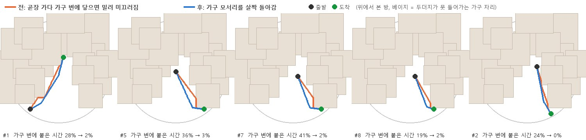
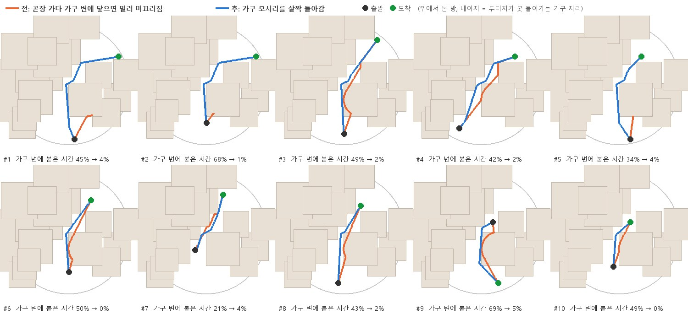

# 땅굴 방: 두더지가 가구를 돌아서 걷게 (2026-11-18)

## 요청
> 지금 두더지가 이동할대 직진으로만 이동하려는 오류가 있어. 예를들어 어떤 부분을 클릭해서 그곳으로 갈때 중간에 가구가 있다면 돌아서 가지 못하고, 일직선 경로로 가다가 미끄러지는 느낌이야. 중간에 가구가 있다면 슬쩍 돌아가게 만들어봐

## 원인
- 바닥을 누르면 `moleActor walkStep` 이 누른 곳을 향해 **곧장** 걸었음
- 가구마다 두더지가 못 들어가는 바닥 사각형(발자리, `roomScene` 의 `feet`, 두더지 반지름만큼 넓힘)이 있고, 걷는 동안 매 프레임 `clampRoom` 이 발자리 안에 들어간 두더지를 **가장 가까운 변으로 밀어냄** (남의 땅굴에서는 집주인 두더지 둘레 원에서도 밀어냄)
- 그래서 가구에 닿으면 몸은 원래 방향을 보는데 위치는 변을 따라 옆으로 밀려남 → "미끄러지는 느낌". 모서리를 못 넘으면 0.5초 뒤 그 자리에서 멈춤 (남의 땅굴에서 10번 중 3번)

## 고친 것
- **`three/roomPath.ts` (새로)**: 걷기를 시작할 때 길을 한 번 정함
  - 곧장 갈 수 있으면 예전과 같음 (점 하나)
  - 막혀 있으면 발자리 사각형 모서리에서 12cm 바깥(`CORNER`)에 점을 찍고, 서로 보이는 점끼리 이은 그래프에서 가장 짧은 길 (A*). 방은 둥근 볼록 모양이라 방 밖 모서리 점만 뺌
  - 경계 위 점(clampRoom 이 변으로 민 도착점)은 막힌 것으로 안 보고, 출발점이 이미 발자리 안이면(방석에서 일어난 자리 등) 빠져나오는 길은 막지 않음
  - 길이 없으면 `null` → 예전처럼 곧장 (clampRoom 이 그대로 지켜 줌)
- **`moleActor walkStep`**: 점들을 차례로 따라감. 걷는 동안 **다음 점이 바로 보이면 앞당겨 넘어가서** 모서리를 살짝 둥글게 돎. 모서리를 도는 중에는 멈춰서 제자리 돌기 대신 속도만 줄이며 돎 (몸 돌리는 속도도 조금 빠르게). `nav` 옵션이 없으면(탐색 들판 · 찻방) 예전 그대로
  - 처음에는 "지금 점에 20cm 안으로 오면 다음 점으로"도 넣었는데, 안 보이는 다음 점으로 일찍 꺾어 모서리를 파고들어 다시 미끄러짐(남의 땅굴 #9, 변에 붙은 시간 54%) → 5cm(거의 도착)로 줄임
- **`roomScene`**: 장애물 = clampRoom 과 같은 가구 발자리 + 집주인 두더지 자리(둥근 자리를 감싸는 네모, 방문자 뷰)
- 걷기를 쓰는 곳 모두 적용: 바닥 누르기, 가구 누르기(앞까지 걸어가기 · 방석 앉으러 가기 · 커피), 인사하러 가기
- 손잡이: `?nav=0` 예전처럼 곧장 (비교용), `?navdbg=1` 시험용 `window.__roomNav`(두더지 자리 · 장애물 · 걷기 · 바닥 점의 화면 좌표)

## 확인 (헤드리스 크롬, 실제 앱)
방 두 개: 내 땅굴 `/burrow`(관심사 10개라 가구가 많음) · 남의 땅굴 `/burrow/yerin`(집주인 두더지가 방 가운데 앞쪽에 서 있음).
빈 바닥 점(0.25m 격자) 가운데 **곧장 가면 가구에 막히는 두 점** 10쌍씩 골라, 같은 쌍을 전(`?nav=0`)과 후로 걸어 보고 자취를 기록. "가구 변에 붙은 시간" = 두더지가 발자리 경계 1cm 안에 있던 시간 비율 (밀려 미끄러지는 시간)

| 10쌍씩 | 전 | 후 |
|---|---|---|
| 내 땅굴 · 가속 켬: 도착 | 10/10 | 10/10 |
| 내 땅굴 · 가속 켬: 가구 변에 붙은 시간 (가운데 / 가장 많이) | 19% / 41% | **2% / 3%** |
| 남의 땅굴 · 가속 켬: 도착 | **7/10** (3번은 중간에 멈춤) | 10/10 |
| 남의 땅굴 · 가속 켬: 가구 변에 붙은 시간 (가운데 / 가장 많이) | 49% / 69% | **2% / 5%** |
| 가속 끔 (같은 쌍) | 내 땅굴 10/10 · 21% / 42%, 남의 땅굴 7/10 · 49% / 69% | 내 땅굴 10/10 · **2% / 3%**, 남의 땅굴 10/10 · **4% / 5%** |

내 땅굴 (주황 = 전, 파랑 = 후)

남의 땅굴 (가운데 큰 네모 = 집주인 두더지 자리)

- 전에는 대각선으로 가다 가구 변에 닿으면 직각으로 꺾여 변을 따라 밀려 감. 남의 땅굴에서는 집주인 두더지 둘레를 따라 미끄러지다 멈추기도 함. 후에는 모서리 앞에서 미리 둥글게 돎. 내 땅굴에서 걸은 거리는 전과 거의 같음 (쌍마다 차이 0.08m 안)
- 실제 마우스 클릭(화면 좌표로 바닥을 누름)으로도 가구 반대편 점에 정확히 도착 (오차 0, 내 땅굴 3.9초 · 남의 땅굴 6.3초)
- 길 계산은 클릭 한 번에 한 번 (가구 20개 기준 10ms 미만, 단위 시험), 걷는 동안은 프레임마다 선분 하나 검사
- `npm test` 267 통과 (새 `room-path.test.ts` 9개), 스모크 가속 켬 · 끔 · WebGL 없음 98/98
- 다시 재기: `tools/room-path/nav-check.mjs` (사용법은 파일 머리), 그림 `nav-plot.py`

## 시험
- `src/tests/room-path.test.ts` 9개: 곧장 · 모서리 돌기 · 짧은 쪽 · 틈 지나가기 · 벽에 붙은 가구 · 갈 수 없는 곳(null) · 경계 위 도착점 · 가구 안에서 출발 · 속도

## 남은 것
- 가구 발자리가 축에 맞춘 네모라, 비스듬히 놓인 관심사 가구는 실제보다 조금 넓게 피함 (예전 clampRoom 과 같은 기준)
- 방향키 조종은 그대로 (누르는 방향으로 가다 가구에 닿으면 밀림. 직접 조종이라 길 찾기를 넣지 않음)

## 배포
- 같은 날 사용자 "응 다 올려줘" → 시험판 version 6 · 팀 링크 version 37 (main 4700b6d 공유 빌드, 두 링크 파일 목록 = 빌드 186개 + index.html 확인)
