# 잇팅 (it-ting) 프로토타입 — legacy

> **보관용입니다.** 2026-11-10에 디자인 기준이 Figma "03. Screens"로 바뀌면서 이 폴더의 단일 HTML 시안들은 더 이상 고치지 않습니다.
> 지금 개발 중인 앱(디굴디굴)은 [저장소 루트 README](../README.md)와 `app/`을 보세요. 아래 명령은 모두 `legacy/` 폴더 안에서 실행합니다.

관심사 기반 커뮤니티 **잇팅**의 UI/UX 프로토타입입니다. 가입할 때 고른 관심사로 3D 방(두더지 시안에서는 굴)이 자동으로 만들어지고, 서로의 방을 구경하다가 1:1 대화와 모임으로 이어지는 흐름을 보여 줍니다. 팀원에게 화면, 흐름, 색·타이포 시스템을 공유하려고 만들었습니다.

강화하려는 차별점은 세 가지입니다.

1. **부담 없는 첫 대화**: 방에 놓인 소품과 그 사연이 말을 거는 계기가 됩니다.
2. **내향적인 사람도 편하게**: 구경, 제스처, 공감, 명함처럼 말하지 않고도 관계를 시작할 수 있는 단계가 있습니다.
3. **니치한 취미 발견**: 사람이 적은 태그일수록 가중치를 높게 줘서, 드문 취미를 가진 사람끼리 먼저 만나게 합니다.

## 버전 한눈에 보기

| 버전 | 파일 | 핵심 |
|---|---|---|
| v1 | (파일 없음) | 화면 전체 + 색·타이포 시스템 + 디자인 시스템 페이지 |
| v2 | [`archive/itting-v2.html`](archive/itting-v2.html) | 첫 대화 지원(관계 단계·넛지), 니치 매칭, 방 주인 경험, 알림 센터 |
| v3 | [`itting-prototype.html`](itting-prototype.html) | 방 무드 10종, 벽 장식, 소품 66종, 관심 분류 11개, 샘플 방 14개 |
| 두더지 시안 | [`itting-mole.html`](itting-mole.html) | v3에서 갈라진 세계관 변형. 두더지가 관심사 밭을 걷다가 남의 굴을 파고 들어감 |
| 밤티 두더지 | [`itting-mole-v2.html`](itting-mole-v2.html) | 두더지 시안을 귀엽고 어이없게. 짝짝이 눈 아기 두더지, 흙 동굴 굴, 삐뚤빼뚤 손글씨 UI (리뷰: 귀엽지 않고 너무 덜떨어지게 나옴) |

모든 버전은 HTML 파일 하나로 되어 있고, 외부 의존성은 Google Fonts와 three.js r128뿐입니다.

---

## v1: 첫 화면 구성

방을 프로필로 쓰는 기본 구조를 잡은 버전입니다. 저장소에는 v1 파일이 남아 있지 않고, 그 위에 기능을 더한 v2부터 보관되어 있습니다.

- 온보딩(닉네임 → 관심사 → 방 자동 생성), 내 방, 둘러보기, 남의 방 구경, 대화, 모임 화면
- Moss(차분한 초록, 주요 동작)와 Lamp(따뜻한 노랑, 사람이 닿는 순간) 두 색을 중심으로 한 컬러 시스템
- Hahmlet(제목) · IBM Plex Sans KR(본문) · IBM Plex Mono(숫자) 타이포
- 컬러, 타입 스케일, 컴포넌트를 모은 디자인 시스템 페이지

## v2: 첫 대화와 니치 매칭

"처음 말 거는 부담"과 "드문 취미 찾기"를 화면 단위로 풀어낸 버전입니다.

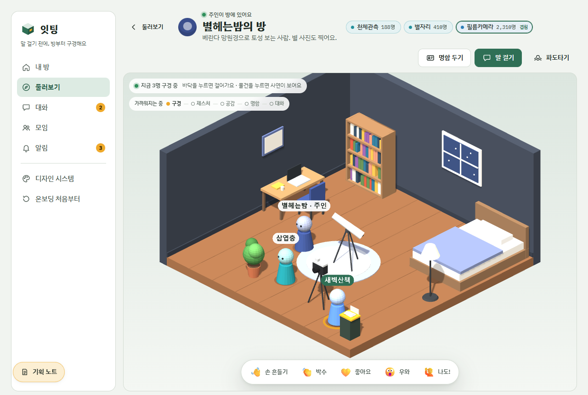

- **가까워지는 단계**: 구경 → 제스처 → 공감 → 명함 → 대화. 어느 단계에서 멈춰도 괜찮다는 걸 화면에 보여 줍니다.
- **넛지**: 방 주인이 손을 흔들어 답하면, 겹치는 취미와 관련된 사연을 골라 "이 사연 보고 이야기해 볼까요?"라고 살짝 제안합니다.
- **사연으로 말 걸기**: 소품 사연에서 대화를 시작하면 첫 메시지에 사연 카드가 붙습니다.
- **니치 매칭**: 추천 점수 = Σ(겹치는 태그마다 1 + 1000 / 태그 인원). 화석수집(23명)이 겹치면 시티팝(1,240명)이 겹칠 때보다 훨씬 위로 올라갑니다. 둘러보기 맨 위에 "취향 짝꿍"이 나옵니다.
- **방 주인 경험**: 방 기록(다녀간 사람 · 받은 공감 · 받은 명함), 실시간 입장 알림, "조용히 있기" 모드
- **알림 센터**: 방문, 명함, 공감, 메시지, 취향 매칭, 모임 일정 알림을 모으고, 방문 알림은 하루 한 번 요약으로 받을 수도 있습니다.
- 취미 상세 페이지, 빠른 답장("나중에 답할게요"), 차단·신고

| 내 방 | 둘러보기 |
|---|---|
| 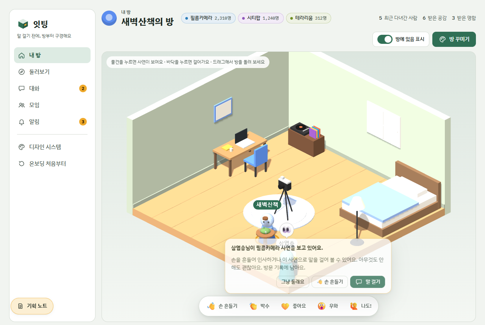 | 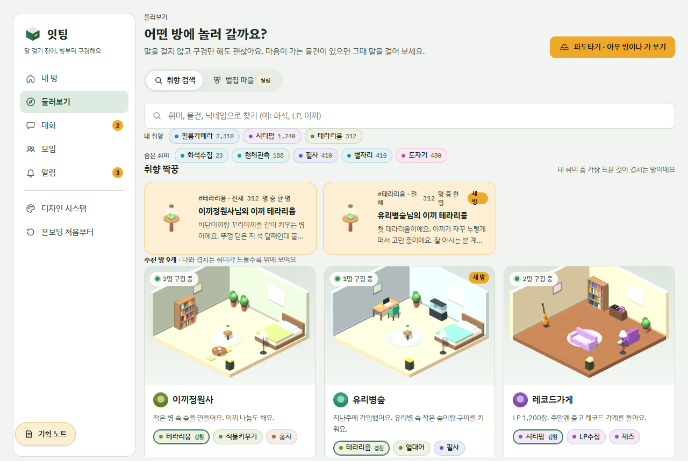 |

> v2에는 모달 배경이 `hidden` 속성을 무시하고 화면을 덮는 버그가 있습니다(v3에서 수정). 위 스크린샷은 보관 파일은 그대로 두고, 찍을 때만 v3의 수정 한 줄을 적용해서 찍었습니다.

## v3: 취향이 보이는 방

방 안 인테리어로 "무엇을 좋아하는 사람인지"가 바로 보이게 만든 버전입니다. 지금 팀에 공유된 기준 버전입니다.

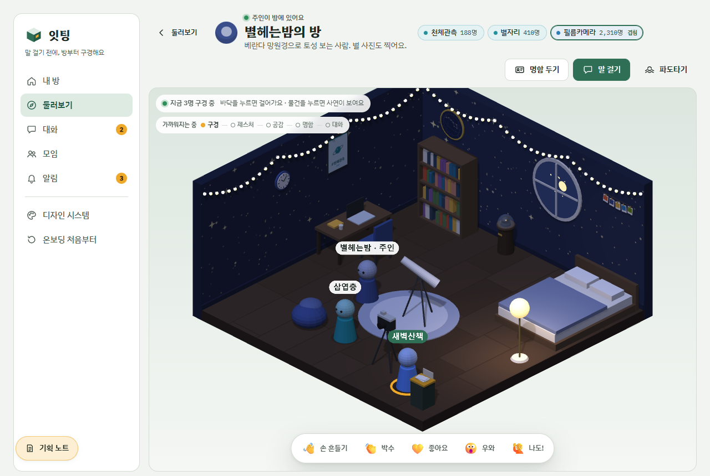

- **방 무드 10종**: 숲속 오두막, 북유럽 화이트, 레트로 팝, 네온 아케이드, 빈티지 서재, 밤하늘 관측소, 작은 온실, 다다미 방, 공방 작업실, 파스텔 원룸. 무드 하나가 벽지 · 바닥 · 조명 · 창문 · 가구 나무색 · 침대와 스탠드 모양을 한꺼번에 정합니다.
- **자동 생성**: 가장 무거운 취향 분류(드문 태그일수록 무거움)로 무드를 고릅니다. 가장 드문 태그 2개는 벽 포스터가 되고, 포스터에는 그 취미를 가진 사람 수가 적힙니다.
- **벽 장식 16종 + 천장 띠 장식**, 벽 장식 자리 7곳
- **소품 24종 → 66종**: 개미 사육장(48명), 아마추어 무선(57명), 운석(31명)처럼 드문 취미에도 전용 소품이 있습니다.
- 관심 분류 3개 추가(운동·아웃도어, 영화·애니, 반려동물), 태그 약 60개, 샘플 방 14개
- 꾸미기 패널 3탭: 물건 추가 / 무드 · 벽 · 바닥 / 벽 장식

| 온보딩 | 내 방 |
|---|---|
| 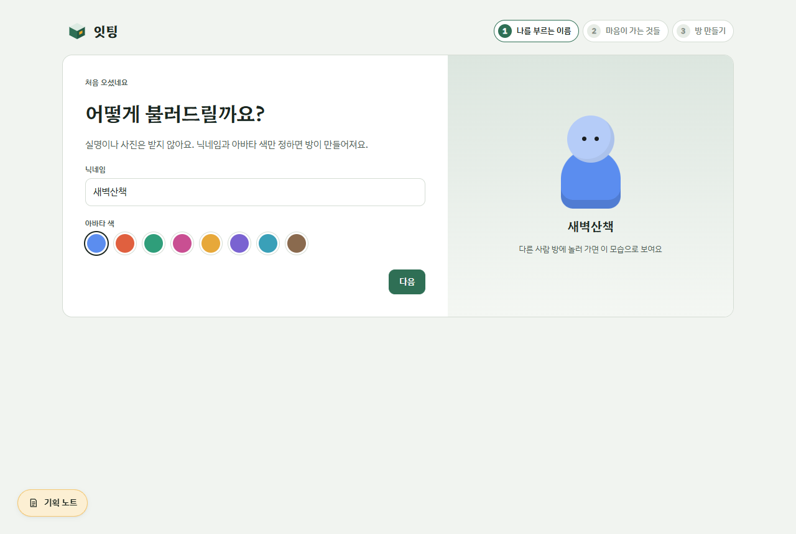 | 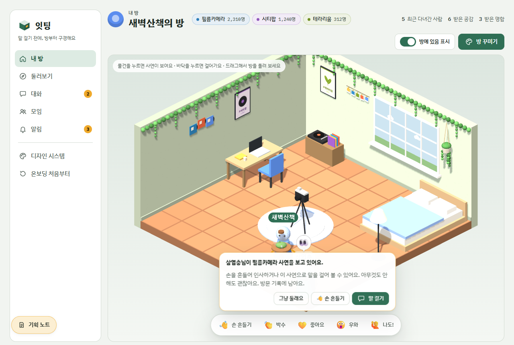 |

| 둘러보기 | 디자인 시스템 |
|---|---|
| 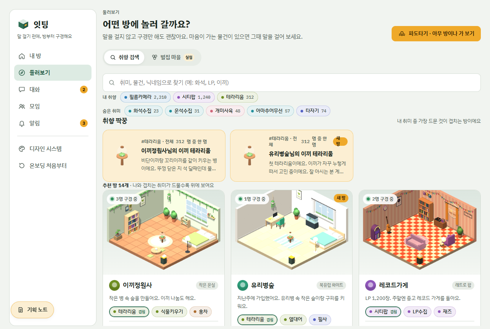 | 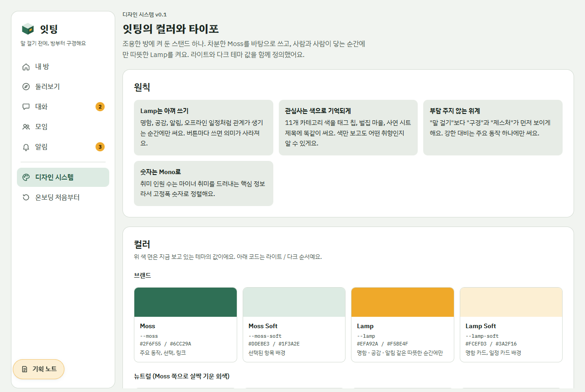 |

## 두더지 시안: 관심사 밭과 굴

v3를 기반으로 세계관을 바꿔 본 별도 시안입니다. v3를 대체하지 않고 나란히 비교하려고 따로 만들었습니다.

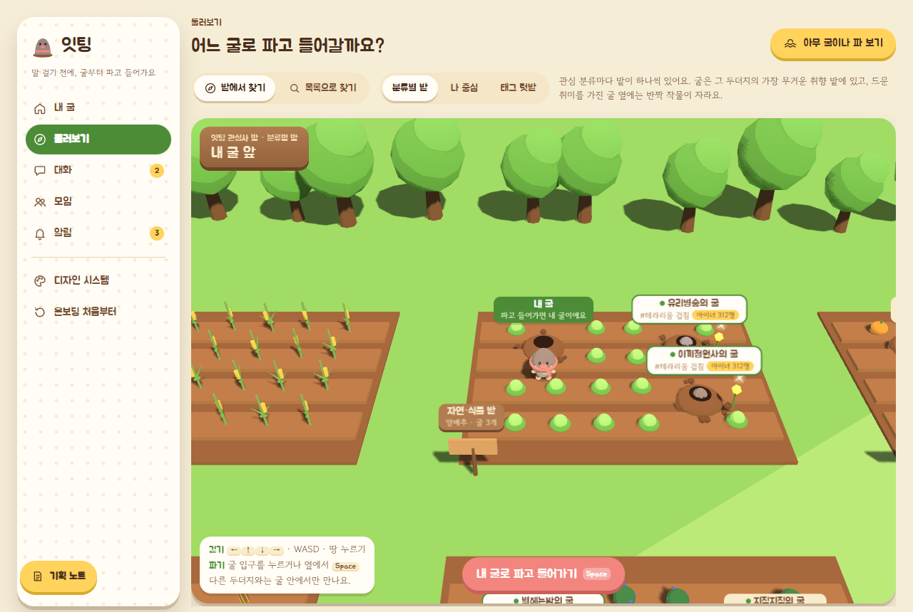

- **캐릭터는 두더지**: 온보딩에서 털 색과 목도리 색을 고릅니다. 목도리 색은 굴 안 소품의 포인트 색으로도 쓰입니다.
- **밭에서 찾기**: 땅 위의 "관심사 밭"을 방향키·WASD·클릭으로 걷습니다. 다른 두더지는 보이지 않고 굴 입구(흙무더기)만 보여서, 마주칠 걱정 없이 산책할 수 있습니다. 주인이 접속해 있으면 가끔 굴 밖으로 고개를 내밉니다.
- **파고 들어가기**: 굴 입구를 누르거나 옆에서 Space를 누르면, 엉덩이를 씰룩이며 땅을 파는 연출 뒤에 그 두더지의 굴로 들어갑니다. 남의 공간에 들어가는 순간을 장난스럽게 만들어 문턱을 낮추려는 의도입니다.
- **천장에서 쿵**: 굴에 도착하면 천장에서 떨어지고, 주인이 있으면 깜짝 놀라 점프합니다. 먼저 말을 걸지 않아도 반응을 한 번 주고받은 상태로 시작합니다. "밭으로 올라가기"를 누르면 들어갔던 흙무더기에서 다시 튀어나옵니다.
- **굴 = 흙 단면 속의 방**: v3의 방 생성(무드, 소품, 벽 장식, 니치 가중치)은 그대로 두고, 바깥을 흙 층 · 뿌리 · 개미굴이 보이는 단면과 위쪽 풀밭으로 감쌌습니다.
- **밭 배치 3종 비교**: 아래 세 가지를 둘러보기 화면에서 바꿔 볼 수 있습니다.

| 분류별 밭 | 나 중심 | 태그 텃밭 |
|---|---|---|
|  | 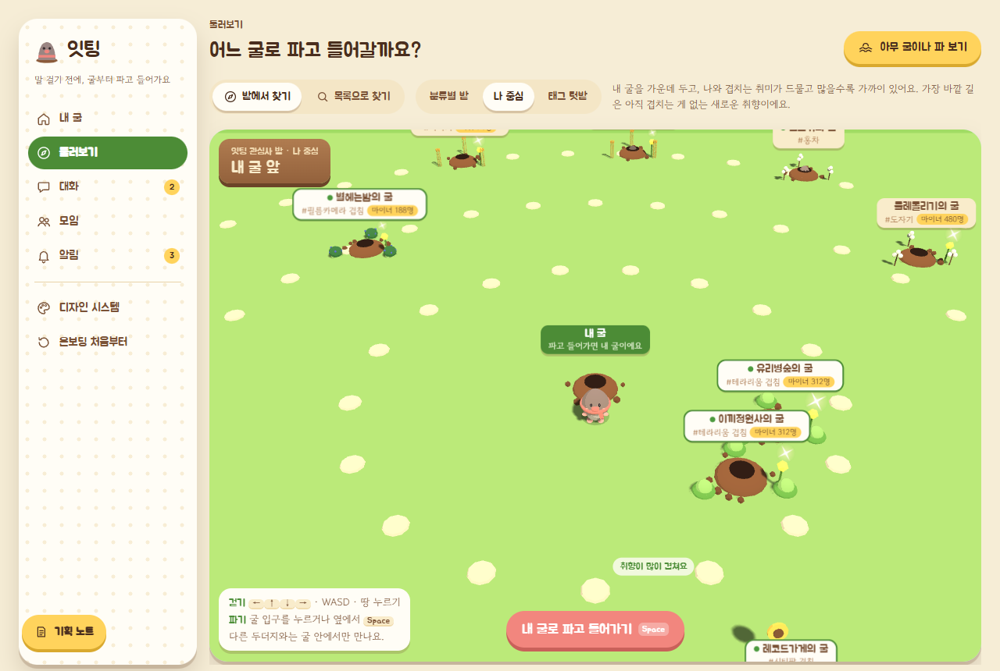 | 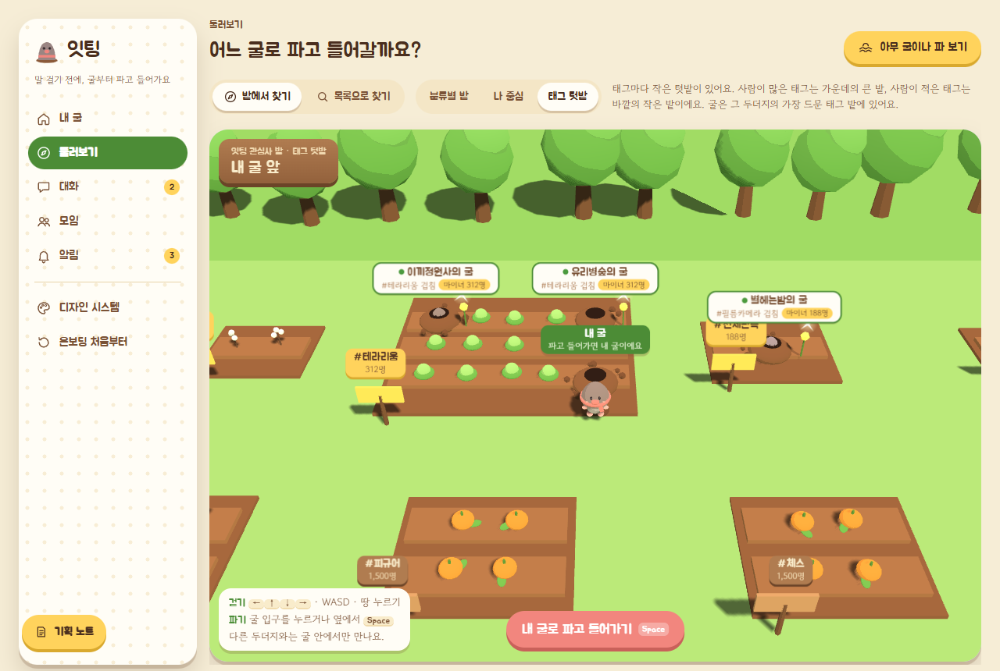 |
| 관심 분류마다 작물이 다른 밭(음악은 해바라기, 게임은 호박 등). 굴은 그 두더지의 가장 무거운 취향 밭에 있고, 드문 취미(500명 미만)를 가진 굴 옆에는 반짝 작물이 자랍니다. | 내 굴을 가운데 두고, 겹치는 취미가 드물고 많을수록 가까이 있습니다. 가장 바깥 길은 아직 겹치는 게 없는 새로운 취향입니다. | 태그마다 작은 텃밭이 있습니다. 사람이 많은 태그는 가운데의 큰 밭, 사람이 적은 태그는 바깥의 작은 밭입니다. 굴은 가장 드문 태그 밭에 있습니다. |

- **비주얼**: 동글동글한 Jua(제목·버튼·숫자)와 Gowun Dodum(본문), 잎사귀 초록 · 종 노랑 · 딸기 분홍에 모래·나무껍질 뉴트럴, 툰 셰이딩, 아래 그림자가 있는 알약 버튼. 다크 테마는 "밤의 굴"입니다.
- UI 문구의 "방"은 "굴"로 바꿨고, 둘러보기는 "밭에서 찾기"(기본)와 "목록으로 찾기"(v3 검색)로 나뉩니다.

| 온보딩 | 내 굴 |
|---|---|
| 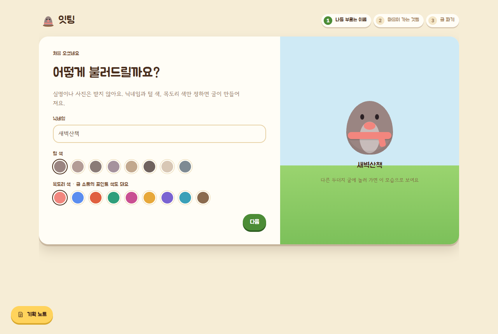 | 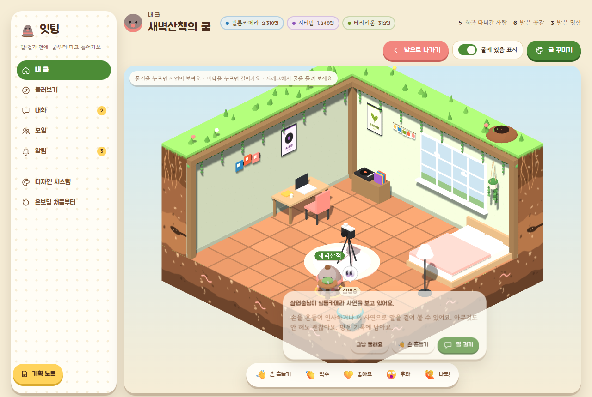 |

| 남의 굴 | 디자인 시스템 |
|---|---|
| 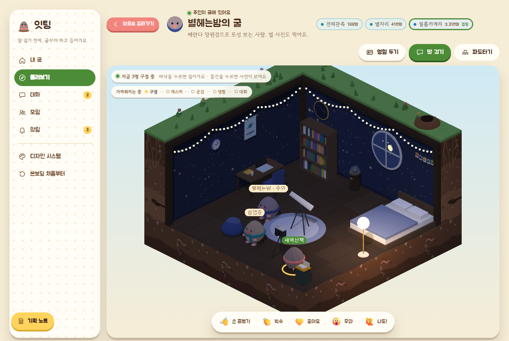 | 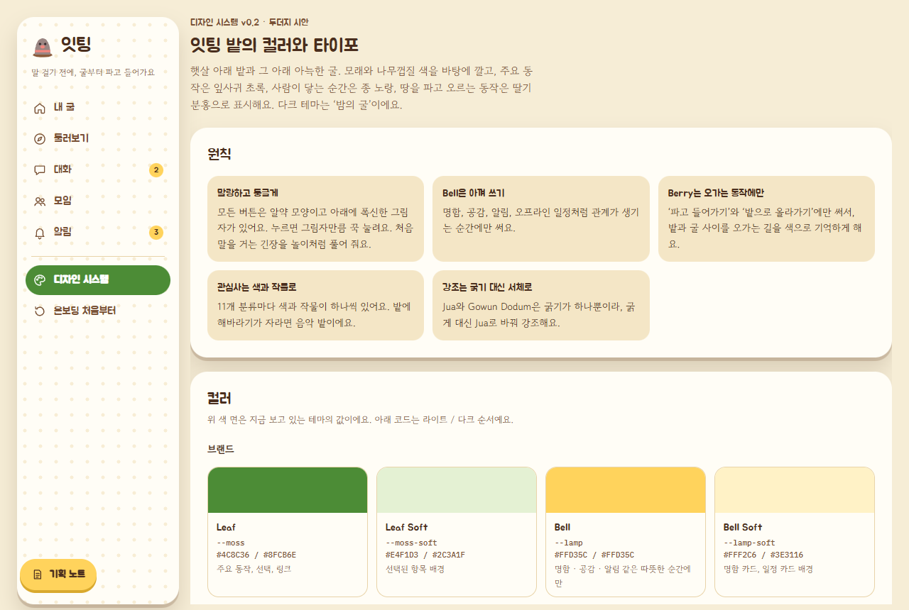 |

> 스크린샷은 정지 화면이라 파고들기, 천장에서 떨어지기 같은 애니메이션은 담기지 않았습니다. 남의 굴 스크린샷은 떨어지는 연출을 끄고 찍었습니다. 직접 실행해서 확인해 주세요.

## 밤티 두더지: 귀엽고 어이없게

두더지 시안을 "밤티 나게" 바꾼 버전입니다. 대충 만든 것 같은 어설픔과 조금 모자라 보이는 캐릭터로 "실수해도 괜찮은 곳"이라는 분위기를 만들고, 지켜 주고 싶은 마음이 들게 하는 게 목표입니다. 밭 배치 3종, 파고들기, 천장에서 떨어지기 같은 흐름은 두더지 시안과 같습니다.

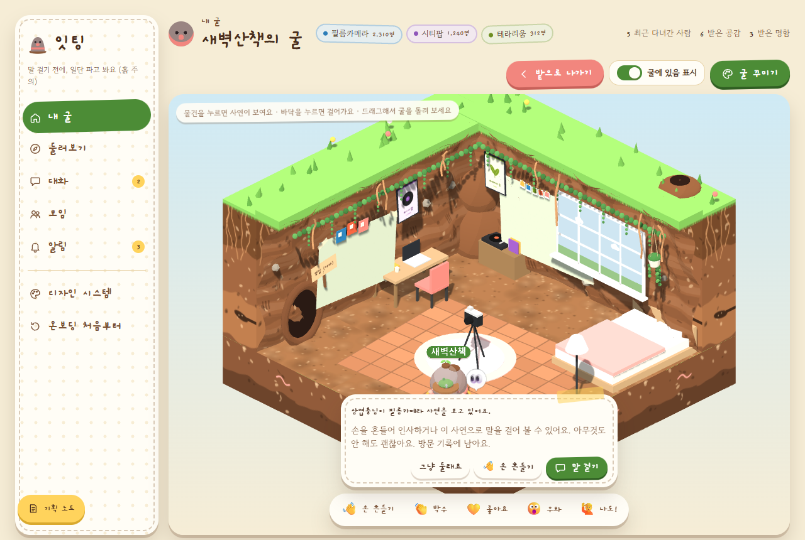

- **두더지**: 머리가 크고 몸이 짧은 아기 비율에, 크기도 높이도 다른 짝짝이 눈과 뻐드렁니 두 개가 있습니다. 머리에는 새싹, 흙덩이, 돌멩이가 붙어 있고, 목도리는 삐뚤게 매고 있습니다. 눈은 느리게 깜빡이고 가끔 한쪽만 감습니다.
- **자주 넘어짐**: 밭에서도 굴 안에서도 걷다가 가끔 앞으로 철퍼덕 엎어졌다가 부르르 털고 일어납니다("꽈당", "철퍼덕"). 다른 두더지도 굴 안을 돌아다니다 넘어집니다.
- **굴 = 대충 파낸 흙 동굴**: 평평한 벽 대신 울퉁불퉁한 흙벽이 위로 갈수록 방 쪽으로 말려 들어옵니다. 천장 처마에서 뿌리가 늘어지고, 벽에는 돌멩이와 삽질 자국이 있고, 옆에는 "옆집 (아마)" 팻말이 붙은 굴 구멍이 있습니다. 무드 벽지는 테이프로 대충 붙인 조각으로, 무드 바닥은 삐뚤게 깐 장판으로 남겼습니다.
- **밤티 UI**: 제목·버튼·칩을 손글씨 서체(Gaegu Bold)로 바꾸고, 1~2도씩 기울였습니다. 카드 테두리는 바느질한 점선이고, 군데군데 테이프가 붙어 있습니다. 버튼에 마우스를 올리면 흔들립니다.
- **어이없는 문구**: "어디를 파 볼까요? (아무 데나 파도 됨)", "아무 데나 막 파기", "굴 파다가 길 한 번 잃는 중", "퐁! 밭으로 올라왔어요. 입에 흙 들어감" 같은 문구로 바꿨습니다.

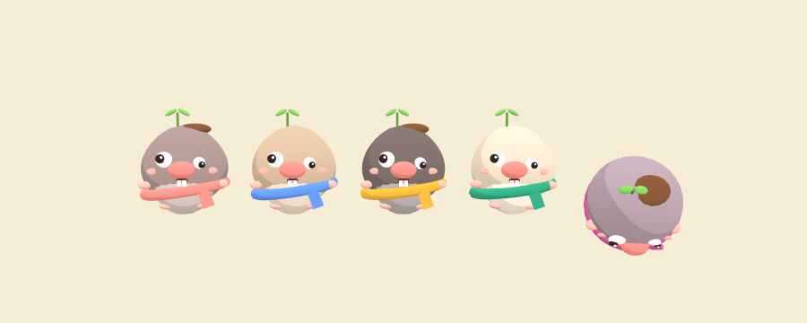

| 밭 둘러보기 | 남의 굴 | 온보딩 |
|---|---|---|
| 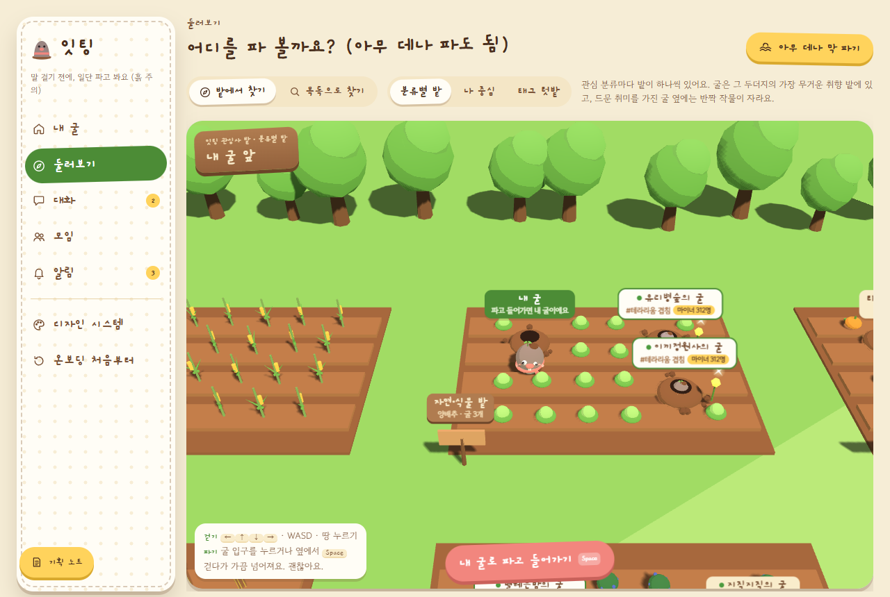 | 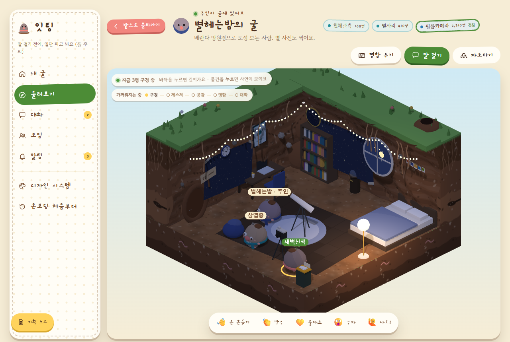 | 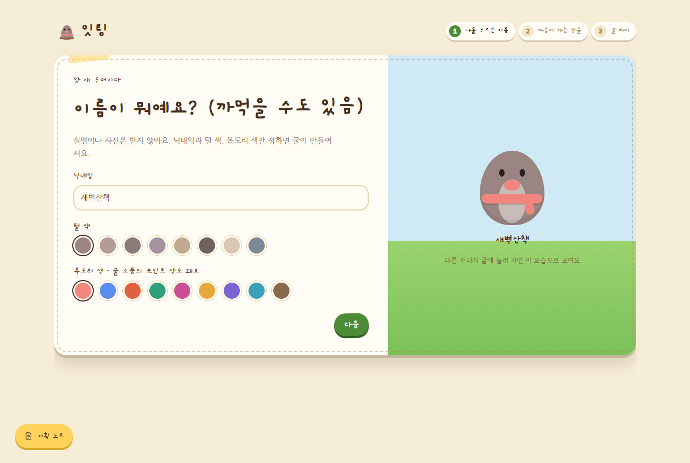 |

### 리뷰

- 귀엽지 않고 너무 덜떨어지게 나왔다

---

## 실행 방법

파일에 `<html>/<head>/<body>` 태그가 없어서(Claude 아티팩트로 게시할 때 자동으로 붙음) 로컬 서버로 감싸서 띄웁니다.

```bash
node tools/serve.js                          # v3      → http://127.0.0.1:5178
PORT=5179 node tools/serve.js itting-mole.html          # 두더지 시안
PORT=5181 node tools/serve.js itting-mole-v2.html       # 밤티 두더지
PORT=5180 node tools/serve.js archive/itting-v2.html    # v2
```

주소 뒤에 해시를 붙이면 해당 화면으로 바로 갑니다: `#onboarding`, `#my-room`, `#explore`, `#visit`, `#chat`, `#groups`, `#notifications`, `#system`

화면 왼쪽 아래의 **기획 노트** 버튼을 누르면 화면마다 기획 의도와 MVP 구현 메모를 볼 수 있습니다.

## 폴더 구조

```
itting-prototype.html   v3 (기준 버전)
itting-mole.html        두더지 시안
itting-mole-v2.html     밤티 두더지
archive/itting-v2.html  v2 보관본
tools/serve.js          로컬 미리보기 서버
docs/screenshots/       README용 스크린샷
../CLAUDE.md            작업 인수인계 문서 (저장소 루트, legacy 구조·데이터·주의할 점 포함)
```
