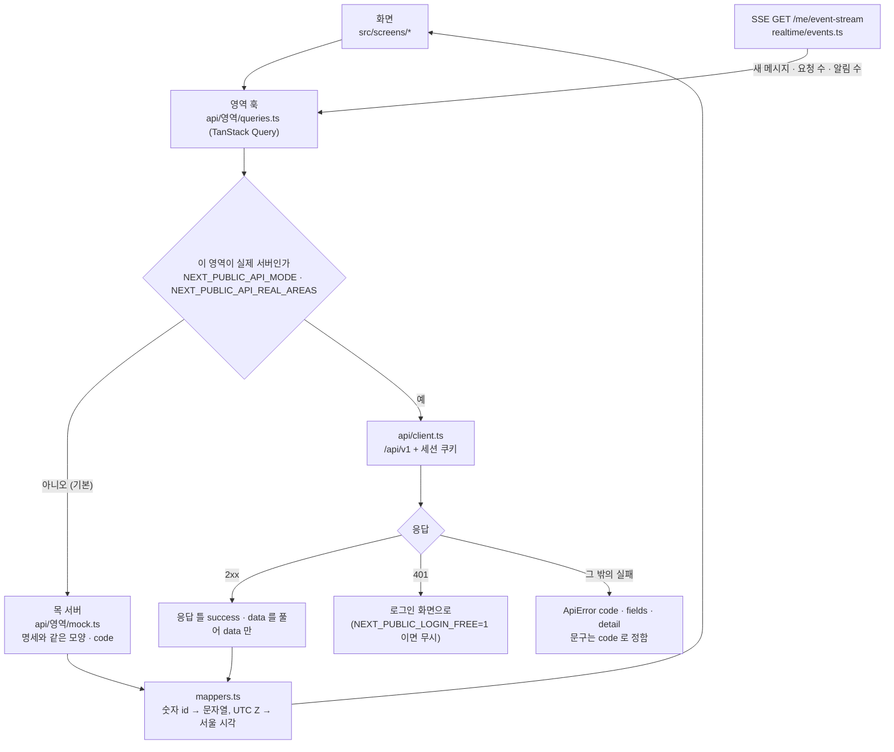
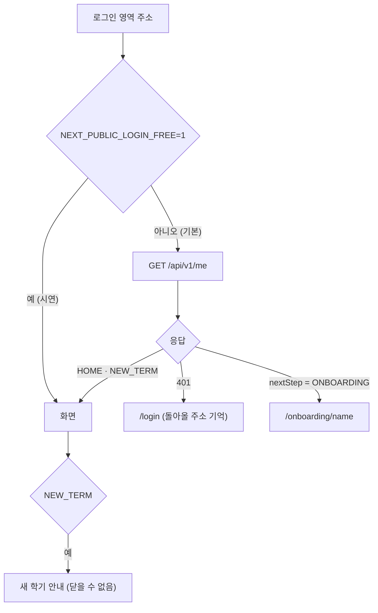

# KAN-64 프론트엔드 프로토타입 이전 (Next.js)

- Jira: [KAN-64](https://it-ting.atlassian.net/browse/KAN-64)
- 브랜치: `chore/fe/KAN-64-frontend-import`

## 계획

### 목표

프로토타입 리포(`min9u/it-ting-prototype`)에서 만든 웹 프론트엔드를 이 리포 `frontend/`에 넣는다. 서비스 명세(`docs/spec/`)와 API 명세(`docs/api/`, 111개)에 맞춘 화면 48개(같은 주소)와 3D 땅굴 · 탐색 들판, 목 서버, 실시간 소식(SSE) 연결이다.

- Next.js 16.4 (App Router) · React 19.3 · TypeScript 6.0 (strict) · TanStack Query 5 · three.js 0.165 · CSS Modules · vitest
- 처음에는 모든 영역이 목 서버로 돈다. 백엔드가 만든 영역은 `NEXT_PUBLIC_API_REAL_AREAS`로 하나씩 실제 서버에 붙인다

범위 밖:
- 실제 백엔드로 로그인 · 온보딩 · 땅굴 · 게시판 · 알림 확인 (다음 티켓, 영역별. 이번에는 목 서버로 모든 화면을 확인)
- 배포(서버 · 도메인 · Nginx). 설정 예시만 프로토타입 리포에 있음
- 프론트 코드 규칙 확정(KAN-4)
- 프로토타입 리포의 예전 이력(커밋 300여 개). 서명할 수 없는 다른 사람 커밋이 섞여 있고 메시지 형식이 달라 옮기지 않는다. PR 본문에 원래 리포 링크를 남긴다

### 정한 것

| # | 질문 | 정한 답 | 정한 사람 |
|---|---|---|---|
| 1 | 프레임워크 | Next.js App Router. 화면은 거의 클라이언트 컴포넌트, three.js 는 브라우저에서만 불러옴 | 사용자 (2026-11-22) |
| 2 | 커밋 나누기 | 화면 · 기능 하나에 커밋 하나(62개), PR 하나. 커밋마다 tsc · 린트(오류 0) · 테스트 · 빌드 통과 | 사용자 (2026-11-22) |
| 3 | 기준 문서 | 서비스 명세가 기준. API 명세에 맞추고, 명세에 없는 기능(차단 · 모임 신고 · 접속 중 표시 · 꾸미기 소품 · 색 탭 등)은 뺐다 | 사용자 (2026-11-22) |
| 4 | 실험실(저사양 패널 · 목 서버 손잡이 · `/lab/*` · `/screens` · `/dev/crash`) | `next dev`에서만 켜지고 배포 빌드에는 코드까지 빠짐(`page.lab.tsx`, `NEXT_PUBLIC_LABS`). CI 가 빠졌는지 검사 | 사용자 (2026-11-22) |
| 5 | 꾸미기 가구 탭 | 뺌 (명세 dev 9ea6698: 가구는 고르지 않음) | 사용자 (2026-11-23) |
| 6 | 안 쓰는 파일(소품 썸네일 131개 등) | 옮기기 전에 지움 | 사용자 (2026-11-23) |
| 7 | Jira | 새 티켓 KAN-64. KAN-25(Next.js 프로젝트 초기 설정)의 작업 내용이 이 이전에 모두 들어가 "관련" 링크로 걸어 둠. KAN-25 를 닫을지는 담당자와 정함 | 사용자 (2026-11-23 · 11-24) |
| 8 | 로그인 검사 | 환경 변수 `NEXT_PUBLIC_LOGIN_FREE`. 기본은 명세대로 검사(비로그인 → 로그인, 온보딩 안 끝남 → 온보딩, 401 → 다시 로그인), `1`이면 시연용으로 모두 열림 | 사용자 (2026-11-23) |
| 9 | PR 수 | 하나. 본문에 커밋 묶음 표로 리뷰 순서를 안내 | 사용자 (2026-11-23) |
| 10 | 실제 백엔드 연결 확인 | 다음 티켓(영역별). 이번에는 목 서버로 전 화면 확인 | 사용자 (2026-11-23) |
| 11 | 한 파일에 여러 화면이 든 곳(로그인 · 회원가입 · 비밀번호 찾기, 게시판 · 글쓰기 · 내 활동) | 파일을 나누지 않고, 뒤 화면 커밋은 주소(`page.tsx`)만 넣고 본문에 까닭을 적음 | 사용자 (2026-11-23) |
| 12 | 기준 명세 버전 | `dev` `61e6c10`(KAN-54 병합)까지 반영. 이후 바뀌면 PR 전에 다시 맞춤 → PR 중에 `2862f69`(KAN-58 · KAN-52 · KAN-26 · KAN-59 · KAN-46 병합)까지 확인해 맞춤 | 사용자 (2026-11-23) |
| 13 | 버전 · 패키지 매니저 | Next.js 16.4.6 · npm · Node 24.18(`frontend/.nvmrc`). 이 조합으로 테스트 · 스모크 · CI(우분투, Node 24)까지 통과. KAN-25에서 다르게 정했다면 그쪽을 따른다 | 사용자 (2026-11-24, 제안대로) |
| 14 | 린트 | Next 기본 규칙 + React Compiler 규칙은 경고로(지금 경고 55, 오류 0). CI 는 오류만 막음. React Compiler 규칙을 오류로 하면 three.js · 애니메이션 코드 대부분을 다시 써야 해서, 코드 규칙(KAN-4)에서 정할 때 맞춘다 | 사용자 (2026-11-24, 제안대로) |
| 15 | 큰 파일 | 3D 모델 · 텍스처 약 13MB 를 Git LFS 없이 그대로. LFS 는 CI · 클론 설정이 늘고, 모델이 자주 바뀌지 않는다 | 사용자 (2026-11-24, 제안대로) |
| 16 | 프론트 테스트가 팀 명세를 읽음 | `docs/api` · `docs/spec`을 직접 읽어 API 111개 · 관심사 · 알림 종류를 대조(유지). 명세가 바뀌면 프론트 CI 가 알려 준다. 백엔드 PR 에서는 이 CI 가 돌지 않아(경로 `frontend/**`) 다음 프론트 PR 에서 드러난다 | 사용자 (2026-11-24, 제안대로) |
| 17 | 리포 바깥 파일 | `.github/workflows/frontend-ci.yml` 새 파일(타입 → 린트 → 테스트 → 배포 빌드 → 실험실 빠짐 검사, 백엔드 CI 와 같은 꼴), `AGENTS.md` 저장소 지도의 `frontend/` 한 줄 | 사용자 (2026-11-24, 제안대로) |
| 18 | 명세와 다르게 둔 것 · 백엔드에 물을 것 | PR 본문에 목록 링크만 두고, 정하는 것은 다음 티켓(관심사 `code` 칼럼, 채팅 메시지 멱등 키, SSE 와 세션 연장 등). 화면 동작은 지금 명세대로 돌아간다 | 사용자 (2026-11-24, 제안대로) |
| 19 | KAN-25(Next.js 프로젝트 초기 설정) | 이 작업에 KAN-25 의 일(App Router · strict TS · ESLint · TanStack Query)이 모두 들어간다. Jira 에 "관련" 링크를 걸었고, 이 PR 이 병합되면 KAN-25 도 닫자고 담당자에게 제안한다 | 사용자 (2026-11-24, 제안대로) |
| 20 | 방문자가 자기 방명록 글을 지울 때의 확인 문구(명세 05 "아직 정하지 않은 것") | "내가 남긴 방명록을 삭제할까요?" / "이 땅굴에서 사라지고 되돌릴 수 없어요." / 취소 · 삭제. 명세 05 에 이 문구를 넣어 달라고 기획에 요청 | 사용자 (2026-11-24) |

### 만들 것

| 묶음 | 커밋 | 내용 |
|---|---|---|
| 설정 · 바탕 | 1 ~ 5 | Next 설정(첫 커밋만 빈 루트 레이아웃), 디자인 토큰 · 전역 CSS · Pretendard, 공통 유틸 · 관심사 태그(대분류 12 · 소분류 90) · 목 데이터 |
| 3D | 6 ~ 15 | 그래픽 성능 단계 · 3D 엔진 · 저사양 그리기(가속 꺼진 PC 대응), 두더지(glb · 동작 · 액세서리 41개), 땅굴 방 · 가구 배치 · 우체통, 탐색 들판(구멍 점프 · 줌 3단계 · 울타리), 찻방 |
| API | 16 ~ 33 | 클라이언트(`/api/v1`, 응답 틀 · `ApiError` · 401), 목 서버, 화면 이동 어댑터, 기본 UI 컴포넌트, SSE, 영역 11개(types · real · mock · mappers · queries) + 명세 대조 테스트, 실험실 스위치 |
| 앱 틀 | 34 ~ 35 | 에러 경계 · 없는 주소 · 오프라인 띠, 로그인 영역 틀 · 상단 메뉴 |
| 화면 | 36 ~ 57 | 랜딩 · 로그인 · 회원가입 · 비밀번호 찾기, 온보딩, 내 땅굴 · 방문, 탐색, 채팅, 모임, 게시판, 알림, 설정, 관리자, 실험실 |
| 테스트 · CI · 문서 | 58 ~ 62 | 여러 영역에 걸친 테스트, 화면 스모크 · 실험실 빠짐 검사 스크립트, CI, `frontend/README.md`, `AGENTS.md` 한 줄 |

커밋 62개의 제목 · 담는 것은 프로토타입 리포 `docs/team-import-rehearsal.md`에 표로 있다. 같은 결과를 `tools/team-import/import.mjs`로 다시 만들 수 있다.

### 테스트

| 확인 | 방법 | 기준 |
|---|---|---|
| 커밋마다 | `tsc --noEmit` · `eslint` · `vitest` · `next build` | 62개 모두 통과, 린트 오류 0 |
| 마지막 트리 | 단위 테스트 | 641개 통과 (2 todo) |
| 화면 | `npm run smoke` (헤드리스 크롬, 가속 켬 · 끔) | 화면 105개에서 예외 · 콘솔 에러 · 빈 화면 없음 |
| 실험실 | `npm run check:labs-off` | 배포 빌드에서 실험실 주소 404, 결과물에 실험실 코드 없음 |
| CI | PR 의 `frontend-ci` | 우분투 · Node 24 에서 통과 |
| 충돌 | `git merge-tree --write-tree HEAD origin/dev` | 충돌 없음 (`frontend/` 밖은 CI 파일 · `AGENTS.md` 한 줄뿐) |

## 결과

### 한눈에 보기

화면이 서버 값을 읽고 쓰는 길이다. 응답이 갈리는 곳은 마름모다.

로그인 영역에 들어갈 때(`screens/start/Guards.tsx` `RequireLogin`)다.

### 바꾼 것

| 묶음 | 커밋 | 내용 |
|---|---|---|
| 설정 · 바탕 | 1 ~ 5 | `frontend/` Next 설정, 디자인 토큰 · 전역 CSS · Pretendard, 공통 유틸 · 관심사 태그(대분류 12 · 소분류 90) · 목 데이터 |
| 3D | 6 ~ 15 | `src/three/`: 그래픽 성능 단계 · 저사양 그리기, 두더지(glb · 동작 · 액세서리 41개), 땅굴 방 · 가구 배치 · 우체통, 탐색 들판, 찻방 |
| API | 16 ~ 33 | `src/api/`: 클라이언트 · 목 서버 · 영역 11개(types · real · mock · mappers · queries) + 명세 대조 테스트, `src/realtime/` SSE, `src/lib/nav.tsx` 화면 이동 어댑터, 기본 UI 컴포넌트, 실험실 스위치 |
| 앱 틀 | 34 ~ 35 | 에러 경계 · 없는 주소 · 오프라인 띠, 로그인 영역 틀 · 상단 메뉴 |
| 화면 | 36 ~ 57 | `src/app/` 주소와 `src/screens/` 화면: 랜딩 · 인증 · 온보딩 · 내 땅굴 · 방문 · 탐색 · 채팅 · 모임 · 게시판 · 알림 · 설정 · 관리자 · 실험실 |
| 테스트 · CI · 문서 | 58 ~ 62 | 영역을 걸친 테스트, `scripts/smoke.mjs` · `scripts/check-labs-off.mjs`, `.github/workflows/frontend-ci.yml`, `frontend/README.md`, `AGENTS.md` 한 줄 |
| 로컬 리뷰 고침 | 64 ~ 68 | 아래 "확인한 것"의 P1 |
| 최신 명세 | 70, 84, 109, 113 | KAN-58: 푸시 공개 키가 없을 때(`null`) 알림 켜기 안내 / KAN-52: 가려진 글의 댓글 수정 실패 문구 / KAN-59: 브라우저 푸시를 알림 한 줄 모양으로 읽기(서비스 워커) / KAN-46: 탐색 방노트에 주인 자기소개 |
| Codex 리뷰 고침 | 72 ~ 73, 75 ~ 76, 78, 80, 82 ~ 83, 86, 88, 90, 92, 94, 96 ~ 97, 99, 101, 103, 105, 107, 111 | 인증이 풀릴 때 이전 계정 캐시 비우기(P0), 온보딩 확정 뒤 계정 갱신 기다리기(P1) / 계정이 바뀔 때 보내지 못한 채팅 메시지 비우기(P0), 댓글 등록순 유지(P1) / 다시 불러와 404 면 없음 안내 먼저(P1) / 계정이 바뀐 뒤 끝난 쓰기는 캐시를 바꾸지 않음(P0) / 지운 글의 상세 · 댓글 캐시 만료(P1), 내 땅굴에서 방명록 알림으로 방명록 열기(P1) / 알림 설정은 저장하는 동안 스위치 잠금(P1) / 낙관적 쓰기가 실패하면 되돌린 뒤 다시 받기(P1) / 나간 대화방을 다시 열면 없음 안내 먼저(P1) / 내 방명록 글을 신고하면 목록과 글 수 다시 받기(P1) / 다음 날 끝나는 모임도 수정 화면에서 저장(P1) / 참여 취소하면 대화방 캐시도 다시 받기(P1), 방문자가 자기 방명록 글을 지울 때도 확인(P1) / 내 정보 수정 중 꾸미기로 갈 때 저장 전 확인(P1), 다른 화면으로 갈 때도(P1) / 모집 마감 검사를 명세에 맞춤(P1 2) / 여러 날 이어지는 모임의 끝나는 날짜 보존(P1) / 꾸미기 · 관심사 고르기 · 댓글 수정 중 이동할 때도 저장 전 확인(P1) / 서비스 워커가 활성화된 뒤 푸시 구독(P1) |

### 확인한 것

- 커밋 62개 모두 커밋 전에 `tsc --noEmit` · `eslint`(오류 0, 마지막 경고 55) · `vitest` · `next build` 통과, 59번부터 실험실 빠짐 검사 통과. 서명 62개 모두 확인됨(`G`)
- 리뷰 고친 뒤: 타입 · 린트(오류 0, 경고 55) · 단위 테스트 641개(2 todo) · 배포 빌드 · 실험실 빠짐 검사 통과
- 화면 스모크(헤드리스 크롬, 실험실 켠 빌드): 가속 켬 106개 · 가속 끔 106개 모두 OK, 경고 · 실패 0
- PR 전 `dev` 가 `fa73cd7`(KAN-58 병합)로 나아감: 바뀐 명세는 `docs/api/10-settings.md`(`pushPublicKey` 가 `null` 일 수 있음, 공지 제목 100자) · `docs/db/notification.md`. `pushPublicKey` `null` 을 처리하는 커밋을 더했고, 새 명세 문서를 놓고 빌드 · 타입 · 린트 · 테스트 641개 통과
- `git merge-tree --write-tree HEAD origin/dev`(`2862f69`): 충돌 없음. `frontend/` 밖은 `.github/workflows/frontend-ci.yml` · `AGENTS.md` 한 줄 · 이 문서
- 로컬 코드 리뷰(영역 넷으로 나눠 `AGENTS.md` Code Review Rules 기준): P0 0건, P1 10건 고침
  1. 방문자 뷰 방명록이 서버의 `canDelete` · `canReport`를 무시하고 목 계정 id 와 비교 → 실제 모드에서 내 글에 "삭제"가 없고 "신고"만 보임 (`GuestbookModal.tsx`)
  2. 프로필 팝업의 "나" 판별이 목 계정 id → 실제 모드에서 내 프로필에 신고 아이콘 (`ProfilePopup.tsx`, `GET /me` 의 `userId` 로)
  3. 모임 화면의 "오늘"이 목 데이터의 고정 날짜(11-03) → 실제 모드에서 날짜 필터 · D-day · 달력이 틀림 (`data/meetupStore.ts` `TODAY`: 실제 모드는 서울 오늘)
  4. 모임 수정에서 정원을 1명까지 줄일 수 있음 → 400 (`MeetupNew.tsx`, 2 ~ 50)
  5. 참여 취소 · 내보내진 사람이 모집 완료 모임을 열면 "다시 신청할 수 없어요" 대신 모집 완료 카드 (`MeetupDetail.tsx` `viewOf`)
  6. 실제 모드에서 보내는 중 · 실패한 내 메시지가 왼쪽(남의 메시지)에 그려짐 (`Chat.tsx`, 내 id · 내 프로필로)
  7. 찻방 · 탐색 · 방문의 내 두더지가 목 값으로 그려짐 (`MyWornSync`: 실제 모드는 `GET /me/burrow` 의 두더지로)
  8. 모임 공지 "지우기"가 확인 없이 바로 지움, 완료 토스트 없음 (00 공통 16 · 17)
  9. 온보딩 중간 단계에 새로 고침 · 주소로 들어오면 빈 값으로 진행되어 확정이 400 (`Onboarding.tsx`, 온보딩 1로)
  10. 재설정 메일 링크 `/password-reset/{token}`(KAN-41)에 맞는 주소가 없어 없는 주소로 감 (`app/(pc)/password-reset/[token]` 추가)
- Codex 리뷰(`70722cb`, 직접 요청): P0 1건 · P1 1건 고침
  1. **P0** 같은 탭에서 세션이 끝난 뒤 다른 계정으로 로그인하면 이전 계정의 내 땅굴 · 계정 · 대화 목록 캐시가 보임 → 401 · 로그인 성공 때 계정마다 다른 캐시를 모두 버림(`lib/authFlow.ts` `dropUserData`, `useSessionReset`), 테스트 `auth-cache.test.ts`
  2. **P1** 온보딩 확정 뒤 `GET /me` 갱신을 기다리지 않아 온보딩 1로 되돌아감(로컬 리뷰의 "확인 필요"였음) → 갱신을 기다린 뒤 이동
  - 고친 뒤 빌드 · 타입 · 린트 오류 0 · 테스트 643개(2 todo) 통과
- Codex 재리뷰(`8ffdfb2`): 새 P0 1건 · P1 1건 고침
  1. **P0** 보내지 못한 채팅 메시지(`api/chat/outbox`, 탭 메모리)가 로그아웃 뒤에도 남아 다른 계정에 이전 사람의 미전송 글이 보임 → 로그아웃 · 401 · 로그인 성공 때 비우고, 그 전에 보내던 결과가 늦게 와도 버림(세대 번호)
  2. **P1** 댓글을 다 받기 전에 새 댓글을 쓰면 등록순이 깨짐(로컬 리뷰의 "확인 필요"였음) → 남은 페이지를 받은 뒤 맨 끝에(`appendTopComment`)
  - 테스트 `auth-cache.test.ts`(2 추가) · `comment-order.test.ts`, 고친 뒤 빌드 · 타입 · 린트 오류 0 · 테스트 647개(2 todo) · 스모크(게시판 16 · 채팅 10 · 로그인 1) 통과
- Codex 세 번째 리뷰(`92aa648`): 새 P1 1건 고침
  1. **P1** 받아 둔 글을 다시 불러와 404(지워짐 · 가려짐)를 받아도 이전 본문이 보임 → `QueryGate` 가 404 · 410 을 이전 값보다 먼저(일시적 실패만 이전 값 유지)
  - 테스트 `query-gate.test.ts`, 고친 뒤 빌드 · 타입 · 린트 오류 0 · 테스트 650개(2 todo) · 스모크(게시판 16 · 모임 20 · 땅굴 22) 통과
- Codex 네 번째 리뷰(`54a4e5d`): 새 P0 1건 고침
  1. **P0** 쓰기를 보낸 뒤 응답 전에 계정이 바뀌면, 늦게 끝난 요청의 되돌리기 · 성공 처리가 이전 계정 데이터를 새 계정 캐시에 넣음(예: 단골 해제 실패 → A 의 단골 목록이 B 에게) → 세션 번호(`sessionGeneration`)를 계정이 바뀔 때 올리고, 쓰기 훅을 모두 `useSessionMutation`(번호가 바뀌었으면 끝난 뒤 처리를 건너뜀)으로. 세션 자체를 바꾸는 `api/auth` 만 예외
  - 테스트 `session-mutation.test.ts`, 고친 뒤 빌드 · 타입 · 린트 오류 0 · 테스트 653개(2 todo) · 스모크(땅굴 22 · 모임 20 · 게시판 16 · 설정 12 · 채팅 10) 통과
- Codex 다섯 번째 리뷰(`bd9e758`): 새 P1 2건 고침
  1. **P1** 글을 지운 뒤 뒤로 가기로 돌아오면 지운 글이 보임 → 상세 · 댓글 캐시를 다시 받지 않고 만료만(`refetchType: 'none'`)
  2. **P1** 이미 내 땅굴에 있을 때 방명록 알림을 누르면 방명록이 안 열림 → 주소의 `modal` 이 바뀌면 열고, 닫을 때 지움
  - 테스트 `comment-order.test.ts` 에 1개 추가, 고친 뒤 빌드 · 타입 · 린트 오류 0(경고 55 그대로) · 테스트 654개(2 todo) · 스모크(게시판 16 · 땅굴 22 · 알림 3) 통과. 방명록 알림은 브라우저로 눌러 보지는 않음
- Codex 여섯 번째 리뷰(`5f79cae`): 새 P1 1건 고침
  1. **P1** 알림 설정을 저장하는 중에 다른 스위치를 누르면, 앞 요청이 늦게 실패할 때 되돌리기가 뒤 변경까지 덮어씀 → 저장하는 동안 스위치 잠금, 끝나면 설정을 다시 받음
  - 테스트 `notif-settings-save.test.ts`, 고친 뒤 빌드 · 타입 · 린트 오류 0(경고 55) · 테스트 656개(2 todo) · 스모크(설정 12) 통과
- Codex 일곱 번째 리뷰(`7ccddf0`): 새 P1 1건 고침
  1. **P1** 댓글 좋아요 대기 중 다른 댓글을 지우고 좋아요가 실패하면 요청 전 목록으로 되돌려 지운 댓글이 다시 보임 → 한 곳이 아니라 공통 부품 `useOptimistic` 에서: 실패해 되돌린 뒤 바꿨던 캐시를 항상 다시 받음(모든 낙관적 쓰기)
  - 테스트 `optimistic-rollback.test.ts`, 고친 뒤 빌드 · 타입 · 린트 오류 0(경고 55) · 테스트 657개(2 todo) · 스모크(게시판 16 · 모임 20 · 땅굴 22) 통과
- Codex 여덟 번째 리뷰(`ae42083`): 새 P1 1건 고침
  1. **P1** 나간 대화방에 뒤로 가기로 돌아오면 404 여도 이전 메시지 · 입력창이 보임(세 번째 지적과 같은 종류, 채팅은 `QueryGate` 대신 직접 판단) → 404 를 받아 둔 대화보다 먼저(`roomPaneView`). 같은 패턴이 남은 화면은 없음(나머지는 `QueryGate` 거나 404 가 없는 목록)
  - 테스트 `chat-room-gone.test.ts`, 고친 뒤 빌드 · 타입 · 린트 오류 0(경고 55) · 테스트 660개(2 todo) · 스모크(채팅 10) 통과
- Codex 아홉 번째 리뷰(`83852aa`): 새 P1 1건 고침
  1. **P1** 내 땅굴에서 방명록 글을 신고해 가려져도 목록 · 글 수를 다시 받지 않음(방문자 뷰는 이미 다시 받음) → 방문자 뷰와 같이 신고 뒤 방명록 · 내 땅굴 다시 받기
  - 테스트 `guestbook-report-refresh.test.ts`, 고친 뒤 빌드 · 타입 · 린트 오류 0(경고 55) · 테스트 661개(2 todo) · 스모크(땅굴 22) 통과
- Codex 열 번째 리뷰(`87783b9`): 새 P1 1건 고침
  1. **P1** 다음 날 끝나는 모임은 수정 화면이 시간만 비교해 저장이 막힘(로컬 리뷰의 "확인 필요"였음) → '다음 날 …' 값은 시작보다 뒤로(`endNotAfterStart`), 선택지에도 남김
  - 테스트 `meetup-api.test.ts` 에 2개 추가, 고친 뒤 빌드 · 타입 · 린트 오류 0(경고 55) · 테스트 663개(2 todo) · 스모크(모임 20) 통과
- Codex 열한 번째 리뷰(`e0e57d4`): 새 P1 2건 고침
  1. **P1** 모임 참여를 취소해 대화방에서 나가도 대화방 캐시가 남아, 뒤로 가기로 돌아오면 이전 메시지 · 입력창이 보임 → 취소 뒤 그 대화방 · 메시지 · 대화 목록도 다시 받기
  2. **P1** 방문자가 자기 방명록 글을 확인 없이 지움 → 명세 05 방명록 3 대로 삭제 확인을 거침. 방문자용 문구는 명세에 없어 "내가 남긴 방명록을 삭제할까요? / 이 땅굴에서 사라지고 되돌릴 수 없어요."로 씀(사용자 확정 2026-11-24, 정한 것 20)
  - 테스트 2개 추가, 고친 뒤 빌드 · 타입 · 린트 오류 0(경고 55) · 테스트 665개(2 todo) · 스모크(땅굴 22 · 모임 20) 통과
- Codex 열두 번째 리뷰(`d544a4e`): 새 P1 1건 고침
  1. **P1** 내 정보 수정에서 바꾼 뒤 "땅굴 꾸미기"를 누르면 확인 없이 내용이 사라짐(00 공통 18) → 수정 패널이 바뀐 것을 알리고(`onDirtyChange`) 꾸미기로 가기 전에 저장 전 확인
  - 테스트 1개 추가, 고친 뒤 빌드 · 타입 · 린트 오류 0(경고 55) · 테스트 666개(2 todo) · 스모크(땅굴 22) 통과
- Codex 열세 번째 리뷰(`91566fe`): 새 P1 1건 고침
  1. **P1** 내 정보 수정 중 상단 메뉴로 이동하면 확인 없이 내용이 사라짐 → 모임 · 글쓰기 양식과 같이 `useBlocker` 로 막고 저장 전 확인
  - 테스트 1개 추가, 고친 뒤 빌드 · 타입 · 린트 오류 0(경고 55) · 테스트 667개(2 todo) · 스모크(땅굴 22) 통과
- Codex 열네 번째 리뷰(`3e390fb`): 새 P1 2건 고침
  1. **P1** 모집 마감이 시작 시각과 같은 모임은 수정 화면에서 저장이 막힘(명세: 시작보다 늦을 수 없다 = 같으면 됨) → `deadlineAfterStart`
  2. **P1** 마감 입력의 최솟값이 목 데이터 기준 정오로 고정 → 지금(`NOW`) 기준
  - 테스트 2개 추가, 고친 뒤 빌드 · 타입 · 린트 오류 0(경고 55) · 테스트 669개(2 todo) · 스모크(모임 20) 통과
- Codex 열다섯 번째 리뷰(`b998e34`): 새 P1 1건 고침
  1. **P1** 여러 날 이어지는 모임을 수정하면 끝나는 날짜가 다음 날로 앞당겨짐 → 받은 끝나는 날짜(`endYmd`)를 보존해 보냄, 표시는 '다음 날' · 'M월 D일'
  - 테스트 2개 추가, 고친 뒤 빌드 · 타입 · 린트 오류 0(경고 55) · 테스트 671개(2 todo) · 스모크(모임 20) 통과
- Codex 열여섯 번째 리뷰(`0e40cf0`): 새 P1 1건 고침
  1. **P1** 두더지 꾸미기 중 상단 메뉴로 가면 확인 없이 바꾼 것이 사라짐(열세 번째와 같은 종류) → 같은 틈이 있던 관심사 고르기 · 댓글 수정 칸까지 `useBlocker`, 저장 전 확인이 있는 화면은 이동도 막는지 검사하는 테스트 `unsaved-guard.test.ts`
  - 고친 뒤 빌드 · 타입 · 린트 오류 0(경고 55) · 테스트 672개(2 todo) · 스모크(땅굴 22 · 게시판 16) 통과
- Codex 열일곱 번째 리뷰(`8222d8f`): **지적 없음(👍)**
- Codex 열여덟 번째 리뷰(`9ac2639`): 새 P1 1건 고침
  1. **P1** 브라우저 알림을 처음 켤 때 서비스 워커가 설치 중이라 구독이 `InvalidStateError` 로 실패 → 활성화될 때까지 기다린 뒤 구독(`whenActive`)
  - 테스트 `push-activate.test.ts`, 고친 뒤 빌드 · 타입 · 린트 오류 0(경고 55) · 테스트 699개(2 todo) · 스모크(설정 12) 통과
- PR 중에 `dev` 가 `2862f69`(KAN-46 들판 · 이사 · 방문 API)로: 들판 입구에 `items[].intro` 가 생겨 탐색 방노트에 자기소개를 보임(예전 백엔드 질문 05-2 해소). 새 명세 문서로 빌드 · 타입 · 린트 오류 0 · 테스트 699개(2 todo) · 스모크(탐색 11 · 설정 12) 통과
- PR 중에 `dev` 가 `4d2407c`(KAN-59 브라우저 푸시)로: 푸시 내용이 알림 한 줄과 같은 JSON 이고 문구 · 갈 곳은 프론트 서비스 워커가 정함(명세 09 · 10). 예전에 가정한 `{ title, body, url }` 이라 실제 푸시가 "디굴디굴" 한 줄 · 첫 화면으로 갔을 것 → `public/push-sw.js` 가 앱 알림 목록과 같은 규칙(`noticeText` · `noticeLink`)으로 만들고, 알림 종류 22개마다 두 곳 결과를 비교하는 테스트 `push-sw.test.ts`. 새 명세 문서로 빌드 · 타입 · 린트 오류 0 · 테스트 696개(2 todo) · 스모크(설정 12 · 알림 3) 통과
- PR 중에 `dev` 가 `a89e327`(KAN-26 PR CI)로: 명세 변경 없음. 새 팀 CI(병합 흐름 · 마이그레이션 보호 · 비밀값 gitleaks · 스킬 동기화)가 이 PR 에서 모두 통과
- PR 전 `dev` 가 다시 `74f54b2`(KAN-52 커뮤니티 ②)로: `docs/api/08-community.md` 만 바뀜. 프론트는 두 code 를 이미 처리, 새 명세로 테스트 통과. 수정 실패 문구만 맞춤
- 리뷰의 "확인 필요"에서 같이 고친 것: 모임 상세 주최자 카드의 "내가 열었어요"가 실제 모드에서 안 나옴(`data.my === 'HOST'` 로)

### 계획과 달라진 점

- 로컬 리뷰 고침을 62개 뒤 커밋으로 더했다(위 10건)
- 재설정 링크 주소를 KAN-41 명세(`/password-reset/{token}`)에 맞췄다. 프로토타입 때 질문(백엔드 질문 02-4)으로 올렸던 것인데 명세에서 이미 정해졌다
- 화면 스모크 화면이 105 → 106개(재설정 링크 주소 하나 늘어남)
- PR 전에 `dev` 에 들어온 KAN-58 명세(`pushPublicKey` 가 `null`)에 맞추는 커밋을 더했다
- Codex 리뷰가 PR 을 연 뒤 자동으로 오지 않아(파일 590개) `@codex review` 로 직접 요청했고, 나온 P0 · P1 을 고쳤다

### 남은 일

- 실제 백엔드 연결 확인(다음 티켓, 영역별): `NEXT_PUBLIC_API_REAL_AREAS` 에 백엔드가 만든 영역부터. 채팅을 켤 때는 실시간 소식 `events` 도 같이 켜야 새 메시지가 온다
- 리뷰의 "확인 필요"(고치지 않음, 실제 서버로 볼 때 확인):
  - 내 땅굴 · 온보딩 미리보기의 방 색 씨앗이 목 id `'me'` → 실제 모드에서 내가 보는 내 방과 남이 보는 내 방의 색 · 무늬가 다름
  - 재설정 메일 보냄 화면에 state 없이 들어오면 예시 이메일이 채워짐(`Auth.tsx` `PasswordResetSent`)
  - 방문자가 자기 방명록 글을 지울 때 결과를 기다리지 않고 완료 토스트, 입력칸 글자 수가 UTF-16 단위(서버는 코드 포인트, 더 엄격한 쪽)
  - 공지 고치기 "취소"에 "아직 저장되지 않았습니다" 모달이 없음(00 공통 18 범위 확인)
  - 글꼴 `Do Hyeon` 은 `src/app/layout.tsx` 가 Google Fonts 에서 받음(인터넷이 끊기면 기본 글꼴)
- 명세와 다르게 둔 것 · 백엔드 질문: 프로토타입 리포 `docs/backend/api-v1/feature-changes.md` · `questions-for-backend.md`
- KAN-25(Next.js 프로젝트 초기 설정): 이 작업에 다 들어갔으니 닫을지 담당자와 정하기

### 검토 순서

1. 이 문서, `frontend/README.md`(실행 · 환경 변수), `.github/workflows/frontend-ci.yml`
2. `src/api/client.ts` · `src/api/config.ts`(응답 틀 · 에러 · 실제/목 전환) → 영역 하나(`src/api/auth/`)의 types · real · mappers · mock · queries
3. `src/screens/start/Guards.tsx`(로그인 검사) · `src/components/AppShell.tsx`
4. 관심 있는 화면 하나씩(`src/app/` 주소 → `src/screens/`)
5. `src/tests/`(명세 대조 테스트 `api-v1-endpoints.test.ts` 부터)
6. 3D(`src/three/`)는 마지막. 화면 동작과 서버 값에는 영향이 없다

